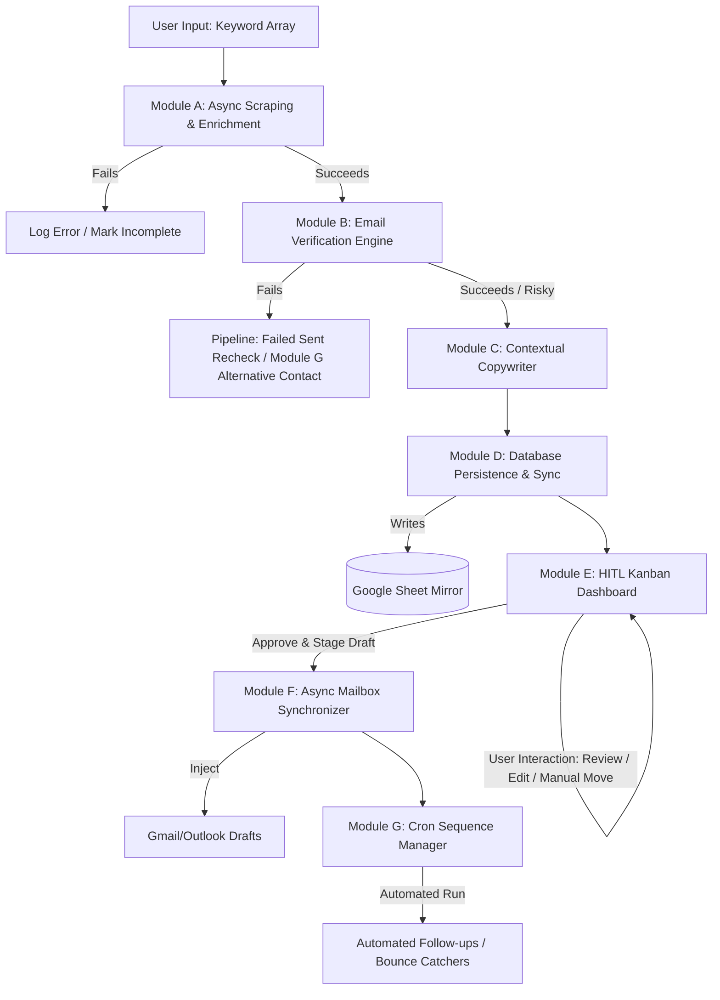

# System Specification: AI-Driven Outbound Sales Funnel Engine & HIP Dashboard

**Target Audience:** Autonomous Coding Agents / LLM Software Engineers

> This document is optimized for code-generation models and CLI tools (like Claude Code, Cursor, or Aider). It strips away high-level corporate fluff and structures the requirements as an unambiguous, deterministic system specification.

---

## 1. System Overview & Architecture Topology

This application is an autonomous top-of-funnel outbound engine. It executes multi-stage web scraping, performs identity resolution and validation, synthesizes hyper-personalized cold outreach via an LLM engine, interfaces directly with user mailboxes via OAuth, and exposes a state-driven Human-in-the-Loop (HITL) CRM Dashboard.

### 1.1 Complete Flow Pipeline



---

## 2. Core Modules Technical Specification

### Module A: Async Market Scanner & Enrichment Engine

* **Input:** Array of strings (keywords/niche tags).
* **Execution Pattern:** Asynchronous background worker queue (e.g., Celery, BullMQ). Do not execute within the HTTP request/response cycle.

#### Workflow Steps
1. **Company Discovery:** Query Google Custom Search API, Crunchbase, or LinkedIn Companies. Extract company name, root domain URL, and baseline descriptions. Deduplicate by unique root domain.
2. **Deep Scraping:** For each unique company, fetch the homepage, `/about`, `/news`, and `/blog` (up to 2 levels deep). Parse HTML, strip script/style tags, and extract raw text.
3. **News Aggregation:** Query a News API for company mentions over the last 180 days.
4. **Contact & Attribute Extraction:**
   * Query LinkedIn/Data providers to identify the highest-ranking target persona matching a target job title array: `["VP of Sales", "CTO", "Chief Architect", "Director of Product"]`.
   * Extract the Contact Person's Name, their Job Title, and their Public Post Text or profile description (to isolate structural quirks for the `eccentricities` field).

#### Output Data Dictionary
* `company_name` (String)
* `company_description` (Text - Max 500 words summary)
* `commonalities` (Text - Shared locations, tools, investor alignments, or mutual histories discovered)
* `company_news` (Text - Markdown bulleted list of 2-3 recent milestones)
* `main_projects` (Text - Current active products or initiatives)
* `contact_name` (String)
* `contact_title` (String)
* `eccentricities` (Text - Specific personal details, interests, writing styles, or presentation topics found)

---

### Module B: Email Verification Engine

* **Logic:** Before writing to the final database, route `contact_name` + `company_domain` into an email generation and verification pipeline.
* **Execution:**
  1. Generate standard email permutations (e.g., `first.last@domain.com`, `first@domain.com`, `initial.last@domain.com`).
  2. Call an external Verification API (e.g., Hunter.io, NeverBounce).

#### Conditional Branching
* **If status = `Valid`:** Write to database field `email_address`; set state to `PENDING_REVIEWS`.
* **If status = `Catch-All` or `Unknown`:** Flag `email_status` as risky; append warning flag in dashboard but allow processing.
* **If status = `Invalid`:** Leave `email_address` null; immediately set status to `FAILED_SENT_RECHECK` and trigger the Alternative Contact Routine (Module G).

---

### Module C: Contextual AI Copywriter (Prompt Design)

* **Engine Target:** `gpt-4o`, `claude-3-5-sonnet`, or similar high-reasoning LLM.
* **Input Variables:** Ingests outputs from Module A.
* **Outputs Required:**
  * `pitch_email` (Subject + Body)
  * `follow_up_1` (Subject + Body)
  * `follow_up_2` (Subject + Body)

#### Strict Engineering Prompt Directives
* **Persona:** World-class, elite executive salesperson. Brief, impactful, patterns like a human colleague.
* **Negative Constraints:** Absolute ban on corporate clichés (e.g., *"I hope this email finds you well"*, *"In today's fast-paced digital landscape"*, *"revolutionary blueprint"*, *"delighted to connect"*).
* **Structure Constraint:** Total word count per draft must stay under 150 words. Must have a clear, singular, low-friction call to action (CTA).
* **Context Integration:** The `pitch_email` must inject the `eccentricities` naturally into the hook (first 2 sentences) and wrap the `main_projects` and `company_news` into the value proposition (sentences 3-5).

---

### Module D: Database Persistence & Bi-Directional Google Sheet Sync

* **Primary Database:** Relational Schema (PostgreSQL) or Document Schema (MongoDB).
* **Mirror Target:** Google Sheets via Google Sheets API.
* **Synchronization Flow:**
  * System updates PostgreSQL $\rightarrow$ Trigger webhook/event listener $\rightarrow$ Upsert row to Google Sheet.
  * *Optional:* Poll Google Sheet every 5 minutes $\rightarrow$ Detect manual text updates made by a human inside the sheet cells $\rightarrow$ Sync back to PostgreSQL.

#### Relational Database Schema Definition

```sql
CREATE TABLE companies (
    id SERIAL PRIMARY KEY,
    name VARCHAR(255) NOT NULL,
    domain VARCHAR(255) UNIQUE NOT NULL,
    description TEXT,
    commonalities TEXT,
    news TEXT,
    main_projects TEXT,
    created_at TIMESTAMP DEFAULT CURRENT_TIMESTAMP
);

CREATE TABLE contacts (
    id SERIAL PRIMARY KEY,
    company_id INT REFERENCES companies(id) ON DELETE CASCADE,
    full_name VARCHAR(255) NOT NULL,
    title VARCHAR(255),
    email_address VARCHAR(255),
    email_status VARCHAR(50),
    eccentricities TEXT,
    pipeline_status VARCHAR(50) DEFAULT 'AWAITING_APPROVAL'
);

CREATE TABLE email_sequences (
    id SERIAL PRIMARY KEY,
    contact_id INT REFERENCES contacts(id) ON DELETE CASCADE,
    pitch_subject VARCHAR(255),
    pitch_body TEXT,
    followup_1_body TEXT,
    followup_2_body TEXT,
    remote_draft_id VARCHAR(255),
    last_sent_at TIMESTAMP,
    sequence_step INT DEFAULT 0
);
```

---

### Module E: Human-in-the-Loop Kanban Dashboard

A web interface providing visual drag-and-drop state manipulation and inline text editing components.

#### Pipeline State Machine Definitions
* `AWAITING_APPROVAL`: Initial state. Fully enriched company and contact data, email drafts generated, sitting in queue.
* `COMPANIES_REACHED`: Pitch email successfully sent through the user's connected mailbox.
* `FAILED_SENT_RECHECK`: System detected a hard bounce, or data extraction failed to isolate a valid email.
* `RESPONSES_RECEIVED`: Thread detected an incoming message from the prospect's domain. Automated cadences completely frozen.
* `AUTOMATED_FOLLOW_UP_ACTIVE`: The 7-day no-response timer has passed; follow-up sequence running autonomously.
* `SALES_CONVERTED`: Marked manually or through a conversion trigger (e.g., booking software integration webhook).

#### UI/UX Components & Actions
* **Main View:** Kanban board separating the 6 statuses into distinct vertical swimlanes.
* **Card Preview:** Shows Company Name, Contact Name, Title, and Email Status badge.
* **Interactive Review Modal:** Clicking a card opens an overlay modal.
  * **Left Pane:** Structured layout showing all scraped business attributes (Description, News, Commonalities, Projects, Quirks).
  * **Right Pane:** Rich Text Editors for Pitch, Follow-up 1, and Follow-up 2.
* **Action Buttons:**
  * `[Save Changes]`: Commits text updates directly to the localized DB and mirrors to the Google Sheet.
  * `[Approve & Stage Draft]`: Triggers Module F to inject the finalized strings directly into the real workspace mailbox as active drafts. Moves state safely to `COMPANIES_REACHED`.

---

### Module F: Workspace Mailbox Integration (Async Sync)

* **Authorization Protocol:** OAuth 2.0 with offline access tokens. Connects to Gmail API or Microsoft Graph API.
* **Draft Injection Workflow:**
  1. When a human clicks `[Approve & Stage Draft]`, read the finalized `pitch_subject`, `pitch_body`, and `email_address`.
  2. Construct an API payload targeting the provider's Draft endpoint (e.g., `/gmail/v1/users/me/drafts`).
  3. Capture the returned `draft_id` from the API response and map it to `remote_draft_id` inside the `email_sequences` database table.
* **Throttle Guardrails:** Introduce a strict delay queue worker. Never push drafts or sends concurrently; enforce an artificial staggering of 45 to 120 random seconds between actions to keep account deliverability healthy.

---

### Module G: Automated Sequence Manager & Multi-Channel Fallback Loops

A background service running continuously (e.g., scheduled cron intervals every 12-24 hours).

#### Sequence Progression Loop
1. Scan for rows marked `COMPANIES_REACHED` where `last_sent_at` equals current date minus 7 calendar days.
2. **Check Inbound Mail Box:** Perform an API query filtering by the prospect's email address or tracking message header thread ID (`In-Reply-To`).
3. **Evaluation Branch:**
   * **If message detected:** Halt execution loop. Transition row state immediately to `RESPONSES_RECEIVED`. Alert the user inside the dashboard via visual highlight notifications.
   * **If no message detected:** Fetch `followup_1_body`. Send the follow-up email directly on the same email thread. Update database `sequence_step = 1`, refresh `last_sent_at` to the current timestamp, and pivot status to `AUTOMATED_FOLLOW_UP_ACTIVE`.
4. Repeat this identical structure 7 days later for `followup_2_body`.

#### Automated Fallback Trigger Loop
1. Scan incoming mailbox data via API webhooks specifically identifying Delivery Status Notifications (DSNs), Mail Delivery Subsystem errors, or strings containing `"undeliverable"`, `"permanent failure"`, or `"bounce"`.
2. Parse the body text of the bounce notification to isolate the target address that failed.
3. Look up the corresponding row in the `contacts` table and automatically change `pipeline_status` to `FAILED_SENT_RECHECK`.
4. **Alternative Contact Exploration:** Call an internal sub-routine worker that scrapes the target company configuration details again, explicitly blacklists the bounced contact name, resolves an alternative secondary target decision-maker, and passes the entity back down to Module A Step 4 to re-initialize the enrichment engine automatically.

---

## 3. System Edge Cases, Validations, & Defenses

| Failure Point | System Action / Exception Handling |
| :--- | :--- |
| **Out of Office (OOO) Auto-Replies** | NLP Filter scans inbound mail for phrases (*"out of office"*, *"vacation"*, *"return date"*). If confirmed, do not move to `RESPONSES_RECEIVED`. Mark contact status as `PAUSED_OOO`, parse return date, and add 2 days before setting status back to `AUTOMATED_FOLLOW_UP_ACTIVE`. |
| **Alternative Responder Threading** | If a response comes from an unindexed email address belonging to the same root domain corporate network, parse the metadata `In-Reply-To` header. Map it to the original parent `company_id`, pause all active contact tracks associated with that company, and advance the card to `RESPONSES_RECEIVED`. |
| **OAuth Token Expiry / Re-Auth** | Catch API error codes `401 Unauthorized` or expired refresh tokens. Gracefully pause the worker queues tied to that specific mailbox account, notify the dashboard user with an explicit reconnect layout banner, and prevent data degradation. |
| **Rate Limit Violations** | Wrap external scraper and data enricher API integrations with global counter limits (e.g., Redis rate limiting). Queue excess tasks back into the background infrastructure if thresholds are breached. |

---

## 4. Developer Prompts for Claude Code Initialization

Use these prompts sequentially to instruct the AI agent to build the system layout:

1. **Database & Queue Infrastructure:**
   > "Build a backend service in [Node.js/Python] configuring the PostgreSQL schema detailed in Module D of the specification. Setup background processing queues using [BullMQ/Celery] to support the multi-stage asynchronous data flows."
2. **Scraping & Verification:**
   > "Implement Module A and Module B data scraping and email verification workflows. Ensure all API calls are abstracted behind helper interfaces and handle catch-all domains or missing emails gracefully by pivoting leads to the recheck pipeline."
3. **AI Copywriter & OAuth Draft Staging:**
   > "Build Module C and Module F. Integrate an LLM client with strict prompt constraints ensuring zero corporate filler words, and set up Gmail/Outlook OAuth flows that inject generated sequences directly into the mailbox as staging drafts."
4. **HITL Kanban Dashboard:**
   > "Create the Module E Human-in-the-Loop Kanban Dashboard using a clean frontend interface. Implement the review modal split-screen setup allowing live editing of the generated email sequence text fields prior to draft validation."
5. **Cron Service & Fallback Automation:**
   > "Write the Module G cron service worker logic. Code the 7-day delay verification checker, reply identification filters, and the fallback automation route that replaces bounced records with fresh secondary contact targets automatically."
