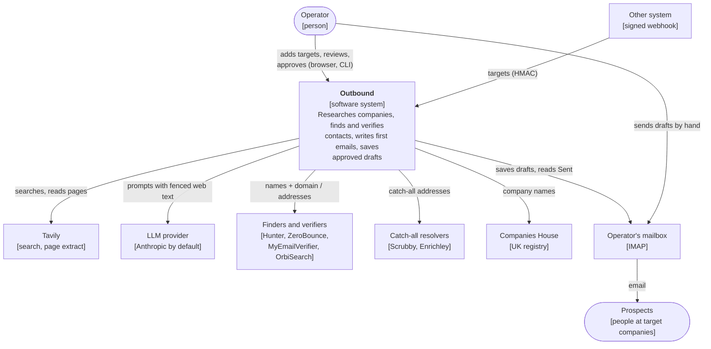
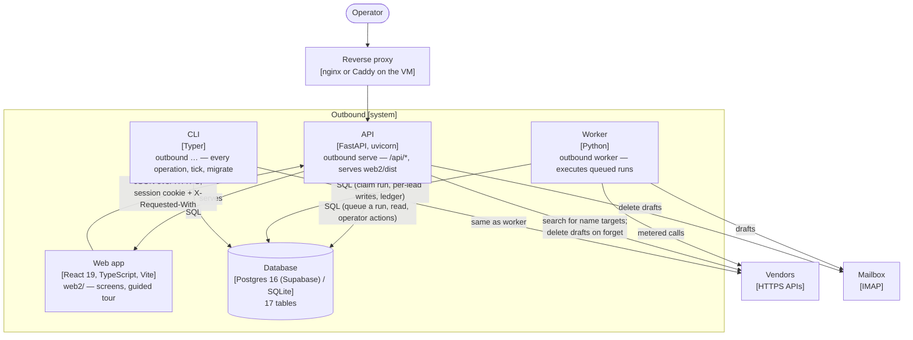
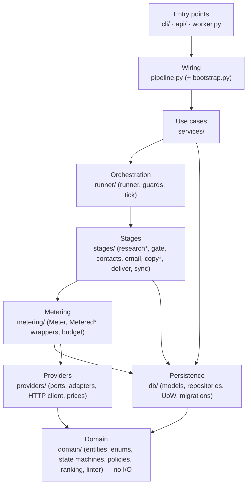
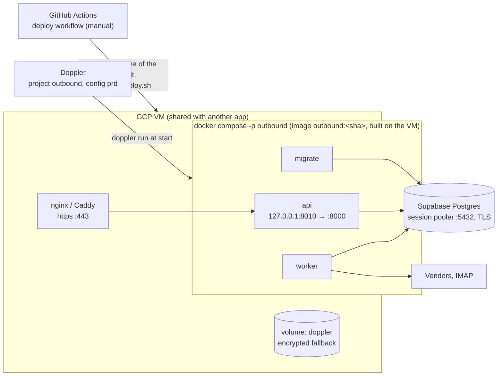

# Architecture

This is the architecture description of the Outbound engine. It follows the [arc42](https://arc42.org/overview) template in a shortened form, and draws the [C4 model](https://c4model.com/) views as Mermaid flowcharts. For the mechanics behind each view, see the [high-level design](../hld/hld.md).

## 1. Introduction and goals

Outbound is an outbound B2B email engine for one operator. For each target company it:

1. researches the company;
2. finds and verifies a decision-maker's work email through a pay-as-you-go vendor waterfall;
3. writes a short personalised first email;
4. once the operator approves it, saves it as a draft in the operator's mailbox.

The operator sends drafts by hand. Follow-ups, replies, automatic sending and multiple workspaces come in later phases ([phases/](../../phases/README.md)).

**Quality goals, in priority order.** Each goal has measurable scenarios in [quality attributes](quality-attributes.md).

| # | Goal | Meaning |
|---|---|---|
| 1 | **Safe and compliant** | No email to a suppressed person, a blocked country or an unverified recipient without a human knowingly allowing it. Every decision can be audited later |
| 2 | **Cost-controlled** | ≤ $0.50 per prospect, every paid call recorded, no call paid twice, hard caps that hold |
| 3 | **Correct and recoverable** | A crash at any point loses nothing and repeats no paid vendor lookup. Operator input is never overwritten |
| 4 | **Operable by one person** | One VM, a few commands, plain logs, a screen for every action |
| 5 | **Changeable** | A vendor is swapped by adding one adapter and changing one config line. Rules are testable without a database |

**Stakeholders**

| Who | Wants |
|---|---|
| The operator | Good leads and emails with little effort, and no legal or reputational risk |
| The people emailed | Not to be contacted unlawfully; an easy opt-out; erasure on request |
| The maintainer (developer) | Small, well-tested changes, clear rules, no surprise spend |
| Reviewers (security, privacy, legal) | Evidence that the controls exist and work |

## 2. Constraints

| Kind | Constraint | Consequence |
|---|---|---|
| Legal | PECR (UK), GDPR (EU/UK), CASL (CA), DPDP (IN), CAN-SPAM (US) | Per-country rules, consent records, footers, suppression and erasure are part of the core ([safety model](../hld/safety-model.md)) |
| Legal | A human approves every first email (Phases 2–4) | The engine writes drafts only; sending is by hand |
| Budget | 5–50 prospects a week at ≤ $0.50 each | Cache every vendor answer; stop early; cheap vendors first; no always-on infrastructure |
| Team | One developer and one operator | A modular monolith; no queue, broker or microservices; strong conventions ([CLAUDE.md](../../../CLAUDE.md)) |
| Technical | Python 3.12 with `uv`; SQLite for development, Postgres in production; React app served by the API | One codebase and one image; SQLAlchemy and Alembic over both databases |
| Hosting | A shared GCP VM with an existing reverse proxy; Supabase Postgres; Doppler | Loopback-only port behind the proxy; no registry; secrets injected at start ([deployment](../operations/deployment.md)) |
| Vendors | No vendor is trusted alone; some docs are partial (Scrubby); OrbiSearch verifies only | Every vendor behind a port, with fixtures from documentation and a live check |

## 3. Context (C4 level 1)

| Neighbour | Data in | Data out | Contract |
|---|---|---|---|
| Operator | Targets, edits, approvals, consents, settings | Leads, drafts for review, reports | Web app and CLI ([manual](../../USER_MANUAL.md)) |
| Other systems | Targets | Acceptance per row | [Webhook](../api/webhook-integration.md) |
| Vendors | Search results, addresses, verdicts, completions | Company names, domains, person names, addresses, prompts | One port per kind ([integrations](../integrations/README.md)) |
| Mailbox | The Sent folder | Drafts | IMAP |

The personal data that flows to each neighbour is listed in [privacy and data processing](../security/privacy-data-processing.md).

## 4. Solution strategy

| Goal | Approach | Decision |
|---|---|---|
| Safe | Policies as pure functions; checked again before every later step and at deliver; suppression always wins; skips explicit and acknowledged; human approval | [0012](../adr/0012-server-side-safety-gates.md), [0019](../adr/0019-policy-block-holds-never-suppresses.md)–[0022](../adr/0022-consent-belongs-to-the-recipient.md) |
| Cost-controlled | Every paid call through one meter: cache, then caps, then call, then a ledger row committed on its own | [0005](../adr/0005-metered-decorator-and-ledger.md) |
| Recoverable | Status is the queue; stages hold no transaction across the network; one short write per lead with optimistic locking | [0002](../adr/0002-the-table-is-the-queue.md), [0006](../adr/0006-no-transaction-across-network.md) |
| Auditable | Every status change and operator action is an event, written in the same transaction | [0007](../adr/0007-state-machines-emit-events.md) |
| Operator wins | `manual_fields`; the engine records rather than overwrites | [0011](../adr/0011-operator-input-wins.md) |
| Changeable | Ports and adapters; constructor injection from one composition root; layers enforced by import-linter | [0001](../adr/0001-modular-monolith.md), [0008](../adr/0008-ports-and-adapters.md) |
| Simple to run | One image, three containers, one database, no broker | [0015](../adr/0015-one-image-built-on-the-vm.md)–[0017](../adr/0017-supabase-session-pooler.md) |
| Model use is bounded | LangGraph only inside research and copy, stateless; web text fenced; output reviewed by a person | [0004](../adr/0004-langgraph-only-in-research-and-copy.md) |

## 5. Building blocks

### Containers (C4 level 2)

| Container | Code | Responsibility |
|---|---|---|
| Web app | `web2/` | Every operator screen; talks only to the API through a client generated from its OpenAPI document ([LLD](../lld/web-frontend.md)) |
| API | `outbound/api/` | Auth, CSRF, problem-details errors, the operator's use cases through services; queues runs; never runs the pipeline in a request ([LLD](../lld/api.md)) |
| Worker | `outbound/worker.py` | Claims queued runs and executes them ([LLD](../lld/runner-and-worker.md)) |
| CLI | `outbound/cli/` | The same use cases for the terminal, plus `db`, `seed`, `tick`, `serve`, `worker` ([LLD](../lld/cli.md)) |
| Database | `outbound/db/` | All state: leads, people, messages, the event log, the cost ledger, runs ([schema](../data/schema.md)) |

### Components (C4 level 3): the engine's layers

The API, worker and CLI share one Python package. Inside it, layers depend only downward:

\* LangGraph subgraph inside. The full dependency rules are in the [HLD](../hld/hld.md#1-decomposition), and each block has an [LLD](../README.md#low-level-design).

## 6. Runtime view

Three scenarios show how the blocks cooperate. Every stage is shown in [pipeline flow](../hld/pipeline-flow.md).

**A run from the web app.** The operator starts a run. The API inserts a `queued` run and returns 202. The worker claims it within about 2 seconds and executes it: discovery if asked, then each stage over the due leads. It records counts and cost on the run, and the web app polls until it finishes. See [HLD §3](../hld/hld.md#3-how-work-is-queued).

**Review to draft.** The operator approves a `copy_ready` email, acknowledging any skipped check. That one transaction moves the message and the company to `approved`. The next run's deliver stage checks everything again and saves the draft with an idempotent `Message-ID`. After the operator sends it, `tick`'s Sent sync records it as `sent`.

**Crash and rerun.** The worker is killed during the email stage. The lead's status is unchanged, because the stage's write never happened, and every vendor call already made is in the ledger with its answer. The next run selects the lead again, and the meter answers the repeated vendor lookups from cache at zero cost. Model calls are not cached (by design, see [metering](../lld/metering.md)), so a stage interrupted after its model calls asks again. The interrupted run itself stays `running` until it is cleaned up ([R-05](../tech-debt-and-risks.md#r-05--p1--runs-a-stopped-worker-leaves-its-run-running-runs-can-overlap-b2-b3)).

## 7. Deployment view

| Environment | Database | Secrets | Proxy |
|---|---|---|---|
| Development | SQLite file (`DATABASE_BACKEND=sqlite`) | `.env` | none (`127.0.0.1:8000`) |
| Rehearsal (`deploy/local-test.sh`) | Local Postgres container | Doppler `dev` | Caddy, `https://localhost:8443` |
| Production | Supabase | Doppler `prd` | The VM's proxy |

Releases, rollback and their limits are in [release and rollback](../operations/release-and-rollback.md). Setup is in [deployment](../operations/deployment.md), and each environment in [environments](../operations/environments.md).

## 8. Cross-cutting concepts

| Concept | Summary | Detail |
|---|---|---|
| **The lead is a company** | A `companies` row is the unit of work and of status. People, addresses and messages hang off it | [schema](../data/schema.md) |
| **Lifecycles** | Five transition tables; an illegal move cannot be written; every move is an event | [state machines](../hld/state-machines.md) |
| **Safety** | Suppression, country policy, recipient consent, verification, person confirmation, approval, deliver re-check | [safety model](../hld/safety-model.md) |
| **Money** | Integer micro-USD; one meter; ledger rows committed independently; monthly caps per provider; per-prospect ceiling | [metering](../lld/metering.md) |
| **Persistence** | Repositories return frozen entities, never ORM rows; one unit of work per change; optimistic locking | [persistence](../lld/persistence.md) |
| **Identity and time** | UUIDv7 string ids; UTC everywhere; `UtcDateTime` refuses naive datetimes | [domain](../lld/domain.md) |
| **Tenancy** | `workspace_id` on every row and query | [HLD §5](../hld/hld.md#5-tenancy) |
| **Security** | One operator; Argon2 password; signed session cookie; CSRF header; strict CSP; HMAC webhook; secrets only from the environment | [threat model](../security/threat-model.md) |
| **Privacy** | Minimal personal data; hashed suppression; forget scrubs every column; no retention purge yet | [privacy](../security/privacy-data-processing.md) |
| **Model use** | Stateless LangGraph subgraphs; fenced untrusted text; JSON answers validated with Pydantic; no tools | [research](../lld/stage-research.md), [copy](../lld/stage-copy.md) |
| **Errors** | Typed exceptions; retries only in the HTTP client; RFC 9457 at the API | [HLD §7](../hld/hld.md#7-errors-and-retries) |
| **Logging** | structlog JSON; an event name plus values; context bound once; redaction of secrets, bodies and addresses | [logging](../lld/logging.md), [observability](../operations/observability.md) |
| **Configuration** | pydantic-settings from the environment (and `.env` in development); compose fixes the deployment-specific values | [configuration reference](../operations/configuration-reference.md) |
| **Testability** | Fakes at every port; a whole fake world for end-to-end and browser tests; no network in tests | [testing strategy](../quality/testing-strategy.md) |
| **User interface** | Design tokens synced from Stitch; status words in one file; a guided tour kept current by a test | [web frontend](../lld/web-frontend.md), [design.md](../../design.md) |

### Technology stack

| Concern | Choice |
|---|---|
| Language and tooling | Python 3.12, managed with `uv`; ruff (lint and format), mypy (strict on the domain), import-linter, pre-commit |
| Data | SQLAlchemy 2 and Alembic; SQLite (development, tests) and Postgres 16 (Supabase) with psycopg 3 |
| Models and settings | Pydantic v2; pydantic-settings |
| HTTP to vendors | httpx with tenacity retries in one client |
| Model orchestration | LangGraph, in research and copy only |
| Interfaces | Typer (CLI); FastAPI and uvicorn (API); argon2-cffi and itsdangerous (login) |
| Utilities | dnspython (mailbox DNS check), tldextract (offline public-suffix list), UUIDv7 ids, structlog (logging) |
| Web app | React 19, TypeScript, Vite; Tailwind; TanStack Query and Router; a client generated with openapi-typescript and openapi-fetch; Playwright |
| Tests | pytest (with `pytest-socket` blocking the network), Playwright |
| Delivery | Docker (one image), docker compose, GitHub Actions, Doppler, Supabase |

## 9. Architecture decisions

The decisions are recorded as ADRs in [adr/](../adr/README.md). Product decisions are in [PLAN.md §3](../../PLAN.md#3-decisions-all-confirmed).

## 10. Quality requirements

See [quality attributes](quality-attributes.md): each goal in §1 is broken into testable scenarios, with the test or check that proves it, or the gap that stops it being proven.

## 11. Risks and technical debt

The full list is in the [register](../tech-debt-and-risks.md). The ones that matter most to this architecture are:

- **[R-01](../tech-debt-and-risks.md#r-01--p0--operations-a-rollback-after-a-migration-leaves-the-app-down):** the rollback path fails after a migration, so the deployment view's recovery promise does not hold yet.
- **[R-02](../tech-debt-and-risks.md#r-02--p1--pipeline-scheduled-work-never-runs-in-production-b7):** nothing schedules `tick`, so part of the runtime view (retries, catch-all answers, Sent sync) does not happen in production.
- **[R-03](../tech-debt-and-risks.md#r-03--p1--cost-model-calls-are-recorded-at-0-b5)** and **[R-04](../tech-debt-and-risks.md#r-04--p1--cost-the-budget-cap-prices-a-catch-all-submit-at-0):** the cost goal's caps do not count model spend or resolver submits.
- **[R-05](../tech-debt-and-risks.md#r-05--p1--runs-a-stopped-worker-leaves-its-run-running-runs-can-overlap-b2-b3):** the recovery goal holds for leads but not for runs.
- **[R-08](../tech-debt-and-risks.md#r-08--p1--security-web-text-can-close-the-prompt-fence):** the prompt fence can be closed early; human approval remains the control.

## 12. Glossary

See [glossary](../glossary.md).
