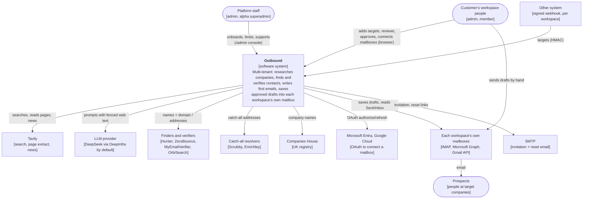
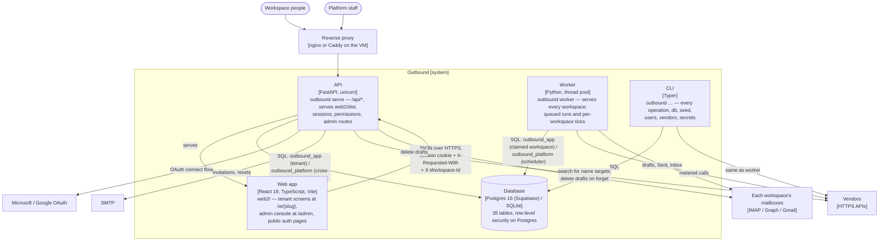
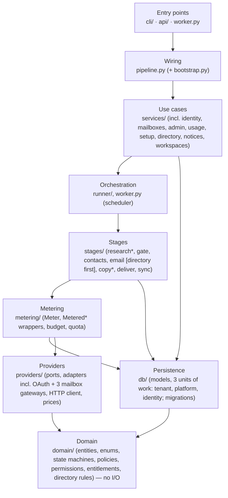
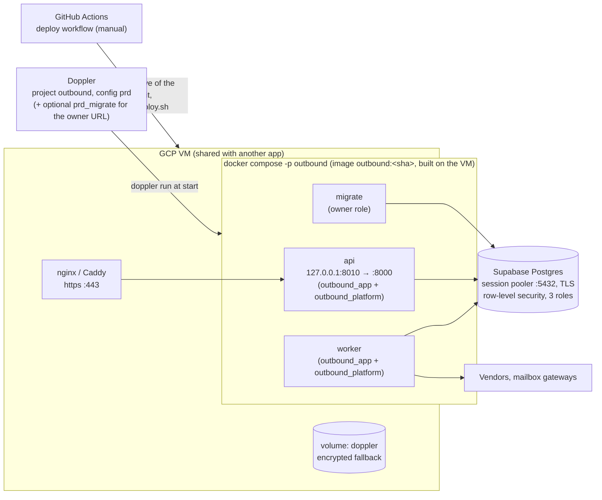

# Architecture

This is the architecture description of the Outbound engine. It follows the [arc42](https://arc42.org/overview) template in a shortened form, and draws the [C4 model](https://c4model.com/) views as Mermaid flowcharts. For the mechanics behind each view, see the [high-level design](../hld/hld.md).

## 1. Introduction and goals

Outbound is an outbound B2B email engine, now a multi-tenant SaaS in an invite-only alpha (Phase 6, sub-phases 6a–6d built). Each customer company has its own workspace, team, mailboxes and limits. For each target company in a workspace, the engine:

1. researches the company;
2. finds and verifies a decision-maker's work email, checking a shared **verified lead directory** before any paid vendor (Phase 6g);
3. writes a short personalised first email;
4. once a person at that workspace approves it, saves it as a draft in their own connected mailbox (IMAP, Microsoft 365, or Google).

A workspace's people send drafts by hand. Follow-ups, full reply triage and automatic sending come in later phases ([phases/](../../phases/README.md)); opt-out and hard-bounce handling (4a) is already built.

**Quality goals, in priority order.** Each goal has measurable scenarios in [quality attributes](quality-attributes.md).

| # | Goal | Meaning |
|---|---|---|
| 1 | **Safe and compliant** | No email to a suppressed person, a blocked country or an unverified recipient without a human knowingly allowing it. Every decision can be audited later |
| 2 | **Isolated** | One workspace's data is never visible to another — proven at the database level, not just in application code |
| 3 | **Cost-controlled** | ≤ $0.50 per prospect, every paid call recorded, no call paid twice, hard caps that hold, per-step credits that a plan can limit |
| 4 | **Correct and recoverable** | A crash at any point loses nothing and repeats no paid vendor lookup. Operator input is never overwritten. A stale run is freed automatically |
| 5 | **Operable with a small team** | A few commands, plain logs, a screen for every action, an admin console for platform staff |
| 6 | **Changeable** | A vendor is swapped by adding one adapter and changing one config line. Rules are testable without a database |

**Stakeholders**

| Who | Wants |
|---|---|
| A customer's workspace members (admin, member) | Good leads and emails with little effort, control of their own mailboxes and team, and no legal or reputational risk |
| The people emailed | Not to be contacted unlawfully; an easy opt-out; erasure on request |
| Platform staff (admin, alpha-only superadmin) | A console to onboard, support and limit customers without touching the database by hand |
| The maintainer (developer) | Small, well-tested changes, clear rules, no surprise spend |
| Reviewers (security, privacy, legal) | Evidence that tenant isolation, consent and erasure controls exist and work |

## 2. Constraints

| Kind | Constraint | Consequence |
|---|---|---|
| Legal | PECR (UK), GDPR (EU/UK), CASL (CA), DPDP (IN), CAN-SPAM (US) | Per-country rules, consent records, footers, suppression and erasure are part of the core ([safety model](../hld/safety-model.md)) |
| Legal | A human approves every first email | The engine writes drafts only; sending is by hand |
| Legal | A workspace is the data controller for its prospects; the platform is its processor. The lead directory makes the platform a controller of what it serves | A DPA is required before the first outside customer; the directory needs its own legal basis before public launch ([PLAN.md §11](../../PLAN.md#11-compliance-and-deliverability)) |
| Budget | 5–50 prospects a week per workspace at ≤ $0.50 each; plans can set tighter limits | Cache every vendor answer; stop early; cheap vendors first; the directory as a free first link; no always-on infrastructure |
| Isolation | One database must serve many workspaces with no cross-tenant leak, even if application code has a bug | Postgres row-level security plus composite foreign keys, proven with application scoping deliberately patched out ([tenancy and isolation](../lld/tenancy-and-isolation.md)) |
| Team | A small team, an invite-only alpha | A modular monolith; no queue, broker or microservices; strong conventions ([CLAUDE.md](../../../CLAUDE.md)) |
| Technical | Python 3.12 with `uv`; SQLite for development and tests, Postgres (with row-level security) in production; React app served by the API | One codebase and one image; SQLAlchemy and Alembic over both databases, with the tenancy model degrading gracefully (no RLS) on SQLite |
| Hosting | A shared GCP VM with an existing reverse proxy; Supabase Postgres; Doppler | Loopback-only port behind the proxy; no registry; secrets injected at start, including encryption keys for stored credentials ([deployment](../operations/deployment.md)) |
| Vendors | No vendor is trusted alone; some docs are partial (Scrubby); OrbiSearch verifies only; Microsoft and Google OAuth apps need their own verification | Every vendor behind a port, with fixtures from documentation and a live check; the alpha fits inside an unverified OAuth app's user cap |

## 3. Context (C4 level 1)

| Neighbour | Data in | Data out | Contract |
|---|---|---|---|
| Workspace people | Targets, edits, approvals, consents, settings, mailbox OAuth consent | Leads, drafts for review, reports | Web app and CLI ([manual](../../USER_MANUAL.md)) |
| Platform staff | Plan, limit, vendor-key and status changes | Customer overview, audit trail | [Admin console](../lld/plans-credits-and-admin.md) |
| Other systems | Targets | Acceptance per row | [Webhook](../api/webhook-integration.md) |
| Vendors | Search results, addresses, verdicts, completions | Company names, domains, person names, addresses, prompts | One port per kind ([integrations](../integrations/README.md)) |
| Mailboxes | The Sent and Inbox folders | Drafts | IMAP / Microsoft Graph / Gmail API, per mailbox |
| OAuth providers | Authorization code, refresh token | Client id and secret, scopes | Authorization-code + PKCE |

The personal data that flows to each neighbour is listed in [privacy and data processing](../security/privacy-data-processing.md).

## 4. Solution strategy

| Goal | Approach | Decision |
|---|---|---|
| Safe | Policies as pure functions; checked again before every later step and at deliver; suppression always wins; skips explicit and acknowledged; human approval | [0012](../adr/0012-server-side-safety-gates.md), [0019](../adr/0019-policy-block-holds-never-suppresses.md)–[0022](../adr/0022-consent-belongs-to-the-recipient.md) |
| Isolated | Shared database and schema; composite foreign keys; Postgres row-level security under a least-privilege role; cross-workspace reads through a separate platform role that cannot write tenant rows; proven with application scoping patched out | [tenancy and isolation](../lld/tenancy-and-isolation.md); ADRs 0024–0026 |
| Cost-controlled | Every paid call through one meter: cache, then caps, then call, then a ledger row committed on its own; a per-step credit check ahead of the budget check; the lead directory as a free first link | [0005](../adr/0005-metered-decorator-and-ledger.md), [0027](../adr/0027-credits-charged-once-per-lead-per-step.md) |
| Recoverable | Status is the queue; stages hold no transaction across the network; one short write per lead with optimistic locking; a run heartbeat frees a stale run automatically | [0002](../adr/0002-the-table-is-the-queue.md), [0006](../adr/0006-no-transaction-across-network.md) |
| Auditable | Every status change and operator action is an event, written in the same transaction; every superadmin read of another workspace is audited | [0007](../adr/0007-state-machines-emit-events.md) |
| Operator wins | `manual_fields`; the engine records rather than overwrites | [0011](../adr/0011-operator-input-wins.md) |
| Changeable | Ports and adapters; constructor injection from one composition root; layers enforced by import-linter, including a boundary around the platform unit of work | [0001](../adr/0001-modular-monolith.md), [0008](../adr/0008-ports-and-adapters.md) |
| Simple to run | One image, three containers, one database reached as three roles, no broker | [0015](../adr/0015-one-image-built-on-the-vm.md)–[0017](../adr/0017-supabase-session-pooler.md), [0024](../adr/0024-row-level-security-and-least-privilege-roles.md) |
| Model use is bounded | LangGraph only inside research and copy, stateless; web text fenced; output reviewed by a person | [0004](../adr/0004-langgraph-only-in-research-and-copy.md) |

## 5. Building blocks

### Containers (C4 level 2)

| Container | Code | Responsibility |
|---|---|---|
| Web app | `web2/` | Tenant screens under `/w/{slug}`, the admin console under `/admin`, and public auth/onboarding pages; talks only to the API through a client generated from its OpenAPI document ([LLD](../lld/web-frontend.md)) |
| API | `outbound/api/` | Sessions, permissions, CSRF, problem-details errors, tenant and admin use cases through services; queues runs; never runs the pipeline in a request ([LLD](../lld/api.md)) |
| Worker | `outbound/worker.py` | Serves every active workspace: claims its queued runs, ticks it on a timer, recovers stale runs, runs platform-wide periodic jobs ([LLD](../lld/runner-and-worker.md)) |
| CLI | `outbound/cli/` | The same use cases for the terminal, plus `db`, `seed`, `serve`, `worker`, `users create`, `vendors …`, `secrets …` ([LLD](../lld/cli.md)) |
| Database | `outbound/db/` | All state: leads, people, messages, the event log, the cost ledger, runs, identity, plans and usage, the lead directory ([schema](../data/schema.md)) |

### Components (C4 level 3): the engine's layers

The API, worker and CLI share one Python package. Inside it, layers depend only downward:

\* LangGraph subgraph inside. The full dependency rules, including the import-linter boundary around `outbound.db.platform`, are in the [HLD](../hld/hld.md#1-decomposition), and each block has an [LLD](../README.md#low-level-design).

## 6. Runtime view

Four scenarios show how the blocks cooperate. Every stage is shown in [pipeline flow](../hld/pipeline-flow.md); the tenancy mechanics in [tenancy and isolation](../lld/tenancy-and-isolation.md).

**A run from the web app.** A workspace member starts a run. The API inserts a `queued` run in that workspace's own unit of work and returns 202. The worker's scheduler, reading only workspace ids from the platform connection, picks that workspace up (least-recently-served first), opens its tenant connection, claims the run, and executes it: discovery if asked, then each stage over the due leads, now gated by credits as well as budget. It records counts and cost on the run, and the web app polls until it finishes. See [HLD §3](../hld/hld.md#3-how-work-is-queued).

**Signing in and choosing a workspace.** A person signs in with email and password; the API creates a server-side session (`sessions` table) and returns their memberships. The SPA picks a workspace (or asks, if there is more than one), builds a router with that workspace's slug as its basepath, and sends `X-Workspace-Id` on every request from then on. See [identity and access](../lld/identity-and-access.md).

**Review to draft.** A workspace member approves a `copy_ready` email, acknowledging any skipped check. That one transaction moves the message and the company to `approved`. The next run's deliver stage checks everything again — including whether that workspace's mailbox is still connected — and saves the draft with an idempotent `Message-ID` through whichever gateway (IMAP, Graph, Gmail) that mailbox uses. The Sent sync later records it as `sent`; the inbox reader classifies opt-outs and hard bounces as they arrive.

**Crash and rerun.** The worker is killed during the email stage of one workspace's run. That lead's status is unchanged, because the stage's write never happened, and every vendor call already made is in the ledger with its answer. The run's heartbeat stops; after 30 minutes `Worker.recover_stale` fails it, freeing that workspace to be scheduled again. The next run selects the lead again, and the meter answers the repeated vendor lookups from cache at zero cost (model calls are not cached by design).

## 7. Deployment view

| Environment | Database | Secrets | Proxy |
|---|---|---|---|
| Development | SQLite file (`DATABASE_BACKEND=sqlite`; no row-level security) | `.env` | none (`127.0.0.1:8000`) |
| Rehearsal (`deploy/local-test.sh`) | Local Postgres container, with `outbound_app`/`outbound_platform` roles created on first start | Doppler `dev` | Caddy, `https://localhost:8443` |
| Production | Supabase, reached as `outbound_app` / `outbound_platform` (never the owner, except for `migrate`) | Doppler `prd` (+ `prd_migrate` recommended, so the owner's password never reaches `api` or `worker`) | The VM's proxy |

Releases, rollback and their limits are in [release and rollback](../operations/release-and-rollback.md). Setup is in [deployment](../operations/deployment.md), and each environment in [environments](../operations/environments.md).

## 8. Cross-cutting concepts

| Concept | Summary | Detail |
|---|---|---|
| **The lead is a company** | A `companies` row is the unit of work and of status. People, addresses and messages hang off it | [schema](../data/schema.md) |
| **Lifecycles** | Six transition tables (five lead-related, plus the workspace itself); an illegal move cannot be written; every move is an event | [state machines](../hld/state-machines.md) |
| **Safety** | Suppression, country policy, recipient consent, verification, person confirmation, credits and workspace access, approval, deliver re-check | [safety model](../hld/safety-model.md) |
| **Tenancy and isolation** | Composite foreign keys; Postgres row-level security under a least-privilege role; cross-workspace reads through a separate role that cannot write tenant rows; a startup self-check | [tenancy and isolation](../lld/tenancy-and-isolation.md) |
| **Identity and access** | Users, memberships (workspace admin/member), platform roles (admin, alpha superadmin), server-side sessions, fixed permission sets per role | [identity and access](../lld/identity-and-access.md) |
| **Plans, credits and admin** | Per-step credits charged once per lead; overrides and grants; an access date; the platform's own console | [plans, credits and admin](../lld/plans-credits-and-admin.md) |
| **Mailboxes** | Each workspace connects its own, over IMAP (app password) or OAuth (Microsoft Graph, Gmail), encrypted at rest | [mailboxes and OAuth](../lld/mailboxes-and-oauth.md) |
| **The lead directory** | Shared verified facts across workspaces, served with no contributor attribution; the free first link of the email waterfall | [lead directory](../lld/lead-directory.md) |
| **Opt-outs and bounces** | The inbox reader classifies replies by rule (no model) and suppresses or invalidates automatically | [inbox and opt-outs](../lld/inbox-and-opt-outs.md) |
| **Money** | Integer micro-USD; one meter; ledger rows committed independently; monthly caps per provider (now also platform-wide, pausing a vendor); per-prospect ceiling; per-step credits | [metering](../lld/metering.md), [plans, credits and admin](../lld/plans-credits-and-admin.md) |
| **Persistence** | Repositories return frozen entities, never ORM rows; three units of work (tenant, platform, identity); optimistic locking | [persistence](../lld/persistence.md) |
| **Identity and time (values)** | UUIDv7 string ids; UTC everywhere; `UtcDateTime` refuses naive datetimes | [domain](../lld/domain.md) |
| **Security** | Argon2 passwords; server-side sessions the server can revoke; CSRF header; strict CSP; HMAC webhook; secrets only from the environment; encrypted credentials at rest | [threat model](../security/threat-model.md) |
| **Privacy** | Minimal personal data; hashed suppression; forget scrubs every column, including the lead directory; no retention purge yet | [privacy](../security/privacy-data-processing.md) |
| **Model use** | Stateless LangGraph subgraphs; fenced untrusted text; JSON answers validated with Pydantic; no tools | [research](../lld/stage-research.md), [copy](../lld/stage-copy.md) |
| **Errors** | Typed exceptions; retries only in the HTTP client; RFC 9457 at the API | [HLD §7](../hld/hld.md#7-errors-and-retries) |
| **Logging** | structlog JSON; an event name plus values; context bound once; redaction of secrets, bodies and addresses | [logging](../lld/logging.md), [observability](../operations/observability.md) |
| **Configuration** | pydantic-settings from the environment (and `.env` in development); vendor keys and model settings can also live in the database, overriding the environment, without a restart | [configuration reference](../operations/configuration-reference.md) |
| **Testability** | Fakes at every port; a whole fake world for end-to-end and browser tests; no network in tests; the Postgres suite also runs as the least-privilege roles | [testing strategy](../quality/testing-strategy.md) |
| **User interface** | Design tokens synced from Stitch; status words in one file; a guided tour kept current by a test; a separate admin console app | [web frontend](../lld/web-frontend.md), [design.md](../../design.md) |

### Technology stack

| Concern | Choice |
|---|---|
| Language and tooling | Python 3.12, managed with `uv`; ruff (lint and format), mypy (strict on the domain), import-linter, pre-commit |
| Data | SQLAlchemy 2 and Alembic; SQLite (development, tests) and Postgres 16 (Supabase) with psycopg 3; row-level security on Postgres only |
| Models and settings | Pydantic v2; pydantic-settings |
| HTTP to vendors | httpx with tenacity retries in one client |
| Model orchestration | LangGraph, in research and copy only |
| Interfaces | Typer (CLI); FastAPI and uvicorn (API); argon2-cffi (passwords), server-side sessions |
| Encryption | `cryptography` (AES-256-GCM) for mailbox tokens/passwords and platform vendor keys at rest |
| Utilities | dnspython (mailbox DNS check), tldextract (offline public-suffix list), UUIDv7 ids, structlog (logging) |
| Web app | React 19, TypeScript, Vite; Tailwind; TanStack Query and Router; a client generated with openapi-typescript and openapi-fetch; Playwright |
| Tests | pytest (with `pytest-socket` blocking the network), Playwright |
| Delivery | Docker (one image), docker compose, GitHub Actions, Doppler, Supabase |

## 9. Architecture decisions

The decisions are recorded as ADRs in [adr/](../adr/README.md). Product decisions are in [PLAN.md §3](../../PLAN.md#3-decisions-all-confirmed).

## 10. Quality requirements

See [quality attributes](quality-attributes.md): each goal in §1 is broken into testable scenarios, with the test or check that proves it, or the gap that stops it being proven.

## 11. Risks and technical debt

The full list is in the [register](../tech-debt-and-risks.md). The ones that matter most to this architecture are:

- **[R-01](../tech-debt-and-risks.md#r-01--p0--operations-a-rollback-after-a-migration-leaves-the-app-down):** the rollback path still fails after a migration, so the deployment view's recovery promise does not hold yet.
- **[R-03](../tech-debt-and-risks.md#r-03--p1--cost-model-calls-are-recorded-at-0-b5):** the cost goal's caps still do not count model spend by default.
- **[R-08](../tech-debt-and-risks.md#r-08--p1--security-web-text-can-close-the-prompt-fence):** the prompt fence can be closed early; human approval remains the control.
- **New with Phase 6:** no MFA and an alpha-only superadmin who can read every workspace read-only (accepted for the alpha, audited, removed in 6f); vendor credentials, mailbox tokens and the platform's own vendor keys are only as safe as `SECRETS_KEYS`; Google and Microsoft OAuth app verification is outstanding.

**Closed since the last review:** R-02 (nothing ran `tick`) and R-05 (a stale run never recovered) are both fixed by Phase 6a's multi-workspace worker and run heartbeat.

## 12. Glossary

See [glossary](../glossary.md).
