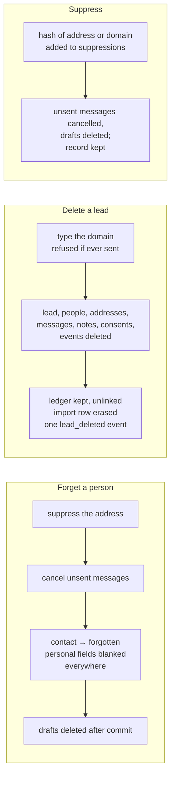

# Data lifecycle

How a record is created, changed, kept and erased. Columns are in [schema](schema.md); the personal data inventory and the legal view are in [privacy and data processing](../security/privacy-data-processing.md).

## Creation

| Record | Created by | Notes |
|---|---|---|
| Workspace, default campaign, country rules | `outbound seed` (`outbound/services/seed.py::seed_defaults`) on every deploy | Idempotent. Seeding never overwrites an edited policy |
| Import batch and rows | Intake: CLI, upload, quick add, webhook, discovery (`outbound/services/intake.py::IntakeService.run`) | One transaction per batch. `import_rows.raw` keeps the submitted row as given |
| Company (the lead) | Intake, when a row is accepted | Deduplicated by registrable domain per workspace. A repeat merges into the existing lead |
| Contact | Intake (operator-given: `active`), research (site or confirming search: `candidate`; mention only: `unconfirmed`), **Add a person** (`active`) | A person with the same name at the company is updated, not duplicated |
| Contact email | Intake (`operator_given`), the waterfall (every address it checks, including invalid ones), an operator edit | One primary per contact. An edited address is kept beside the old one |
| Consent | The operator (**Record consent**, or with **Add a person**) | One active consent per basis per person |
| Note | Intake (operator notes), the operator, the system | Append-only |
| Message | The copy stage (`generated`) | At most one live message per company, contact and step |
| Provider call | The meter, on every paid call, cache hit or refusal | Committed in its own transaction |
| Event | Every status change and operator action, in the same transaction | Append-only |
| Run | The API (`queued`), the CLI and `tick` (`running`) | — |

## Change

- **Status** changes only through the [state machines](../hld/state-machines.md). Each change writes a `status_changed` event.
- **Fields** change through repository `update_fields`, which writes a `field_changed` event with `{field, old, new, source}`.
- **Operator input wins.** A field the operator set is listed in the row's `manual_fields`. An engine write to it is not applied, and is recorded as an event with `applied: false` ([ADR 0011](../adr/0011-operator-input-wins.md)).
- **Concurrency.** `companies` and `messages` are protected by `row_version`; a stale write fails. Other tables are last-writer-wins ([R-15](../tech-debt-and-risks.md#r-15--p2--correctness-runs-and-three-tables-bypass-the-usual-guards)).
- **Skips and confirmations** are row flags or statuses with an event that records who did it and why:
  - `companies.policy_skip_from` with `policy_skip_granted` and `policy_skip_revoked`;
  - `contact_emails.verification_skipped` with `email_verification_skipped` and `_restored`;
  - an `unconfirmed → candidate` status change.

## Retention

There is **no automatic retention or purge** today ([R-07](../tech-debt-and-risks.md#r-07--p1--data-no-backups-no-retention-unsalted-suppression-hashes-a6-e3), Phase 3b A6). Everything is kept until the operator removes it. The cache lifetimes (90 days for finder, verifier and resolver answers, 30 days for search and registry) only decide whether an answer is *reused*. They do not delete it.

| Data | Kept | Proposed (A6) |
|---|---|---|
| Vendor answers (`provider_calls.response`), which can hold names and addresses | For ever | Blank `response` after the cache lifetime (90 days); keep cost, outcome and timing |
| Events | For ever | Not decided |
| Container logs | 10 MB × 5 files per container (Docker rotation) | — |
| Leads, people, messages | Until deleted, forgotten or suppressed | — |

## The three ways out

| | Forget (`PrivacyService.forget`) | Delete a lead (`PrivacyService.delete_lead`) | Remove a person (`LeadService.remove_person`) | Suppress |
|---|---|---|---|---|
| **Use when** | A person asks to be erased (GDPR Art. 17) | A lead was added by mistake and never emailed | A search attached the wrong person, never written to | Someone must never be contacted again (opt-out, complaint) |
| **Rows** | Kept; personal fields blanked | Deleted | Deleted | Kept |
| **Refused when** | — | Any message was `sent` or `bounced` (the record of mail that left must stay); the typed domain does not match | Any message names the person | — |
| **Suppression** | The address, always, even if not held. The company too if nobody workable is left | The domain, optionally | — | The address or domain |
| **Ledger** | `response` blanked for calls about the person, and any response containing their address or full name | Rows kept (spend is real), unlinked, `response` blanked | Rows kept, unlinked, `response` blanked | Kept |
| **Events** | Data for the person, their addresses and messages becomes `{"erased": true}`. A `forgotten` event with no personal data | All deleted except one `lead_deleted` event (domain and counts) | Deleted for the person; one `person_removed` event on the company | `suppression_added` (kind and reason only, never the value) |
| **Mailbox** | Drafts deleted after commit; any that cannot be are reported (`drafts_left`) | Drafts deleted after commit | — | Drafts of cancelled messages deleted |
| **Code** | `outbound/services/forget.py::forget_email`, `outbound/db/repositories/erasure.py::ErasureRepository.scrub_contact` | `ErasureRepository.delete_company` | `ErasureRepository.delete_contact` | `outbound/db/repositories/suppressions.py`, `outbound/services/privacy.py` |

What forget blanks, table by table, is listed in [schema §4](schema.md#4-history-manual-input-concurrency). A test scans every text column of every table for the person's address and name after forgetting (`tests/db/test_forget.py::test_forgetting_removes_every_trace_of_the_person`, `tests/db/test_privacy.py::test_forgetting_a_person_after_a_real_run_leaves_no_trace_anywhere`).

**Suppression stores only a hash.** That is SHA-256 of the trimmed, lower-cased value, unsalted, so the list cannot be read back but can be checked against guesses ([R-07](../tech-debt-and-risks.md#r-07--p1--data-no-backups-no-retention-unsalted-suppression-hashes-a6-e3)).

## Outside the database

Erasure reaches only what the system controls:

| Copy | Erased by forget or delete? |
|---|---|
| Drafts in the mailbox | Yes, after commit; failures are reported |
| **Sent** mail in the mailbox | No. It is the operator's correspondence |
| Vendors' own logs (Hunter, Tavily, the LLM provider…) | No. See the sub-processor list in [privacy](../security/privacy-data-processing.md) |
| Container logs | Not needed: addresses are masked by the redaction processor and names are never logged. Client IPs are logged ([R-14](../tech-debt-and-risks.md#r-14--p2--privacy-personal-data-in-logs)) |
| Database backups | Depends on the Supabase plan's backup retention ([R-07](../tech-debt-and-risks.md#r-07--p1--data-no-backups-no-retention-unsalted-suppression-hashes-a6-e3)) |

## Planned

- Phase 4 adds inbound messages (replies), automatic suppression on opt-out and hard bounce, and contact status changes from replies: [phase-4-close-the-loop.md](../../phases/phase-4-close-the-loop.md).
