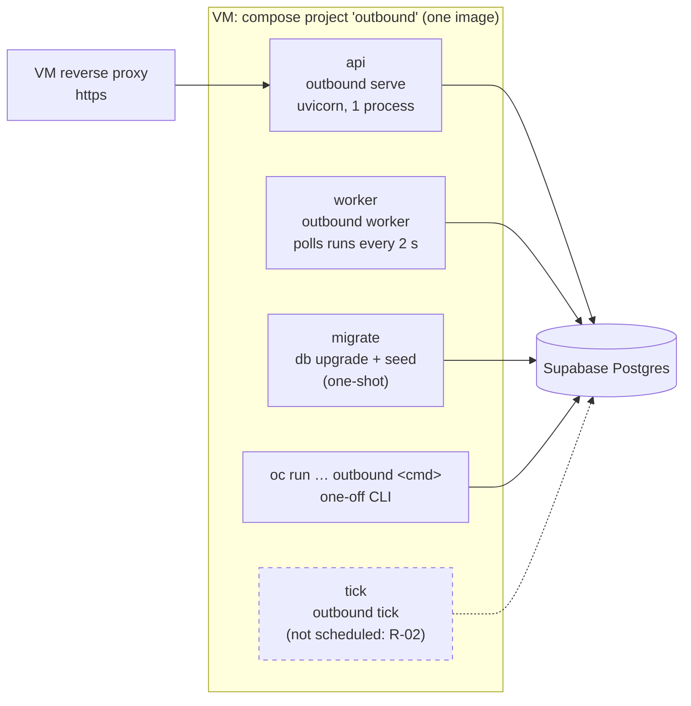
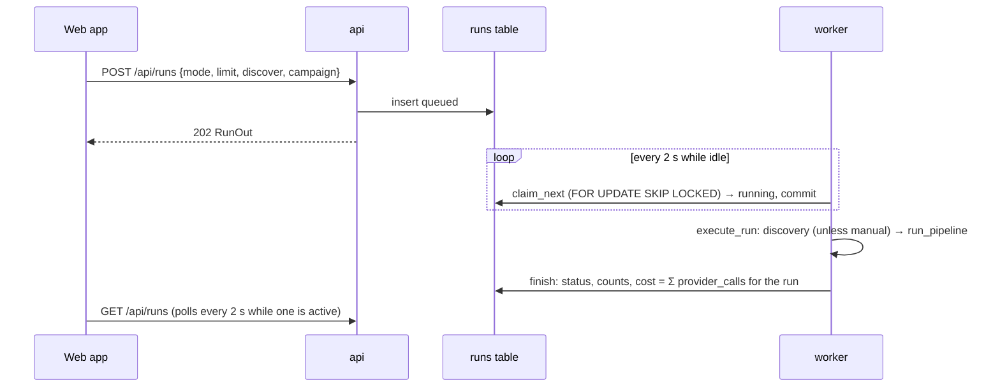
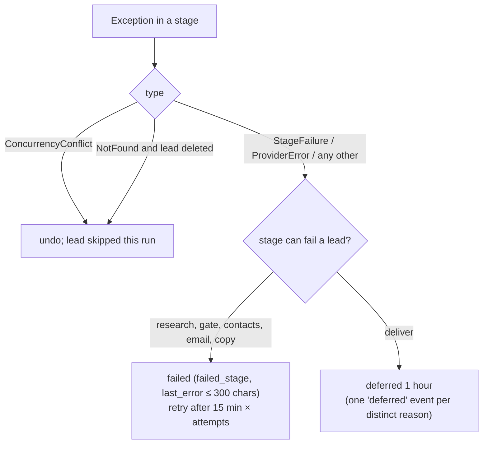

# High-level design

This page explains how the parts of Outbound work together: the processes, how work is queued, how data stays consistent, how tenants are separated, how the outside world is reached, and where the design runs out of room. Read [architecture](../architecture/architecture.md) first for the context and the C4 views.

## 1. Decomposition

Outbound is a modular monolith: one Python package, `outbound/`, in layers. Imports only point down the list below. Three import-linter contracts in `pyproject.toml` check this (`uv run lint-imports`, also in CI). Ruff bans importing `outbound.db.models` outside `outbound/db`.

| Layer (top to bottom) | Package | Owns | May not |
|---|---|---|---|
| Entry points | `cli/`, `api/`, `worker.py` | Parsing input, auth, HTTP, the process loop | Contain business rules |
| Wiring | `pipeline.py` | Building stages over metered providers | — |
| Use cases | `services/` | Operations shared by CLI and API: intake, review, leads, runs, settings, privacy, reports, webhook | Call a vendor except through the meter |
| Orchestration | `runner/` | Selecting due leads, guards, the per-lead transaction, the tick | Know vendor details |
| Stages | `stages/` | One step of the pipeline each; LangGraph subgraphs in `research/` and `copy/` | Open a transaction across a network call; call a vendor directly |
| Metering | `metering/` | Cache, budget, ledger around every paid call | — |
| Data / Providers | `db/` and `providers/` (independent of each other) | Repositories and unit of work / ports, adapters, HTTP client, prices | Depend on each other; leak ORM rows or vendor JSON upward |
| Domain | `domain/` | Entities, enums, state machines, policies, ranking, linter, footer | Do any I/O, or import any other layer, SQLAlchemy or httpx |

Outside the layers: `config.py` (settings), `bootstrap.py` (the composition root), `logging.py` and `prompts/` (model instructions).

The full module list is in the [LLD index](../README.md#low-level-design). The decision is [ADR 0001](../adr/0001-modular-monolith.md).

## 2. Processes

| Process | Started by | Does | Concurrency |
|---|---|---|---|
| `api` | compose, `outbound serve` | The JSON API under `/api` and the built web app. It never runs the pipeline in a request: it inserts a `queued` run | One uvicorn process; handlers are synchronous (run in its thread pool) except the webhook and the upload |
| `worker` | compose, `outbound worker` | Claims the oldest `queued` run and executes it with the same code the CLI uses (`outbound/pipeline.py::execute_run`) | One. A second is safe on Postgres (`SKIP LOCKED`) but not on SQLite ([R-15](../tech-debt-and-risks.md#r-15--p2--correctness-runs-and-three-tables-bypass-the-usual-guards)) |
| `migrate` | compose, before `api` and `worker` | `outbound db upgrade && outbound seed`, both idempotent | One-shot |
| `tick` | cron, by hand: **nothing in production yet** | Retries due failures, runs the catch-all poller and the Sent sync, then a pipeline pass | Not locked against the worker ([R-05](../tech-debt-and-risks.md#r-05--p1--runs-a-stopped-worker-leaves-its-run-running-runs-can-overlap-b2-b3)) |
| CLI | the operator | Any command, including `run`, which runs the pipeline in the foreground | As above |

## 3. How work is queued

There is no message broker ([ADR 0002](../adr/0002-the-table-is-the-queue.md)). Two tables are the queue.

**Leads.** A lead's `status` says which stage wants it next, and `next_action_at` says when. `CompanyRepository.due(status, limit, now)` returns leads in a status whose `next_action_at` is empty or past. They are ordered by `priority`, then `created_at`, then `id`. The index `ix_companies_queue (workspace_id, status, next_action_at)` serves this query. Holds wait for a person; failures and deferrals wait for their time.

| Delay | Value | Set by |
|---|---|---|
| Retry after a failure | 15 min × (attempts + 1); automatic retries stop at 3 attempts | `Runner._fail`; `Runner.retry_failed` runs from `tick` and `outbound retry` only |
| Deferral (deliver or sync error, a guard that cannot hold) | 1 hour | `Runner._defer` |
| Catch-all resolving | 6 hours between polls | `EmailStage`, `CatchAllPoller` |

**Runs.** The API inserts a `runs` row with status `queued` and the request in `params`. The worker claims it: `SELECT … ORDER BY created_at, id LIMIT 1 FOR UPDATE SKIP LOCKED`, then sets `running` and commits *before* executing. Cancelling a `queued` run is immediate. Cancelling a `running` run marks it `cancelled`, and the runner notices between leads and between stages, finishing the lead in hand first.

## 4. Consistency model

| Concern | Mechanism | Where |
|---|---|---|
| A unit of change | `UnitOfWork`: one session, every repository bound to it, nothing written without `commit()`, rollback on exception | `outbound/db/uow.py` |
| No lock across the network | A stage runs with no transaction open; reads are separate short transactions (`ctx.read`); the runner writes the result in one short transaction | `outbound/stages/base.py`, `outbound/runner/runner.py::Runner._apply`, [ADR 0006](../adr/0006-no-transaction-across-network.md) |
| Lost updates | `row_version` on `companies` and `messages` (SQLAlchemy `version_id_col`), plus an explicit `expected_version` from callers. A stale write raises `ConcurrencyConflict` → API `409 version_conflict`, runner "skipped" | `outbound/db/models.py`, `outbound/db/repositories/base.py` |
| Legal transitions only | Transition tables checked by the repository; an event written in the same transaction | [state machines](state-machines.md), [ADR 0007](../adr/0007-state-machines-emit-events.md) |
| Operator input wins | Fields the operator set are listed in `manual_fields`; an engine write to one is not applied and is recorded as a `field_changed` event with `applied: false` | `ScopedRepository._apply_changes`, [ADR 0011](../adr/0011-operator-input-wins.md) |
| Money is never lost | Every paid call writes its ledger row in **its own** committed transaction, before the stage's result is written. A stage that then fails has still recorded its spend | `outbound/metering/metered.py::Meter`, [ADR 0005](../adr/0005-metered-decorator-and-ledger.md) |
| Outside effects | A stage that changes the outside world (a saved draft) returns an `undo`, which the runner calls if the database write fails | `StageResult.undo`, `DeliverStage` |
| Idempotency | Vendor answers cached by request hash; draft `Message-ID` checked before saving; webhook `event_id` unique; intake dedupes by registrable domain; seed and migrations are repeatable | see each LLD |

**What is not covered.** `contacts`, `contact_emails` and `runs` have no `row_version`, so the last writer wins. Run status changes are not checked against their table ([R-15](../tech-debt-and-risks.md#r-15--p2--correctness-runs-and-three-tables-bypass-the-usual-guards)).

## 5. Tenancy

Every table except `workspaces` has a `workspace_id`, and every repository query is scoped by it (binding rule 6). `ScopedRepository._row` scopes even a lookup by id. Only `AdminUnitOfWork` reads `workspaces`.

Today there is **one workspace per process**. `outbound/api/deps.py::build_services` binds the API's services to the workspace named in `WORKSPACE_NAME`, and the worker binds to `--workspace` (default `default`). There are no users or memberships; one operator logs in with a password ([ADR 0013](../adr/0013-single-operator-signed-sessions.md)). The multi-tenant model (users, Supabase auth, row-level security) is Phase 6.

## 6. The outside world

| System | Why | Port / module | Protocol and auth | When it fails |
|---|---|---|---|---|
| Tavily | Search, page extraction, discovery, LinkedIn-title search | `SearchProvider` | HTTPS, Bearer | Retries; then the research stage fails the lead |
| Hunter, ZeroBounce | Find addresses (and verify) | `EmailFinder` | HTTPS, API key | That finder's error is collected and the next is tried |
| MyEmailVerifier (default), Hunter, ZeroBounce, OrbiSearch | Verify addresses | `EmailVerifier` | HTTPS, API key | The address is not chosen; the next source is tried |
| Scrubby (async), Enrichley (sync) | Resolve catch-alls | `CatchAllResolver` | HTTPS, API key | The lead is held as unverified catch-all |
| LLM (Anthropic by default; OpenAI-compatible presets) | Research summaries, fit, persona, copy, critic | `LlmClient` | HTTPS, Bearer, 90 s timeout | Retries; then the lead fails at that stage |
| Companies House | UK incorporation (free) | `CompanyRegistry` | HTTPS, Basic | Optional; skipped without a key |
| IMAP mailbox | Save drafts, read Sent | `Mailbox` | IMAPS 993, password | Deliver defers an hour; sync fails its job |
| Supabase Postgres | All state | SQLAlchemy | TLS via `sslmode=require` in the URL, password | Everything stops; the API returns 500 |
| Doppler | Secrets at container start | `doppler run` | Service token | Starts from the encrypted fallback file |
| GitHub Actions | Deploy | SSH | Deploy key | No deploy; the running release is untouched |

Every vendor except the mailbox sits behind the meter. Each vendor's details are in [integrations](../integrations/README.md).

## 7. Errors and retries

- **HTTP retries happen in one place,** `outbound/providers/http.py::HttpClient`, and adapters never retry.
  - Retried: network errors, 429 (honouring `Retry-After` up to 60 s), 5xx, and a verifier's 202 "still processing".
  - Never retried: 401, 403 or any other 4xx.
  - Three attempts with exponential back-off from 1 s to 8 s, and a 30 s timeout per call.
- **Budget refusals** (`BudgetExceeded`) are `ProviderError`s. The waterfall collects them and tries the next source. The runner's budget guard fails a lead that has used its per-prospect ceiling.
- **A whole run fails** only on an error outside the per-lead handling. The worker records it on the run (`run_failed`) and keeps polling.
- **API errors** are RFC 9457 problem details with stable codes ([API conventions](../api/api-conventions.md)). A 500 carries a reference (the request id) and no detail.

## 8. Composition

`outbound/bootstrap.py::build_container` builds the settings, the engine and the unit-of-work factory once per process. `outbound/pipeline.py::assemble` wraps every vendor in its `Metered*` decorator and builds the stages, the jobs (the poller only with a resolver; deliver and the Sent sync only with a mailbox), the runner and its guards. Tests swap in fakes at the `Providers` boundary (`tests/stages/world.py`). Nothing is a global. See [configuration and bootstrap](../lld/configuration-and-bootstrap.md).

## 9. Limits of this design

The design target is **5–50 new prospects a week at no more than $0.50 each**, for one operator. Within that, nothing here is near a limit. These are the points that give way first as volume grows:

| Limit | Today | What gives first |
|---|---|---|
| Throughput | One worker processes leads one at a time; research and copy spend seconds per lead on model calls | A run of 50 new leads takes minutes, which is fine at this volume. Parallelism would need the B2 run lock first |
| Database connections | 3 processes × pool 5 = 15, the Supabase small-plan pooler limit | A one-off `oc run` can hit `max clients reached` ([R-12](../tech-debt-and-risks.md#r-12--p2--capacity-the-connection-pool-fills-the-supabase-pooler)) |
| Event table growth | One row per transition and per operator action; no retention | Not a concern below hundreds of thousands of rows |
| Scheduling | `tick` is not scheduled | Retries, catch-all answers and the Sent sync do not happen ([R-02](../tech-debt-and-risks.md#r-02--p1--pipeline-scheduled-work-never-runs-in-production-b7)) |
| Mailboxes | One IMAP mailbox from settings | Phase 6 |
| Availability | One VM, one process of each; deploys restart for a few seconds | Acceptable for a back-office batch tool; see [SLOs](../operations/slos.md) |

## Planned

- Phase 4 adds an inbox reader and follow-up scheduling on the same queue: [phase-4-close-the-loop.md](../../phases/phase-4-close-the-loop.md).
- Phase 5 adds sending with rate limits and breakers: [phase-5-automated-sending.md](../../phases/phase-5-automated-sending.md).
- Phase 6 adds users, workspaces and row-level security: [phase-6-saas-ready.md](../../phases/phase-6-saas-ready.md).
