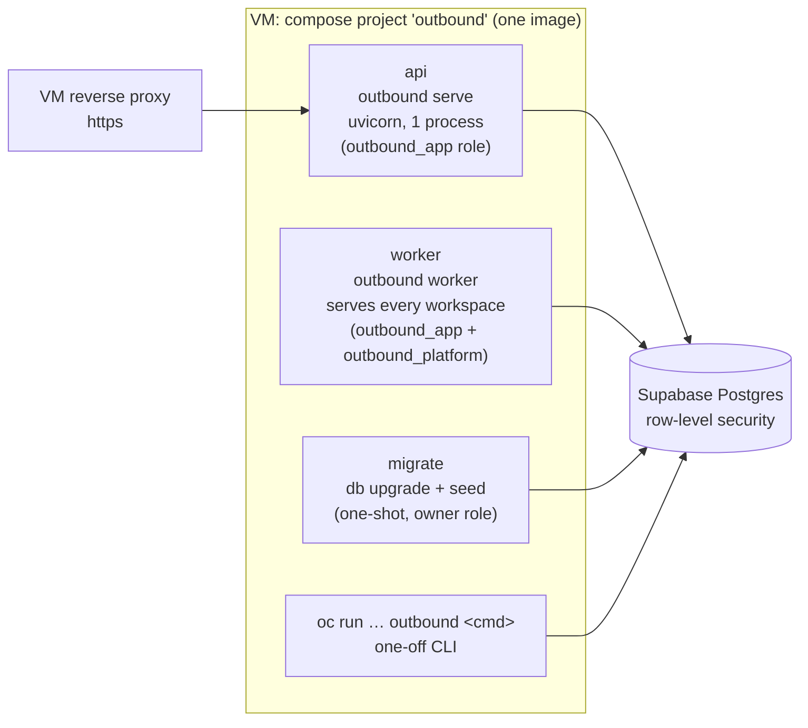
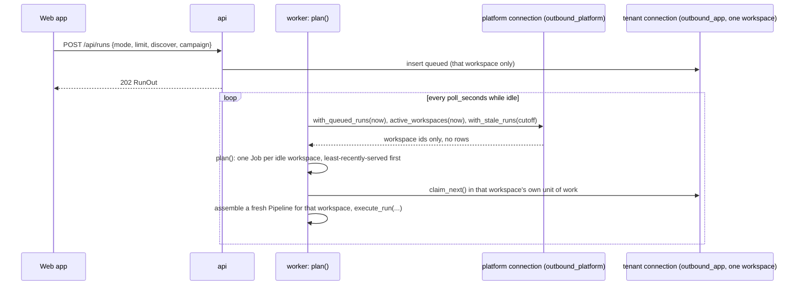
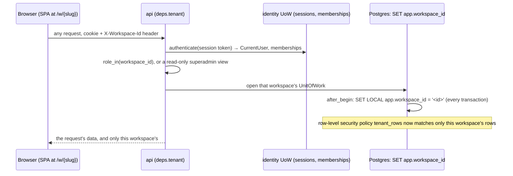
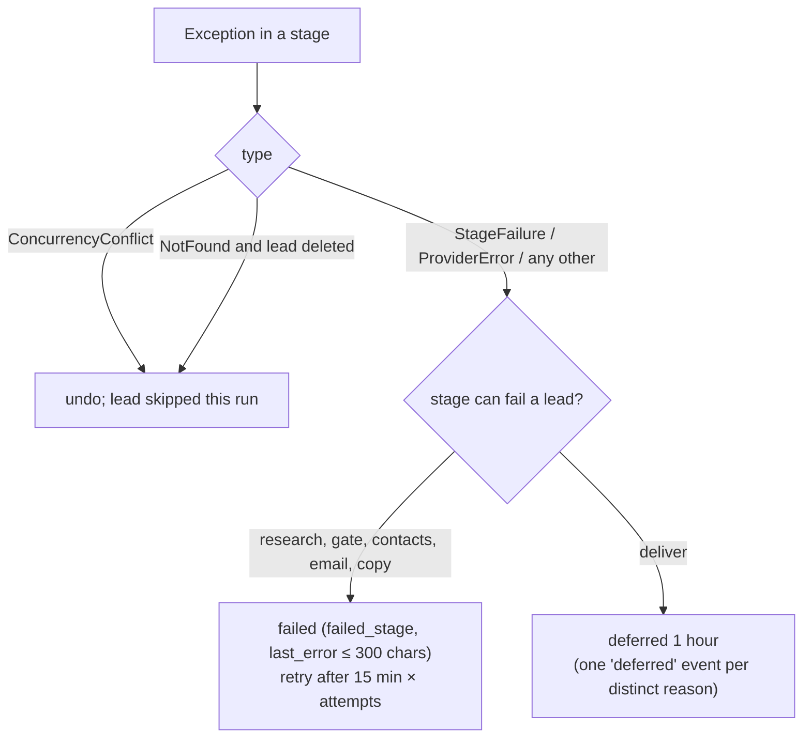

# High-level design

This page explains how the parts of Outbound work together: the processes, how work is queued, how data stays consistent, how tenants are separated, how the outside world is reached, and where the design runs out of room. Read [architecture](../architecture/architecture.md) first for the context and the C4 views.

Outbound is now a multi-tenant SaaS (Phase 6, sub-phases 6a–6d, all built). One deployment serves every customer's workspace; the database itself — not application code — keeps them apart, through composite foreign keys and Postgres row-level security. §5 below is the part of this page that changed most since the single-tenant build.

## 1. Decomposition

Outbound is a modular monolith: one Python package, `outbound/`, in layers. Imports only point down the list below. Three import-linter contracts in `pyproject.toml` check this (`uv run lint-imports`, also in CI), and a fourth keeps tenant code (stages, the runner, metering, most services) from importing the platform unit of work. Ruff bans importing `outbound.db.models` outside `outbound/db`.

| Layer (top to bottom) | Package | Owns | May not |
|---|---|---|---|
| Entry points | `cli/`, `api/`, `worker.py` | Parsing input, auth, HTTP, the process loop | Contain business rules |
| Wiring | `pipeline.py`, `bootstrap.py` | Building stages over metered providers; the composition root | — |
| Use cases | `services/` | Operations shared by CLI and API: intake, review, leads, runs, settings, reports, webhook, privacy, **identity, mailboxes, admin, usage, setup, directory, notices, workspaces** | Call a vendor except through the meter |
| Orchestration | `runner/`, `worker.py` | Selecting due leads, guards (now including credits), the per-lead transaction, the multi-workspace scheduler | Know vendor details |
| Stages | `stages/` | One step of the pipeline each; LangGraph subgraphs in `research/` and `copy/`; the lead directory sits at the front of the email waterfall | Open a transaction across a network call; call a vendor directly |
| Metering | `metering/` | Cache, budget, ledger around every paid call, plus the per-workspace **quota** check | — |
| Data / Providers | `db/` and `providers/` (independent of each other) | Repositories and three units of work (tenant, platform, identity) / ports, adapters, HTTP client, prices, OAuth, mailbox adapters | Depend on each other; leak ORM rows or vendor JSON upward |
| Domain | `domain/` | Entities, enums, state machines, policies, ranking, linter, footer, **permissions, entitlements, directory rules, sender identity, inbox classification** | Do any I/O, or import any other layer, SQLAlchemy or httpx |

Outside the layers: `config.py` (settings), `bootstrap.py` (the composition root), `logging.py` and `prompts/` (model instructions).

The full module list is in the [LLD index](../README.md#low-level-design). The decision is [ADR 0001](../adr/0001-modular-monolith.md).

## 2. Processes

| Process | Started by | Does | Concurrency |
|---|---|---|---|
| `api` | compose, `outbound serve` | The JSON API under `/api`, auth and the admin console, and the built web app. It never runs the pipeline in a request: it inserts a `queued` run | One uvicorn process, synchronous handlers in its thread pool |
| `worker` | compose, `outbound worker` | **Serves every active workspace.** Plans the next job (a queued run, or a due tick) per workspace, least-recently-served first, up to `--threads` (4) at once in a thread pool; recovers stale runs; runs platform-wide periodic jobs (notices, vendor spend caps) | One process, several threads; one piece of work per workspace at a time |
| `migrate` | compose, before `api` and `worker` | `outbound db upgrade && outbound seed`, both idempotent. Connects as the table **owner**, the only process that does | One-shot |
| CLI | the operator or platform staff | Any command, including `run` for one workspace in the foreground; `outbound users create`, `outbound vendors …`, `outbound secrets …` | As above |

There is no longer a separate `outbound tick` CLI loop or a `--workspace` flag on `worker`: the worker ticks every active workspace itself, on a timer (`--tick-minutes`, default 15), so no cron job is needed. `outbound tick` still exists for one workspace, used by tests and by hand.

## 3. How work is queued

There is no message broker ([ADR 0002](../adr/0002-the-table-is-the-queue.md)). Two tables are the queue, now read across every workspace by the scheduler.

**Leads.** A lead's `status` says which stage wants it next, and `next_action_at` says when. `CompanyRepository.due(status, limit, now)` returns leads in a status whose `next_action_at` is empty or past, inside that workspace's own unit of work. The index `ix_companies_queue (workspace_id, status, next_action_at)` serves this query.

**Runs.** The API inserts a `runs` row with status `queued`. The worker's `SchedulerQueries` (on the **platform** connection, `outbound/db/platform.py`) answers only **which workspace ids** have a queued run or are due for a tick — never the run's own rows. The worker then opens that workspace's own unit of work to claim and execute it:

| Delay | Value | Set by |
|---|---|---|
| Retry after a failure | 15 min × (attempts + 1); automatic retries stop at 3 attempts | `Runner._fail`, `Runner.retry_failed` (a tick) |
| Deferral (deliver or sync error, a guard that cannot hold) | 1 hour | `Runner._defer` |
| Catch-all resolving | 6 hours between polls | `EmailStage`, `CatchAllPoller` |
| A tick for one active workspace | Every 15 minutes (`--tick-minutes`); skipped while that workspace already has a run in progress | `Worker.plan` |
| A run whose worker died | Failed after 30 minutes with no heartbeat (`--stale-after`), freeing the queue | `Worker.recover_stale`, `runs.heartbeat_at` |

A platform **kill switch** (`platform_settings.data.kill_runs`) stops every workspace's work at once; `Worker.plan` checks it first and returns no jobs while it is set.

## 4. Consistency model

| Concern | Mechanism | Where |
|---|---|---|
| A unit of change | `UnitOfWork`: one session, one workspace, every repository bound to it, nothing written without `commit()`, rollback on exception | `outbound/db/uow.py` |
| No lock across the network | A stage runs with no transaction open; reads are separate short transactions (`ctx.read`); the runner writes the result in one short transaction | `outbound/stages/base.py`, `outbound/runner/runner.py::Runner._apply`, [ADR 0006](../adr/0006-no-transaction-across-network.md) |
| Lost updates | `row_version` on `companies` and `messages` (SQLAlchemy `version_id_col`), plus an explicit `expected_version` from callers. A stale write raises `ConcurrencyConflict` → API `409 version_conflict`, runner "skipped" | `outbound/db/models.py`, `outbound/db/repositories/base.py` |
| Legal transitions only | Transition tables checked by the repository; an event written in the same transaction | [state machines](state-machines.md), [ADR 0007](../adr/0007-state-machines-emit-events.md) |
| Operator input wins | Fields the operator set are listed in `manual_fields`; an engine write to one is not applied and is recorded as a `field_changed` event with `applied: false` | `ScopedRepository._apply_changes`, [ADR 0011](../adr/0011-operator-input-wins.md) |
| Money is never lost | Every paid call writes its ledger row in **its own** committed transaction, before the stage's result is written. A stage that then fails has still recorded its spend | `outbound/metering/metered.py::Meter`, [ADR 0005](../adr/0005-metered-decorator-and-ledger.md) |
| A credit is charged once | `usage_events` has a partial unique index on `(workspace_id, step, company_id)` for every step except `rewrite`, so retrying a stage after it already charged never charges twice | [plans, credits and admin](../lld/plans-credits-and-admin.md) |
| A row cannot point into another workspace | Composite foreign keys: a child's `(workspace_id, parent_id)` references the parent's `(workspace_id, id)` (migration 0007). Row-level security does not protect foreign-key checks, so this is the one thing that does | `outbound/db/models.py::_tenant_fk`, [tenancy and isolation](../lld/tenancy-and-isolation.md) |
| Outside effects | A stage that changes the outside world (a saved draft) returns an `undo`, which the runner calls if the database write fails | `StageResult.undo`, `DeliverStage` |
| Idempotency | Vendor answers cached by request hash; draft `Message-ID` checked before saving; webhook `event_id` unique; intake dedupes by registrable domain; seed and migrations are repeatable; the Sent sync and the inbox reader use an overlap window so two passes agree | see each LLD |

**What is not covered.** `contacts`, `contact_emails` and `runs` have no `row_version`, so the last writer wins ([R-15](../tech-debt-and-risks.md#r-15--p2--correctness-runs-and-three-tables-bypass-the-usual-guards)). Run status changes are not checked against their table.

## 5. Tenancy

The schema has grown from 17 tables to 35, and every tenant table is now explicitly scoped by `workspace_id`. Full detail is in [tenancy and isolation](../lld/tenancy-and-isolation.md) and [identity and access](../lld/identity-and-access.md); this section is the shape of it.

### Three kinds of table

| Kind | Examples | Protected by | Connects as |
|---|---|---|---|
| **Tenant tables** | `companies`, `contacts`, `messages`, `mailboxes`, `credentials`, `workspace_plans`, `usage_events`, 16 of them plus `workspaces` itself | Postgres row-level security (`outbound_app` may only see rows matching `current_setting('app.workspace_id')`) and composite foreign keys | `outbound_app` (API, worker) |
| **The same tenant tables, read-only across workspaces** | — | `outbound_platform` has a read-only policy over the same 16 tables, for the scheduler and admin console | `outbound_platform` (worker's scheduler, admin reads) |
| **Platform-only tables, no row-level security** | `users`, `memberships`, `auth_tokens`, `sessions`, `audit_log` (identity, migration 0010); `platform_credentials`, `platform_settings` (vendor keys and config, 0012–0013); `directory_*` (the lead directory, 0014) | Grants alone: each role gets exactly the operations it needs on exactly the columns it needs (the directory's `contributor_workspace_id` and `reporter` columns are never granted to `outbound_app`) | Whichever role the table's grants name |

### How a tenant request is scoped

- **The browser never asks the server to resolve `/w/{slug}`.** The SPA looks up the slug among the signed-in user's own memberships (from `GET /api/auth/me`) client-side, and sends the resolved workspace id as an `X-Workspace-Id` header on every API call.
- **`app.workspace_id` is set per transaction, never per session,** because a pooled connection must not carry one workspace's key into its next use (`outbound/db/session.py::_set_workspace`, a SQLAlchemy `after_begin` listener).
- **A superadmin's read of another workspace** sets the same header but gets a `Tenant` built with `superadmin_view=True`: every permission check then grants read-only access, and the first view of that workspace in that session writes one `audit_log` row.

### Three connections, one Postgres database

| Role | Used by | May | Bypasses RLS? |
|---|---|---|---|
| owner (`postgres` on Supabase) | `migrate` only | Everything (owners are not subject to row-level security) | Yes, inherently — never used outside migrations |
| `outbound_app` | `api`, `worker` (tenant work) | Tenant tables: SELECT/INSERT/UPDATE/DELETE scoped by `app.workspace_id`; `workspaces`: its own row only | No |
| `outbound_platform` | `worker`'s scheduler, the admin console's reads, platform writes | Tenant tables: SELECT only, any row; identity, plans, vendor-key and directory tables per their own grants | No |

`serve` and `worker` **refuse to start in production** if they find themselves connected as the owner, a superuser, or a BYPASSRLS role (`outbound/db/isolation.py::isolation_problems`), and the same check confirms row-level security is actually enabled and that Supabase's Data API roles (`anon`, `authenticated`) hold no grants. This is a startup self-check, not a database constraint, so it is re-run by hand after any infrastructure change.

### What this buys, and what it does not

- **Buys:** a bug in application-level scoping (a forgotten `WHERE workspace_id = …`) cannot leak another customer's data, because the database itself refuses the row. This was Phase 6a's gate, proven with application scoping deliberately patched out.
- **Does not buy:** protection if a connection is ever made as the owner or a superuser; protection against a bug in the identity or platform tables, which have no row-level security of their own (they are reached only through named, hand-written queries, never a generic tenant query).

## 6. The outside world

| System | Why | Port / module | Protocol and auth | When it fails |
|---|---|---|---|---|
| Tavily | Search, page extraction, discovery, LinkedIn-title search, news | `SearchProvider` | HTTPS, Bearer | Retries; then the research stage fails the lead |
| Hunter, ZeroBounce | Find addresses (and verify) | `EmailFinder` | HTTPS, API key | That finder's error is collected and the next is tried |
| MyEmailVerifier (default), Hunter, ZeroBounce, OrbiSearch | Verify addresses | `EmailVerifier` | HTTPS, API key | The address is not chosen; the next source is tried |
| Scrubby (async), Enrichley (sync) | Resolve catch-alls | `CatchAllResolver` | HTTPS, API key | The lead is held as unverified catch-all |
| The **verified lead directory** (platform-internal, not a vendor) | Checked before any paid finder | `EmailFinder` (`DirectoryFinder`) | In-process, no network | Falls through to the paid waterfall |
| LLM provider (DeepSeek via DeepInfra by default; any OpenAI-compatible endpoint) | Research summaries, fit, persona, copy, critic, inbox classification where rules are not enough | `LlmClient` | HTTPS, Bearer, 90 s timeout | Retries; then the lead fails at that stage |
| Companies House | UK incorporation (free) | `CompanyRegistry` | HTTPS, Basic | Optional; skipped without a key |
| Mailbox: **IMAP, Microsoft Graph, or Gmail API**, one or more per workspace | Save drafts, read Sent and Inbox | `Mailbox` | IMAPS 993 (app password) / OAuth (Graph, Gmail) | Deliver defers an hour; sync and inbox jobs skip that mailbox and continue with the others |
| Microsoft Entra, Google Cloud (OAuth) | Let a customer connect their own mailbox | — | Authorization-code + PKCE | The connect flow fails; the mailbox stays disconnected |
| Supabase Postgres | All state | SQLAlchemy, three roles | TLS via `sslmode=require` in the URL | Everything stops; the API returns 500 |
| Doppler | Secrets at container start | `doppler run` | Service token | Starts from the encrypted fallback file |
| SMTP (any provider) | Invitation and password-reset email | — | — | The API refuses to start in production without `SMTP_HOST`; in development, links print to the log |
| GitHub Actions | Deploy | SSH | Deploy key | No deploy; the running release is untouched |

Every vendor except the mailbox and SMTP sits behind the meter. Each vendor's details are in [integrations](../integrations/README.md).

## 7. Errors and retries

- **HTTP retries happen in one place,** `outbound/providers/http.py::HttpClient`, and adapters never retry.
  - Retried: network errors, 429 (honouring `Retry-After` up to 60 s), 5xx, and a verifier's 202 "still processing".
  - Never retried: 401, 403 or any other 4xx.
  - Three attempts with exponential back-off from 1 s to 8 s, and a 30 s timeout per call.
- **Budget and credit refusals** (`BudgetExceeded`, and the new `RefusalKind.CREDITS` / `RefusalKind.ACCESS`) are refused before the stage runs. A lead out of credits for a step waits **in place**, not failed, and the next credit grant or period rollover resumes it automatically ([plans, credits and admin](../lld/plans-credits-and-admin.md)).
- **A whole run fails** only on an error outside the per-lead handling. The worker records it on the run and keeps serving other workspaces.
- **A workspace's tick failing never stops another workspace's tick:** `Worker._tick` catches and logs, per the module's own design rule ("one workspace's broken tick must not stop the others").
- **API errors** are RFC 9457 problem details with stable codes ([API conventions](../api/api-conventions.md)). A 500 carries a reference (the request id) and no detail.

## 8. Composition

`outbound/bootstrap.py::build_container` now builds **three** unit-of-work factories, not one: `UnitOfWorkFactory` (tenant work, bound to one workspace at a time), `PlatformUnitOfWorkFactory` (cross-workspace reads and platform writes, `outbound/db/platform.py`), and `IdentityUnitOfWorkFactory` (users, sessions, tokens, audit, `outbound/db/identity.py`). In production the tenant and platform factories can point at different database roles over different connection strings (`DATABASE_URL` / `PLATFORM_DATABASE_URL`); in development and tests they share one SQLite file, where row-level security does not apply and isolation rests on the composite foreign keys and the application's own scoping alone.

`outbound/pipeline.py::assemble` still wraps every vendor in its `Metered*` decorator and builds the stages, but now takes the lead directory finder as the first link in the email waterfall, and the guard chain now checks credits and workspace access before budget. Tests swap in fakes at the `Providers` boundary (`tests/stages/world.py`). Nothing is a global. See [configuration and bootstrap](../lld/configuration-and-bootstrap.md).

## 9. Limits of this design

The design target is **5–50 new prospects a week at no more than $0.50 each**, now per workspace, with "about how many workspaces at once" the new question Phase 6 raises. Within the alpha's handful of invited customers, nothing here is near a limit. These are the points that give way first as workspaces or volume grow:

| Limit | Today | What gives first |
|---|---|---|
| Throughput | One worker, several threads, one piece of work per workspace at a time; research and copy spend seconds per lead on model calls | More workspaces active at once than `--threads` allow queue behind each other; raise `--threads`, or run a second worker process (claiming is safe across workers on Postgres) |
| Database connections | 3 roles × pool size (default 5) against the Supabase pooler's ~15-client limit on small plans | A busy alpha with several one-off `oc run` commands can hit `max clients reached` ([R-12](../tech-debt-and-risks.md#r-12--p2--capacity-the-connection-pool-fills-the-supabase-pooler)) |
| Event table growth | One row per transition and per operator action, per workspace; no retention | Not a concern below hundreds of thousands of rows |
| Mailbox tokens | Refreshed inline when used; no background refresh job | A mailbox idle for a long time may need a reconnect on first use after its long-lived refresh token itself expires |
| Lead directory | Platform-wide tables, no per-workspace partitioning | Fine at alpha scale; a very large directory would need indexing attention, not a redesign |
| Availability | One VM, one process of each; deploys restart for a few seconds; the rollback defect (R-01) means a bad migration cannot be rolled back automatically | Acceptable for an invite-only alpha; see [SLOs](../operations/slos.md) |

## Planned

- Phase 4 (the rest, beyond 4a) adds just-in-time follow-ups, full reply triage and the Replies screen on the same queue.
- Phase 5 adds sending with rate limits and breakers, through the same mailbox adapters built in 6c.
- Phase 6e (billing) and 6f (launch readiness: MFA, removing superadmin, CASA, a penetration test) come after the alpha.
- See [phase-6-saas-ready.md](../../phases/phase-6-saas-ready.md) and [phase-7-later.md](../../phases/phase-7-later.md).
