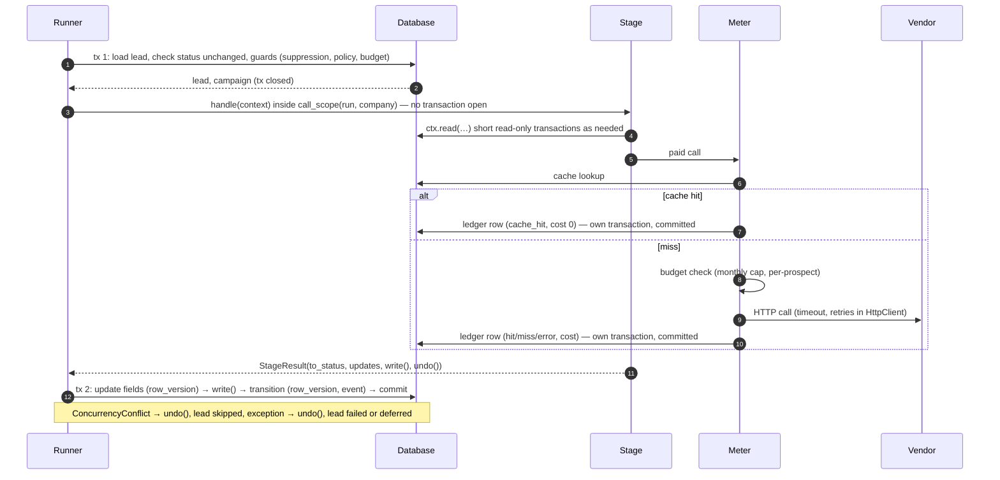
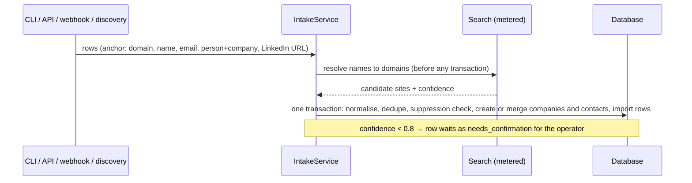
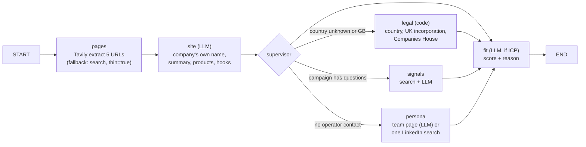
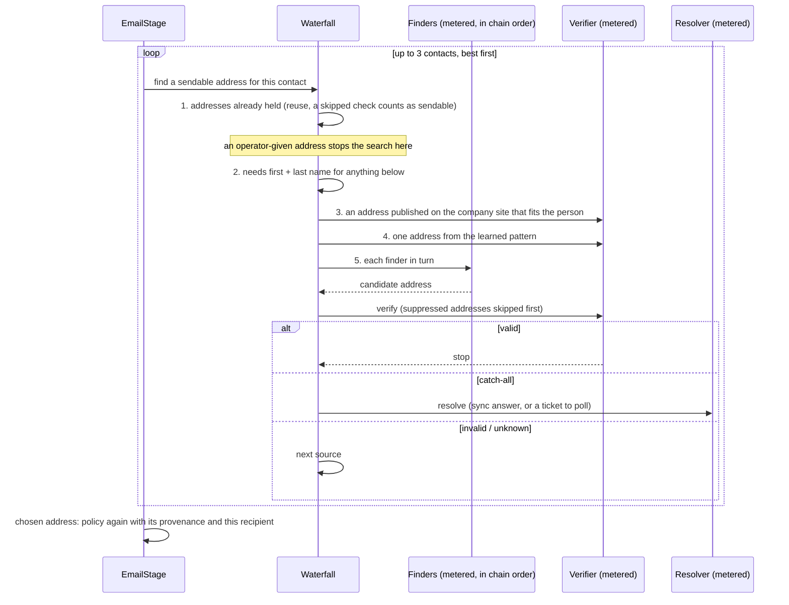
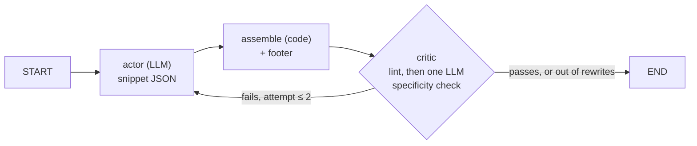
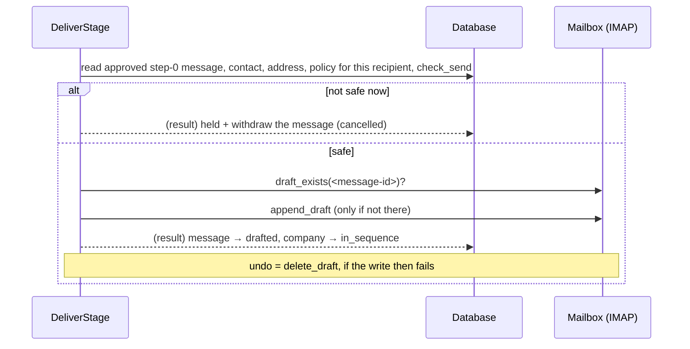

# Pipeline flow

This page follows one lead from intake to a draft in the mailbox. Each stage's internals are in its [LLD](../README.md#low-level-design). This page shows what crosses the boundaries: the runner, the stage, the meter, the vendors and the database. For the product description of each stage, see [PLAN.md §8](../../PLAN.md#8-pipeline-stages).

## The shape of every stage

Every runner-driven stage has the same three-step shape. This is the core contract of the system (binding rule 5 in [CLAUDE.md](../../../CLAUDE.md)).

What this gives:

- **A crash at any point loses nothing.** Status is the queue, and every vendor answer (search, finder, verifier, resolver, registry) is already in the ledger, so a rerun pays for none of them again. Model calls are the exception: they are not cached, by design, because two identical prompts should give two different drafts. A stage interrupted mid-way asks the model again.
- **No lock is held while a vendor is slow.** Transactions are milliseconds long.
- **An operator edit wins a race.** If the operator changed the lead while a stage worked, the final write fails its `row_version` check and the stage's result is dropped.

## Order and selection

`outbound/runner/runner.py::Runner.run_pipeline` runs the stages in this order. Each stage takes up to `limit` leads (default 50) that are in its input status and due: `next_action_at` is null or past. They are ordered by priority, then age (`CompanyRepository.due`).

| # | Stage | Input → output | Guard: policy / budget | Paid calls |
|---|---|---|---|---|
| 1 | Intake (a service, not a runner stage) | file, form, webhook or discovery → `new` | — | Tavily, only for rows without a domain |
| 2 | Research | `new` → `researched` | no / yes | Tavily 2–4, LLM 1–4, Companies House (free) |
| 3 | Gate | `researched` → `qualified` / `disqualified` / `held` | decides itself / no | — |
| 4 | Contacts | `qualified` → `contacts_found` | yes / no | — |
| 5 | Email | `contacts_found` → `email_ready` / `held` | yes / yes | finders, verifier, resolver |
| 6 | Copy | `email_ready` → `copy_ready` / `held` | yes / yes | LLM 1–6 |
| 7 | Review (a service, the operator) | `copy_ready` → `approved` / `rejected` | — | — |
| 8 | Deliver (only if a mailbox is configured) | `approved` → `in_sequence` / `held` | yes / no | — (IMAP) |
| 9 | Sent sync (a tick job) | message `drafted` → `sent` | — | — (IMAP) |

Each stage makes its list when it starts, after the previous stage has finished, so one run can carry a new lead all the way from research to `copy_ready`. It stops there, because review needs the operator. A lead that is held, deferred (`next_action_at` in the future) or failed waits for a later run.

## 1. Intake

- **A domain already known** merges into the existing company: notes are appended, and conflicting values become events.
- **Suppressed domains and addresses** are rejected per row.
- **Discovery** first searches for companies matching the campaign's ideal customer. It asks for twice the wanted count, skips articles and documents, and stores only the website: a search title is never used as a name.
- **Webhook calls** are idempotent by `event_id`.

LLD: [services](../lld/services.md#intake).

## 2. Research (LangGraph)

- The **site** worker always runs first. The company name it returns is saved (unless the operator set one), and the other workers use it.
- A person found by search is saved as a `candidate` only when their profile's employer is this company. A person who is only mentioned is saved as `unconfirmed`, and anyone else is dropped.
- The graph is stateless: no checkpointer (binding rule 9).

The stage writes the research JSON, the answers, the fit score and reason, the name, country and legal entity where they were missing, and the people found. Any error fails the lead at `research`.

LLD: [research](../lld/stage-research.md).

## 3. Gate and 4. Contacts

No paid calls.

- **Gate:**
  1. The fit gate: `discovery` leads need the campaign's minimum score; manual, import and referral leads bypass it.
  2. The country policy (`policy_decision_for(stage="gate")`): ALLOW gives `qualified`, BLOCK gives `disqualified`, HOLD gives `held`. The decision is stored on the company.
- **Contacts:** ranks the workable people against the campaign's target titles, then by seniority. People the operator chose come first: added by the operator, given an address by the operator, or with a recorded consent. With nobody workable, the lead fails, and the reason says when only unconfirmed people were found.

LLD: [gate and contacts](../lld/stage-gate-and-contacts.md).

## 5. Email (the waterfall)

| Result | Next status |
|---|---|
| An address chosen and the policy allows it | `email_ready`; the address pattern is learned for the domain |
| A resolver ticket outstanding | `held` / `catch_all_resolving`. The poller job checks every 6 hours |
| Only an unverifiable catch-all, and `safe_to_send_only` is on | `held` / `catch_all_unverified` |
| Nothing usable | the lead fails at `email` |

Every address checked is saved, including invalid ones, so none is paid for twice. A `ProviderError`, including `BudgetExceeded`, from one source is collected, and the next source is tried.

LLD: [email](../lld/stage-email.md).

## 6. Copy (LangGraph)

1. Before any model call, the stage checks:
   - the sender profile is reviewed, with a real signature;
   - the recipient's address is sendable;
   - the policy allows this recipient;
   - every field the footer needs is filled.

   If the policy check fails, the lead is held. If any other check fails, the lead fails.
2. The writer is shown the campaign's recent operator edits as examples.
3. The result is a `generated` message for step 0, with its snippets and lint report. A draft that still fails after 2 rewrites goes to review flagged with its issues.

LLD: [copy](../lld/stage-copy.md).

## 7. Review

The operator approves (optionally editing) or rejects, on the Review screen or with `outbound review`. Approval:

- re-checks suppression;
- refuses an edit that removes the footer;
- requires an acknowledgement for any skipped check;
- stores the edit and its edit distance;
- moves the message to `approved` and the company to `approved`, in one transaction.

See [safety model](safety-model.md#5-human-approval).

## 8. Deliver

A mailbox error defers the lead by an hour; it never fails it.

LLD: [deliver and sync](../lld/stage-deliver-and-sync.md).

## 9. Sent sync and the catch-all poller (tick jobs)

These are `Job`s run by `outbound tick`, not by the worker ([R-02](../tech-debt-and-risks.md#r-02--p1--pipeline-scheduled-work-never-runs-in-production-b7)).

- **Sent sync** reads the Sent folder from shortly before the earliest open draft. A sent mail matches a draft on recipient, normalised subject and time. A match that is unique in both directions moves the message to `sent` and stores the body that actually went out and its edit distance. Anything ambiguous writes one `sync_ambiguous` event and waits for the operator.
- **Catch-all poller** asks the resolver about every `catch_all_resolving` lead that is due. An answer updates the address and sends the lead back to the email step. No answer moves `next_action_at` on by 6 hours.

## Planned

- Phase 4 adds follow-ups (steps 1 and 2), reply reading and bounce handling after `in_sequence`: [phase-4-close-the-loop.md](../../phases/phase-4-close-the-loop.md).
- Phase 5 adds direct sending instead of drafts: [phase-5-automated-sending.md](../../phases/phase-5-automated-sending.md).
