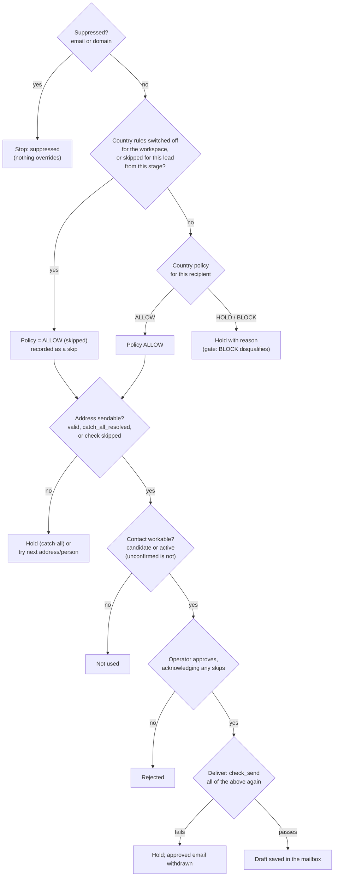

# Safety model

Outbound writes to real people at real companies, so a wrong email can be a legal problem (PECR, GDPR, CASL, DPDP), a reputational one, or a deliverability one. This page explains every check that stands between a lead and an email, the order in which they win, and every place each one is made again.

The *policy* (which countries allow what, and why) is in [PLAN.md §11](../../PLAN.md#11-compliance-and-deliverability). This page is about how the code enforces it.

## Principles

1. **Checked again late.** A check made early, at intake or the gate, is made again right before every later step that could lead to an email. Rules, consents and suppressions can change while a lead waits, and the latest answer wins.
2. **Server-side only.** The web app shows checks, but every one of them is enforced in a service, a stage or the runner. Calling the API directly skips nothing. This is binding rule 8 in [CLAUDE.md](../../../CLAUDE.md).
3. **Fail closed, but never silently.** When a check cannot say yes, the lead is *held* with a reason the operator can act on. It is not dropped, and it is not let through.
4. **Suppression is absolute.** No setting, skip, consent or approval overrides the do-not-contact list.
5. **A person decides what the engine cannot prove.** The operator may skip a check the engine cannot make, such as a country rule, an unverifiable address, or a person a search could not place. Each skip has a reason, is recorded as an event, and must be acknowledged again when the email is approved.
6. **Nothing reaches a mailbox without a human approval.** In Phases 2–4 the engine only writes drafts, and only for approved emails. Phase 5's automatic sending must never send an email that relies on a skipped check ([PLAN.md §7](../../PLAN.md#7-lifecycles)).

## The checks, in order of precedence

### 1. Suppression

- **What:** a hashed email address or a registrable domain on the `suppressions` list. Sources are opt-outs, the operator's **Suppress**, **Forget**, and (Phase 4) hard bounces and complaints.
- **Checked:**
  - at intake, so a suppressed target is not added;
  - by the runner's guard before **every** stage, for the domain (`outbound/runner/guards.py::Guards.check`);
  - by the waterfall, which skips a suppressed address before paying to verify it;
  - at approval, for the address and its domain (`outbound/services/review.py::ReviewService.approve`);
  - by deliver, for both again (`outbound/domain/policies.py::check_send`).
- **Effect:**
  - A suppressed domain at a guard moves the lead to `suppressed`, which is final.
  - A suppressed address at approval refuses the approval.
  - At deliver, the lead is held and its approved email withdrawn.
- **Overridden by:** nothing.

### 2. Country policy

- **What:** the rule for the lead's country (`country_policies`), decided by `outbound/domain/policies.py::decide_country_policy`. The decision is made in this order:
  1. Unknown country: hold `country_unknown`.
  2. No rule for the country: hold `needs_operator`.
  3. `block`: BLOCK, unless the recipient consented.
  4. Corporate subscribers only (GB) and the company is not one: hold `entity_unknown` or `consent_required`, unless consented.
  5. Address provenance not in the allowed list (CA): hold `consent_required`, unless consented.
  6. `consent_required` without consent: hold.
  7. Otherwise ALLOW.

  A recorded consent overrides every hold and block except an unknown country, because without a country there is no footer to attach.
- **Whose consent counts.** `outbound/stages/policy.py::policy_decision_for` takes an optional `recipient_id`.
  - The gate and the runner's guard run before a recipient is chosen. There, anyone's consent at the company keeps the lead moving.
  - The email, copy and deliver steps name the recipient. There, only *that person's* consent counts. Someone else's consent never allows writing to this person ([ADR 0022](../adr/0022-consent-belongs-to-the-recipient.md)).
- **Checked:**

| Where | Code | On a non-ALLOW answer |
|---|---|---|
| Gate | `outbound/stages/gate.py::GateStage.handle` | BLOCK → `disqualified`; HOLD → `held` with the reason. The decision is stored in `companies.policy_decision` |
| Guard before contacts, email, copy, deliver | `Guards.check` (stages with `guard_policy = True`) | `held`. **A block holds rather than suppresses**, because a rule can come back into force and that must never end a lead ([ADR 0019](../adr/0019-policy-block-holds-never-suppresses.md)) |
| Email, once an address is chosen | `outbound/stages/email/stage.py::EmailStage.handle` | `held`, with the chosen address's provenance and the recipient's consent |
| Copy, before writing | `outbound/stages/copy/stage.py::CopyStage.handle` | `held` (for example, the consent belongs to someone else) |
| Deliver, before saving the draft | `outbound/stages/deliver.py::DeliverStage.handle` | `held`; the approved email is withdrawn (`cancelled`) |

- **Operator switches.** Both make the decision ALLOW with `skipped = True`. Suppression still applies, and the country's footer still travels with the email. See [ADR 0020](../adr/0020-policy-skip-is-a-tail-from-a-stage.md).
  - **Workspace:** `workspaces.settings.country_policy_enabled = false` switches every country rule off. The app shows a red banner while it is off.
  - **One lead:** `companies.policy_skip_from` names a stage (`gate`, `contacts`, `email`, `copy` or `deliver`). The rule is skipped at that stage and every later one: always a tail, so no stage contradicts a later one. `LeadService.skip_policy` needs a reason and writes `policy_skip_granted`. `revoke_policy_skip` is allowed until approval.

### 3. Address verification

- **What:** whether the address has proof that it reaches a mailbox. `outbound/domain/policies.py::is_sendable` accepts:
  - `valid` and `catch_all_resolved`;
  - `catch_all_unverified` only when the workspace's `safe_to_send_only` is off (default on);
  - **any status** when the operator skipped the check (`contact_emails.verification_skipped`, with a reason in an `email_verification_skipped` event).
- **Checked:** the waterfall chooses only a sendable address (`outbound/stages/email/waterfall.py`). The copy stage writes only to a sendable primary address. Deliver checks again (`check_send`).
- **On failure:** the waterfall tries the next finder, then the next contact (up to 3). A catch-all goes to the resolver, and the lead is held as `catch_all_resolving` or `catch_all_unverified`. With nothing usable, the lead fails at the email stage.
- **The skip** also stops all paid finder and verifier calls for that address, and it covers even `invalid`, because the operator knows the address. It must be acknowledged at approval.

### 4. The person

- **What:** whether the contact really works at the company and may be written to. Only `candidate` and `active` contacts are workable.
- **How it is decided:**
  - A searched person is *confirmed* only when their profile's employer is the company (its whole name or its website's name). A person who is only mentioned with the company is saved as `unconfirmed`, and anyone else is dropped (`outbound/domain/names.py::employer_matches`, `mentions_company`).
  - People the operator adds or imports are `active`.
  - The operator can **Confirm they work here**, which moves the person `unconfirmed → candidate`. This is the "person check" skip, and approval must acknowledge it.
- **Checked:**
  - The contacts stage ranks workable people only, and fails with a clear reason when it finds only unconfirmed ones.
  - Deliver checks the contact's status again.

### 5. Human approval

- **What:** the operator reads touch 1 and approves or rejects it (`ReviewService.approve`, `reject`). Approval:
  - refuses an address or domain that is now suppressed;
  - refuses an edit that removes the footer;
  - **refuses an email that relies on any skipped check unless `acknowledge_skips` is set**, and then records `approved_with_skips` with the kinds of skip.
- **The kinds of skip** (`outbound/services/review.py::_skips`):

| Kind | When |
|---|---|
| `country_policy` | Rules switched off for the workspace, or skipped for this lead |
| `email_verification` | The address is used without proof |
| `works_here` | The recipient was `unconfirmed` and the operator confirmed them |

- **Interfaces:** the Review screen shows the list with a required tick box. The CLI takes `--acknowledge-skips`.

### 6. Deliver: the last check

`DeliverStage.handle` runs `check_send` with every condition at once: sendable address, address not suppressed, domain not suppressed, country policy ALLOW for this recipient, and contact workable. Every failing reason is reported. If any fails, the lead is held and the approved email is withdrawn. Once released, the lead is checked again and gets a fresh email; nothing is retried silently.

Drafting is idempotent. The draft's own `Message-ID` is `<{message id}.outbound@{mailbox domain}>`, and deliver asks the mailbox for it before saving. If the database write after saving fails, the stage's `undo` deletes the draft.

## The content of the email

The checks above decide *whether* to write. Three more govern *what* is written.

| Control | Where | What it prevents |
|---|---|---|
| Sender profile must be reviewed | `CopyStage.handle` fails until `sender_profile.reviewed_at` is set and a real signature exists | Claims seeded from examples reaching a real email (Phase 3b A1) |
| Footer | `outbound/domain/footer.py::render_footer`, under `footer_enabled` (default on): the country's footer, or a short default | Missing sender identity, postal address or opt-out line. A blank field the footer needs fails the lead before any model call |
| Copy linter | `outbound/domain/copy_lint.py::lint`: length, subject, reading grade, one question, no link in touch 1, no address in the body, banned phrases, footer present | Spammy or non-compliant copy. A draft that still fails after 2 rewrites goes to review flagged |
| Fenced web text | `outbound/prompts/fence.py` | A web page steering the model. This defence has a known gap ([R-08](../tech-debt-and-risks.md#r-08--p1--security-web-text-can-close-the-prompt-fence)); human approval is the control that holds |

## What is not covered yet

- **Opt-outs arrive by reply,** and replies are not read until Phase 4. Until then the operator reads replies by hand and uses **Suppress** on the lead page ([manual §13](../../USER_MANUAL.md#13-known-limits-in-this-version)).
- **No send-rate or bounce circuit breaker** runs, because nothing is sent automatically. The `breaker` settings exist for Phase 5.
- **The safety model assumes one operator.** There is no second approver and no role separation (Phase 6).

## Tests that prove it

| Rule | Tests |
|---|---|
| Policy decision order, consent override, skip per stage | `tests/domain/test_policies.py`, `tests/db/test_policy_skip.py` |
| Recipient-only consent | `tests/db/test_leads_and_settings.py`, `tests/domain/test_ranking.py` |
| Verification skip, acknowledgement at approval | `tests/db/test_verification_skip.py` |
| Deliver re-check, hold and withdraw | `tests/db/test_review_and_deliver.py` |
| Guard order and holds | `tests/db/test_runner.py`, `tests/db/test_gate_and_contacts.py` |
| Copy linter | `tests/domain/test_copy_lint.py` |
| The whole loop in a browser, including an acknowledged approval | `web2/e2e/loop.spec.ts` |

## Planned

- Phase 4 adds reply reading, automatic opt-out suppression and bounce handling: [phase-4-close-the-loop.md](../../phases/phase-4-close-the-loop.md).
- Phase 5 adds automatic sending with breakers, and must exclude skipped checks: [phase-5-automated-sending.md](../../phases/phase-5-automated-sending.md).
