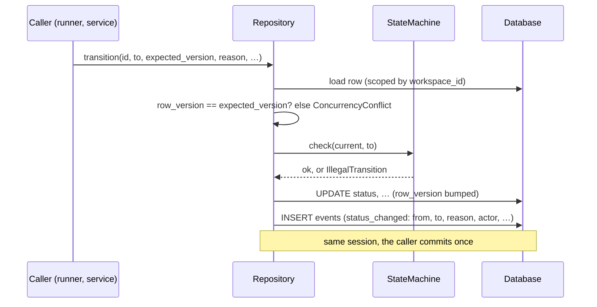
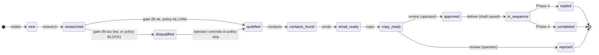
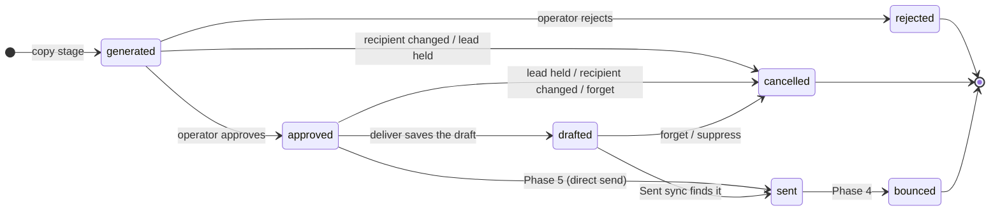
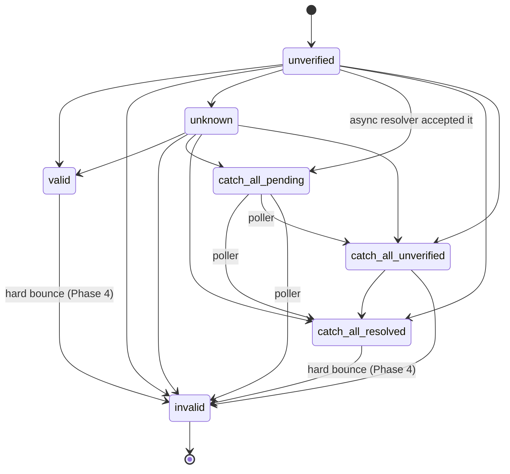
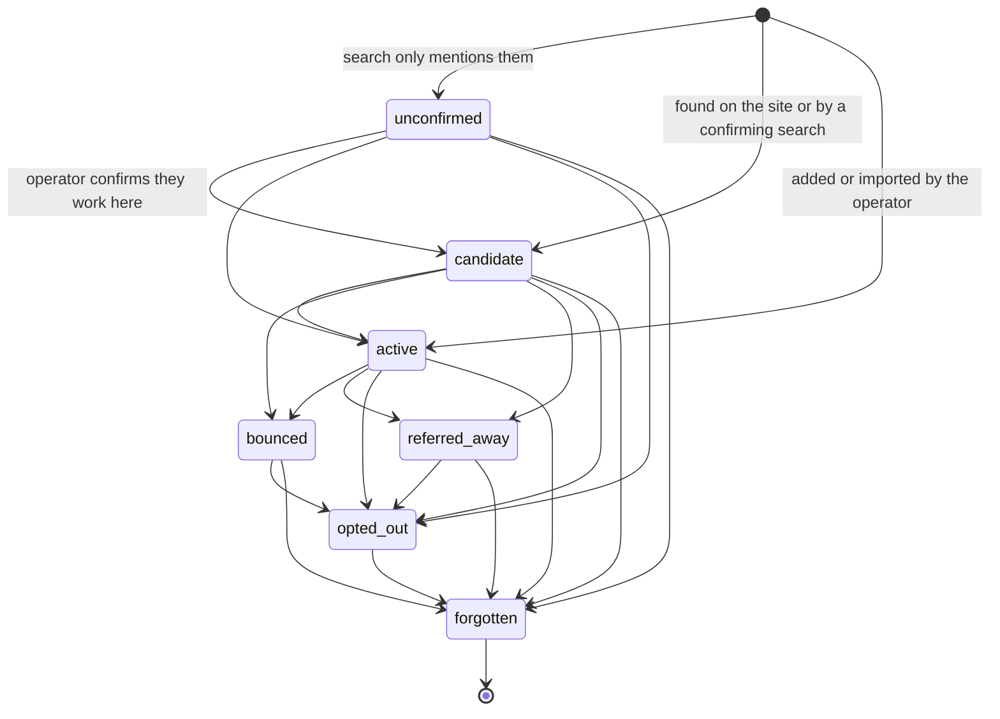
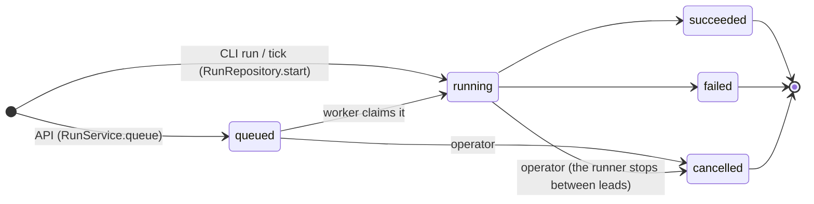
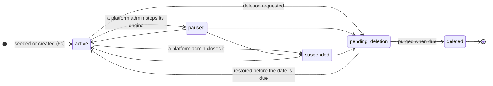

# State machines

Every status in the system belongs to one of five lifecycles. Each lifecycle is a transition table in `outbound/domain/state_machines.py`. A move that is not in its table cannot be written. This page is the reference for those tables. The code is the source; the tables below are copied from it.

For what each status means to the operator, see the [manual §6](../../USER_MANUAL.md#6-what-happens-to-a-company-step-by-step). For the product rules behind the transitions, see [PLAN.md §7](../../PLAN.md#7-lifecycles).

## How a transition is enforced



- `StateMachine.check` raises `IllegalTransition` (`outbound/domain/state_machines.py::IllegalTransition`). The API maps that to `409 action_not_allowed`.
- A `StateMachine` refuses to build if any state has no row, so adding a status without deciding its exits fails at import time.
- The repository writes the `events` row in the same session as the status change. Callers never write status events themselves.

| Lifecycle | Enforced by | Version check | Event written |
|---|---|---|---|
| Company | `CompanyRepository.transition` | yes (`row_version`) | `status_changed` with `from`, `to`, `reason`, `hold_reason`, `failed_stage`, `error` |
| Message | `MessageRepository.transition` | yes (`row_version`) | `status_changed` |
| Email address | `ContactEmailRepository.transition` | no | `status_changed` |
| Contact | `ContactRepository.transition` | no | `status_changed` |
| Run | `RunRepository` uses `RUN.allows` only | no | **none** ([R-15](../tech-debt-and-risks.md#r-15--p2--correctness-runs-and-three-tables-bypass-the-usual-guards)) |

## Company (the lead)

`COMPANY` in `outbound/domain/state_machines.py`; values in `outbound/domain/enums.py::CompanyStatus`.

### The main path



### Every transition

| From | To | Who moves it, and why |
|---|---|---|
| `new` | `researched` | Research stage |
| | `failed` | Research raised an error |
| | `suppressed` | Guard: domain suppressed |
| `researched` | `qualified` | Gate: fit passes and the country policy allows |
| | `disqualified` | Gate: fit below the campaign minimum, **or the country policy is BLOCK** |
| | `held` | Gate: the policy needs something first (consent, country, legal entity, a policy row) |
| | `failed`, `suppressed` | Stage error; guard |
| `qualified` | `contacts_found` | Contacts stage |
| | `held` | Guard: the policy now holds (a rule changed since the gate) |
| | `failed`, `suppressed` | No one to rank; guard |
| `disqualified` | `qualified` | Operator override (`LeadService.requalify`), or a policy skip from the gate |
| | `suppressed` | Operator suppression |
| `contacts_found` | `email_ready` | Email stage chose a sendable address the policy allows for that recipient |
| | `held` | Catch-all resolving or unverifiable; policy refused this recipient or this provenance |
| | `failed`, `suppressed` | No address found; guard |
| `email_ready` | `copy_ready` | Copy stage wrote touch 1 |
| | `contacts_found` | Operator chose a different recipient (`LeadService.change_recipient`) |
| | `held` | Copy found the policy does not allow this recipient |
| | `failed`, `suppressed` | Stage error (e.g. sender profile not reviewed); guard |
| `held` | `researched`, `qualified`, `contacts_found`, `email_ready` | Release: to the hold reason's resume point (below), or to where a policy skip resumes |
| | `suppressed` | Suppression |
| | `rejected`, `failed` | Allowed by the table; no code path uses them today |
| `copy_ready` | `approved` | Operator approves (`ReviewService.approve`) |
| | `rejected` | Operator rejects (`ReviewService.reject`) |
| | `contacts_found` | Operator chose a different recipient; the email is cancelled |
| | `suppressed` | Suppression |
| `approved` | `in_sequence` | Deliver saved the draft |
| | `held` | Guard or deliver: no longer safe to send; the approved email is withdrawn (cancelled) |
| | `contacts_found` | Operator chose a different recipient; the email is cancelled |
| | `rejected`, `suppressed` | Operator; suppression |
| `in_sequence` | `replied`, `completed`, `contacts_found` | Phase 4: reply handling, end of sequence, a bounce or referral moving to the next contact |
| | `suppressed` | Suppression (an opt-out) |
| `failed` | `new`, `researched`, `qualified`, `contacts_found`, `email_ready` | Retry: back to the failed stage's input status |
| | `suppressed` | Suppression |
| | `rejected` | Allowed by the table; no code path uses it today |
| `replied`, `completed`, `rejected`, `suppressed` | — | Final |

### Helper tables

**Which stages can fail a lead** (`STAGE_INPUT_STATUS`). A retry returns the lead to that stage's input status (`retry_status_for`).

| Stage | Input status |
|---|---|
| research | `new` |
| gate | `researched` |
| contacts | `qualified` |
| email | `contacts_found` |
| copy | `email_ready` |

Deliver and the Sent sync never fail a lead. On an error they *defer* it, leaving the status unchanged and moving `next_action_at` an hour on. See [runner and worker](../lld/runner-and-worker.md).

**Where a hold resumes** (`resume_status_for`):

| `hold_reason` | Resumes at |
|---|---|
| `catch_all_resolving`, `catch_all_unverified` | `contacts_found` (the email step runs again) |
| `consent_required`, `country_unknown`, `entity_unknown` | `researched` (the gate runs again) |
| `needs_operator` | No default: the operator chooses |

**Policy skips.** `POLICY_STAGE_AT` names the stage that checks the country rule for a lead in each status. `RESUME_AFTER_SKIP` says where a lead that stage stopped resumes once the rule is skipped from there.

| Status | Checking stage | Resumes at after a skip |
|---|---|---|
| `researched` | gate | `researched` |
| `qualified` | contacts | `qualified` |
| `contacts_found` | email | `contacts_found` |
| `email_ready` | copy | `email_ready` |
| `approved` | deliver | `email_ready` (the withdrawn email is written again) |

## Message

`MESSAGE`; values in `MessageState`. One row per touch. Touch 1 is `step` 0.



A database rule keeps at most one *live* message per company, contact and step: the partial unique index `ux_messages_live_touch`, where the state is not `cancelled` or `rejected` (migration 0002).

## Email address

`EMAIL`; values in `EmailStatus`. One row per address the waterfall has checked, including invalid ones, so no address is paid for twice.



`invalid` is final and never retried. Which statuses are *sendable* is a policy, not a state: `valid` and `catch_all_resolved`; `catch_all_unverified` only when `safe_to_send_only` is off; **any status** when the operator has skipped the check (`verification_skipped`). See [safety model](safety-model.md).

## Contact (a person)

`CONTACT`; values in `ContactStatus`. Only `candidate` and `active` are workable (`WORKABLE_CONTACT_STATUSES`).



`forgotten` is final. The row is kept but its personal fields are blanked (see [data lifecycle](../data/data-lifecycle.md)).

## Run

`RUN`; values in `RunStatus`.



This table is consulted but not enforced, and no events are written ([R-15](../tech-debt-and-risks.md#r-15--p2--correctness-runs-and-three-tables-bypass-the-usual-guards)). **`running` → `failed` on a stale heartbeat is fixed as of Phase 6a** (previously [R-05](../tech-debt-and-risks.md#r-05--p1--runs-a-stopped-worker-leaves-its-run-running-runs-can-overlap-b2-b3), now closed): `runs.heartbeat_at` is touched between leads, and `Worker.recover_stale` fails any `running` run whose heartbeat is older than `--stale-after` (30 minutes), freeing the workspace to be scheduled again. A partial unique index also keeps at most one `running` pipeline run per workspace (`ux_runs_one_running_pipeline`), so runs within a workspace no longer overlap. See [runner and worker](../lld/runner-and-worker.md) and [tenancy and isolation](../lld/tenancy-and-isolation.md).

## Workspace

`WORKSPACE`; values in `WorkspaceStatus` (Phase 6a). Governs whether a workspace may be used at all; a plan's access date is a separate, finer-grained check (read-only, not a status) in [plans, credits and admin](../lld/plans-credits-and-admin.md).



| Status | Meaning | Engine runs? | Sign-in and reading? |
|---|---|---|---|
| `active` | Normal | Yes | Yes |
| `paused` | A platform admin stopped the engine for this workspace | No new work is picked up; leads already due stay queued | Yes |
| `suspended` | A platform admin closed it | No | No (API refuses, `403 workspace_closed`) |
| `pending_deletion` | Deletion asked for; `deletion_due_at` set | No | Yes, until purged |
| `deleted` | Purged; the row stays as a tombstone so cost history keeps its key | No | No |

`outbound/api/deps.py::tenant` checks this status on every request (except for a superadmin's read-only view, which is still allowed into a suspended workspace). `Worker.plan`'s `active_workspaces` query is how the scheduler decides which workspaces are even worth asking for due work.

## Other events

Status changes are not the only events. The full list of event types, and which code writes each, is in [observability](../operations/observability.md#the-events-table).

## Planned

- **Built (4a, 2026-10-26):** an opt-out reply suppresses the contact (`contacts.status → opted_out`); a hard bounce invalidates the address (`contact_emails.status → invalid`) and marks the sent message `bounced`, and the lead continues to its next contact (`in_sequence → contacts_found`). See [inbox and opt-outs](../lld/inbox-and-opt-outs.md).
- **Still planned (the rest of Phase 4):** `replied`, `completed`, just-in-time follow-ups, and automatic referral handling: [phase-4-close-the-loop.md](../../phases/phase-4-close-the-loop.md).
- Phase 5 uses `approved → sent` for direct sending: [phase-5-automated-sending.md](../../phases/phase-5-automated-sending.md).

## How to refresh this page

```bash
# The tables themselves
sed -n '/^COMPANY = /,/^)/p;/^MESSAGE = /,/^)/p;/^EMAIL = /,/^)/p;/^RUN = /,/^)/p;/^CONTACT = /,/^)/p' \
  outbound/domain/state_machines.py
# The status values
grep -n "class .*Status\|class MessageState\|class HoldReason" -A16 outbound/domain/enums.py
# Who transitions what
grep -rn "\.transition(" outbound --include=*.py | grep -v "def transition"
```

Compare every edge in each table with the diagrams and the "Every transition" table above, one by one.
