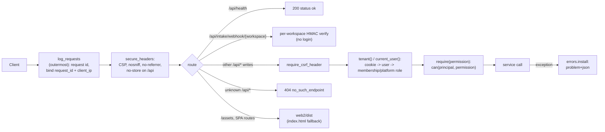

# API

**Code:** `outbound/api/` (`app.py`, `auth.py`, `deps.py`, `errors.py`, `request_log.py`, `schemas.py`, `routers/`) · **Layer:** entry point · **Tests:** `tests/api/`

## Purpose

The API is the web app's back end and the door for the per-workspace signed intake webhook. It authenticates a person (not an operator — Phase 6b replaced the single shared login with real accounts), resolves which workspace they're acting in and as what role, protects writes against cross-site requests, turns HTTP into service calls, and turns domain errors into stable problem-details responses. It never runs the pipeline inside a request: it queues a run for the worker. It also serves the built web app, so production is one HTTP process.

## Responsibilities

- The app factory: middleware, security headers, routers, the static web app.
- Sign-in, session cookies, the login throttle, the CSRF header check, and resolving a request to a workspace and a permission ([identity and access](identity-and-access.md)).
- Request and response models (Pydantic) and the OpenAPI document the web client is generated from.
- Mapping exceptions to RFC 9457 problem details with stable codes.
- One request id per request, bound to every log line.

**Not its job:**

- business rules and refusals ([services](services.md));
- running the pipeline ([runner and worker](runner-and-worker.md));
- the permission model itself, which lives in `outbound/domain/permissions.py` ([identity and access](identity-and-access.md)) — a router only names which `Permission` it needs.

## Public interface

| Symbol | Kind | What it does |
|---|---|---|
| `outbound/api/app.py::create_app` | function | `create_app(services, web_dist=WEB_DIST, email=None) → FastAPI` (the test entry point; `services` may be a prebuilt `Services` or a per-request `ServicesFactory`) |
| `outbound/api/app.py::create_app_from_container` | function | Production factory: wires the real pipeline (search/writer if configured), the admin/vendor/directory/identity services from the container's three units of work |
| `outbound/api/deps.py::current_user`, `tenant`, `require`, `require_platform`, `services` | dependencies | Resolve a session cookie to a user, a user+workspace to a `Principal`, and gate a route on exactly one `Permission` — see [identity and access](identity-and-access.md) |
| `outbound/api/auth.py::session_token`, `set_session`, `clear_session`, `LoginThrottle`, `require_csrf_header` | — | Cookie plumbing and CSRF |
| `outbound/api/errors.py::install` | function | Registers the exception handlers |
| `outbound/api/request_log.py::log_requests` | middleware | Request id, context binding, one log line per request |
| `outbound/api/schemas.py` | models | `In` (`extra="forbid"`, strings ≤ 10,000 characters) and `Out` (`from_attributes`) bases |

The endpoints are listed in the [API reference](../api/api-reference.md); the contract rules are in [API conventions](../api/api-conventions.md).

## How it works

### Request pipeline



`secure_headers` is registered first, so it runs inside `log_requests`. The catch-all `Exception` handler runs outside both, so a **500 response does not carry the security headers** ([R-17](../tech-debt-and-risks.md#r-17--p3--api-a-500-response-lacks-the-security-headers)).

### Routers

All routers are in `outbound/api/routers/`, registered under one `X-Requested-With` CSRF dependency (`webhook.py` is the one router registered without it, since its own HMAC signature is the write guard). "Permission" means whichever `Permission` the route declares via `require()`/`require_platform()` ([identity and access](identity-and-access.md)) — every tenant route must declare exactly one, checked by a test.

| Router | Scope | Calls |
|---|---|---|
| `auth.py` | Sign-in, sign-up, invites, resets, me, sessions | `IdentityService` |
| `team.py` | Memberships: invite, role change, remove | `IdentityService` |
| `admin.py` | Platform admin: customers, plans, credits, access, people, settings, audit | `AdminService` — `require_platform` only |
| `mailboxes.py` | Connect, check, disconnect a workspace's mailbox; OAuth callback | `MailboxService` ([mailboxes and OAuth](mailboxes-and-oauth.md)) |
| `integrations.py` | The workspace's intake webhook secret | `SettingsService` |
| `setup.py` | What a new workspace still has to do (`GET /api/setup`) | `WorkspaceSetupService` |
| `usage.py` | Plan & usage, credit banners | `UsageService` ([plans, credits and admin](plans-credits-and-admin.md)) |
| `targets.py` | Discovery and manual intake | `IntakeService`, `LeadService.update` |
| `review.py` | Approve/edit/reject a drafted email | `ReviewService` |
| `leads.py` | Lead CRUD, timeline, directory report/skip, profile upload | `LeadService`, `LeadDirectory` |
| `runs.py` | Queue, cancel, inspect runs and reports | `RunService`, `ReportService` |
| `settings.py` | Country policy, campaigns, workspace profile | `SettingsService` |
| `privacy.py` | Forget, export, delete | `PrivacyService` |
| `webhook.py` | The signed intake webhook, per workspace | `WebhookService` — HMAC only, no session |
| `app.py` | `GET /api/health` (open), `GET /api/openapi.json` (signed-in, not in the schema) | — |

That is about 147 operations on 130 paths (`web2/openapi.json`), up from 59 on 48 before the SaaS transformation — the growth is almost entirely `admin.py` (platform console), `mailboxes.py`, `team.py`, `usage.py` and `setup.py`, all new in Phase 6.

### Authentication and CSRF

- **Accounts, not one shared operator.** Password hashing, sign-up, invites and resets are `IdentityService`'s job; the API only reads/writes the session cookie and enforces the permission the route declares. See [identity and access](identity-and-access.md) for the full mechanism.
- **Session:** a random token, hashed (SHA-256) and stored as a revocable `sessions` row — not signed-stateless any more ([ADR 0026](../adr/0026-revocable-sessions-and-fixed-permission-model.md), superseding [ADR 0013](../adr/0013-single-operator-signed-sessions.md)). The cookie is `__Host-outbound_session` when `COOKIE_SECURE`, else the unprefixed `outbound_session`; `HttpOnly`, `SameSite=Strict`. Signing out, or an admin revoking a session, takes effect on the very next request.
- **Workspace resolution:** `/w/{slug}` is resolved to a `workspace_id` in the browser; the SPA sends it as `X-Workspace-Id`. The server reasons only about the id.
- **Throttle:** 5 failed logins per 60 seconds per client address, in memory, per process — unchanged in mechanism from Phase 3b, now gating real account sign-in rather than the one shared password. The client address is uvicorn's, which trusts `X-Forwarded-For` from `FORWARDED_ALLOW_IPS` (`*` in production, safe because the port is loopback-only behind the proxy).
- **CSRF:** every method other than GET, HEAD and OPTIONS needs an `X-Requested-With` header (`403 missing_header`). A cross-site form cannot set it, and `SameSite=Strict` is a second layer. There is no CORS middleware, so browsers keep the same-origin default.
- **The intake webhook** is signed per workspace (each workspace has its own secret, set in Settings → Integrations), not a single platform-wide `INTAKE_WEBHOOK_SECRET` any more.

### Headers and static files

- **Every response** (except a 500, R-17) carries:
  - `Content-Security-Policy: default-src 'self'; img-src 'self' data:; frame-ancestors 'none'; object-src 'none'; base-uri 'none'; form-action 'self'`;
  - `X-Content-Type-Options: nosniff`;
  - `Referrer-Policy: no-referrer`.
- **`/api/*` responses** also get `Cache-Control: no-store`.
- **No API docs.** FastAPI's Swagger UI and ReDoc are switched off, because they would load scripts from a CDN the CSP forbids. The OpenAPI document is served only to a signed-in person.
- **Static files.** If `web2/dist/index.html` exists, `/assets` is served as static files, and any other non-API path returns the file if it exists inside `dist` (`_file_inside` blocks traversal and dotfiles), else `index.html`. An `/api/...` path the router does not know returns `404 no_such_endpoint` with a hint to restart `serve` and the worker after an upgrade.

### Errors

`errors.install` maps exceptions to `application/problem+json` with `type: urn:outbound:<code>`, `title: <code>`, `status`, `detail`, `code` and extra fields:

| Exception | Status, code |
|---|---|
| `NotFound` | 404 `not_found` |
| `ConcurrencyConflict` | 409 `version_conflict` |
| `LeadError`, `ReviewError`, `IllegalTransition` | 409 `action_not_allowed` |
| `SettingsError`, `InvalidInput` | 422 `invalid_request` |
| `RequestValidationError` | 422 `validation_failed` with `errors: [{field, message}]` |
| Unauthenticated (no/expired/revoked session) | 401 `unauthenticated` |
| Lacking the route's permission | 403 `forbidden` |
| A non-member, non-superadmin workspace request | 404 `not_found` (deliberately, not 403 — see [identity and access](identity-and-access.md)) |
| Access lapsed / workspace locked | 403 `access_lapsed` ([plans, credits and admin](plans-credits-and-admin.md)) |
| A once-per-lead step with no credit left | 402-shaped `credit_exhausted` |
| Any other exception | 500 `internal_error`: no detail, a reference (the request id), and the `X-Request-ID` header; logged as `unhandled_error` |

Routers raise the remaining codes directly. The full list is in [API conventions](../api/api-conventions.md).

### Request logging

`log_requests`:

- keeps a caller's `X-Request-ID` if it matches `^[A-Za-z0-9._-]{8,64}$`, else makes one, and echoes it back;
- binds `request_id` and `client_ip`;
- logs one `http_request` line with the route template (never the query string), status and duration;
- uses DEBUG for successful requests to `/api/health`, `/api/status` and `/assets`, ERROR for 5xx, WARNING for 4xx, and INFO otherwise.

## Invariants

- No tenant route reaches a service without the one `Permission` it declares, checked (`can()`) against the resolved `Principal`.
- No write is accepted without the CSRF header.
- An error response never contains a stack trace or internal detail.
- The API never executes the pipeline.
- A non-member's request for a workspace they cannot view returns 404, never 403.

## Errors and failure behaviour

A database outage makes every request a 500 with a reference. `/api/health` still answers 200, because it does not touch the database ([R-06](../tech-debt-and-risks.md#r-06--p1--operations-health-checks-do-not-see-a-broken-worker-or-database)).

## Transactions and concurrency

One uvicorn process. Handlers are synchronous and run in its thread pool, except the webhook and the upload. Each service call opens its own unit of work (tenant, platform or identity, as appropriate — [persistence](persistence.md)). Write endpoints that edit a lead or a message take a `row_version` and answer 409 on conflict.

## Configuration

`SECRETS_KEYS`, `APP_BASE_URL`, `SUPERADMIN_ENABLED`, `TERMS_VERSION`, `EMAIL_FROM`/`SMTP_*`, `COOKIE_SECURE`, `API_HOST`, `API_PORT`, `FORWARDED_ALLOW_IPS`, `MICROSOFT_CLIENT_ID`/`_SECRET`, `GOOGLE_CLIENT_ID`/`_SECRET`. `OPERATOR_PASSWORD_HASH`, `SESSION_SECRET`, `WORKSPACE_NAME` and `INTAKE_WEBHOOK_SECRET` no longer exist — see [configuration and bootstrap](configuration-and-bootstrap.md) and the [configuration reference](../operations/configuration-reference.md) for the full field list. `outbound serve` refuses a non-loopback host unless `COOKIE_SECURE` is set.

## Observability

`http_request`, `unhandled_error`, `login_throttled`, `login_failed`, `login_succeeded`, `session_revoked`, `invite_sent`, `mailbox_connected`, `mailbox_reconnect_needed`, `directory_reported`, `inbound_handled`. See [observability](../operations/observability.md).

## Security and privacy

See the [threat model](../security/threat-model.md) and the [ASVS checklist](../security/asvs-l1-checklist.md). Known gaps:

- an in-memory, per-process login throttle ([R-13](../tech-debt-and-risks.md#r-13--p2--security-session-and-login-hardening), partially closed — session revocation itself is now solved by [ADR 0026](../adr/0026-revocable-sessions-and-fixed-permission-model.md); the throttle's per-process scope remains);
- client IPs logged ([R-14](../tech-debt-and-risks.md#r-14--p2--privacy-personal-data-in-logs));
- headers missing on 500 ([R-17](../tech-debt-and-risks.md#r-17--p3--api-a-500-response-lacks-the-security-headers));
- the Microsoft/Google OAuth apps are not yet verified/published with either platform ([mailboxes and OAuth](mailboxes-and-oauth.md#known-limitations)).

## Tests

| File | Proves |
|---|---|
| `tests/api/test_auth.py` | Sign-in, sign-up, throttle, cookie flags, session revocation taking effect immediately, CSRF header enforcement |
| `tests/api/test_routes_declare_permission.py` | Every tenant route declares exactly one `Permission` |
| `tests/api/test_security.py` | No file outside `web2/dist` (including the encoded `..%2f` case); no hidden files; headers on pages and on a 401; webhook size limit; a 500 with no internal detail; `serve` refuses a network bind without secure cookies; unknown API paths |
| `tests/api/test_endpoints.py` | Every endpoint against the services, including the 409 conflict |
| `tests/api/test_gate.py` | The whole loop through the API with a real worker; a cancelled queued run never executes; a failing run is recorded and the worker carries on |
| `tests/api/test_request_logging.py` | Request ids, levels, no query strings in logs |

## Planned

- Reply and follow-up endpoints build on the [inbox and opt-outs](inbox-and-opt-outs.md) groundwork landed in Phase 4a: [phase-4-close-the-loop.md](../../phases/phase-4-close-the-loop.md).
- OAuth app verification with Microsoft and Google is tracked in the [tech-debt register](../tech-debt-and-risks.md).

## How to refresh this page

```bash
grep -n "@router\.\(get\|post\|put\|patch\|delete\)" outbound/api/routers/*.py | wc -l
jq '[.paths[] | keys[]] | length' web2/openapi.json; jq '.paths | length' web2/openapi.json
grep -n "exception_handler\|code=" outbound/api/errors.py
grep -n "def require\|def require_platform\|def tenant\|def current_user" outbound/api/deps.py
uv run pytest tests/api -q
```
