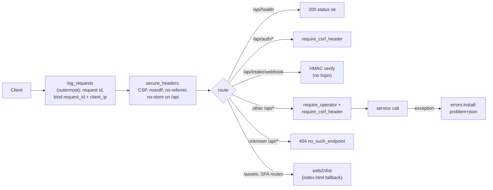

# API

**Code:** `outbound/api/` (`app.py`, `auth.py`, `deps.py`, `errors.py`, `request_log.py`, `schemas.py`, `routers/`) · **Layer:** entry point · **Tests:** `tests/api/`

## Purpose

The API is the web app's back end and the door for the signed intake webhook. It authenticates the operator, protects writes against cross-site requests, turns HTTP into service calls, and turns domain errors into stable problem-details responses. It never runs the pipeline inside a request: it queues a run for the worker. It also serves the built web app, so production is one HTTP process.

## Responsibilities

- The app factory: middleware, security headers, routers, the static web app.
- Operator login, session cookies, the login throttle, the CSRF header check.
- Request and response models (Pydantic) and the OpenAPI document the web client is generated from.
- Mapping exceptions to RFC 9457 problem details with stable codes.
- One request id per request, bound to every log line.

**Not its job:**

- business rules and refusals ([services](services.md));
- running the pipeline ([runner and worker](runner-and-worker.md)).

## Public interface

| Symbol | Kind | What it does |
|---|---|---|
| `outbound/api/app.py::create_app` | function | `create_app(services, web_dist=WEB_DIST) → FastAPI` (the test entry point) |
| `outbound/api/app.py::create_app_from_container` | function | Production factory: requires `OPERATOR_PASSWORD_HASH` and `SESSION_SECRET`, binds the workspace from `WORKSPACE_NAME`, wires the metered search (if Tavily is configured) and the mailbox (if IMAP is configured) |
| `outbound/api/deps.py::Services`, `build_services` | dataclass, function | Every service, bound to one workspace |
| `outbound/api/auth.py::Sessions`, `LoginThrottle`, `require_operator`, `require_csrf_header` | — | Authentication and CSRF |
| `outbound/api/errors.py::install` | function | Registers the exception handlers |
| `outbound/api/request_log.py::log_requests` | middleware | Request id, context binding, one log line per request |
| `outbound/api/schemas.py` | models | `In` (`extra="forbid"`, strings ≤ 10,000 characters) and `Out` (`from_attributes`) bases, and about 56 wire models |

The endpoints are listed in the [API reference](../api/api-reference.md); the contract rules are in [API conventions](../api/api-conventions.md).

## How it works

### Request pipeline



`secure_headers` is registered first, so it runs inside `log_requests`. The catch-all `Exception` handler runs outside both, so a **500 response does not carry the security headers** ([R-17](../tech-debt-and-risks.md#r-17--p3--api-a-500-response-lacks-the-security-headers)).

### Routers

All routers are in `outbound/api/routers/`. "Login" means `require_operator`; "CSRF" means `require_csrf_header` on writes.

| Router | Operations | Guard | Calls |
|---|---|---|---|
| `auth.py` | 3 (login, logout, me) | CSRF | `Sessions`, `LoginThrottle` |
| `webhook.py` | 1 | HMAC signature | `WebhookService` |
| `targets.py` | 5 | login + CSRF | `IntakeService`, `LeadService.update` |
| `review.py` | 4 | login + CSRF | `ReviewService` |
| `leads.py` | 19 | login + CSRF | `LeadService` |
| `runs.py` | 7 | login + CSRF | `RunService`, `ReportService` |
| `settings.py` | 15 | login + CSRF | `SettingsService` |
| `privacy.py` | 4 | login + CSRF | `PrivacyService` |
| `app.py` | `GET /api/health` (open), `GET /api/openapi.json` (login, not in the schema) | — | — |

That is 59 operations on 48 paths, matching `web2/openapi.json`.

### Authentication and CSRF

- **Password:** Argon2 (`argon2-cffi` defaults), checked against `OPERATOR_PASSWORD_HASH` ([ADR 0013](../adr/0013-single-operator-signed-sessions.md)).
- **Session:** the cookie `outbound_session`, signed with `itsdangerous` (`SESSION_SECRET`, at least 16 characters, salt `outbound-session`), valid for `SESSION_HOURS` (12). Flags: `HttpOnly`, `SameSite=Strict`, `Secure` when `COOKIE_SECURE`. Sessions are stateless: logout deletes the cookie, but a copied token stays valid until it expires ([R-13](../tech-debt-and-risks.md#r-13--p2--security-session-and-login-hardening)).
- **Throttle:** 5 failed logins per 60 seconds per client address, in memory, per process. The client address is uvicorn's, which trusts `X-Forwarded-For` from `FORWARDED_ALLOW_IPS` (`*` in production, safe because the port is loopback-only behind the proxy).
- **CSRF:** every method other than GET, HEAD and OPTIONS needs an `X-Requested-With` header (`403 missing_header`). A cross-site form cannot set it, and `SameSite=Strict` is a second layer. There is no CORS middleware, so browsers keep the same-origin default.

### Headers and static files

- **Every response** (except a 500, R-17) carries:
  - `Content-Security-Policy: default-src 'self'; img-src 'self' data:; frame-ancestors 'none'; object-src 'none'; base-uri 'none'; form-action 'self'`;
  - `X-Content-Type-Options: nosniff`;
  - `Referrer-Policy: no-referrer`.
- **`/api/*` responses** also get `Cache-Control: no-store`.
- **No API docs.** FastAPI's Swagger UI and ReDoc are switched off, because they would load scripts from a CDN the CSP forbids. The OpenAPI document is served only to a logged-in operator.
- **Static files.** If `web2/dist/index.html` exists, `/assets` is served as static files, and any other non-API path returns the file if it exists inside `dist` (`_file_inside` blocks traversal and dotfiles), else `index.html`. An `/api/...` path the router does not know returns `404 no_such_endpoint` with a hint to restart `serve` and the worker after an upgrade.

### Errors

`errors.install` maps exceptions to `application/problem+json` with `type: urn:outbound:<code>`, `title: <code>`, `status`, `detail`, `code` and extra fields:

| Exception | Status, code |
|---|---|
| `NotFound` | 404 `not_found` |
| `ConcurrencyConflict` | 409 `version_conflict` |
| `LeadError`, `ReviewError`, `IllegalTransition` | 409 `action_not_allowed` |
| `SettingsError`, `InvalidInput` | 422 `invalid_request` |
| `RequestValidationError` | 422 `validation_failed` with `errors: [{field, message}]` |
| Any other exception | 500 `internal_error`: no detail, a reference (the request id), and the `X-Request-ID` header; logged as `unhandled_error` |

Routers raise the remaining codes directly. The full list of 18 is in [API conventions](../api/api-conventions.md).

### Request logging

`log_requests`:

- keeps a caller's `X-Request-ID` if it matches `^[A-Za-z0-9._-]{8,64}$`, else makes one, and echoes it back;
- binds `request_id` and `client_ip`;
- logs one `http_request` line with the route template (never the query string), status and duration;
- uses DEBUG for successful requests to `/api/health`, `/api/status` and `/assets`, ERROR for 5xx, WARNING for 4xx, and INFO otherwise.

## Invariants

- No route reaches a service without the guard its router declares.
- No write is accepted without the CSRF header.
- An error response never contains a stack trace or internal detail.
- The API never executes the pipeline.

## Errors and failure behaviour

A database outage makes every request a 500 with a reference. `/api/health` still answers 200, because it does not touch the database ([R-06](../tech-debt-and-risks.md#r-06--p1--operations-health-checks-do-not-see-a-broken-worker-or-database)).

## Transactions and concurrency

One uvicorn process. Handlers are synchronous and run in its thread pool, except the webhook and the upload. Each service call opens its own unit of work. Write endpoints that edit a lead or a message take a `row_version` and answer 409 on conflict.

## Configuration

`OPERATOR_PASSWORD_HASH`, `SESSION_SECRET`, `SESSION_HOURS`, `COOKIE_SECURE`, `INTAKE_WEBHOOK_SECRET`, `API_HOST`, `API_PORT`, `FORWARDED_ALLOW_IPS`, `WORKSPACE_NAME`. `outbound serve` refuses a non-loopback host unless `COOKIE_SECURE` is set. See the [configuration reference](../operations/configuration-reference.md).

## Observability

`http_request`, `unhandled_error`, `login_throttled`, `login_failed`, `login_succeeded`, `service_started` (`role=api`). See [observability](../operations/observability.md).

## Security and privacy

See the [threat model](../security/threat-model.md) and the [ASVS checklist](../security/asvs-l1-checklist.md). Known gaps:

- no session revocation, no HSTS, an in-memory throttle ([R-13](../tech-debt-and-risks.md#r-13--p2--security-session-and-login-hardening));
- client IPs logged ([R-14](../tech-debt-and-risks.md#r-14--p2--privacy-personal-data-in-logs));
- headers missing on 500 ([R-17](../tech-debt-and-risks.md#r-17--p3--api-a-500-response-lacks-the-security-headers));
- an incomplete OpenAPI document ([R-18](../tech-debt-and-risks.md#r-18--p3--api-the-openapi-document-is-incomplete)).

## Tests

| File | Proves |
|---|---|
| `tests/api/test_auth_and_errors.py` | Login, logout, throttle, cookie flags, every error shape |
| `tests/api/test_security.py` | No file outside `web2/dist` (including the encoded `..%2f` case fixed in Phase 3b); no hidden files; headers on pages and on a 401; webhook size limit; a 500 with no internal detail; `serve` refuses a network bind without secure cookies; unknown API paths |
| `tests/api/test_endpoints.py` | Every endpoint against the services, including the 409 conflict |
| `tests/api/test_gate.py` | The whole loop through the API with a real worker; a cancelled queued run never executes; a failing run is recorded and the worker carries on |
| `tests/api/test_request_logging.py` | Request ids, levels, no query strings in logs |

## Planned

- Phase 4 adds reply and follow-up endpoints: [phase-4-close-the-loop.md](../../phases/phase-4-close-the-loop.md).
- Phase 6 replaces the single-operator login with Supabase auth and workspace membership: [phase-6-saas-ready.md](../../phases/phase-6-saas-ready.md).

## How to refresh this page

```bash
grep -n "@router\.\(get\|post\|put\|patch\|delete\)" outbound/api/routers/*.py | wc -l
jq '[.paths[] | keys[]] | length' web2/openapi.json; jq '.paths | length' web2/openapi.json
grep -n "exception_handler\|code=" outbound/api/errors.py
uv run pytest tests/api -q
```
