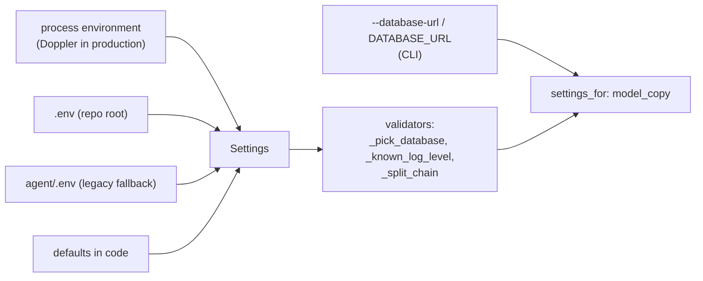

# Configuration and bootstrap

**Code:** `outbound/config.py`, `outbound/bootstrap.py`, `outbound/pipeline.py` · **Layer:** outside the layers (configuration and composition root) plus `pipeline` (wiring) · **Tests:** `tests/test_config.py`, `tests/db/test_session.py`, `tests/db/test_robustness.py`, `tests/test_cli.py`

## Purpose

This is where a process gets its settings and builds its objects. Settings come from the environment only; secrets never live in code. One composition root builds three database engines (owner/migrate, tenant, platform) and their unit-of-work factories, plus the `Keyring` that seals and opens per-workspace mailbox and vendor credentials. `pipeline.assemble` wraps every vendor in its meter and builds the stages, jobs and services for one workspace. Nothing else constructs these objects, so there are no hidden globals, and tests build the same graph with fakes ([ADR 0001](../adr/0001-modular-monolith.md)).

## Responsibilities

- **Load and validate settings**, deciding the three database URLs ([tenancy and isolation](tenancy-and-isolation.md#three-connections)).
- **Build the `Container`** (settings, engine, `uow`, `platform`, `identity` unit-of-work factories, `Keyring`), and resolve a workspace name with a helpful error.
- **Build the real providers** from settings, or report what is missing.
- **Build the meter** with prices and caps, the metered providers (including the shared [lead directory](lead-directory.md) as the free first finder), and the stages and jobs that the configured vendors and connected mailboxes allow.
- **Execute a run request** (discovery, then the pipeline) for the CLI and the worker.

**Not its job:** the list of every setting, which is in the [configuration reference](../operations/configuration-reference.md); a workspace's own entitlements and credit limits, read separately by the runner's guards ([plans, credits and admin](plans-credits-and-admin.md)).

## Public interface

| Symbol | Kind | What it does |
|---|---|---|
| `outbound/config.py::Settings` | pydantic-settings model | 58 fields, 17 of them `SecretStr` |
| `outbound/bootstrap.py::Container` | dataclass | `settings`, `engine`, `uow` (tenant `UnitOfWorkFactory`), `platform` (`PlatformUnitOfWorkFactory`), `identity` (`IdentityUnitOfWorkFactory`) |
| `outbound/bootstrap.py::build_container` | function | `Settings` → `Container`, building the tenant and platform engines (the same engine when `PLATFORM_DATABASE_URL` is unset) and the `Keyring` from `SECRETS_KEYS` |
| `outbound/bootstrap.py::Container.workspace_id` | method | Name → id, resolved through `container.platform()`. Raises `ConfigurationError` with the commands to run if the database is not migrated or seeded |
| `outbound/pipeline.py::real_providers` | function | `Providers` from settings. A missing required key raises `NotConfigured` naming it; no resolver is allowed |
| `outbound/pipeline.py::build_meter` | function | The one way to get a `Meter`: merged prices, monthly caps, the workspace's per-prospect ceiling |
| `outbound/pipeline.py::assemble` | function | `(container, workspace_id, providers) → Pipeline` (runner, tick, review, runs, intake, meter, search, stage names, `has_mailbox`) — always for **one** workspace; the worker calls it fresh per job |
| `outbound/pipeline.py::mailboxes_for` | function | The workspace's own connected mailboxes (`StoredMailboxes`, DB-backed, OAuth-refreshed), or a test/script's injected single mailbox |
| `outbound/pipeline.py::execute_run` | function | Discovery unless `mode` is `manual`, then `runner.run_pipeline` |
| `outbound/pipeline.py::discover_companies` | function | Search for companies that fit the campaign and add them through intake |
| `outbound/pipeline.py::metered_search_or_none` | function | Tavily behind the meter, or `None` without a key (the API's intake) |

## How settings load



**Precedence, highest first:**

1. The process environment. In production this is what `doppler run` injects, plus the compose `environment:` values; Doppler wins on a clash ([R-11](../tech-debt-and-risks.md#r-11--p2--configuration-doppler-overrides-compose-not-the-other-way-round)).
2. `agent/.env`, then `.env`. With several env files, pydantic-settings gives priority to the later file, so the legacy `agent/.env` overrides the root `.env`. It no longer exists, but the fallback is still read, despite the code comment saying to drop it in Phase 2 ([R-19](../tech-debt-and-risks.md#r-19--p3--housekeeping-stale-references-and-inconsistent-versions)).
3. The defaults in code.

Unknown variables are ignored (`extra="ignore"`). In the container, `.dockerignore` excludes every `.env*`, so only the environment applies. The CLI's `--database-url`, or `DATABASE_URL`, is applied last.

**Validators:**

- **`_pick_database`:**
  - an explicit `database_url` wins;
  - otherwise `DATABASE_BACKEND=sqlite` gives `sqlite:///<SQLITE_PATH>`;
  - otherwise `postgres` uses `POSTGRES_URL`;
  - if `postgres` is chosen and `POSTGRES_URL` is empty, start-up fails with "DATABASE_BACKEND is postgres but POSTGRES_URL is not set".
- **`_known_log_level`:** upper-cases the level and refuses unknown ones.
- **`_split_chain`:** reads `FINDER_CHAIN=hunter,zerobounce` as a list.

**Secrets** are `SecretStr`. They print as `**********` and are unwrapped only where they are used: the registry building an adapter, `Keyring.from_setting` unwrapping `SECRETS_KEYS` once at bootstrap, the pipeline checking the Tavily key. `POSTGRES_URL`/`POSTGRES_PLATFORM_URL`/`POSTGRES_MIGRATE_URL` and `DATABASE_URL`/`PLATFORM_DATABASE_URL`/`MIGRATE_DATABASE_URL` are plain strings, since they hold a password; they are logged only through SQLAlchemy's `render_as_string(hide_password=True)`. `OPERATOR_PASSWORD_HASH` and `SESSION_SECRET` no longer exist — Phase 6b replaced them with per-account passwords and revocable sessions ([identity and access](identity-and-access.md)).

**Checks at start-up, outside `Settings`:**

- `serve`/`worker` run `outbound/db/isolation.py::isolation_problems` and refuse to start in production on an unsafe database role or exposed Data API grant ([tenancy and isolation](tenancy-and-isolation.md)).
- `serve` refuses a non-loopback host without `COOKIE_SECURE`.
- The worker needs every provider in the chain configured; a workspace's own mailbox (if any) is read from the database, not from a start-up setting, so a missing mailbox no longer stops the worker — it just means that workspace has no deliver stage until one is connected.

## How the pipeline is assembled

`assemble(container, workspace_id, providers)` — called fresh for **one** workspace, every time the worker picks up a job for it (the runner keeps per-run state, so pipelines are not cached across workspaces or across runs):

1. Reads the workspace, and builds `BudgetPolicy.live_from(MONTHLY_CAPS_MICRO_USD)` and the meter (`DEFAULT_PRICES` merged with `PROVIDER_PRICES`).
2. Wraps every vendor:
   - `MeteredSearch`;
   - `MeteredLlm` (`DEFAULT_LLM_PRICES` merged with `LLM_PRICES`; a separate `MeteredLlm` for `LLM_COPY_MODEL` if set, else the same instance is reused for research and copy);
   - `MeteredRegistry` (if Companies House is configured);
   - the shared [lead directory](lead-directory.md) as the first finder, always, wrapped with `ttl=None` (never cached — every lookup is its own ledger row, `billed=False`, so hit rate and savings can be read back exactly), then one `MeteredFinder` per configured vendor finder;
   - `MeteredVerifier`;
   - `MeteredResolver` (if a resolver is configured).
3. Builds the stages: `Research`, `Gate`, `Contacts`, `Email`, `Copy`, and `Deliver` **only if the workspace has at least one connected mailbox** (`mailboxes_for`/`_any_mailbox` — read from the `mailboxes` table, not a setting).
4. Builds the jobs: `CatchAllPoller` **only with a resolver**; with a mailbox, also `SentSync`, `InboxSync` ([inbox and opt-outs](inbox-and-opt-outs.md)), and `MailboxHealth` (only for `StoredMailboxes`, the real per-workspace case, not a test's injected single mailbox). `ResumeService` is always inserted first in the tick's job list, so a credit that appeared since the last tick (a new billing period, an admin's grant) releases leads waiting on it *before* that same tick's pipeline pass looks for work ([plans, credits and admin](plans-credits-and-admin.md)).
5. Builds `Runner(…, Guards(budget))`, `Tick`, `ReviewService`, `RunService`, `IntakeService`.

| Missing | Effect |
|---|---|
| Tavily or LLM key, or a finder or verifier in the chain | `NotConfigured`: the worker and `run` stop with the name |
| Resolver | Catch-all addresses are held as `catch_all_unverified` |
| Companies House key | UK incorporation from site markers only |
| No mailbox connected for this workspace | No deliver stage, no Sent/inbox sync, no mailbox health job; leads stop at `approved` until one is connected |
| No entitlement credit left for a step | The lead waits (not failed); `ResumeService` releases it once credit returns |

Tests build the same pipeline with `tests/stages/world.py::World.providers()` in place of `real_providers`.

## Invariants

- Nothing reads settings or creates an engine except `build_container` (and `Settings()` in the CLI's `settings_for`).
- No stage receives an unmetered vendor.
- A missing key fails when the process starts, with the provider's name, not at the first call.

## Configuration

All of it. Each setting's name, type, default, whether it is secret, and where it is set: [configuration reference](../operations/configuration-reference.md).

## Observability

`service_started` (from `serve` and `worker`) logs the role and the database URL with the password hidden — no longer a single workspace name, since both now serve every active workspace. The `environment` setting is printed on every log line.

## Security and privacy

See [secrets management](../security/secrets-management.md) and [tenancy and isolation](tenancy-and-isolation.md).

- Secrets come only from the environment and `.env`, which is git-ignored and scanned by gitleaks.
- In production they come from Doppler.
- `SECRETS_KEYS` is unwrapped once, at bootstrap, into the `Keyring` every `UnitOfWork` carries — never re-read per call.

## Tests

| File | Proves |
|---|---|
| `tests/test_config.py` | The database switch: SQLite by default, Postgres and back, Postgres without a URL refused, an explicit URL wins |
| `tests/db/test_session.py` | URL normalising and pool settings |
| `tests/db/test_robustness.py` | Every path metered; a meter for a missing workspace says what is wrong |
| `tests/test_cli.py` | A database not set up, or not seeded, gives the commands to run |
| `tests/conftest.py` | Every test clears provider variables and ignores `.env`, so an exported key never changes a result |

## Known limitations

- The `agent/.env` fallback is still read ([R-19](../tech-debt-and-risks.md#r-19--p3--housekeeping-stale-references-and-inconsistent-versions)).
- `WORKSPACE_NAME`/`--workspace` no longer exist for `serve`/`worker` (both now serve every active workspace), which closes the earlier risk of the two binding to different single workspaces ([R-22](../tech-debt-and-risks.md#r-22--p3--configuration-the-api-and-the-worker-can-bind-to-different-workspaces), now closed) — a workspace mismatch is simply not possible any more at this layer.
- The budget is read once per `assemble()` call — now once per *job*, since the worker reassembles the pipeline for every piece of work rather than once per process, narrowing (though not eliminating) the earlier "budget change invisible to a running process" gap ([R-10](../tech-debt-and-risks.md#r-10--p1--budget-a-running-worker-does-not-see-budget-changes-b4)).
- `PLATFORM_DATABASE_URL` falling back to `DATABASE_URL` when unset is correct for SQLite and single-role rehearsal, but would misconfigure the scheduler's role in production if left unset there ([tenancy and isolation](tenancy-and-isolation.md#known-limitations)).
- Two settings name the catch-all resolver: `CATCH_ALL_RESOLVER`, and `catch_all_resolver` in the workspace settings; only the first is used (carried forward from Phase 3b, B9).

## Planned

Usage-based billing integration and a narrower `PLATFORM_DATABASE_URL` default are tracked in the [tech-debt register](../tech-debt-and-risks.md).

## How to refresh this page

```bash
uv run python -c "from outbound.config import Settings as S; f=S.model_fields; print(len(f), sum('SecretStr' in str(v.annotation) for v in f.values()))"
grep -n "def \|stages\|jobs.append" outbound/pipeline.py
uv run pytest tests/test_config.py tests/db/test_session.py -q
```
