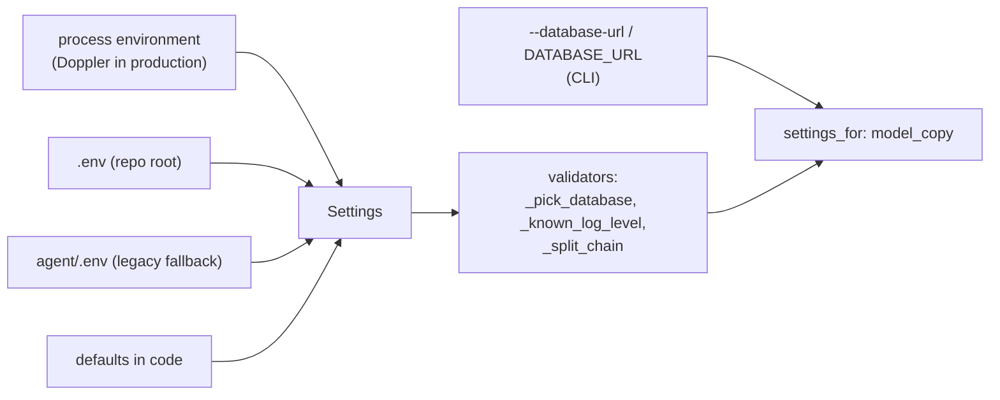

# Configuration and bootstrap

**Code:** `outbound/config.py`, `outbound/bootstrap.py`, `outbound/pipeline.py` · **Layer:** outside the layers (configuration and composition root) plus `pipeline` (wiring) · **Tests:** `tests/test_config.py`, `tests/db/test_session.py`, `tests/db/test_robustness.py`, `tests/test_cli.py`

## Purpose

This is where a process gets its settings and builds its objects. Settings come from the environment only; secrets never live in code. One composition root builds the database engine and the unit-of-work factory. `pipeline.assemble` wraps every vendor in its meter and builds the stages, jobs and services. Nothing else constructs these objects, so there are no hidden globals, and tests build the same graph with fakes ([ADR 0001](../adr/0001-modular-monolith.md)).

## Responsibilities

- **Load and validate settings**, deciding the database URL.
- **Build the `Container`** (settings, engine, unit-of-work factory), and resolve a workspace name with a helpful error.
- **Build the real providers** from settings, or report what is missing.
- **Build the meter** with prices and caps, the metered providers, and the stages and jobs that the configured vendors allow.
- **Execute a run request** (discovery, then the pipeline) for the CLI and the worker.

**Not its job:** the list of every setting, which is in the [configuration reference](../operations/configuration-reference.md).

## Public interface

| Symbol | Kind | What it does |
|---|---|---|
| `outbound/config.py::Settings` | pydantic-settings model | 52 fields, 16 of them `SecretStr` |
| `outbound/bootstrap.py::build_container` | function | `Settings` → `Container(settings, engine, uow)` |
| `outbound/bootstrap.py::Container.workspace_id` | method | Name → id. Raises `ConfigurationError` with the commands to run if the database is not migrated or seeded |
| `outbound/pipeline.py::real_providers` | function | `Providers` from settings. A missing required key raises `NotConfigured` naming it; no resolver or no mailbox is allowed |
| `outbound/pipeline.py::build_meter` | function | The one way to get a `Meter`: merged prices, monthly caps, the workspace's per-prospect ceiling |
| `outbound/pipeline.py::assemble` | function | `(container, workspace_id, providers) → Pipeline` (runner, tick, review, runs, intake, meter, search, stage names, `has_mailbox`) |
| `outbound/pipeline.py::execute_run` | function | Discovery unless `mode` is `manual`, then `runner.run_pipeline` |
| `outbound/pipeline.py::discover_companies` | function | Search for companies that fit the campaign and add them through intake |
| `outbound/pipeline.py::metered_search_or_none` | function | Tavily behind the meter, or `None` without a key (the API's intake) |

## How settings load



**Precedence, highest first:**

1. The process environment. In production this is what `doppler run` injects, plus the compose `environment:` values; Doppler wins on a clash ([R-11](../tech-debt-and-risks.md#r-11--p2--configuration-doppler-overrides-compose-not-the-other-way-round)).
2. `agent/.env`, then `.env`. With several env files, pydantic-settings gives priority to the later file, so the legacy `agent/.env` overrides the root `.env`. It no longer exists, but the fallback is still read, despite the code comment saying to drop it in Phase 2 ([R-19](../tech-debt-and-risks.md#r-19--p3--housekeeping-stale-references-and-inconsistent-versions)).
3. The defaults in code.

Unknown variables are ignored (`extra="ignore"`). In the container, `.dockerignore` excludes every `.env*`, so only the environment applies. The CLI's `--database-url`, or `DATABASE_URL`, is applied last.

**Validators:**

- **`_pick_database`:**
  - an explicit `database_url` wins;
  - otherwise `DATABASE_BACKEND=sqlite` gives `sqlite:///<SQLITE_PATH>`;
  - otherwise `postgres` uses `POSTGRES_URL`;
  - if `postgres` is chosen and `POSTGRES_URL` is empty, start-up fails with "DATABASE_BACKEND is postgres but POSTGRES_URL is not set".
- **`_known_log_level`:** upper-cases the level and refuses unknown ones.
- **`_split_chain`:** reads `FINDER_CHAIN=hunter,zerobounce` as a list.

**Secrets** are `SecretStr`. They print as `**********` and are unwrapped only where they are used: the registry building an adapter, the API reading the session and webhook secrets, the pipeline checking the Tavily key. `POSTGRES_URL`, `DATABASE_URL` and `OPERATOR_PASSWORD_HASH` are plain strings. The first two hold a password, so they are logged only through SQLAlchemy's `render_as_string(hide_password=True)`.

**Checks at start-up, outside `Settings`:**

- `serve` needs `OPERATOR_PASSWORD_HASH` and a `SESSION_SECRET` of at least 16 characters.
- `serve` refuses a non-loopback host without `COOKIE_SECURE`.
- The worker needs every provider in the chain configured.

## How the pipeline is assembled

`assemble(container, workspace_id, providers)`:

1. Reads the workspace, and builds `BudgetPolicy.from_workspace_settings` (per-prospect ceiling plus `MONTHLY_CAPS_MICRO_USD`) and the meter (`DEFAULT_PRICES` merged with `PROVIDER_PRICES`).
2. Wraps every vendor:
   - `MeteredSearch`;
   - `MeteredLlm` (`DEFAULT_LLM_PRICES` merged with `LLM_PRICES`);
   - `MeteredRegistry` (if Companies House is configured);
   - one `MeteredFinder` per finder;
   - `MeteredVerifier`;
   - `MeteredResolver` (if a resolver is configured).
3. Builds the stages: `Research`, `Gate`, `Contacts`, `Email`, `Copy`, and `Deliver` **only if a mailbox is configured**.
4. Builds the jobs: `CatchAllPoller` **only with a resolver**, and `SentSync` **only with a mailbox**.
5. Builds `Runner(…, Guards(budget))`, `Tick`, `ReviewService`, `RunService`, `IntakeService`.

| Missing | Effect |
|---|---|
| Tavily or LLM key, or a finder or verifier in the chain | `NotConfigured`: the worker and `run` stop with the name |
| Resolver | Catch-all addresses are held as `catch_all_unverified` |
| Companies House key | UK incorporation from site markers only |
| IMAP login | No deliver stage and no Sent sync; leads stop at `approved` |

Tests build the same pipeline with `tests/stages/world.py::World.providers()` in place of `real_providers`.

## Invariants

- Nothing reads settings or creates an engine except `build_container` (and `Settings()` in the CLI's `settings_for`).
- No stage receives an unmetered vendor.
- A missing key fails when the process starts, with the provider's name, not at the first call.

## Configuration

All of it. Each setting's name, type, default, whether it is secret, and where it is set: [configuration reference](../operations/configuration-reference.md).

## Observability

`service_started` (from `serve` and `worker`) logs the role, the workspace and the database URL with the password hidden. The `environment` setting is printed on every log line.

## Security and privacy

See [secrets management](../security/secrets-management.md).

- Secrets come only from the environment and `.env`, which is git-ignored and scanned by gitleaks.
- In production they come from Doppler.

## Tests

| File | Proves |
|---|---|
| `tests/test_config.py` | The database switch: SQLite by default, Postgres and back, Postgres without a URL refused, an explicit URL wins |
| `tests/db/test_session.py` | URL normalising and pool settings |
| `tests/db/test_robustness.py` | Every path metered; a meter for a missing workspace says what is wrong |
| `tests/test_cli.py` | A database not set up, or not seeded, gives the commands to run |
| `tests/conftest.py` | Every test clears provider variables and ignores `.env`, so an exported key never changes a result |

## Known limitations

- The `agent/.env` fallback is still read ([R-19](../tech-debt-and-risks.md#r-19--p3--housekeeping-stale-references-and-inconsistent-versions)).
- The API's workspace comes from `WORKSPACE_NAME`, while the CLI's comes from `--workspace` ([R-22](../tech-debt-and-risks.md#r-22--p3--configuration-the-api-and-the-worker-can-bind-to-different-workspaces)).
- The budget is read once at assembly ([R-10](../tech-debt-and-risks.md#r-10--p1--budget-a-running-worker-does-not-see-budget-changes-b4)).
- Two settings name the catch-all resolver: `CATCH_ALL_RESOLVER`, and `catch_all_resolver` in the workspace settings; only the first is used (Phase 3b B9).

## Planned

- Phase 6 reads per-workspace settings and users from the database: [phase-6-saas-ready.md](../../phases/phase-6-saas-ready.md).

## How to refresh this page

```bash
uv run python -c "from outbound.config import Settings as S; f=S.model_fields; print(len(f), sum('SecretStr' in str(v.annotation) for v in f.values()))"
grep -n "def \|stages\|jobs.append" outbound/pipeline.py
uv run pytest tests/test_config.py tests/db/test_session.py -q
```
