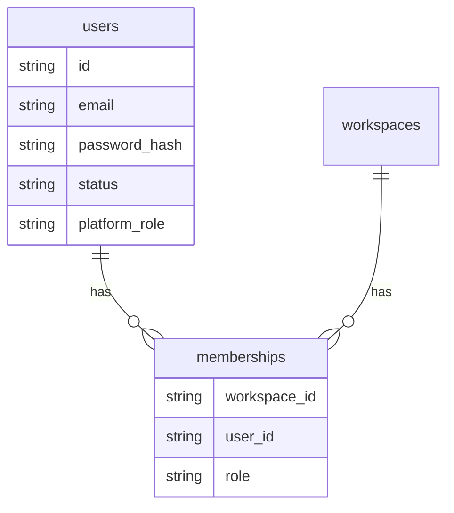
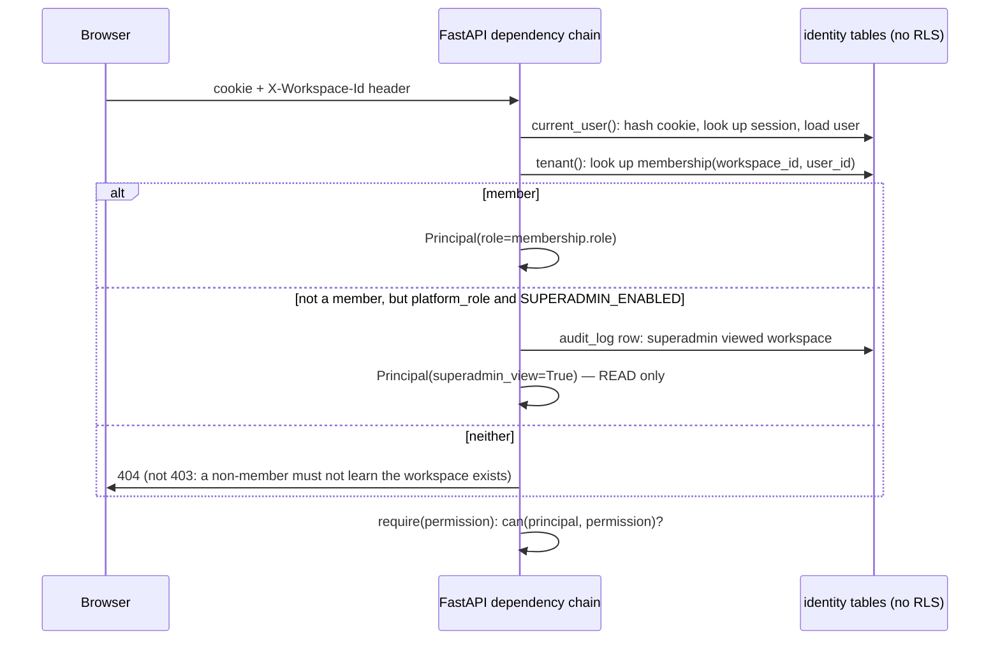

# Identity and access

**Code:** `outbound/db/identity.py`, `outbound/db/models.py` (`UserRow`, `MembershipRow`, `AuthTokenRow`, `SessionRow`, `AuditRow`), `outbound/api/auth.py`, `outbound/api/deps.py`, `outbound/domain/permissions.py`, `outbound/domain/entities.py`, `outbound/services/identity.py` · **Layer:** db → services → api · **Tests:** `tests/services/test_identity.py`, `tests/api/test_auth.py`, `tests/domain/test_permissions.py`

## Purpose

Phase 3b had one operator, one password hash, one stateless signed session. Phase 6b makes the product multi-tenant: a person can belong to several workspaces with a different role in each, needs to be invited, reset a password, and sign out of a device remotely — none of which a stateless session can do. This module is the identity layer underneath multi-tenancy: who a person is, which workspaces they belong to and as what, and how a browser proves it across requests.

## Responsibilities

- Hold people (`users`), their workspace memberships and roles, time-limited email-link tokens (invite, password reset, remove-my-data), revocable sessions, and the audit log.
- Let the API resolve a cookie to a signed-in person and, given a requested workspace, to a `Principal` with a fixed role ([permissions](#permissions-not-roles-you-can-edit)).
- Give the platform's own staff (`PlatformRole`) a path into any workspace for support, read-only, and audited.

**Not its job:** deciding what a role may do with that identity once resolved (that's `Permission`/`can()`, used by every route — see below); isolating one workspace's *data* from another's (`db` row-level security — see [tenancy and isolation](tenancy-and-isolation.md)). Identity tables have no `workspace_id` scoping of their own because they are **platform** tables: a user row is the same row no matter which workspace is asking about it, and a membership row is how a user and a workspace are linked, not data belonging to either alone.

## Public interface

| Symbol | Kind | What it does |
|---|---|---|
| `outbound/db/identity.py::UserRepository` | repository | create, `by_email`, `set_password`, `accept_terms`, `set_status`, `set_platform_role` |
| `outbound/db/identity.py::MembershipRepository` | repository | `add`, `get`, `for_user`, `members(workspace_id)`, `set_role`, `remove` |
| `outbound/db/identity.py::AuthTokenRepository` | repository | `create`, `by_hash`, `use`, `revoke`, `revoke_open(purpose, email)`, `pending_invites` |
| `outbound/db/identity.py::SessionRepository` | repository | `create`, lookup by hash, revoke, list a user's sessions |
| `outbound/api/auth.py::session_token`, `set_session`, `clear_session` | functions | Read/write the session cookie |
| `outbound/api/auth.py::LoginThrottle` | class | In-memory per-client-address failed-attempt window |
| `outbound/api/auth.py::require_csrf_header` | dependency | Refuses any non-GET request without `X-Requested-With` |
| `outbound/api/deps.py::current_user`, `tenant`, `require`, `require_platform` | dependencies | The chain every route goes through |
| `outbound/domain/permissions.py::Permission`, `Principal`, `can()` | domain | The fixed permission model |
| `outbound/services/identity.py::IdentityService` | service | Sign-up, invite, accept, sign-in, sign-out, reset, remove-my-data — the use cases, each writing `audit_log` |

## How it works

### People, memberships and roles



A `UserRow` is global — one email, one password hash, an optional `platform_role` (`admin`/`superadmin`, for platform staff only). A `MembershipRow` is the join: `(workspace_id, user_id, role)` with `role` a `MembershipRole` (`admin`/`member`). The same person can hold `admin` in one workspace and `member` in another, or no membership at all in a third. There is no workspace-level superuser outside this table — an "admin" is just a membership row with `role=admin`.

### Signing in: cookie, hash, and a revocable row

1. `POST /api/auth/login` checks the password (Argon2, via `IdentityService`), and on success calls `SessionRepository.create(user_id, token_hash, expires_at, ip=..., user_agent=...)` — the **hash** of a random token is stored, never the token.
2. `outbound/api/auth.py::set_session` sets the cookie: `httponly`, `samesite=strict`, `path=/`, and named `__Host-outbound_session` when `COOKIE_SECURE` is true (the name itself is part of the `__Host-` contract: no `Domain` attribute, `Secure`, `Path=/`). Over plain HTTP (local development) it falls back to the unprefixed `outbound_session` name, since browsers refuse a `__Host-` cookie without HTTPS.
3. Every request, `current_user` reads the cookie, hashes it the same way, and looks up the still-unexpired, unrevoked session row — so **signing out, or an admin revoking a session, takes effect on the next request**, unlike the Phase 3b signed session that could never be invalidated before its expiry.
4. Every non-GET request must also carry `X-Requested-With` (`require_csrf_header`), which a cross-site form or image tag cannot add — the CSRF defence, replacing nothing (Phase 3b had none, since there was only one operator and no browser-reachable session to forge).

### Resolving a request to a `Principal`



- `/w/{slug}` is resolved to a `workspace_id` **in the browser**, not as a server path parameter; the SPA sends it as `X-Workspace-Id` on every API call. The server only ever reasons about a `workspace_id`, never a slug.
- A superadmin who is not a member sees the workspace **read-only** (`Principal.superadmin_view=True` grants exactly `READ`, never `WORK`), and the first access in a browser session is written to `audit_log` — repeat accesses in the same session are not re-logged, to keep the log to one row per look, not one per click.
- A non-member, non-superadmin request for a workspace gets `404`, not `403`: confirming a workspace's existence to someone outside it is itself a disclosure.

### Permissions, not roles, gate every route

`outbound/domain/permissions.py` is pure domain code (no I/O): a fixed `Permission` enum, two role→permission maps (`ROLE_PERMISSIONS` for `MembershipRole`, `PLATFORM_PERMISSIONS` for `PlatformRole`), and `can(principal, permission, owner_id=None)`. Every API route — tenant or platform — declares exactly one `Permission` through `require()`/`require_platform()` in `outbound/api/deps.py`; a test (`tests/api/test_routes_declare_permission.py`) fails any tenant route that declares none, so a new endpoint cannot ship unreviewed-open.

One permission, `MAILBOXES_OWN`, is owner-checked rather than role-checked: a `member` may manage *their own* connected mailbox (`owner_id == principal.user_id`) but not another member's, while an `admin` holds the broader `MAILBOXES_MANAGE` and can manage anyone's. This is the only permission in the table with that shape — everything else is role-only.

### Tokens: invite, reset, remove-my-data

One table, `auth_tokens`, serves three `AuthTokenPurpose`s with the same shape: a purpose, the target email, a token **hash** (the email link carries the raw token; only the hash is stored), an expiry, and optional `workspace_id`/`role` (set only for an invite, so accepting it creates the right membership). `revoke_open(purpose, email)` retires every still-open token of that purpose for that address before a new one is issued, so a second "forgot password" email invalidates the first link rather than leaving two valid at once. Accepting consumes the token (`use`) rather than deleting the row, so the audit trail of "this address was invited/reset on this date" survives.

### Audit log

`audit_log` (platform table, no RLS) gets one row per: sign-in, sign-out, invite sent/accepted, role changed, member removed, mailbox connected/disconnected, a superadmin's first view of a workspace in a session, workspace deleted. Written in the same transaction as the action it records, through `outbound/services/identity.py`, never by a route handler directly.

## Invariants

- A session row, once revoked or expired, authenticates nothing — checked on every request, not cached.
- A `Principal`'s permissions come only from `ROLE_PERMISSIONS`/`PLATFORM_PERMISSIONS`/`superadmin_view`; there is no per-user permission override.
- A superadmin's cross-workspace view is always read-only; `can()` grants it exactly `READ`, never `WORK` or any workspace-admin permission.
- An `auth_tokens` row of a given purpose and email is revoked before a fresh one of the same purpose and email is issued.
- A non-member's request for a workspace they do not belong to, and are not viewing as superadmin, returns 404.

## Errors and failure behaviour

| Situation | Response |
|---|---|
| No session cookie, or an expired/revoked one | `401`, problem type `unauthenticated` |
| A member of no role matching the permission required | `403`, problem type `forbidden` |
| A non-member, non-superadmin workspace request | `404` (never `403` — see above) |
| 5 failed logins from one client address within 60s | `429` from `LoginThrottle`, independent of which account was tried |
| A write request missing `X-Requested-With` | `403`, `missing_header` |
| An expired or already-used invite/reset token | `410` (gone), not `404` |
| `SUPERADMIN_ENABLED=false` | Every platform-admin route behaves as if no superadmin exists; a platform admin cannot view a workspace at all |

## Transactions and concurrency

Identity writes (session creation, token use, membership changes) are ordinary short transactions through the **platform** session (no `app.workspace_id` is set, and none of these tables carry row-level security). `LoginThrottle` is in-process memory, not the database — correct for the one-API-process-behind-one-proxy deployment today, but it resets on restart and does not share state across horizontally scaled API processes; flagged in [capacity and limits](../operations/capacity-and-limits.md).

## Configuration

`SECRETS_KEYS` (wraps mailbox/vendor credentials, not sessions — session tokens are hashed, not encrypted, so there is nothing to decrypt), `APP_BASE_URL` (the host invite/reset links point to), `SUPERADMIN_ENABLED`, `TERMS_VERSION`, `COOKIE_SECURE`, `EMAIL_FROM`/`SMTP_*` (how invite/reset mail is sent — blank `SMTP_HOST` logs the message instead of sending it, used in development). See [configuration reference](../operations/configuration-reference.md).

## Observability

Audit rows (above) are the durable record; structured log events (`login_succeeded`, `login_failed`, `session_revoked`, `invite_sent`, …) carry `user_id`/`workspace_id`, never an email address or name, consistent with the project-wide logging rule.

## Security and privacy

See the [threat model](../security/threat-model.md#identity) for session fixation/CSRF/throttle analysis, and [privacy and data processing](../security/privacy-data-processing.md) for what `users`/`audit_log` hold and for how long. Passwords are Argon2id-hashed (`outbound/services/identity.py`); session and auth tokens are stored as SHA-256 hashes of a 32-byte random value.

## Tests

| File | Proves |
|---|---|
| `tests/services/test_identity.py` | Sign-up, invite/accept, reset, revoke-on-reuse, remove-my-data, each use case's audit row |
| `tests/api/test_auth.py` | Cookie attributes by `COOKIE_SECURE`, CSRF header enforcement, throttle behaviour, session revocation taking effect immediately |
| `tests/domain/test_permissions.py` | Every `Permission` is reachable from some role; `MAILBOXES_OWN` owner-vs-manage logic; superadmin grants only `READ` |
| `tests/api/test_routes_declare_permission.py` | Every tenant route declares exactly one permission |

## Known limitations

- `LoginThrottle` is per-process memory: scaling the API to more than one process weakens the throttle to "per process," not "per deployment." Not a problem at today's single-process scale.
- There is no device list UI yet for a user to see and revoke their own other sessions (the data exists in `sessions`; the screen does not).

## Planned

A self-service "your sessions" screen and SSO (OIDC) are out of scope before Phase 6 closes; tracked in the [tech-debt register](../tech-debt-and-risks.md).

## How to refresh this page

```bash
sed -n '1,60p' outbound/domain/permissions.py
sed -n '1,80p' outbound/api/auth.py
grep -n "class.*Repository" outbound/db/identity.py
uv run pytest tests/domain/test_permissions.py tests/api/test_auth.py tests/services/test_identity.py -q
```
