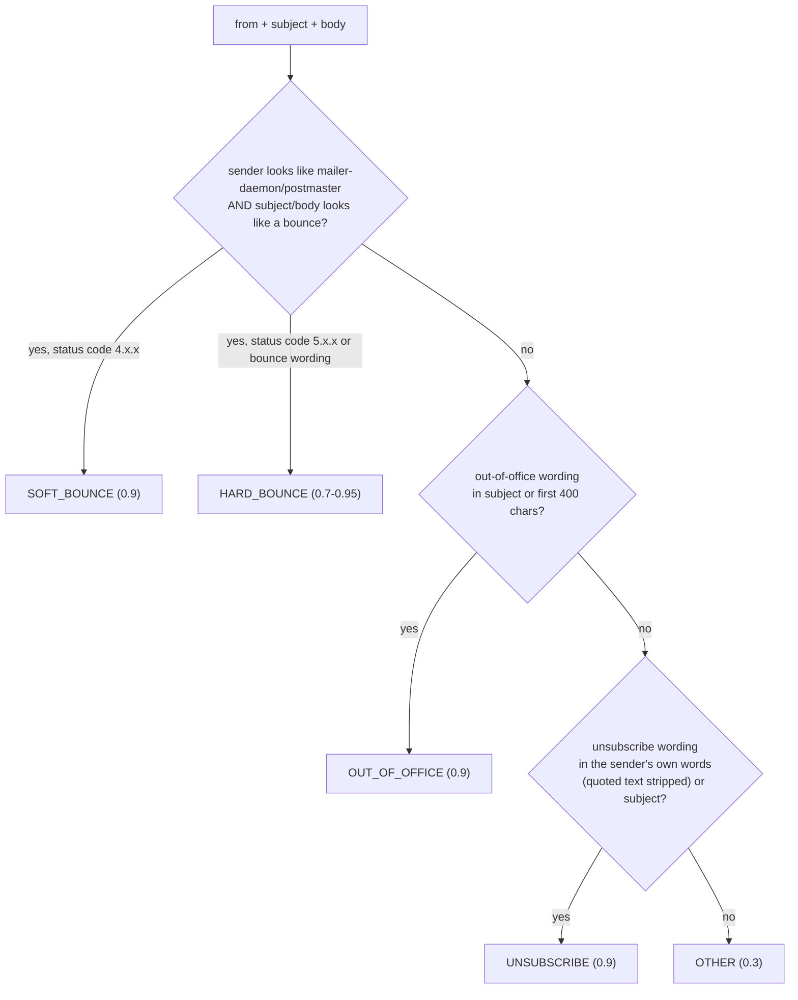
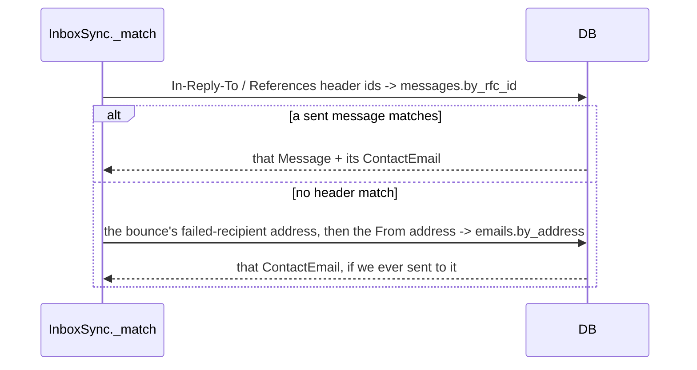

# Inbox sync and opt-outs

**Code:** `outbound/domain/inbox.py`, `outbound/services/inbox.py`, `outbound/db/models.py` (`InboundMessageRow`), `outbound/db/repositories/inbound.py` · **Layer:** domain → services · **Tests:** `tests/domain/test_inbox.py`, `tests/services/test_inbox_sync.py`

## Purpose

Once a draft is sent, replies arrive — and two kinds legally and operationally cannot wait for a human to notice them: an opt-out, which must stop every further email to that person, and a hard bounce, which means the address no longer exists. Phase 4a reads every connected mailbox's inbox, classifies each new message with fixed rules (no model, so the same text always gets the same answer), and acts immediately on those two categories.

## Responsibilities

- Classify an inbound message as `HARD_BOUNCE`, `SOFT_BOUNCE`, `OUT_OF_OFFICE`, `UNSUBSCRIBE` or `OTHER`, from the sender, subject and body alone, with no network call and no model.
- Match a reply back to the specific sent message or recipient address it answers, so the right contact is suppressed or invalidated — never the wrong one.
- Auto-suppress a contact on `UNSUBSCRIBE`, auto-invalidate an email address on `HARD_BOUNCE`, through the existing [safety-model](safety-model.md) mechanisms (`PrivacyService`), not a parallel path.
- Run idempotently as a periodic tick job across every mailbox a workspace has connected, tolerating one mailbox's failure without blocking the others.

**Not its job:** reading or acting on anything beyond these two categories — `OUT_OF_OFFICE` and `OTHER` are recorded for a human to see on the lead's timeline, but nothing automatic happens to them. A fuller reply classifier (interested/not interested/forward me to someone else) is explicitly a later phase, not this one.

## Public interface

| Symbol | Kind | What it does |
|---|---|---|
| `inbox.py::classify(from_address, subject, body) -> Classification` | function | Pure, rules-only categorisation; returns a category, a confidence, and (for a bounce) the failed recipient address |
| `inbox.py::Classification` | dataclass | `category`, `confidence`, `failed_recipient` |
| `services/inbox.py::InboxSync` | tick job | `run()`: reads every open mailbox's inbox since the last successful read (with overlap), classifies, matches, acts, records |
| `FIRST_LOOK` / `OVERLAP` | constants | A never-before-synced mailbox looks back 7 days; every subsequent pass re-reads the last hour to tolerate a mail server's own delivery lag |

## How it works

### Classification is regex, in a fixed order, and conservative



The order matters: a bounce notification's sender address (`mailer-daemon@`, `postmaster@`) is checked first and narrowly, because a bounce is the one category whose *sender* is diagnostic, not the person who originally received the email. `_own_words()` strips everything from the first quoted-reply marker onward (`> `, `On ... wrote:`, `----- Original Message`) before checking for opt-out wording, so a reply that **quotes** our own footer's unsubscribe language back at us is not misread as the person asking to opt out — only what the person themselves wrote is checked. Confidence scores are informational (shown on the lead's timeline) and are not currently used to gate the automatic actions — any `HARD_BOUNCE`/`UNSUBSCRIBE` match acts, regardless of score; refining that is explicitly future work (see Planned).

### Matching a reply to the right lead



Threading headers (`In-Reply-To`/`References`, parsed for `<...>` message-id tokens) are tried first and are the most reliable signal — they tie a reply to the *exact* message we sent. Failing that, a bounce's extracted failed-recipient address, then the reply's own `From` address, are checked against addresses we have actually sent to (`messages.sent_to`) — never matched to an address merely present in our database, which would risk acting on a reply about a lead we never contacted from this mailbox.

### Idempotent by message id, overlapping by design

Each pass asks a mailbox for everything since `latest - OVERLAP` (one hour past the last message this mailbox has ever recorded), or `now - FIRST_LOOK` (7 days) the first time a mailbox is synced. The one-hour overlap means a message right at the boundary of two passes is seen twice; `uow.inbound.known(rfc_message_id)` short-circuits a repeat before it is classified or matched again, so running the job twice, or two workers at once, produces the same end state — no duplicate suppression, no duplicate audit row.

### Acting: through the existing safety machinery, not around it

`UNSUBSCRIBE` calls `PrivacyService.suppress_contact(contact_id, actor=SYSTEM)` — the same suppression path a person can trigger by hand, so a suppressed-by-reply contact is indistinguishable from any other suppression everywhere else in the system (it blocks every future send, is checked again at draft/send time per [safety-model](safety-model.md), and shows the same way in reports). `HARD_BOUNCE` calls `PrivacyService.bounced(email_id, actor=SYSTEM)`, invalidating that specific address (not the whole contact — a different address for the same person may still be good) and letting the lead's ranking move on to another person at that company if one exists. Both actions run under the `SYSTEM` actor, distinct from `OPERATOR`, so the audit trail is honest about what triggered them.

### A broken mailbox never stops the others

`run()` iterates every open mailbox independently; a `ProviderError` from one (an expired OAuth grant, an unreachable IMAP server) is logged (`inbox_sync_mailbox_failed`) and that mailbox is skipped for this pass — the next tick retries it with the same `latest`-based `since`, so nothing already-synced is re-read, and nothing from the broken mailbox is silently lost, only delayed.

## Invariants

- A message is recorded (and can be acted on) at most once, keyed by its `rfc_message_id`.
- `UNSUBSCRIBE`/`HARD_BOUNCE` are only acted on when the reply was matched to a specific `ContactEmail` this workspace actually sent to — never on an unmatched reply, regardless of how confident the classification.
- Opt-out wording found only inside quoted text (our own footer, quoted back) never triggers suppression.
- One mailbox's provider failure does not prevent `InboxSync.run()` from processing the others.

## Errors and failure behaviour

| Situation | Behaviour |
|---|---|
| A mailbox's inbox read fails (`ProviderError`) | Logged, that mailbox skipped this pass, others continue, next pass retries from the same `since` |
| No mailbox is open at all (`MailboxUnavailable`) | `run()` returns zero counts; no exception propagates to the tick scheduler |
| A message does not match any sent message or address | Not stored at all — "mail that is not about our emails is ignored and never stored," per the module's own docstring intent; nothing is retained for messages outside this workspace's correspondence |
| A matched message is `OUT_OF_OFFICE`/`OTHER` | Recorded (`uow.inbound.add`) for the lead's timeline; no automatic action |

## Transactions and concurrency

Reading the mailbox (network I/O) happens outside any open transaction; the "is this known" check, the row insert, and the `mark_handled` update are each their own short transaction, consistent with the project-wide "no network call inside an open transaction" rule — `_handle()` deliberately does the classification and matching (pure/local) between two separate `with self._uow(...)` blocks rather than holding one open across the mailbox call.

## Configuration

No dedicated settings; runs as one of `outbound/worker.py`'s periodic jobs per workspace, on the same tick cadence as everything else (`--tick-minutes`).

## Observability

`inbound_handled` (`category`, `acted`) and `inbox_sync_mailbox_failed` (`mailbox_id`, `reason`, truncated) log events; `InboundMessageRow` rows themselves are the durable record shown on a lead's timeline.

## Security and privacy

Classification reads a real person's reply text — never logged (`body_excerpt` is stored in the database, never in a log line) and covered by the same forget/erasure flow as any other message ([privacy and data processing](../security/privacy-data-processing.md)). `OTHER`-category replies are retained in full for the lead's timeline, which is a deliberate product choice (a sales person needs to see what was actually said) rather than an oversight — flagged in the privacy doc as a retention consideration.

## Tests

| File | Proves |
|---|---|
| `tests/domain/test_inbox.py` | Every regex path: bounce sender+subject/status-code combinations, out-of-office phrasing in several languages' worth of fixtures, opt-out wording found and **not** found inside quoted text |
| `tests/services/test_inbox_sync.py` | Idempotent re-run (overlap + `known()`), one mailbox's failure not blocking others, header-first then address-fallback matching, `SYSTEM`-actor suppression/invalidation, `FIRST_LOOK`/`OVERLAP` windowing |

## Known limitations

- Classification confidence is not yet used to hold a low-confidence `HARD_BOUNCE`/`UNSUBSCRIBE` match for human confirmation rather than acting immediately — today, any match of either category acts, at any confidence.
- No language-model-based classifier exists yet for the broader "interested / not interested / wrong person" categories that `OTHER` currently absorbs undifferentiated.

## Planned

The confidence-gated hold, and a later-phase model-based classifier for the richer reply categories, are explicitly out of scope for Phase 4a and tracked in the [tech-debt register](../tech-debt-and-risks.md) and `docs/phases/`.

## How to refresh this page

```bash
cat outbound/domain/inbox.py
sed -n '1,140p' outbound/services/inbox.py
uv run pytest tests/domain/test_inbox.py tests/services/test_inbox_sync.py -q
```
