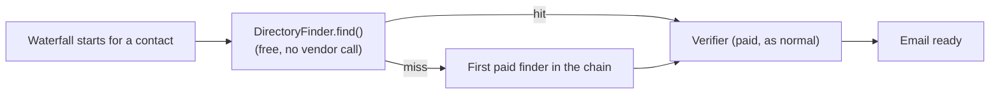

# The verified lead directory

**Code:** `outbound/domain/directory.py`, `outbound/services/directory.py`, `outbound/stages/email/directory.py`, `outbound/db/repositories/directory.py`, `outbound/db/models.py` (`DirectorySuppressionRow` and the directory tables) · **Layer:** domain → db → stages/services → api · **Tests:** `tests/domain/test_directory.py`, `tests/services/test_directory.py`, `tests/stages/test_directory_finder.py`

## Purpose

Every customer's waterfall independently pays to find and verify the same address when two customers happen to target the same company's same decision-maker. The directory is a platform-level, cross-workspace cache of verified facts: a fact one customer's run confirmed can save another customer a paid lookup, with the contributing customer never identified to the one who benefits.

## Responsibilities

- Answer as the free first link of the email waterfall ([stage-email](stage-email.md)): a hit saves the cost of the first paid finder; a miss costs nothing and simply falls through to the normal chain.
- Fold what a run observes (a verified address) into the shared directory, and let a customer dispute a fact that's wrong for them.
- Decide what may be served (`servable`), what is worth contributing (`CONTRIBUTABLE`), and how two customers' spellings of the same person match (`person_key`) — all with no I/O, in `outbound/domain/directory.py`.
- Give an admin a per-customer switch (`directory_bypass`, an [entitlement](plans-credits-and-admin.md) feature) to skip the directory entirely and go straight to the vendors.

**Not its job:** the vendor waterfall itself, which the directory sits in front of as just another `find()`-shaped source ([stage-email](stage-email.md)); entitlements and billing, which only grant or deny the *ability* to bypass it ([plans, credits and admin](plans-credits-and-admin.md)).

## Public interface

| Symbol | Kind | What it does |
|---|---|---|
| `directory.py::person_key(first_name, last_name)` | function | Case/whitespace-normalised key two customers' spellings of one person meet on |
| `directory.py::servable(status, verified_at, now)` | function | `True` only if `VERIFIED` and within `RETENTION` (730 days) |
| `directory.py::CONTRIBUTABLE` | constant | Only `VALID`/`CATCH_ALL_RESOLVED` addresses are worth sharing |
| `directory.py::month(when)` | function | The only date ever shown to a customer: the month a fact was verified, never the day — a day would let one customer infer when another's run happened |
| `directory.py::DirectoryHit` | dataclass | `email`, `source`, `verified_month` — nothing about who contributed it |
| `stages/email/directory.py::DirectoryFinder` | stage component | Answers the `find()` shape the waterfall expects; `billed=False` always |
| `services/directory.py::LeadDirectory` | service | A workspace's own view: `badge(company_id)`, `report(company_id, field, reason)`, `skip(company_id, skip)` |
| `services/directory.py::DirectoryService` | service | The platform's side: folding runs' findings into served facts, deciding reports, retention sweeps, figures |

## How it works

### A free first link that still gets re-verified



`DirectoryFinder` implements the same `find(person, domain) -> FinderResult` shape as every other finder (`outbound/providers/ports.py::EmailFinder`), so the waterfall ([stage-email](stage-email.md)) treats it identically to Hunter or ZeroBounce — just always first, and `billed=False` so it never touches the meter or the budget guard. A hit still goes through the normal verifier before being used: the directory entry could be months old, and re-verifying it costs far less than a finder lookup would have, so the small re-check is cheap insurance rather than a reason to trust it blindly.

### What gets contributed, and what gets served

A workspace's own run result folds into the directory only when the found address ended at `VALID` or `CATCH_ALL_RESOLVED` (`CONTRIBUTABLE`) — a found-but-unverified or invalid address teaches the directory nothing worth sharing. `servable()` then gates what any workspace can retrieve: `DirectoryStatus.VERIFIED` and not older than `RETENTION` (730 days). A fact that ages out is deleted outright, not just hidden, by the retention sweep (`DirectoryService`) — nothing quietly keeps serving a stale address past its window.

### Disputes: `report()` affects both sides at once

```mermaid
sequenceDiagram
    participant Customer
    participant LeadDirectory
    participant Directory as directory tables (platform)
    participant Emails as this workspace's emails
    Customer->>LeadDirectory: report(company_id, "email", "bounced")
    LeadDirectory->>Directory: holds(address)?
    Directory-->>LeadDirectory: yes
    LeadDirectory->>Directory: report(EMAIL, address, "email", "bounced")
    Note right of Directory: status -> DISPUTED; stops being served<br/>to anyone, until staff decide
    LeadDirectory->>Emails: this workspace's own email row -> INVALID
    Note right of Emails: this workspace stops using it immediately,<br/>independent of the platform's review
```

Reporting one of `REPORT_FIELDS` (`email`, `still_works`, `title`, `linkedin`, `company_name`, `country`) does two things in the same transaction: it moves the shared fact to `DISPUTED` (so it stops being served to *any* customer until a platform admin decides it), and — for the two fields that mean "this address is wrong" — it moves this workspace's own `EmailRow` for that address to `INVALID` immediately, independent of whatever the platform later decides. The customer who reported a bad address never has to wait on a review to stop using it themselves.

### The bypass ability

`directory_bypass` is a `Plan`/`Override` feature flag ([plans, credits and admin](plans-credits-and-admin.md)): a customer with it set may call `skip(company_id, skip=True)`, which sets `companies.skip_directory` and makes the waterfall go straight to the first paid finder for that lead. Without the feature, `skip()` raises `InvalidInput` — this is a deliberate commercial lever, not a technical limitation, since skipping it only costs the customer money and never anyone else anything.

### Privacy by construction, not by filtering

Every value this module can return to a customer — `DirectoryHit`, `DirectoryBadge`, `verified_month` — is built from fields that structurally cannot identify a contributor: `month()` discards the day, and nothing in `DirectoryHit`/`DirectoryBadge` carries a workspace id, a run id or a contributor reference at all. There is no "hide the contributor" filter applied at serving time to redact something that was stored with it — the contributing workspace is simply never written into the shared fact's row in the first place.

## Invariants

- A served address is always `VERIFIED` and within `RETENTION`; nothing serves `DISPUTED` or `INVALID` facts, or anything older than the window.
- A `DirectoryHit`/`DirectoryBadge` never carries a contributor's workspace id, run id, or any other attribution.
- Disputing an address updates the shared fact *and* this workspace's own email row in the same transaction — a customer is never left using an address they just reported as wrong.
- `skip()` succeeds only for a workspace whose entitlements include `directory_bypass`.

## Errors and failure behaviour

| Situation | Behaviour |
|---|---|
| `report()` on a field not in `REPORT_FIELDS` | `InvalidInput` naming the valid choices |
| `report()` on an address the directory holds nothing about | `InvalidInput` — there is nothing to dispute |
| `skip(True)` without `directory_bypass` | `InvalidInput`: "your plan does not include skipping the directory" |
| `DirectoryFinder.find()` with no match | A normal `miss` `FinderResult`, not an error — the waterfall proceeds exactly as if the directory did not exist |

## Transactions and concurrency

`LeadDirectory.report()` holds one short transaction across both writes (the shared fact and the workspace's own email row), consistent with the "no transaction across a network call" rule — both are local database writes, no vendor or LLM call happens inside it. `DirectoryService`'s fold-in-from-runs and retention sweep run as periodic worker jobs ([runner-and-worker](runner-and-worker.md)), reading across workspaces through `PlatformUnitOfWork` ([tenancy and isolation](tenancy-and-isolation.md)).

## Configuration

No dedicated settings; priced implicitly via `finder_price()` (`services/directory.py`), which reports what the *first* configured finder in `FINDER_CHAIN` would have cost, as the figure for "savings from directory hits" shown to platform staff.

## Observability

`directory_reported` log event (`company_id`, `field`); the `DirectoryService` figures (`DirectoryFigures`) feed a platform-only dashboard of hit rate and estimated savings — never broken down in a way that would reveal which workspace contributed or benefited from a specific fact.

## Security and privacy

This is the one place in the system where data deliberately crosses workspace boundaries by design, which makes it the sharpest privacy edge in the product — see the [threat model](../security/threat-model.md#lead-directory) and [privacy and data processing](../security/privacy-data-processing.md#lead-directory) for the full data-sharing rationale, the legal basis (the shared fact is a verified business email, not personal correspondence), and why attribution is structurally absent rather than merely access-controlled.

## Tests

| File | Proves |
|---|---|
| `tests/domain/test_directory.py` | `person_key` normalisation, `servable` status/retention boundary, `CONTRIBUTABLE` set |
| `tests/services/test_directory.py` | `report()`'s two-sided write; `skip()` entitlement gating; retention sweep deletes expired facts outright |
| `tests/stages/test_directory_finder.py` | `DirectoryFinder` returns an unbilled hit/miss shaped like any other finder; the waterfall still re-verifies a hit |

## Known limitations

- A disputed fact sits in `DISPUTED` until a platform admin reviews it; there is no SLA on that review yet, so a wrong address can stay un-served (not wrongly re-served, but unavailable to anyone) for an unbounded time.
- The directory's "savings" figure is an estimate (`finder_price()` of the first chain finder), not a measured counterfactual — it does not account for a hit that would have fallen through to a *later*, cheaper finder anyway.

## Planned

A review queue UI for disputed facts, and per-field (not just per-address) dispute granularity, are tracked in the [tech-debt register](../tech-debt-and-risks.md).

## How to refresh this page

```bash
cat outbound/domain/directory.py
sed -n '1,120p' outbound/services/directory.py
cat outbound/stages/email/directory.py
uv run pytest tests/domain/test_directory.py tests/services/test_directory.py tests/stages/test_directory_finder.py -q
```
