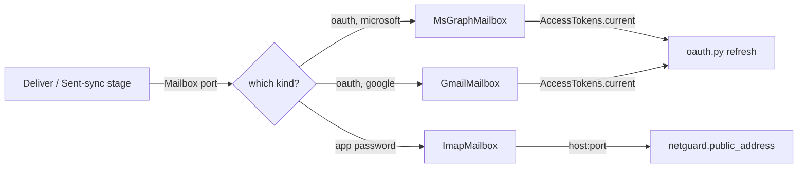

# Mailboxes and OAuth

**Code:** `outbound/providers/ports.py` (`Mailbox`, `AccessTokens`), `outbound/providers/oauth.py`, `outbound/providers/adapters/ms_graph.py`, `outbound/providers/adapters/gmail_api.py`, `outbound/providers/adapters/imap_mailbox.py`, `outbound/providers/netguard.py`, `outbound/db/crypto.py`, `outbound/db/models.py` (`CredentialRow`, `MailboxRow`), `outbound/api/routers/mailboxes.py` · **Layer:** providers → services → api · **Tests:** `tests/providers/test_ms_graph.py`, `tests/providers/test_gmail_api.py`, `tests/providers/test_imap_mailbox.py`, `tests/providers/test_netguard.py`, `tests/providers/test_oauth.py`

## Purpose

Phase 3b had one operator mailbox, configured with an IMAP host and an app password in the environment. Phase 6c lets every workspace connect its own mailbox — any mix of Microsoft 365, Google Workspace/Gmail, or a generic IMAP account — and the platform must never see or store a plaintext password or long-lived token.

## Responsibilities

- Implement one `Mailbox` port three ways (Graph, Gmail API, IMAP), so stages that append drafts, check Sent, and poll the inbox never know which kind of account they're talking to.
- Run the OAuth authorization-code-with-PKCE dance for Microsoft and Google, and keep the resulting tokens fresh (`AccessTokens`).
- Encrypt every mailbox credential at rest, scoped so a key cannot be lifted from one workspace's row and reused against another's.
- Refuse to connect an IMAP host that resolves to a private or reserved address, so a customer cannot point the server at the platform's own network.

**Not its job:** deciding what to send or when ([deliver and sync](stage-deliver-and-sync.md)); the platform's own outbound mail (invites, resets) — that is `TransactionalEmail`, a separate port, sent via SMTP configured once for the whole platform, never per workspace.

## Public interface

| Symbol | Kind | What it does |
|---|---|---|
| `ports.py::Mailbox` | Protocol | `append_draft`, `draft_exists`, `delete_draft`, `list_sent(since)`, `list_inbox(since)` |
| `ports.py::AccessTokens` | Protocol | `current()`, `renew()` — both raise `ReconnectNeeded` when the person must reconnect |
| `oauth.py` | module | PKCE code generation, the authorize URL, the code→token exchange, the refresh call, for Microsoft and Google |
| `adapters/ms_graph.py::MsGraphMailbox` | adapter | Graph `/me/messages`; drafts tagged with a fixed-GUID single-value extended property holding our `Message-ID` |
| `adapters/gmail_api.py::GmailMailbox` | adapter | Gmail API `users.messages`/`users.drafts`; our `Message-ID` matched via `rfc822msgid` search |
| `adapters/imap_mailbox.py::ImapMailbox` | adapter | IMAP `APPEND`/`UID STORE +FLAGS (\Deleted)`/`UID EXPUNGE`, app-password auth |
| `netguard.py::public_address(provider, host, port, allowed_ports, resolve=...)` | function | Resolves `host`, refuses it if any resolved address is not global/is multicast, returns the one address to connect to |
| `outbound/db/crypto.py::Keyring.seal/.open` | class | AES-256-GCM, associated data `"{workspace_id}|{credential_id}"` |

## How it works

### Three adapters behind one port



A stage is handed a `Mailbox` by `outbound/pipeline.py`, built from the workspace's `mailboxes`/`credentials` rows; the stage code is identical regardless of which adapter it got. Our own draft is always found by its `Message-ID`, not by subject or recipient, because a `Mailbox`'s job is "find the thing we put there," and only a stable id is safe for that across providers that reformat headers differently.

- **Microsoft Graph** tags a draft with a single-value extended property (a fixed GUID property set) carrying our `Message-ID`, because Graph's own `internetMessageId` on a *draft* is not guaranteed to survive exactly as sent; the property is read back to find and delete the right draft. Bodies are fetched as plain text (`Prefer: outlook.body-content-type="text"`) to avoid parsing HTML.
- **Gmail API** finds our message by searching `rfc822msgid:<value>` rather than any tag of our own, since Gmail preserves the `Message-ID` header reliably and the search is native.
- **IMAP** is the one case where the lower-level protocol is used directly: `APPEND` to the Drafts folder, then `UID STORE +FLAGS (\Deleted)` followed by `UID EXPUNGE` scoped to that one UID — fixed from an earlier version that expunged every `\Deleted` message in the mailbox, which could delete an unrelated draft a person had flagged by hand.

### OAuth: authorization code with PKCE, one app per provider

The platform runs **one** multi-tenant OAuth application each for Microsoft (`MICROSOFT_CLIENT_ID`/`_SECRET`) and Google (`GOOGLE_CLIENT_ID`/`_SECRET`) — not one per customer. A customer's "Connect mailbox" click:

1. The API generates a random `state` and a PKCE code verifier/challenge (`oauth.py`), stores the verifier server-side keyed by `state`, and redirects to the provider's consent screen.
2. The provider redirects back with `state` and a code; the API checks `state` matches, then exchanges the code (with the verifier) for an access token and a refresh token — the code is used exactly once.
3. Both tokens are sealed (`Keyring.seal`) and stored as a `CredentialRow` (`purpose=MAILBOX_OAUTH`), scoped to `(workspace_id, credential_id)` as associated data, so the ciphertext cannot be decrypted under a different workspace's or credential's id even with the right key version.
4. `AccessTokens.current()` returns the access token, refreshing first if it is near expiry; `.renew()` forces a refresh when the provider rejected a token that looked unexpired. Microsoft rotates the refresh token on every use (the old one keeps working briefly, so a crash between refresh and save does not strand the connection); Google typically does not issue a new one, so the adapter keeps the existing refresh token when none comes back.
5. A refused refresh (`invalid_grant`: revoked consent, expired, password changed elsewhere) raises `ReconnectNeeded`, surfaced to the workspace as "reconnect this mailbox" rather than a generic error — the person, not the platform, is the one who can fix it.

### IMAP: an app password, and a guard against SSRF

A customer-supplied IMAP host is attacker-adjacent: it is typed by a customer, not chosen by us, and a malicious or compromised account could point it at the platform's own infrastructure (a cloud metadata endpoint, the database's private address, another container). `netguard.py::public_address` resolves the hostname once, rejects the connection if *any* resolved address is not global-unicast or is multicast, and returns the specific address that was checked — the adapter connects to that address (not by re-resolving the name), while still sending the original hostname for TLS SNI/certificate validation. This closes the DNS-rebinding gap where a second lookup, made after the check, could answer differently.

### Encryption at rest

Every mailbox credential (OAuth tokens, an IMAP app password) is a `CredentialRow`: `key_version`, a 12-byte `nonce`, and `ciphertext` — `AES-256-GCM` via `outbound/db/crypto.py::Keyring`. The key comes from `SECRETS_KEYS` (JSON, `{"<version>": "<base64 32 bytes>"}`); the highest version always encrypts, so a rotation just means removing old versions once nothing references them. Non-secret detail (which scopes were granted, the connected account's email) lives alongside in a plain `details` JSON column — it is useful for the UI and is not itself a secret.

## Invariants

- A `CredentialRow`'s ciphertext decrypts only under its own `(workspace_id, id)` associated data — moving a row's ciphertext to a different credential id, even within the same workspace, fails to decrypt.
- `netguard.public_address` never returns a non-global address; every IMAP connection goes through it first.
- A `Mailbox` adapter finds and deletes only the draft it itself appended (by `Message-ID`), never "the newest draft" or anything flag-based beyond the one UID/id it targeted.

## Errors and failure behaviour

| Situation | Behaviour |
|---|---|
| OAuth refresh refused (`invalid_grant`) | `ReconnectNeeded`; the mailbox is marked needing reconnection, the workspace is notified, the engine skips delivery through it until fixed |
| IMAP host resolves to a private/reserved address | `ProviderError`, not retried; the connect attempt is refused before any socket opens |
| IMAP host does not resolve | `ProviderError(retryable=True)` — DNS can be transiently unavailable |
| A 401 from Graph/Gmail mid-call | One token renewal and one retry of the call; a second 401 is `ReconnectNeeded` |
| Deleting a draft that no longer exists | `delete_draft` returns `0` removed, not an error — the draft may have been sent or removed by the person already |

## Transactions and concurrency

`CredentialRow.version` is a compare-and-swap counter: refreshing a token reads the row, computes the new ciphertext, and writes back only if `version` is unchanged, so two concurrent refreshes (API and worker, say) do not race to an inconsistent stored token — the loser re-reads and, if its own refresh is now redundant, discards it.

## Configuration

`MICROSOFT_CLIENT_ID`/`MICROSOFT_CLIENT_SECRET`, `GOOGLE_CLIENT_ID`/`GOOGLE_CLIENT_SECRET`, `MAILBOX_TIMEOUT_SECONDS`, `SECRETS_KEYS`, `APP_BASE_URL` (the OAuth redirect URI's host). See [configuration reference](../operations/configuration-reference.md).

## Observability

Log events (`mailbox_connected`, `mailbox_reconnect_needed`, `draft_appended`, `draft_deleted`) carry `workspace_id`/`mailbox_id`, never an email address or message content — the structlog redaction processor would strip email text regardless, but these call sites never pass it in the first place.

## Security and privacy

A connected mailbox is the single highest-value secret a workspace holds — full read/write access to a real inbox. See the [threat model](../security/threat-model.md#mailbox-oauth) and [secrets management](../security/secrets-management.md) for the OAuth app's own credentials (platform-wide, in Doppler) versus a customer's per-mailbox tokens (per-workspace, encrypted in the database).

## Tests

| File | Proves |
|---|---|
| `tests/providers/test_ms_graph.py`, `test_gmail_api.py` | Fixture-driven: draft append/find/delete by Message-ID/rfc822msgid, token-expiry retry-once behaviour |
| `tests/providers/test_imap_mailbox.py` | UID-scoped delete does not touch other `\Deleted`-flagged messages (the fixed bug) |
| `tests/providers/test_netguard.py` | Private/reserved/multicast addresses refused; a mixed public+private DNS answer refused; the checked address is the one connected to |
| `tests/providers/test_oauth.py` | PKCE challenge/verifier pairing, state mismatch refused, refresh-token retention per provider |

## Known limitations

- The OAuth apps are not yet verified/published with Microsoft or Google (a Phase 0 "two facts from reading the vendors' docs"-style open item): until verification, new customers see an "unverified app" warning on the consent screen.
- SMTP (sending, not just reading/drafting) through Graph/Gmail APIs is not implemented; delivery still goes through each adapter's own send-equivalent (Graph/Gmail message send, or leaving an IMAP draft for the person to send by hand per the product's draft-first design).

## Planned

Outlook/Gmail app verification and a wider IMAP provider test matrix are tracked in the [tech-debt register](../tech-debt-and-risks.md).

## How to refresh this page

```bash
sed -n '1,60p' outbound/providers/oauth.py
sed -n '1,55p' outbound/providers/netguard.py
grep -n "class Credential\|class Mailbox" outbound/db/models.py outbound/providers/ports.py
uv run pytest tests/providers/test_netguard.py tests/providers/test_oauth.py tests/providers/test_imap_mailbox.py -q
```
