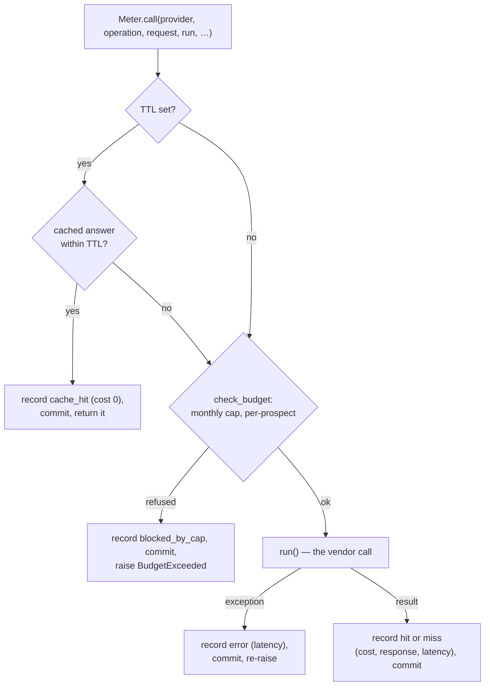

# Metering

**Code:** `outbound/metering/` (`metered.py`, `budget.py`) · **Layer:** metering (above db and providers, below stages) · **Tests:** `tests/db/test_metered.py`, `tests/db/test_robustness.py`

## Purpose

The meter stands between every stage and every paid vendor. Before a call it answers from the cache if it can, then refuses the call if it would break a spend cap. After the call it writes the cost to the ledger, attributed to a run, company and contact. It exists so that the $0.50-per-prospect rule, monthly caps and reruns at no cost are enforced in one place that no stage can bypass ([ADR 0005](../adr/0005-metered-decorator-and-ledger.md), binding rule 3).

## Responsibilities

- Cache vendor answers by request, per workspace, with a time-to-live (TTL) for each kind of call.
- Check the monthly cap per provider and the per-prospect ceiling *before* a call.
- Write one `provider_calls` row for every call, cache hit, error and refusal, each committed in its own transaction.
- Attribute every row to the current run, company and contact.

**Not its job:**

- retries and timeouts (`HttpClient`, [providers](providers.md));
- the runner's budget *guard*, which decides whether a stage runs at all ([runner and worker](runner-and-worker.md));
- prices (the `pricing.py` table, listed in [integrations](../integrations/README.md#prices)).

## Public interface

| Symbol | Kind | What it does |
|---|---|---|
| `outbound/metering/metered.py::Meter` | class | `call(...)` runs the cache, cap, call and record steps; `lookup`, `record`, `price` |
| `outbound/metering/metered.py::MeteredFinder`, `MeteredVerifier`, `MeteredResolver`, `MeteredSearch`, `MeteredLlm`, `MeteredRegistry` | decorators | Each wraps one port and has the same interface, so a stage holds an ordinary `EmailFinder`, `SearchProvider` and so on |
| `outbound/metering/metered.py::call_scope` | context manager | Sets the run, company and contact for every call inside it; unnamed fields keep the outer value |
| `outbound/metering/metered.py::request_hash` | function | SHA-256 of `[provider, operation, canonical(request)]` |
| `outbound/metering/budget.py::BudgetPolicy` | dataclass | `monthly_caps` (provider → micro-USD) and `per_prospect` (micro-USD or `None`); `from_workspace_settings` |
| `outbound/metering/budget.py::check_budget` | function | The reason a call must not be made, or `None` |

Stages receive only metered providers, built by `outbound/pipeline.py::assemble`. Intake's search is metered too (`pipeline.metered_search_or_none`).

## How it works



**Every record is its own unit of work, committed at once.** This happens before the stage returns and before the runner writes the lead. A stage that fails afterwards has still recorded the money it spent, and the next attempt finds the answer in the cache.

### Cache

- **Key:** `request_hash(provider, operation, request)`. Before hashing, the request is made canonical: strings are trimmed and case-folded, mapping keys sorted, lists kept in order. So `Jane@Example.com` and `jane@example.com ` share an entry.
- **Lookup:** `ProviderCallRepository.cached_response` finds the newest row for the same workspace, provider, operation and hash, with outcome `hit` or `miss`, made within the TTL. A `miss` is reusable too, because "the vendor looked and found nothing" is an answer worth keeping.
- **Scope:** the cache is per workspace (`tests/db/test_metered.py::test_the_cache_is_per_workspace`).
- **Unreadable entries:** an entry that no longer decodes into the result model counts as a miss, not an error.

| Wrapper | Operation | Request (the cache key) | TTL | Cost recorded |
|---|---|---|---|---|
| `MeteredFinder.find` | `find` | `{person, domain}` | 90 days | The price if the vendor billed, else 0 |
| `MeteredVerifier.verify` | `verify` | `{email}` | 90 days | The price if billed, else 0 |
| `MeteredResolver.submit` | `submit` | `{email}`; first checks for a cached `resolve` answer | 90 days for `resolve` | The **`resolve`** price, unless the answer says it was not billed |
| `MeteredResolver.poll` | — | — | — | Not metered. An answer is stored as a `resolve` hit (cost 0) so the next submit finds it |
| `MeteredSearch.search` | `search` | `{query, max_results}` | 30 days | The price |
| `MeteredSearch.extract` | `extract` | `{urls}` (sorted) | 30 days | The price |
| `MeteredRegistry.search` | `lookup` | `{name, max_results}` | 30 days | The price (Companies House is free) |
| `MeteredLlm.complete` | `complete` | Model, prompts and parameters | **None** (not cached) | `llm_cost(prices, model, input_tokens, output_tokens)` |

**Why model calls are not cached.** Two identical prompts are usually asked for two different drafts, so a cached reply would be wrong for copy. `MeteredLlm` accepts a `ttl` for deterministic tasks, but no caller passes one today. A rerun therefore repeats model calls for any stage it runs again, while every vendor lookup comes from the cache.

### Budget

`check_budget(policy, uow, provider, expected_cost, company_id, now)` refuses when either is true:

- **Monthly cap:** the provider's spend since the first of this month (UTC) plus `expected_cost` would exceed its entry in `MONTHLY_CAPS_MICRO_USD`. Providers with no entry have no cap.
- **Per-prospect ceiling:** the company's total spend plus `expected_cost` would exceed `budget_per_prospect_micro_usd` from the workspace settings (default 500,000, which is $0.50; `null` means no ceiling and `0` means no paid calls). This is checked only when a company is in scope.

`expected_cost` is `Meter.price(provider, operation)`, which uses the static price table. Two consequences:

- Model calls are checked with an expected cost of 0, because their price depends on tokens. Their real cost is recorded afterwards.
- A resolver `submit` is checked at the price of `<resolver>:submit`, which is not in the table, so it is 0. The call is then charged at the `resolve` price ([R-04](../tech-debt-and-risks.md#r-04--p1--cost-the-budget-cap-prices-a-catch-all-submit-at-0)).

**The runner's budget guard is separate.** `outbound/runner/guards.py::Guards.check` refuses to start a paid stage when the company's spend is already **at or above** the ceiling. The meter refuses a single call that would take spend **over** it. Together they stop work early and catch the last call.

The `BudgetPolicy` is built once, when the pipeline is assembled. A running worker does not see a changed ceiling until it restarts ([R-10](../tech-debt-and-risks.md#r-10--p1--budget-a-running-worker-does-not-see-budget-changes-b4)).

### Attribution

`call_scope` sets a `ContextVar`:

| Set by | Fields |
|---|---|
| `Runner._process` | `run_id`, `company_id` |
| `EmailStage.handle`, per contact tried | `contact_id` (inside the runner's scope) |
| `Tick._run_jobs` | `run_id` of the sync run |

Calls made outside any scope (intake's search from the API) are recorded with no run, company or contact.

## Invariants

- Every paid call has a ledger row, including a failed or refused one.
- A ledger row is committed before the stage's result is written.
- A cached answer is served even when the cap is reached (`tests/db/test_metered.py::test_a_cached_answer_is_served_even_when_the_cap_is_reached`).
- Spend from last month does not count against this month's cap.

## Errors

| Situation | Raised | Who handles it |
|---|---|---|
| Cap or ceiling would be crossed | `BudgetExceeded` (a `ProviderError`) | The waterfall collects it and tries the next source; other stages fail the lead |
| The vendor call raised | The same exception, after an `error` row | The stage |

## Transactions and concurrency

One short unit of work per lookup and per record. The meter never holds a transaction during the vendor call. Two runs working on the same lead at once can both miss the cache and both pay, because nothing locks the lead against a second run ([R-05](../tech-debt-and-risks.md#r-05--p1--runs-a-stopped-worker-leaves-its-run-running-runs-can-overlap-b2-b3)).

## Configuration

`PROVIDER_PRICES` and `LLM_PRICES` (merged over the defaults), `MONTHLY_CAPS_MICRO_USD`, and the workspace setting `budget_per_prospect_micro_usd`. See the [configuration reference](../operations/configuration-reference.md).

## Observability

- `provider_call`:
  - DEBUG for a cache hit;
  - INFO for a hit or miss;
  - WARNING for an error.

  Fields: provider, operation, outcome, cost, latency.
- `provider_call_blocked` (WARNING): provider, operation and reason.

The `provider_calls` table is the cost ledger behind the reports, the lead's vendor-call view and the run's cost ([observability](../operations/observability.md)).

## Security and privacy

`provider_calls.response` stores the vendor's answer, which can contain names and addresses. It is blanked by forget and delete ([data lifecycle](../data/data-lifecycle.md)), but there is no retention purge yet ([R-07](../tech-debt-and-risks.md#r-07--p1--data-no-backups-no-retention-unsalted-suppression-hashes-a6-e3)). Requests are stored only as a hash.

## Tests

| File | Proves |
|---|---|
| `tests/db/test_metered.py` | Cache hit and miss, TTL, per-workspace cache, cap refusal recorded, cached answers served at the cap, monthly reset, the per-prospect ceiling, attribution |
| `tests/db/test_robustness.py` | Every path to a paid vendor, including intake's search, goes through a meter with the same caps |
| `tests/db/test_pipeline_e2e.py` | A rerun costs nothing for vendor lookups; every call is attributed |

## Known limitations

- Model calls are recorded at $0 without `LLM_PRICES` ([R-03](../tech-debt-and-risks.md#r-03--p1--cost-model-calls-are-recorded-at-0-b5)).
- Resolver submits pass the cap check at $0 ([R-04](../tech-debt-and-risks.md#r-04--p1--cost-the-budget-cap-prices-a-catch-all-submit-at-0)).
- The ceiling is read once per process ([R-10](../tech-debt-and-risks.md#r-10--p1--budget-a-running-worker-does-not-see-budget-changes-b4)).
- The pre-call check uses 0 as the expected cost of a model call, so a model call can take a lead slightly over its ceiling.

## Extending it

A new port needs a `Metered*` wrapper here, with an operation name, a canonical request, a TTL (or none, with a reason), and a price key that matches the operation you charge. Add it to `pipeline.assemble` and to `tests/db/test_robustness.py`.

## Planned

- Phase 3b B4 and B5 (live budget read, model prices): [phase-3b-hardening.md](../../phases/phase-3b-hardening.md).

## How to refresh this page

```bash
grep -n "TTL = \|operation=\|ttl=" outbound/metering/metered.py
sed -n '/def check_budget/,/return None/p' outbound/metering/budget.py
uv run pytest tests/db/test_metered.py tests/db/test_robustness.py -q
```
