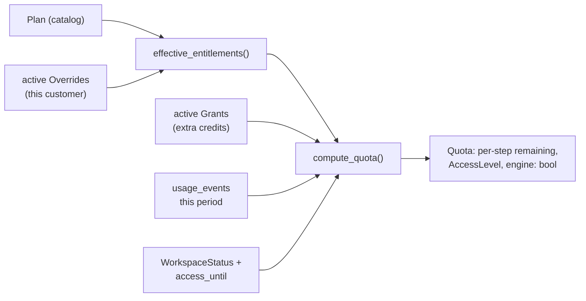

# Plans, credits and admin

**Code:** `outbound/domain/entitlements.py`, `outbound/db/models.py` (`PlanRow`/`OverrideRow`/`GrantRow`/`UsageEventRow`/`PlatformSettingsRow`), `outbound/db/platform.py`, `outbound/api/routers/admin.py`, `outbound/services/entitlements.py` (guard call sites in `runner/`) · **Layer:** domain → db → services → api · **Tests:** `tests/domain/test_entitlements.py`, `tests/services/test_entitlements.py`

## Purpose

With more than one paying customer, the platform needs to meter and cap usage per workspace, let a platform admin adjust an individual customer's limits without shipping code, and give a customer a read-only grace period rather than an abrupt cutoff when access lapses. All of it is pure, testable arithmetic in `outbound/domain/entitlements.py` — no I/O — composed from a plan, that customer's overrides and grants, and what has already been used this period.

## Responsibilities

- Define a `Plan`'s limits (per `UsageStep`, plus seats/mailboxes/campaigns/budget-per-prospect/features) and compute the `Entitlements` actually in force once a workspace's active `Override`s are layered on.
- Track usage with one `usage_events` row per charge, enforce "once per lead per step, except `rewrite`" at the database level, and compute what remains in the current monthly period.
- Decide `AccessLevel` (full / read-only / locked) from `WorkspaceStatus` and an `access_until` date, and whether the worker may run for a workspace at all (`engine_may_run`).
- Give the platform admin console the reads and writes it needs (plan catalog, per-customer overrides and grants, vendor keys) without ever touching tenant data through anything but `PlatformUnitOfWork` ([tenancy and isolation](tenancy-and-isolation.md)).

**Not its job:** what a step costs in actual vendor/LLM spend — that is `outbound/metering/` ([metering](metering.md)); entitlements cap *count* ("5 discoveries this month"), metering caps *money* ("$20 of ZeroBounce this month"). The two guards run independently and either can block a step.

## Public interface

| Symbol | Kind | What it does |
|---|---|---|
| `entitlements.py::Plan` | dataclass | `limits: Mapping[UsageStep, int\|None]` (missing = unlimited), `seats`, `mailboxes`, `active_campaigns`, `max_leads_per_run`, `max_prospect_budget_micro_usd`, `features`, `access_days` |
| `entitlements.py::FREE`, `UNLIMITED` | `Plan` constants | `FREE`: 5 discovery + 5 manual leads, no other features. `UNLIMITED`: every limit `None`; used for workspaces predating plans and for the platform's own test/demo use |
| `entitlements.py::Override` | dataclass | One customer-specific change: `key` (`limit.<step>`, `seats`, `mailboxes`, `active_campaigns`, `max_leads_per_run`, `max_prospect_budget`, `feature.<name>`), `value`, optional `expires_at`/`revoked_at` |
| `entitlements.py::Grant` | dataclass | Extra credits for one `UsageStep`, with its own expiry |
| `entitlements.py::effective_entitlements(plan, overrides, now)` | function | The plan with active overrides folded in, latest `created_at` wins per key |
| `entitlements.py::period_bounds(anchor, now)` | function | The current monthly period, counted from the day the plan started (not the calendar month) |
| `entitlements.py::available(step, entitlements, grants, used, now)` | function | `limit + active grants - used`, floored at 0, or `None` if unlimited |
| `entitlements.py::compute_quota(...)` → `Quota` | function | Everything one screen or one guard needs about a workspace at one moment: entitlements, a `StepQuota` per step, the period, access level, whether the engine may run |
| `entitlements.py::access_level(status, access_until, now)`, `engine_may_run(status, level)` | functions | `AccessLevel.FULL`/`READ_ONLY`/`LOCKED`, and whether the worker should pick up this workspace's runs |
| `outbound/db/platform.py::PlatformUnitOfWork` | class | Reads/writes `PlanRow`, `OverrideRow`, `GrantRow`, cross-workspace `UsageEventRow` aggregates, `PlatformSettingsRow` (vendor keys) |

## How it works

### A plan plus overrides plus grants equals a quota



`effective_entitlements` applies overrides in `created_at` order so the latest setting of a given key wins — an override is never deleted to undo it, it is revoked (`revoked_at` set) or left to expire, keeping the full history. A `limit.<step>` override whose `value` is `None` means "make this step unlimited for this customer," distinct from simply absent (which means "use the plan's own limit").

### Counting usage: once per lead, except rewrites

`usage_events` has no foreign key to `companies` — deleting a lead must not refund its credit, which a cascading delete or an `ON DELETE SET NULL` could accidentally do. Instead, a partial unique index enforces the business rule directly in the schema:

```sql
CREATE UNIQUE INDEX ux_usage_events_once_per_lead
    ON usage_events (workspace_id, step, company_id)
    WHERE step <> 'rewrite';
```

Every step except `REWRITE` ([`UsageStep`](#the-seven-steps)) may be charged at most once per `(workspace_id, company_id)` — a lead that is researched twice (say, after being reset) is charged once, because the service inserts the row with `INSERT ... ON CONFLICT DO NOTHING`-equivalent handling and checks `available()` before doing the paid work at all, not after. `REWRITE` has no such ceiling in the index: every "write it again" is its own row, because it is the one step a customer can legitimately trigger many times on the same lead.

### The seven steps

`DISCOVERY`, `MANUAL` (a company a person added, once accepted as a lead), `RESEARCH`, `EMAIL`, `COPY`, `DELIVER`, `REWRITE`. The first six map one-to-one onto a status transition a lead makes exactly once (`ONCE_PER_LEAD = frozenset(UsageStep) - {REWRITE}`); `REWRITE` maps onto a copy-stage action a person can repeat.

### Periods anchored to plan start, not the calendar

`period_bounds(anchor, now)` counts whole months forward from `assignment.started_at` — a plan started on the 14th resets on the 14th of each following month, not on the 1st. `add_months` clamps the day for short months (started on the 31st, resets on the 28th/30th as appropriate) rather than rolling into the next month.

### Access levels and the engine switch

| `WorkspaceStatus` | `access_until` | `AccessLevel` | `engine_may_run` |
|---|---|---|---|
| `SUSPENDED`, `PENDING_DELETION`, `DELETED` | any | `LOCKED` | false |
| `ACTIVE` or `PAUSED` | `None`, or in the future | `FULL` | true only if `ACTIVE` |
| `ACTIVE` or `PAUSED` | in the past | `READ_ONLY` | false |

`READ_ONLY` is deliberately not `LOCKED`: people can still sign in and read their data (a lapsed trial should not look like data loss), but the worker does no further work and the API refuses any write guarded by a workspace-scoped permission. `PAUSED` with full access is a platform admin's own lever — a workspace the customer or platform wants to freeze without losing the access clock.

### Platform admin console

`outbound/api/routers/admin.py` (behind `require_platform(Permission.ADMIN_READ/ADMIN_WRITE/ADMIN_KEYS)`) exposes: the plan catalog (read-only list of `Plan`s, which are code constants plus any catalog rows — the editable part is overrides and grants, not the plans themselves, keeping the plan list auditable in code review); per-workspace `Quota` (what the Plan & Usage screen shows); creating/revoking an `Override` or `Grant`; setting `access_until`/`WorkspaceStatus`; and platform vendor keys (`PlatformSettingsRow`, AES-256-GCM-encrypted through the same `Keyring` as mailbox credentials — see [tenancy and isolation](tenancy-and-isolation.md#responsibilities)). Every admin write goes through `PlatformUnitOfWork` and writes an `audit_log` row ([identity and access](identity-and-access.md#audit-log)).

## Invariants

- `available()` never returns a negative number; a step either has credit or it does not.
- A step in `ONCE_PER_LEAD` can be charged for the same `(workspace_id, company_id)` at most once, enforced by the database, not just application logic.
- `engine_may_run` is false for any status other than `ACTIVE`, regardless of overrides or grants — no override can make a `SUSPENDED` workspace run.
- An `Override`/`Grant`'s `active(now)` is `revoked_at is None and (expires_at is None or expires_at > now)`; nothing elsewhere re-derives activeness differently.

## Errors and failure behaviour

| Situation | Behaviour |
|---|---|
| A step has no credit remaining | The service call site raises a typed error before doing the paid work (never after); the API returns `402`-shaped problem detail, `credit_exhausted` |
| `access_level` is `READ_ONLY` | Writes guarded by workspace permissions return `403`, `access_lapsed`; reads still succeed |
| `access_level` is `LOCKED` | Every workspace-scoped route (read or write) returns `403`; only a platform admin route can see why |
| A duplicate once-per-lead usage event is attempted | The unique index refuses the insert; the service treats this as "already charged," not an error surfaced to the user |

## Transactions and concurrency

Charging a step and doing the paid work are not one atomic unit — the service checks `available()`, performs the step, and only then inserts the `usage_events` row, inside the same short transaction pattern as everything else (no network call inside an open transaction: the check and the charge are separate from the stage's own work). Two concurrent attempts to charge the same once-per-lead step race on the unique index; the loser's insert fails and is treated as "already charged," not retried as new work.

## Configuration

Plans are code constants (`FREE`, `UNLIMITED`, and any others added to the catalog) — not environment-configured. `outbound/db/platform.py` connection settings are covered in [tenancy and isolation](tenancy-and-isolation.md#three-connections).

## Observability

`usage_events` **is** the usage ledger — the Plan & Usage screen and any billing reconciliation read it directly rather than a derived counter. Admin writes (override/grant created or revoked, plan/status/access_until changed) are in `audit_log`.

## Security and privacy

Platform vendor keys and workspace entitlements are platform data with `ADMIN_KEYS`/`ADMIN_WRITE` gating; a tenant role (`outbound_app`) has read-only access to `PlanRow`/`OverrideRow`/`GrantRow` (to show its own Plan & Usage screen) but cannot write them — only a platform admin, through `PlatformUnitOfWork`, can.

## Tests

| File | Proves |
|---|---|
| `tests/domain/test_entitlements.py` | `effective_entitlements` override ordering and key parsing; `period_bounds` month-anchoring and short-month clamping; `available` floors at zero; `access_level`/`engine_may_run` truth table |
| `tests/services/test_entitlements.py` | Once-per-lead charging is idempotent under the unique index; `REWRITE` charges every call; admin override/grant create-revoke round trip with audit rows |

## Known limitations

- The plan catalog itself (not a customer's overrides) is a code change, by design — there is no admin UI to invent a new plan shape, only to assign and adjust one for a customer. Adding a genuinely new plan still means a PR.
- `max_leads_per_run` and `max_prospect_budget_micro_usd` are entitlement ceilings read by the runner and the research/email stages respectively, but are not yet surfaced on the Plan & Usage screen as "how close are you" — only as a hard stop.

## Planned

Usage-based billing integration (Stripe metered billing reading `usage_events`) is out of scope for Phase 6; the register notes it as the natural next consumer of this ledger.

## How to refresh this page

```bash
sed -n '1,271p' outbound/domain/entitlements.py
sed -n '805,835p' outbound/db/models.py
grep -n "UsageStep" outbound/domain/enums.py
uv run pytest tests/domain/test_entitlements.py tests/services/test_entitlements.py -q
```
