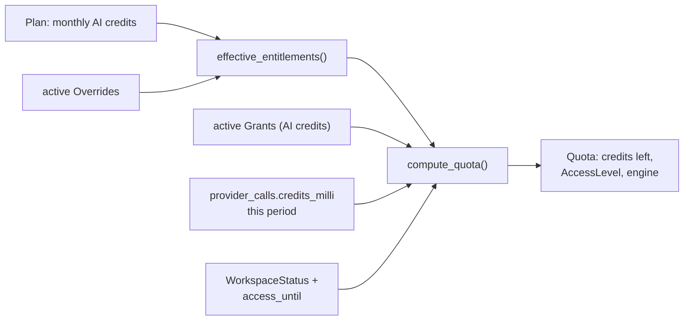

# Plans, credits and admin

**Code:** `outbound/domain/credits.py`, `outbound/domain/entitlements.py`, `outbound/domain/platform_settings.py`, `outbound/metering/metered.py::Meter.record`, `outbound/metering/quota.py`, `outbound/db/repositories/plans.py`, `outbound/services/admin.py`, `outbound/api/routers/admin.py` (guard call sites in `outbound/runner/guards.py`) · **Layer:** domain → db → metering → runner → services → api · **Tests:** `tests/domain/test_entitlements.py`, `tests/db/test_plans.py`, `tests/db/test_quota.py`, `tests/db/test_credits.py`, `tests/db/test_resume.py`, `tests/db/test_metered.py`, `tests/api/test_admin.py`, `tests/api/test_usage.py`

## Purpose

Every workspace has one balance of **AI credits** a month. Every third-party vendor call and every model call uses AI credits; customers see AI credits only, never dollars and never per-step counts. A superadmin defines the plans (Free, Starter, Pro by default) and what an AI credit stands for; a platform admin can grant extra credits, override a customer's settings and extend access ([ADR 0034](../adr/0034-one-ai-credit-balance-metered-per-call.md), which supersedes [ADR 0027](../adr/0027-credits-charged-once-per-lead-per-step.md)).

## Responsibilities

- Turn every metered call into AI credits when it is made and stamp them on its ledger row (`provider_calls.credits_milli`), so a later change of rate never rewrites history.
- Define a `Plan` (monthly AI credits, seats, mailboxes, campaigns, the most a customer may set as budget per lead, features, access days) and compute the `Entitlements` in force once a workspace's active `Override`s are applied.
- Compute what is left this period: monthly credits plus active grants minus the credits the period's calls used.
- Decide `AccessLevel` and whether the worker may run for a workspace (`engine_may_run`), unchanged from before.
- Give the console the reads and writes it needs, with plan definition and the credit rate reserved to superadmins (`Permission.ADMIN_PLANS`).

## How a call becomes AI credits

| Call | AI credits (thousandths, rounded up) |
|---|---|
| A model call whose model has a charge (a console model's `input_credits`/`output_credits`, else `PlatformSettings.llm_charges`; `PlatformSettings.charge`) | `domain/credits.py::llm_credits`: input tokens × charge per million in + output tokens × charge per million out |
| Any other paid call (and a model with no charge but a dollar price in `LLM_PRICES`) | `domain/credits.py::credits_for`: its cost in micro-USD ÷ `PlatformSettings.credit_value_micro_usd` (default 10,000: one credit per US cent) |
| A cache hit, an error, a call blocked by a cap, a free vendor | 0 |

`Meter.record` reads the platform settings in the same short transaction that writes the row. The dollar cost stays on the row (`cost_micro_usd`) for the platform's own books and the admin console; nothing a customer sees reads it. Calls made before migration 0029 keep `credits_milli = 0`: they are not converted.

A model with no charge set uses no credits; the Language model card in the console says so.

## Public interface

| Symbol | Kind | What it does |
|---|---|---|
| `credits.py::credits_for(cost_micro_usd, credit_value_micro_usd)` | function | A call's dollar cost as milli-credits, rounded up; 0 for a free call |
| `credits.py::llm_credits(input_tokens, output_tokens, per_million_in, per_million_out)` | function | A model call's milli-credits at its charge, rounded up |
| `entitlements.py::Plan` | dataclass | `monthly_credits` (None: unlimited), `seats`, `mailboxes`, `active_campaigns`, `max_leads_per_run`, `max_prospect_budget_credits`, `features`, `access_days` |
| `entitlements.py::FREE`, `STARTER`, `PRO`, `DEFAULT_PLANS` | `Plan` constants | 100, 2,000 and 10,000 AI credits a month; the catalog a fresh install starts with |
| `entitlements.py::UNLIMITED` | `Plan` constant | No limits; for workspaces with no plan row and the platform's own use |
| `entitlements.py::Override` | dataclass | One customer-specific change: `monthly_credits`, `seats`, `mailboxes`, `active_campaigns`, `max_leads_per_run`, `max_prospect_budget`, `feature.<name>` |
| `entitlements.py::Grant` | dataclass | Extra AI credits, added to each period's allowance while active; `step` is set only on grants made before migration 0029 |
| `entitlements.py::compute_quota(assignment, plan, overrides, grants, used_milli, status, now)` → `Quota` | function | `Quota.credits` (`CreditQuota`: monthly, granted, allowance, used and remaining milli-credits), the period, access, engine; `has_credits()`, `near_limit` |
| `platform_settings.py::PlatformSettings` | dataclass | Adds `credit_value_micro_usd`, `vendor_caps` (AI credits a month per vendor) and `llm_charges` (model → credits per million tokens in and out) |
| `metering/quota.py::quota_in`, `credit_left`, `WAIT_STEP` | functions, map | The workspace's quota now; whether any credits are left; where a lead waits before each paying stage |
| `repositories/plans.py::UsageRepository.credits_used(start, end)` | method | The period's used milli-credits, from `provider_calls` |

## How it works

### Monthly credits plus grants minus use



A grant adds its credits to every period while it is active, so the console defaults a grant's expiry to the end of the current period ("this month only").

### Where credits are checked

| Where | Check |
|---|---|
| `runner/guards.py::Guards.check` | A stage that makes paid calls (`Stage.spends`) starts only while credits are left; otherwise the lead waits in place at `WAIT_STEP[stage]` (`companies.credit_wait_step`). A stage that has started finishes, so the balance may go a little below nothing |
| `services/intake.py::_Credits` | Adding a lead uses no credits, but a person's rows wait while none are left. A company discovery screened is always added |
| `pipeline.py::discover_companies`, `services/autodiscovery.py` | No search without credits |
| `services/review.py::revise`, `services/leads.py` (write it again) | Refused before the model is asked when none are left |
| `metering/budget.py::check_budget` | The workspace's budget per lead (`budget_per_prospect_credits`) in AI credits; the environment's monthly safety caps per vendor stay in dollars and are the platform's |
| `services/vendors.py::enforce_caps` | Pauses a vendor whose month's calls, across every customer, reached its cap in AI credits |

### Resuming

`services/resume.py::ResumeService` releases every waiting lead and row, oldest first, once credits exist (a grant, a larger plan or override, a new period, extended access). A lead released while credits are short simply waits again before its next paying stage.

### Activity counts are not credits

`usage_events` still records each step once per lead (and every rewrite) for reports and the console's "leads added" and "drafts made". Nothing limits on it.

### Periods anchored to plan start, not the calendar

`period_bounds(anchor, now)` counts whole months forward from `assignment.started_at` — a plan started on the 14th resets on the 14th of each following month, not on the 1st. `add_months` clamps the day for short months (started on the 31st, resets on the 28th/30th as appropriate) rather than rolling into the next month.

### Access levels and the engine switch

| `WorkspaceStatus` | `access_until` | `AccessLevel` | `engine_may_run` |
|---|---|---|---|
| `SUSPENDED`, `PENDING_DELETION`, `DELETED` | any | `LOCKED` | false |
| `ACTIVE` or `PAUSED` | `None`, or in the future | `FULL` | true only if `ACTIVE` |
| `ACTIVE` or `PAUSED` | in the past | `READ_ONLY` | false |

`READ_ONLY` is deliberately not `LOCKED`: people can still sign in and read their data (a lapsed trial should not look like data loss), but the worker does no further work and the API refuses any write guarded by a workspace-scoped permission. `PAUSED` with full access is a platform admin's own lever — a workspace the customer or platform wants to freeze without losing the access clock.

### Platform admin console

`outbound/api/routers/admin.py` behind `require_platform(...)`: platform admins (`ADMIN_READ`, `ADMIN_WRITE`) see every plan and customer, grant and withdraw AI credits, override settings, set access and status, set vendor caps in AI credits and model charges (`ADMIN_KEYS`). Superadmins also hold `ADMIN_PLANS`: they edit the plan catalog, choose the default plan and set what an AI credit stands for (`PUT /api/admin/plans/credit-value`). The console shows customers' use in AI credits and, for staff only, what those calls cost the platform in dollars. Every write goes through `PlatformUnitOfWork` with its `audit_log` row.

### Deleting a customer

`AdminService::schedule_deletion` (`POST /api/admin/customers/{id}/delete`, the customer's name typed as `confirm`) sets `pending_deletion` with `deletion_due_at` 30 days on (`DELETION_GRACE`; `now: true` makes it due at once and purges in the request) and revokes every member's sessions; `deps.py::tenant` refuses a `pending_deletion` workspace like a suspended one. `AdminService::restore` takes it back to `active`. The worker's periodic `AdminService::purge_due` purges what is due: `ErasureRepository::purge_workspace` (as the tenant, under row-level security) blanks `provider_calls` answers and links and deletes the tenant's own rows children first; `IdentityUnitOfWork::forget_workspace` deletes its invitations, join requests and notifications; the row becomes `deleted`. Kept: the workspace row, plan, overrides, grants, usage events, vendor-call costs, audit log and memberships. A membership of a deleted workspace is how `IdentityService::lost_a_workspace` knows a person must ask staff for a new one (`/api/me/workspace-request`, audited as `workspace_requested`); staff answer with `/api/admin/workspace-requests/{user_id}/approve` (a new workspace, the person its admin) or `/dismiss`. Open requests are read from the audit log, like credit requests.

## Invariants

- What is left is never shown below zero, though use may pass the allowance by what one started stage cost.
- A call's AI credits are fixed when it is made: changing the rate or a model's charge never changes a past row.
- `engine_may_run` is false for any status other than `ACTIVE`, whatever the credits.
- An `Override`/`Grant`'s `active(now)` is `revoked_at is None and (expires_at is None or expires_at > now)`.

## Errors and failure behaviour

| Situation | Behaviour |
|---|---|
| No AI credits left | A paying stage does not start and the lead waits in place; a rewrite is refused before the model is asked; resuming by hand returns `409 no_credits` with the renewal date |
| `access_level` is `READ_ONLY` | Writes guarded by workspace permissions return `403`, `access_lapsed`; reads still succeed |
| `access_level` is `LOCKED` | Every workspace-scoped route (read or write) returns `403`; only a platform admin route can see why |
| A model with no charge set | Its calls use no AI credits; the console's AI models card warns |

## Transactions and concurrency

The credits are written with the call's ledger row, in the meter's own short transaction. The guard reads the balance before a stage starts; two stages that start at once may both finish past the allowance, which is accepted.

## Configuration

The plan catalog, the credit rate and model charges live in `platform_settings` (JSON, `outbound/domain/platform_settings.py`) and are edited in the console. A fresh install starts with Free, Starter and Pro.

## Observability

`provider_calls.credits_milli` **is** the AI-credit ledger; `runs.credits_milli` totals a run. Admin writes (`plan_saved`, `credit_value_set`, `credits_granted`, `llm_charges_changed`, `vendor_cap_set`, …) are in `audit_log`.

## Security and privacy

Platform vendor keys and workspace entitlements are platform data with `ADMIN_KEYS`/`ADMIN_WRITE` gating; a tenant role (`outbound_app`) has read-only access to `PlanRow`/`OverrideRow`/`GrantRow` (to show its own Plan & Usage screen) but cannot write them — only a platform admin, through `PlatformUnitOfWork`, can.

## Tests

| File | Proves |
|---|---|
| `tests/domain/test_entitlements.py` | The three plans; overrides; credits left; cost and token charges into AI credits; periods; access |
| `tests/db/test_metered.py` | Each call stamped at the rate in force; model charges; budget per lead in credits |
| `tests/db/test_credits.py`, `tests/db/test_resume.py` | Waiting in place without credits, resuming after a grant, discovery and rewrites refused, finished stages may overdraw |
| `tests/api/test_admin.py` | Superadmin-only plans and credit rate; grants in AI credits; model charges; staff see dollar cost |
| `tests/api/test_customer_deletion.py` | Typed confirmation, closed at once, restore, the purge after the grace period keeps only the books, members keep accounts and ask staff for a new workspace |

## Known limitations

- Calls made before migration 0029 have no AI credits; a period that spans the migration counts only later calls.
- A model with no charge set is free to customers until a charge is entered.
- `max_prospect_budget_credits` is shown but not yet enforced when a customer saves their budget per lead.
- Purging a customer deletes its mailbox secrets but does not revoke OAuth tokens at Microsoft or Google; they lapse or the customer revokes them.

## Planned

Billing (6e) charges for plans and AI-credit top-ups, reading `provider_calls.credits_milli`.

## How to refresh this page

```bash
cat outbound/domain/credits.py outbound/domain/entitlements.py outbound/domain/platform_settings.py
grep -n "credits" outbound/metering/metered.py outbound/runner/guards.py
uv run pytest tests/domain/test_entitlements.py tests/db/test_credits.py tests/api/test_admin.py -q
```
