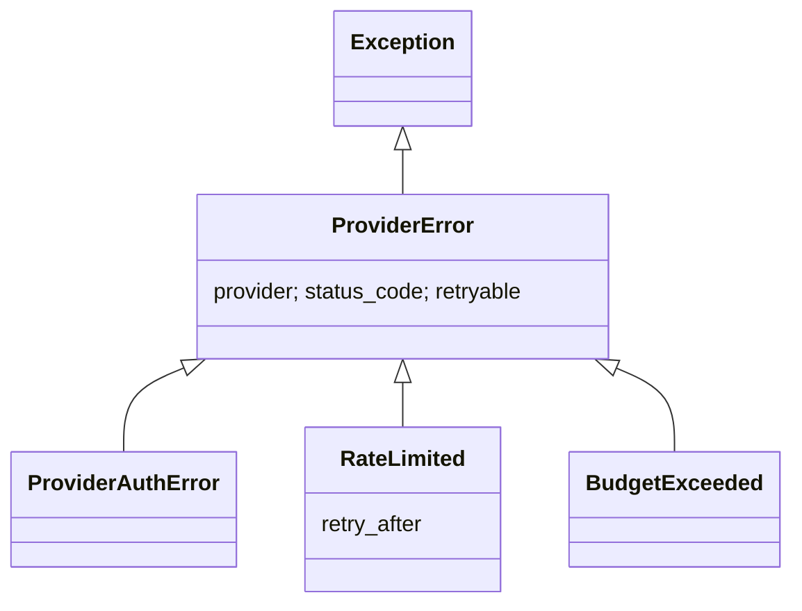

# Providers

**Code:** `outbound/providers/` · **Layer:** providers (above domain; independent of db) · **Tests:** `tests/providers/`, `tests/contract/`

## Purpose

This layer turns every outside service the engine depends on into a typed Python interface. Stages ask a `Protocol` for a result model and never see a vendor's URL, JSON or quirks. It exists so that a vendor can be added, swapped or faked without touching a stage ([ADR 0008](../adr/0008-ports-and-adapters.md)), and so that timeouts and retries live in one place.

## Responsibilities

- **Ports:** one `Protocol` per kind of vendor, with frozen result models.
- **Adapters:** one class per vendor. It maps the vendor's answer into the port's model and raises typed errors.
- **One HTTP client** that owns timeouts, retries and error mapping.
- **A registry** that builds adapters by name from settings.
- **The price table**, and the functions that price a call.
- **Parsing JSON** out of a model's reply.

**Not its job:**

- caching, spend caps and the cost ledger (the [meter](metering.md) wraps every port);
- deciding what to do when a vendor fails (stages);
- the mailbox's business rules ([deliver and sync](stage-deliver-and-sync.md)).

## Public interface

### Ports (`outbound/providers/ports.py`)

All result models extend `_Model`: Pydantic, `frozen=True`, `extra="forbid"`. Models of paid answers carry `raw_status` (the vendor's own word) and `billed` (whether the vendor charged).

| Protocol | Methods | Returns |
|---|---|---|
| `EmailFinder` | `find(person: PersonQuery, domain)` | `FinderResult` (address or none, confidence, `raw_status`, `billed`) |
| `EmailVerifier` | `verify(email)` | `VerificationResult` (`VerificationStatus`: `valid`, `catch_all`, `unknown`, `invalid`) |
| `CatchAllResolver` | `submit(email)`, `poll(ticket)` | `ResolutionTicket` (may already carry a `ResolutionResult`), `ResolutionResult \| None` |
| `SearchProvider` | `search(query, max_results=5)`, `extract(urls)` | `list[SearchHit]`, `list[PageText]` |
| `LlmClient` | `complete(system, user, json_mode, temperature, max_tokens)`; attributes `name`, `model` | `LlmResult` (text, token counts) |
| `CompanyRegistry` | `search(company_name, max_results=5)` | `list[RegistryEntry]` |
| `Mailbox` | `append_draft(OutgoingDraft)`, `draft_exists(id)`, `delete_draft(id)`, `list_sent(since)`, `list_inbox(since)`; attribute `address` | Remote draft id, bool, count, `list[SentMessage]`, `list[InboundMessage]` |

### Adapters

| Vendor | Class | Port | Page |
|---|---|---|---|
| Tavily | `outbound/providers/adapters/tavily.py::TavilySearch` | `SearchProvider` | [tavily](../integrations/tavily.md) |
| Hunter | `outbound/providers/adapters/hunter.py::HunterFinder`, `HunterVerifier` | `EmailFinder`, `EmailVerifier` | [hunter](../integrations/hunter.md) |
| ZeroBounce | `outbound/providers/adapters/zerobounce.py::ZeroBounceFinder`, `ZeroBounceVerifier` | `EmailFinder`, `EmailVerifier` | [zerobounce](../integrations/zerobounce.md) |
| MyEmailVerifier | `outbound/providers/adapters/myemailverifier.py::MyEmailVerifierVerifier` | `EmailVerifier` | [myemailverifier](../integrations/myemailverifier.md) |
| OrbiSearch | `outbound/providers/adapters/orbisearch.py::OrbiSearchVerifier` | `EmailVerifier` (no finder API) | [orbisearch](../integrations/orbisearch.md) |
| Enrichley | `outbound/providers/adapters/enrichley.py::EnrichleyResolver` | `CatchAllResolver` (answers at once) | [enrichley](../integrations/enrichley.md) |
| Scrubby | `outbound/providers/adapters/scrubby.py::ScrubbyResolver` | `CatchAllResolver` (asynchronous) | [scrubby](../integrations/scrubby.md) |
| Companies House | `outbound/providers/adapters/companies_house.py::CompaniesHouse` | `CompanyRegistry` | [companies-house](../integrations/companies-house.md) |
| Any OpenAI-compatible chat API | `outbound/providers/adapters/llm.py::OpenAiCompatibleLlm` | `LlmClient` | [llm](../integrations/llm.md) |
| IMAP | `outbound/providers/adapters/imap_mailbox.py::ImapMailbox` | `Mailbox` | [imap-mailbox](../integrations/imap-mailbox.md) |

### Registry (`outbound/providers/registry.py`)

| Function | Returns | When a name is unknown or its key is missing |
|---|---|---|
| `build_finder_chain(settings)` | Finders in `FINDER_CHAIN` order | `ProviderAuthError` |
| `build_verifier(settings)` | The `VERIFIER` | `ProviderAuthError` |
| `build_resolver(settings)` | The `CATCH_ALL_RESOLVER` | `ProviderAuthError`; `pipeline.real_providers` turns that into "no resolver" |
| `build_llm(settings)` | `OpenAiCompatibleLlm` for `LLM_PROVIDER` and `LLM_MODEL`. The key comes from the vendor's own variable (`ANTHROPIC_API_KEY`, `OPENAI_API_KEY`, `GEMINI_API_KEY`, `COPILOT_API_KEY`), else `LLM_API_KEY` | — |
| `build_search(settings)` | Tavily | `ProviderAuthError` |
| `build_company_registry(settings)` | Companies House, or `None` without a key | — |
| `build_mailbox_if_configured(settings)` | The IMAP mailbox, or `None` without a login | — |
| `configured_finders`, `configured_verifiers`, `configured_resolvers` | Every adapter whose key is set (used by the bake-off) | Skipped |

Registry names: finders `hunter`, `zerobounce`; verifiers `hunter`, `zerobounce`, `orbisearch`, `myemailverifier`; resolvers `scrubby` (needs `SCRUBBY_BASE_URL` too) and `enrichley`.

### Errors (`outbound/providers/errors.py`)



Messages never include the request URL, because several vendors take the API key as a query parameter.

### Other modules

- `outbound/providers/pricing.py`: `DEFAULT_PRICES` (micro-USD per `vendor:operation`), `DEFAULT_LLM_PRICES` (per model, per million tokens; empty), `price_of` (returns **0** for an unknown key), and `llm_cost` (rounds up to a whole micro-dollar). The prices themselves are listed in [integrations](../integrations/README.md#prices).
- `outbound/providers/llm_json.py`: `parse_json_object` takes the outermost `{…}` from a reply. `ask_json(llm, system, user, Model)` makes one call and validates the result against a Pydantic model, raising `ProviderError` if it does not fit.

## How the HTTP client works

`outbound/providers/http.py::HttpClient` is used by every adapter except IMAP (which uses `imaplib`). Adapters never retry on their own.

| Response | Raised as | Retried |
|---|---|---|
| Network error (`httpx.TransportError`) | `ProviderError(retryable=True)` | Yes |
| 429 | `RateLimited` with `retry_after` from the header | Yes, after `Retry-After` (capped at 60 s), else the back-off |
| 401, 403 | `ProviderAuthError` | No: fix the key |
| 202 | `ProviderError("still processing", retryable=True)` (Hunter's verifier) | Yes |
| 5xx | `ProviderError(retryable=True)` | Yes |
| Other 4xx | `ProviderError` | No |
| 2xx that is not JSON, or not a JSON object | `ProviderError` | No |

- **Attempts:** 3 (`DEFAULT_ATTEMPTS`).
- **Back-off:** exponential, 1 s doubling to at most 8 s.
- **Timeout:** 30 s per call (`DEFAULT_TIMEOUT_SECONDS`). The LLM adapter sets its own 90 s.
- **Logging:** each retry logs `provider_retry` at WARNING, with the provider, the method and path (never the URL), the attempt number, the wait and the status.
- **Missing keys:** `require_api_key` fails when the adapter is built, not on the first call.

## Invariants

- No vendor JSON crosses an adapter's boundary. Every answer is a frozen model that refuses unknown fields.
- No adapter retries; only `HttpClient` does, and only on the retryable cases above.
- Every HTTP call has a timeout.
- A missing key fails at start-up with the provider's name ("not configured: …").

## Transactions and concurrency

None. Providers do not touch the database. One `httpx.Client` is shared per adapter.

## Configuration

Vendor keys (`HUNTER_API_KEY`, `ZEROBOUNCE_API_KEY`, `MYEMAILVERIFIER_API_KEY`, `ORBISEARCH_API_KEY`, `ENRICHLEY_API_KEY`, `SCRUBBY_API_KEY` and `SCRUBBY_BASE_URL`, `TAVILY_API_KEY`, `COMPANIES_HOUSE_API_KEY`); the chain (`FINDER_CHAIN`, `VERIFIER`, `CATCH_ALL_RESOLVER`); the model (`LLM_*`, vendor keys); IMAP (`IMAP_*`, `EMAIL_*`, folders); prices (`PROVIDER_PRICES`, `LLM_PRICES`). See the [configuration reference](../operations/configuration-reference.md).

## Observability

`provider_retry` (WARNING). The per-call record (`provider_call`) is written by the [meter](metering.md), not here.

## Security and privacy

- Keys are `SecretStr` in settings and unwrapped only when the registry builds an adapter.
- What each vendor receives (names, domains, addresses, page text, prompts) is listed on its integration page and in [privacy](../security/privacy-data-processing.md).
- Model replies are untrusted: `ask_json` validates their shape, and prompts fence web text ([R-08](../tech-debt-and-risks.md#r-08--p1--security-web-text-can-close-the-prompt-fence)).

## Tests

| File | Proves |
|---|---|
| `tests/providers/test_http.py` | Retry, back-off, `Retry-After`, auth errors, non-JSON, no URL in errors |
| `tests/providers/test_<vendor>.py` (one per adapter) | Mapping from documented responses (fixtures in `tests/providers/fixtures/`) |
| `tests/contract/` (`finder_contract.py`, `verifier_contract.py`, `resolver_contract.py`, `search_contract.py`) | Every adapter of a port behaves the same way: shared contract tests |
| `tests/providers/test_registry.py` | Names, configured sets, missing keys |

The fixtures are built from vendor documentation, not live recordings ([fixtures README](../../../tests/providers/fixtures/README.md)). The network is blocked in every test.

## Known limitations

- The finder chain is provisional, and Scrubby is unverified live ([R-09](../tech-debt-and-risks.md#r-09--p1--vendors-the-provider-chain-is-unproven-e5-d5)).
- No model has a default price ([R-03](../tech-debt-and-risks.md#r-03--p1--cost-model-calls-are-recorded-at-0-b5)).
- IMAP has no retries.

## Extending it

Follow [add a vendor adapter](../guides/add-a-vendor-adapter.md): an adapter on `HttpClient`, a registry entry, a price, fixtures from the vendor's documentation, a test that runs the port's contract tests, and an integration page.

## Planned

- Phase 4 uses `Mailbox.list_inbox` for replies: [phase-4-close-the-loop.md](../../phases/phase-4-close-the-loop.md).
- Phase 5 adds a sending gateway (EmailEngine, Smartlead or Instantly) behind the mailbox port: [phase-5-automated-sending.md](../../phases/phase-5-automated-sending.md).

## How to refresh this page

```bash
grep -n "^class \|    def " outbound/providers/ports.py
grep -n '"[a-z_]*": _Entry' outbound/providers/registry.py
grep -n "DEFAULT_\|MAX_RETRY" outbound/providers/http.py
uv run pytest tests/providers tests/contract -q
```
