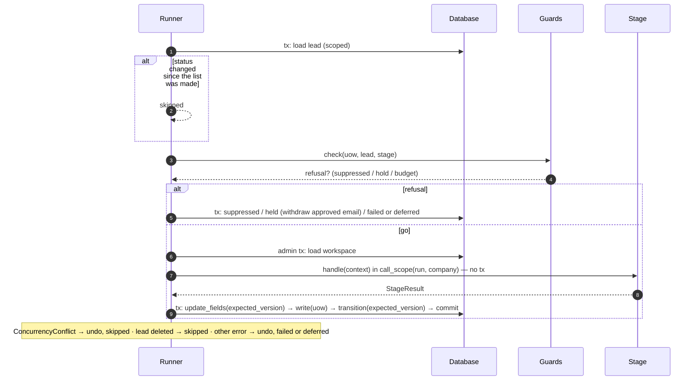
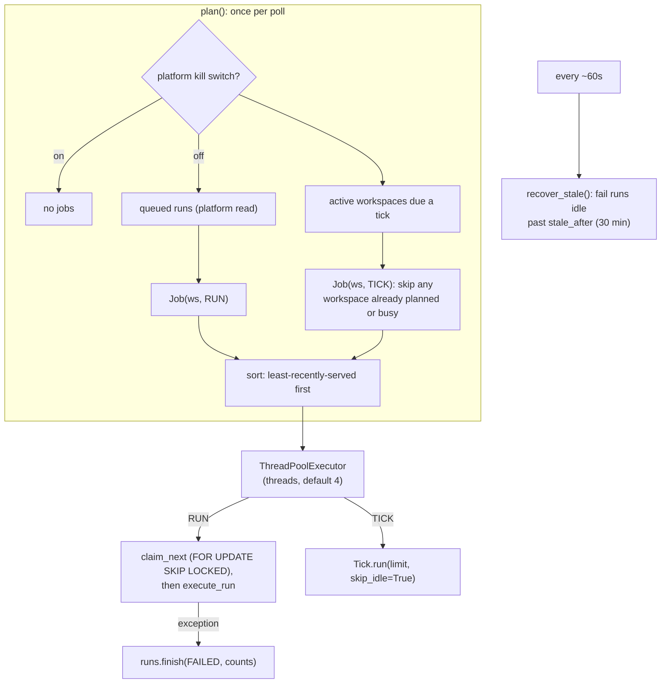

# Runner and worker

**Code:** `outbound/runner/` (`runner.py`, `guards.py`, `tick.py`), `outbound/worker.py`, `outbound/cli/serve.py::worker`, `outbound/db/repositories/audit.py::RunRepository`, `outbound/db/platform.py::SchedulerQueries` · **Layer:** runner (and the worker entry point) · **Tests:** `tests/db/test_runner.py`, `tests/db/test_pipeline_e2e.py`, `tests/db/test_robustness.py`, `tests/db/test_scheduler.py`, `tests/test_worker.py`

## Purpose

The runner is the plain-Python loop that moves leads through the stages, for one workspace, one run at a time. For each due lead it:

1. checks the guards;
2. calls the stage with no transaction open;
3. writes the stage's answer in one short transaction.

A lead that fails is recorded as failed, and the run carries on. As of Phase 6a the **worker** is no longer a single-workspace poller: it is one process that serves *every* workspace, deciding fairly which workspace gets attention next, assembling a fresh pipeline per piece of work, and recovering a run abandoned by a worker that died — replacing the earlier cron-triggered `outbound tick`. Together with the runner, it replaces a queue broker ([ADR 0002](../adr/0002-the-table-is-the-queue.md)) and now a cron schedule too ([ADR 0025](../adr/0025-tenant-bound-foreign-keys-and-multi-workspace-worker.md)).

## Responsibilities

- Select due leads per stage, in priority order.
- Apply the guards (suppression, policy, budget) the same way for every stage.
- Run the stage inside `call_scope(run, company)`.
- Write the result: field updates, child rows and the transition, all with `row_version`, or undo an outside effect.
- Turn failures into `failed` (with back-off) or a deferral.
- Honour cancellation between leads and between stages.
- Record the run's counts and cost.
- **Worker:** plan which workspace gets attention next (queued runs before ticks, least-recently-served first, never a workspace already busy), claim and execute queued runs, give every active workspace a periodic tick, and recover any run whose worker went silent.
- **Tick:** retry due failures, run the jobs, then a pipeline pass — skipping the pipeline pass entirely when nothing is waiting and the caller says so (the worker's own timer does).

**Not its job:**

- what a stage does ([stage LLDs](../README.md#low-level-design));
- the rules behind the guards ([safety model](../hld/safety-model.md));
- building the stages (`pipeline.assemble`, [configuration and bootstrap](configuration-and-bootstrap.md)).

## Public interface

| Symbol | Kind | What it does |
|---|---|---|
| `outbound/runner/runner.py::Runner` | class | `run_pipeline(limit=50, only=None, run_id=None) → RunReport`; `retry_failed(limit=50) → int` |
| `outbound/runner/runner.py::Outcome` | enum | `advanced`, `held`, `failed`, `suppressed`, `deferred`, `skipped` (per lead, counted per stage) |
| `outbound/runner/runner.py::RunReport` | dataclass | `run_id`, `status`, `counts` (stage → outcome → n), `cost_micro_usd` |
| `outbound/runner/guards.py::Guards` | class | `check(uow, company, stage) → Refusal \| None` |
| `outbound/runner/guards.py::Refusal`, `RefusalKind` | — | `suppressed`, `hold`, `budget` |
| `outbound/runner/tick.py::Tick` | class | `run(limit=50, skip_idle=False) → TickReport` |
| `outbound/runner/tick.py::Job` | protocol | `name`, `run() → dict[str, int]` (`CatchAllPoller`, `SentSync`, `InboxSync`) |
| `outbound/worker.py::Worker` | class | `plan() → list[Job]`; `recover_stale() → list[str]`; `execute(job) → bool`; `run_periodic()`; `run_once() → bool`; `run_forever(poll_seconds=2.0, stop=…)` |
| `outbound/worker.py::Task`, `Job` | enum, dataclass | `Task.RUN`/`Task.TICK`; `Job(workspace_id, task)` — the unit the worker plans and executes |
| `outbound/stages/base.py::Stage`, `StageResult`, `StageContext`, `StageFailure`, `Reader` | — | The contract between the runner and a stage |

**The stage contract.** A `Stage` declares:

- `name`;
- `input_status`;
- `guard_policy`: re-check the country policy before it runs;
- `spends`: subject to the budget guard;
- `handle(ctx) → StageResult`.

A `StageResult` carries:

- `to_status`;
- `reason`;
- `hold_reason`;
- `company_updates`;
- `next_action_at`;
- `write(uow)` for child rows;
- `undo()` for an outside effect.

## How it works

### A run

`run_pipeline` either starts a new run (`RunRepository.start`, status `running`), or marks a queued one `running`. It binds `run_id` and `workspace_id` to the log context and logs `run_started`. Then, for each stage in order (optionally only some):

1. `_run_stage` lists up to `limit` due leads in the stage's input status (`CompanyRepository.due`). The list is made when the stage starts, so leads advanced by an earlier stage in the same run are included.
2. Each lead goes through `_process`.
3. After each stage, and before each lead, the run's status is re-read; if it is `cancelled`, the run stops.

At the end, `RunRepository.finish` stores the status, counts, `finished_at` and cost (the sum of the run's ledger rows), and the runner logs `run_finished`. An exception outside the per-lead handling finishes the run as `failed` and re-raises.

### One lead (`_process`)



### Guards (`Guards.check`), in order

| # | Guard | Applies to | Refusal | What the runner does |
|---|---|---|---|---|
| 1 | Domain on the suppression list | every stage | `suppressed` | → `suppressed` (final) |
| 2 | Country policy not ALLOW (`policy_decision_for(stage=…)`) | stages with `guard_policy`: contacts, email, copy, deliver | `hold` with the decision's hold reason, or `needs_operator` | → `held`. If the lead is `approved`, its `generated` and `approved` messages are cancelled first |
| 3 | Company spend ≥ per-prospect ceiling | stages with `spends`: research, email, copy | `budget` | → `failed` for a stage that can fail a lead (all three can) |

A refusal on a stage that cannot fail a lead is deferred instead.

### Failure handling

| Error during `handle` or the write | Outcome |
|---|---|
| `ConcurrencyConflict` (the operator or another run changed the lead) | `undo()`; **skipped**: tried again next run |
| `NotFound`, and the lead no longer exists (deleted mid-run) | Logged as `lead_gone_during_run`; skipped |
| The lead could not even be loaded | Logged as `lead_unreadable`; skipped |
| Anything else | `undo()`; logged as `stage_failed` with the error (≤ 300 characters). If the lead's status has moved meanwhile: skipped. Otherwise a stage in `STAGE_INPUT_STATUS` (research, gate, contacts, email, copy) → **failed**; deliver → **deferred** |

- **Failed:** `failed_stage` and `last_error` are set, `attempts` is incremented, and `next_action_at = now + 15 min × (attempts + 1)`.
- **Deferred:** the status is unchanged, `next_action_at = now + 1 h`, and a `deferred` event is written only when the reason differs from the last one, so an hourly retry does not fill the timeline.
- **Undo errors** are logged (`undo_failed`) and do not hide the original error.

### Retries

`retry_failed(limit)` moves due `failed` leads with fewer than 3 attempts back to their failed stage's input status (`retry_status_for`). It is called by every workspace's own tick, which the worker now runs for every active workspace on a timer ([below](#the-worker-one-process-every-workspace)) — so retries happen in production by default, closing what was once a gap ([R-02](../tech-debt-and-risks.md#r-02--p1--pipeline-scheduled-work-never-runs-in-production-b7), now closed). `outbound retry` still calls it by hand. The operator's **Retry** on the lead page (`LeadService.retry`) ignores both the limit and the back-off.

### The tick

`Tick.run(limit, skip_idle=False)`:

1. `retry_failed`.
2. If there are jobs, start a `sync` run and run each job inside `call_scope(run_id)`. One failing job is logged as `job_failed` and does not stop the others. Finish the sync run.
3. `run_pipeline(limit)` — unless `skip_idle` is set and no lead is waiting, in which case no pipeline run starts at all, so a quiet workspace's Runs screen does not fill up with empty runs. The worker's own timer always passes `skip_idle=True`; a direct `tick` from the CLI does not.

Everything is driven by status and `next_action_at`, so a tick that fires early repeats nothing.

### The worker: one process, every workspace



- **Planning (`Worker.plan`)** reads two cheap, cross-workspace facts through the **platform** unit of work ([tenancy and isolation](tenancy-and-isolation.md)) — which workspaces have a queued run, and which active workspaces are due a tick (`tick_every`, default 15 minutes) — and nothing else; it never reads a workspace's own rows. A platform-wide kill switch (`PlatformSettingsRow.kill_runs`) short-circuits planning to nothing for anyone. At most one job per workspace is planned per pass, a run always outranks a tick for the same workspace, and a workspace already executing a job is skipped (`self._busy`). Jobs are sorted so the workspace that has waited longest is served first — simple least-recently-served fairness, not a priority queue.
- **Executing a job** (`Worker.execute` → `_execute`) runs in a fresh `contextvars.Context`, so one job's logging/request-scoped state cannot leak into the next. A `RUN` job claims the next queued run in that workspace's own unit of work (`uow.runs.claim_next`, `FOR UPDATE SKIP LOCKED` — safe with several workers on Postgres, a no-op on SQLite, which ignores `SKIP LOCKED`) and, if one was claimed, assembles a fresh `Pipeline` for that workspace and calls `execute_run`. A `TICK` job calls that workspace's `Tick.run(limit=tick_limit, skip_idle=True)` directly, with no run claimed first — a tick running into a `RunInProgress` for that workspace is logged as `tick_skipped`, not an error.
- **Stale-run recovery (`Worker.recover_stale`)**, run about every 60 seconds in `run_forever`, asks the platform unit of work which workspaces have a run whose heartbeat has gone quiet past `stale_after` (30 minutes), then fails each such run (`uow.runs.fail_stale`) in that workspace's own unit of work — closing what was once an open gap for a worker killed mid-run ([R-05](../tech-debt-and-risks.md#r-05--p1--runs-a-stopped-worker-leaves-its-run-running-runs-can-overlap-b2-b3), now closed by this mechanism).
- **A fresh pipeline per job**, not one built once at process start, because the runner keeps per-run state and a long-lived worker now serves many workspaces, each needing its own metered providers scoped to its own workspace id.
- **Periodic (platform-wide) jobs** (`run_periodic`, e.g. usage notices) run once per `tick_every` interval, independent of any one workspace's own tick; one failing job is logged (`periodic_failed`) and does not stop the others.
- **Errors are contained** at every level: one job's exception is logged (`run_failed`/`tick_failed`) and finishes that run as `FAILED` without affecting any other workspace's jobs; a database hiccup inside the loop itself is logged as `worker_error` and the loop continues.
- **Still no SIGTERM handler.** A stop or deploy kills the process after Docker's grace period; any run in flight is picked up by the *next* worker's `recover_stale` once its heartbeat goes stale, rather than being lost forever — this is the mechanism that replaced the earlier "no stale-run recovery" gap, not a graceful-shutdown path, so the run still briefly shows as `running` until the next recovery pass.
- **`outbound worker`** takes `--threads` (default 4), `--tick-minutes` (default 15), `--stale-minutes` (default 30), `--tick-limit` (default 50); there is no `--workspace` flag any more — the worker always serves every active workspace, which also makes the earlier risk of the API and worker binding to different single workspaces moot ([R-22](../tech-debt-and-risks.md#r-22--p3--configuration-the-api-and-the-worker-can-bind-to-different-workspaces), now closed).

### Run statuses

| Created by | Starts as | Moves to |
|---|---|---|
| API (`RunService.queue`) | `queued` | `running` (worker), `cancelled` (operator) |
| CLI `run`, `tick` | `running` | `succeeded`, `failed`, `cancelled` |
| Tick jobs | `running` (kind `sync`) | `succeeded`, or `failed` if any job failed |
| Worker, stale (no heartbeat past `stale_after`) | `running` | `failed` (`Worker.recover_stale`), with a `run_stale_failed` log line |

`finish` keeps a status that is already final, so a run cancelled while running stays `cancelled`. Run transitions use `RUN.allows`, not `check`, and write no events ([R-15](../tech-debt-and-risks.md#r-15--p2--correctness-runs-and-three-tables-bypass-the-usual-guards)).

## Invariants

- A stage never holds a transaction open.
- Every lead write checks `row_version`.
- One lead's failure never stops the run.
- A lead in `held` or `failed`, or with a future `next_action_at`, is not picked.
- Suppression is checked before every stage.

## Transactions and concurrency

Per lead: a read and guard transaction, an admin read, then one write transaction.

**Two runs at once for the same workspace** (a CLI `run`, a worker-claimed run, a tick) are still not structurally prevented, though the worker's own planning (at most one job per workspace per pass, and a busy workspace skipped) makes it rare in production:

- Optimistic locking stops a double write: the second run's write conflicts and is skipped.
- Both runs may still pay for the same vendor call before either has cached it.

`claim_next` is safe with several workers on Postgres, but not on SQLite, which ignores `SKIP LOCKED`. Two *different* workspaces' jobs run concurrently on separate threads with no shared locking at all, by design — their rows are isolated by row-level security ([tenancy and isolation](tenancy-and-isolation.md)), so nothing about one workspace's run can affect another's.

## Configuration

`--threads` (4), `--tick-minutes` (15), `--stale-minutes` (30), `--tick-limit` (50) on `outbound worker`; `--limit` on `run`, `tick` and `retry` (50). The per-lead delays (15 min, 1 h, 3 attempts) are constructor defaults, not settings.

## Observability

`run_started`, `run_finished`, `stage_done`, `guard_refused`, `stage_failed`, `lead_gone_during_run`, `lead_unreadable`, `undo_failed`, `job_failed`, `tick_skipped`, `run_claimed`, `run_failed`, `tick_failed`, `run_stale_failed`, `periodic_failed`, `worker_error`. Context (`run_id`, `workspace_id`, `company_id`, `stage`) is bound once and rides on every line. See [observability](../operations/observability.md).

## Tests

| File | Proves |
|---|---|
| `tests/db/test_runner.py` | Every stage in one run; events for every move; priority and limit; `only`; child rows written with the move; holds with a wake time; scheduled leads left alone; failures and illegal results; deferral recorded once; operator edits win; back-off growth and attempt limit; suppression, policy and budget guards; withdrawal on hold; undo of a saved draft; an unreadable lead |
| `tests/db/test_pipeline_e2e.py` | Targets to drafts with fake vendors, and a rerun at zero vendor cost |
| `tests/db/test_robustness.py` | Every paid path metered; misconfiguration errors |
| `tests/db/test_scheduler.py` | `SchedulerQueries` returns correctly filtered ids, scoped and unaffected by any one workspace's own data |
| `tests/test_worker.py` | `plan()` fairness and busy/kill-switch exclusion; `recover_stale`; a job's exception does not affect another workspace's job; `tick_skipped` on `RunInProgress` |

## Known limitations

- Two runs for the *same* workspace can still race if started from different entry points (CLI and worker, say) at the same moment; optimistic locking stops a double write, but the duplicate vendor spend before either write is not prevented.
- The budget is read once per process ([R-10](../tech-debt-and-risks.md#r-10--p1--budget-a-running-worker-does-not-see-budget-changes-b4)) — now once per *worker process*, which serves every workspace, raising the cost of restarting the worker to pick up a budget change.
- The worker's health is not checked ([R-06](../tech-debt-and-risks.md#r-06--p1--operations-health-checks-do-not-see-a-broken-worker-or-database)) — a process alive but stuck in a loop (e.g. `recover_stale` itself failing) would not be caught by a liveness probe alone.

## Planned

- Phase 4 adds follow-up and reply jobs to the tick: [phase-4-close-the-loop.md](../../phases/phase-4-close-the-loop.md) (the opt-out/bounce half of this, [inbox and opt-outs](inbox-and-opt-outs.md), landed in Phase 4a).

## How to refresh this page

```bash
grep -n "def \|timedelta\|max_attempts" outbound/runner/runner.py
sed -n '/def check/,/return None/p' outbound/runner/guards.py
grep -n "def " outbound/worker.py outbound/runner/tick.py
uv run pytest tests/db/test_runner.py -q
```
