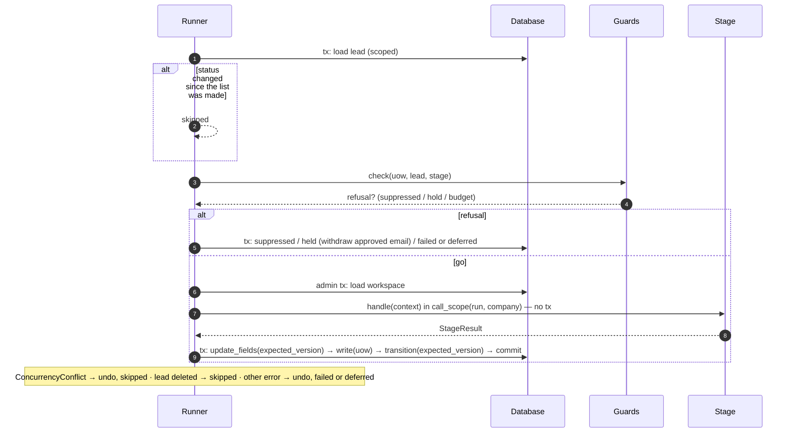
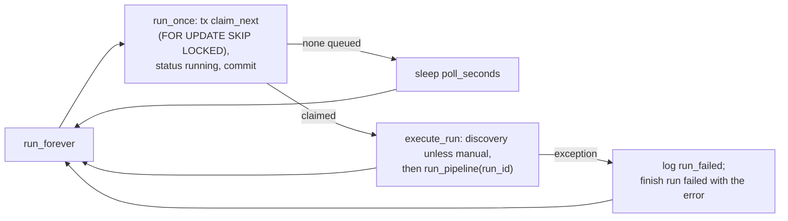

# Runner and worker

**Code:** `outbound/runner/` (`runner.py`, `guards.py`, `tick.py`), `outbound/worker.py`, `outbound/cli/serve.py::worker`, `outbound/db/repositories/audit.py::RunRepository` · **Layer:** runner (and the worker entry point) · **Tests:** `tests/db/test_runner.py`, `tests/db/test_pipeline_e2e.py`, `tests/db/test_robustness.py`

## Purpose

The runner is the plain-Python loop that moves leads through the stages. For each due lead it:

1. checks the guards;
2. calls the stage with no transaction open;
3. writes the stage's answer in one short transaction.

A lead that fails is recorded as failed, and the run carries on. The worker is the process that executes runs queued by the API. The tick is the scheduled pass for retries and periodic jobs. Together they replace a queue broker ([ADR 0002](../adr/0002-the-table-is-the-queue.md)).

## Responsibilities

- Select due leads per stage, in priority order.
- Apply the guards (suppression, policy, budget) the same way for every stage.
- Run the stage inside `call_scope(run, company)`.
- Write the result: field updates, child rows and the transition, all with `row_version`, or undo an outside effect.
- Turn failures into `failed` (with back-off) or a deferral.
- Honour cancellation between leads and between stages.
- Record the run's counts and cost.
- **Worker:** claim queued runs and execute them; survive errors.
- **Tick:** retry due failures, run the jobs, then a pipeline pass.

**Not its job:**

- what a stage does ([stage LLDs](../README.md#low-level-design));
- the rules behind the guards ([safety model](../hld/safety-model.md));
- building the stages (`pipeline.assemble`, [configuration and bootstrap](configuration-and-bootstrap.md)).

## Public interface

| Symbol | Kind | What it does |
|---|---|---|
| `outbound/runner/runner.py::Runner` | class | `run_pipeline(limit=50, only=None, run_id=None) → RunReport`; `retry_failed(limit=50) → int` |
| `outbound/runner/runner.py::Outcome` | enum | `advanced`, `held`, `failed`, `suppressed`, `deferred`, `skipped` (per lead, counted per stage) |
| `outbound/runner/runner.py::RunReport` | dataclass | `run_id`, `status`, `counts` (stage → outcome → n), `cost_micro_usd` |
| `outbound/runner/guards.py::Guards` | class | `check(uow, company, stage) → Refusal \| None` |
| `outbound/runner/guards.py::Refusal`, `RefusalKind` | — | `suppressed`, `hold`, `budget` |
| `outbound/runner/tick.py::Tick` | class | `run(limit=50) → TickReport` |
| `outbound/runner/tick.py::Job` | protocol | `name`, `run() → dict[str, int]` (`CatchAllPoller`, `SentSync`) |
| `outbound/worker.py::Worker` | class | `run_once() → bool`; `run_forever(poll_seconds=2.0, stop=…)` |
| `outbound/stages/base.py::Stage`, `StageResult`, `StageContext`, `StageFailure`, `Reader` | — | The contract between the runner and a stage |

**The stage contract.** A `Stage` declares:

- `name`;
- `input_status`;
- `guard_policy`: re-check the country policy before it runs;
- `spends`: subject to the budget guard;
- `handle(ctx) → StageResult`.

A `StageResult` carries:

- `to_status`;
- `reason`;
- `hold_reason`;
- `company_updates`;
- `next_action_at`;
- `write(uow)` for child rows;
- `undo()` for an outside effect.

## How it works

### A run

`run_pipeline` either starts a new run (`RunRepository.start`, status `running`), or marks a queued one `running`. It binds `run_id` and `workspace_id` to the log context and logs `run_started`. Then, for each stage in order (optionally only some):

1. `_run_stage` lists up to `limit` due leads in the stage's input status (`CompanyRepository.due`). The list is made when the stage starts, so leads advanced by an earlier stage in the same run are included.
2. Each lead goes through `_process`.
3. After each stage, and before each lead, the run's status is re-read; if it is `cancelled`, the run stops.

At the end, `RunRepository.finish` stores the status, counts, `finished_at` and cost (the sum of the run's ledger rows), and the runner logs `run_finished`. An exception outside the per-lead handling finishes the run as `failed` and re-raises.

### One lead (`_process`)



### Guards (`Guards.check`), in order

| # | Guard | Applies to | Refusal | What the runner does |
|---|---|---|---|---|
| 1 | Domain on the suppression list | every stage | `suppressed` | → `suppressed` (final) |
| 2 | Country policy not ALLOW (`policy_decision_for(stage=…)`) | stages with `guard_policy`: contacts, email, copy, deliver | `hold` with the decision's hold reason, or `needs_operator` | → `held`. If the lead is `approved`, its `generated` and `approved` messages are cancelled first |
| 3 | Company spend ≥ per-prospect ceiling | stages with `spends`: research, email, copy | `budget` | → `failed` for a stage that can fail a lead (all three can) |

A refusal on a stage that cannot fail a lead is deferred instead.

### Failure handling

| Error during `handle` or the write | Outcome |
|---|---|
| `ConcurrencyConflict` (the operator or another run changed the lead) | `undo()`; **skipped**: tried again next run |
| `NotFound`, and the lead no longer exists (deleted mid-run) | Logged as `lead_gone_during_run`; skipped |
| The lead could not even be loaded | Logged as `lead_unreadable`; skipped |
| Anything else | `undo()`; logged as `stage_failed` with the error (≤ 300 characters). If the lead's status has moved meanwhile: skipped. Otherwise a stage in `STAGE_INPUT_STATUS` (research, gate, contacts, email, copy) → **failed**; deliver → **deferred** |

- **Failed:** `failed_stage` and `last_error` are set, `attempts` is incremented, and `next_action_at = now + 15 min × (attempts + 1)`.
- **Deferred:** the status is unchanged, `next_action_at = now + 1 h`, and a `deferred` event is written only when the reason differs from the last one, so an hourly retry does not fill the timeline.
- **Undo errors** are logged (`undo_failed`) and do not hide the original error.

### Retries

`retry_failed(limit)` moves due `failed` leads with fewer than 3 attempts back to their failed stage's input status (`retry_status_for`). Only `outbound tick` and `outbound retry` call it ([R-02](../tech-debt-and-risks.md#r-02--p1--pipeline-scheduled-work-never-runs-in-production-b7)). The operator's **Retry** on the lead page (`LeadService.retry`) ignores both the limit and the back-off.

### The tick

`Tick.run(limit)`:

1. `retry_failed`.
2. If there are jobs, start a `sync` run and run each job inside `call_scope(run_id)`. One failing job is logged as `job_failed` and does not stop the others. Finish the sync run.
3. `run_pipeline(limit)`.

Everything is driven by status and `next_action_at`, so a tick that fires early repeats nothing.

### The worker



- `outbound worker` builds the container and the pipeline over the real providers. A missing provider key makes it print `not configured: …` and exit 1. Under compose's `restart: unless-stopped` that becomes a restart loop.
- **Errors are contained.** An exception in `run_once` itself (for example, the database is unreachable) is logged as `worker_error`, and the loop goes on.
- **No graceful shutdown.** There is no SIGTERM handler, and PID 1 in the container is `doppler run`. A stop or deploy kills the process after Docker's 10-second grace: the lead in hand is lost (it is retried next run, with no repeated vendor lookups), and **the run stays `running`** ([R-05](../tech-debt-and-risks.md#r-05--p1--runs-a-stopped-worker-leaves-its-run-running-runs-can-overlap-b2-b3)).
- **The workspace** comes from `--workspace`, default `default`. The API uses `WORKSPACE_NAME`; they must match ([R-22](../tech-debt-and-risks.md#r-22--p3--configuration-the-api-and-the-worker-can-bind-to-different-workspaces)).

### Run statuses

| Created by | Starts as | Moves to |
|---|---|---|
| API (`RunService.queue`) | `queued` | `running` (worker), `cancelled` (operator) |
| CLI `run`, `tick` | `running` | `succeeded`, `failed`, `cancelled` |
| Tick jobs | `running` (kind `sync`) | `succeeded`, or `failed` if any job failed |

`finish` keeps a status that is already final, so a run cancelled while running stays `cancelled`. Run transitions use `RUN.allows`, not `check`, and write no events ([R-15](../tech-debt-and-risks.md#r-15--p2--correctness-runs-and-three-tables-bypass-the-usual-guards)).

## Invariants

- A stage never holds a transaction open.
- Every lead write checks `row_version`.
- One lead's failure never stops the run.
- A lead in `held` or `failed`, or with a future `next_action_at`, is not picked.
- Suppression is checked before every stage.

## Transactions and concurrency

Per lead: a read and guard transaction, an admin read, then one write transaction.

**Two runs at once** (the worker, a CLI `run`, a `tick`) are not prevented ([R-05](../tech-debt-and-risks.md#r-05--p1--runs-a-stopped-worker-leaves-its-run-running-runs-can-overlap-b2-b3)):

- Optimistic locking stops a double write: the second run's write conflicts and is skipped.
- Both runs may still pay for the same vendor call before either has cached it.

`claim_next` is safe with several workers on Postgres, but not on SQLite, which ignores `SKIP LOCKED`.

## Configuration

`--poll-seconds` (2.0) and `--workspace` on `outbound worker`; `--limit` on `run`, `tick` and `retry` (50). The delays (15 min, 1 h, 3 attempts) are constructor defaults, not settings.

## Observability

`run_started`, `run_finished`, `stage_done`, `guard_refused`, `stage_failed`, `lead_gone_during_run`, `lead_unreadable`, `undo_failed`, `job_failed`, `run_claimed`, `run_failed`, `worker_error`, `service_started`. Context (`run_id`, `workspace_id`, `company_id`, `stage`) is bound once and rides on every line. See [observability](../operations/observability.md).

## Tests

| File | Proves |
|---|---|
| `tests/db/test_runner.py` | Every stage in one run; events for every move; priority and limit; `only`; child rows written with the move; holds with a wake time; scheduled leads left alone; failures and illegal results; deferral recorded once; operator edits win; back-off growth and attempt limit; suppression, policy and budget guards; withdrawal on hold; undo of a saved draft; an unreadable lead |
| `tests/db/test_pipeline_e2e.py` | Targets to drafts with fake vendors, and a rerun at zero vendor cost |
| `tests/db/test_robustness.py` | Every paid path metered; misconfiguration errors |

## Known limitations

- `tick` is not scheduled in production ([R-02](../tech-debt-and-risks.md#r-02--p1--pipeline-scheduled-work-never-runs-in-production-b7)).
- Runs can overlap, and a killed run stays `running` ([R-05](../tech-debt-and-risks.md#r-05--p1--runs-a-stopped-worker-leaves-its-run-running-runs-can-overlap-b2-b3)).
- The budget is read once per process ([R-10](../tech-debt-and-risks.md#r-10--p1--budget-a-running-worker-does-not-see-budget-changes-b4)).
- The worker's health is not checked ([R-06](../tech-debt-and-risks.md#r-06--p1--operations-health-checks-do-not-see-a-broken-worker-or-database)).

## Planned

- Phase 3b B2, B3, B7: one run per workspace, stale-run recovery, the worker ticks when idle: [phase-3b-hardening.md](../../phases/phase-3b-hardening.md).
- Phase 4 adds follow-up and reply jobs to the tick: [phase-4-close-the-loop.md](../../phases/phase-4-close-the-loop.md).

## How to refresh this page

```bash
grep -n "def \|timedelta\|max_attempts" outbound/runner/runner.py
sed -n '/def check/,/return None/p' outbound/runner/guards.py
grep -n "def " outbound/worker.py outbound/runner/tick.py
uv run pytest tests/db/test_runner.py -q
```
