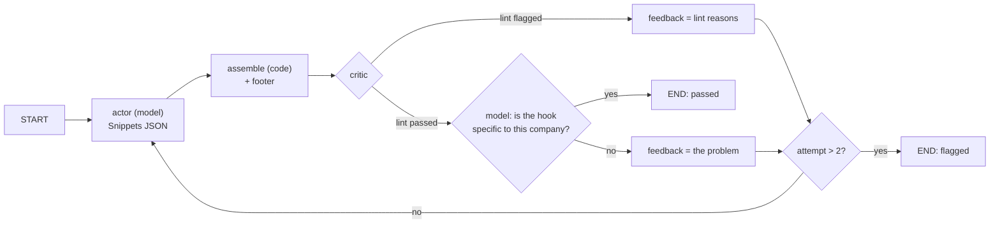

# Stage: Copy

**Code:** `outbound/stages/copy/` (`stage.py`, `graph.py`), `outbound/prompts/copy.py`, `outbound/domain/copy_lint.py`, `outbound/domain/footer.py` · **Layer:** stages · **Tests:** `tests/stages/test_copy_graph.py`, `tests/db/test_copy_stage.py`, `tests/domain/test_copy_lint.py`

## Purpose

The copy stage writes the first email for the chosen recipient. A model writes five short parts. Code assembles them and adds the legal footer, so length, structure and the footer never depend on the model. A linter and a critic send weak drafts back, at most twice. A draft that still fails goes to the operator **flagged**, rather than being hidden or forced through ([ADR 0004](../adr/0004-langgraph-only-in-research-and-copy.md)).

## Responsibilities

- Refuse to write until the sender profile is reviewed and has a real signature.
- Write to the primary sendable address of the first workable contact, and only if the policy allows that recipient.
- Choose the footer: the country's own, the short default, or none, by the `footer_enabled` setting.
- Run the actor → assemble → critic loop.
- Show the writer the operator's recent edits in the same campaign as examples.
- Save touch 1 as a `generated` message with its parts and lint report.

**Not its job:**

- approval and edits ([services: review](services.md));
- the linter rules themselves ([domain](domain.md#copy-linter));
- sending.

## Public interface

| Symbol | Kind | What it does |
|---|---|---|
| `outbound/stages/copy/stage.py::CopyStage` | `Stage` | `name="copy"`, input `email_ready`, `guard_policy=True`, `spends=True`. The constructor takes the metered LLM and an optional `examples` override |
| `outbound/stages/copy/graph.py::run_copy` | function | `(llm, CopyInput) → CopyOutput(subject, body, snippets, report, attempts)` |
| `outbound/stages/copy/graph.py::build_copy_graph` | function | The LangGraph: `actor`, `assemble`, `critic`, and `route` |
| `outbound/stages/copy/graph.py::assemble_email` | function | Greeting, three paragraphs, signature, then `--` and the footer |
| `outbound/stages/copy/graph.py::Snippets` | model | `hook`, `relevance`, `value`, `ask`, `subject`. The subject is forced onto one line, because a newline would break delivery or inject a header |
| `outbound/stages/copy/graph.py::MAX_REWRITES` | constant | 2 |

## How it works

### Preconditions (before any model call)

| Check | On failure |
|---|---|
| `sender_profile.reviewed_at` is set | `StageFailure`: "review and save your sender profile first…" (Phase 3b A1) |
| `signature_name` and `signature_title` are filled and not placeholders (`[…]`) | `StageFailure`: "the sender profile needs signature_name" |
| A workable contact has a primary address that `is_sendable` | `StageFailure`: "no contact has an address that is safe to send to" |
| `policy_decision_for(stage="copy", provenance, recipient_id)` is ALLOW | `held`, with the decision's reason (for example, the consent belongs to someone else) |
| The footer renders: every sender field its template needs is filled | `StageFailure` naming the missing fields |

**Footer choice:**

- `footer_enabled` off: no footer.
- On (the default): the policy decision's `footer_template` (the country's own, kept even when the rule is skipped), else `DEFAULT_FOOTER`.

The footer is rendered by `render_footer` with the address provenance as `{data_source}`.

### The loop



- **The actor** sees:
  - the sender profile;
  - the recipient's first name and title;
  - the company name;
  - research, answers and the operator's notes;
  - up to `few_shot_examples` (default 5) recent operator edits in the same campaign, as before and after pairs (`MessageRepository.edited_examples`: final body set, edit distance above 0, newest first);
  - the feedback from the last round.
- **The critic** runs the deterministic `lint` first, measuring the body without the footer. Only a draft that passes is shown to a model, for one question: is the hook really about this company?
- **Cost:** a good first draft costs one writer call and one check. The worst case is 3 writer calls and 3 checks. A failing lint costs no check call. Model calls are not cached ([metering](metering.md#cache)).
- **A draft that never passes** is returned with its lint issues (plus a `specificity` issue if the critic objected). It becomes `copy_ready` flagged, so the reasons show on the Review screen.

### What the stage writes

`StageResult(copy_ready, reason="written in N attempt(s)[, flagged: …]")`. The write creates one message with:

- `step = 0`, `state = generated`;
- the contact and the exact address;
- `subject`, `generated_body`, `snippets`, `lint_report`.

At most one live message per company, contact and step is enforced by `ux_messages_live_touch`.

## Invariants

- No model is called until the profile is reviewed and the footer can be rendered.
- The footer and the signature are added by code, never by the model.
- The email goes to the recipient the policy decision was made for.
- Every draft reaches the operator, flagged if it failed; none is dropped silently.

## Errors and failure behaviour

| Failure | Outcome |
|---|---|
| A precondition fails | `failed` at `copy` with the reason; the operator fixes the profile or the person, then retries |
| Policy refuses the recipient | `held` |
| The model reply does not fit `Snippets` | `ProviderError` from `ask_json`, so the lead fails at `copy` |
| `BudgetExceeded` | The lead fails at `copy` |

## Transactions and concurrency

There is one read: the chosen address, the policy, notes and examples. The model runs with no transaction open, then the runner writes with the lead's `row_version`.

## Configuration

`LLM_*` settings, and the workspace settings `few_shot_examples`, `footer_enabled` and `safe_to_send_only`. The sender profile comes from Settings. See the [configuration reference](../operations/configuration-reference.md).

## Observability

No events of its own. The run log shows `stage_done` with the reason "written in N attempt(s), flagged: …". The message's lint report is on the Review screen.

## Security and privacy

- **Untrusted text.** Research text, answers and notes are fenced (`untrusted_text`), and the system prompts carry `UNTRUSTED_RULE`. The fence gap is [R-08](../tech-debt-and-risks.md#r-08--p1--security-web-text-can-close-the-prompt-fence).
- **Model output.** It is parsed into a fixed schema, the subject is normalised to one line, and every draft is read by the operator before approval.
- **No invented proof.** Only facts from the sender profile are offered to the writer as proof points (`tests/stages/test_copy_graph.py::test_only_facts_from_the_sender_profile_are_offered_as_proof`).
- **Data sent to the model provider:** the recipient's first name and title, the company name, research, notes, and previous drafts and edits.

## Tests

| File | Proves |
|---|---|
| `tests/stages/test_copy_graph.py` | Assembly by code; one writer call and one check for a good draft; rewrites with reasons; stops after two and flags; a generic hook sent back; banned phrases caught without a model; edits shown as examples; unusable replies are provider errors |
| `tests/db/test_copy_stage.py` | Message saved with its working; country footer filled; a blank sender field fails with the field names; placeholder signature; unsafe address; flagged handover; examples from the same campaign; zero examples; the profile gate; a fresh email after a withdrawal; default footer when the rule is skipped; footers switched off |
| `tests/domain/test_copy_lint.py` | Every lint rule |

## Known limitations

- Writer and critic use the same model as research (Phase 3b D4).
- Follow-ups (steps 1 and 2) are not written yet.

## Planned

- Phase 4 writes follow-ups just before they are due: [phase-4-close-the-loop.md](../../phases/phase-4-close-the-loop.md).

## How to refresh this page

```bash
grep -n "MAX_REWRITES\|def route\|add_node\|add_edge" outbound/stages/copy/graph.py
grep -n "StageFailure\|footer" outbound/stages/copy/stage.py
uv run pytest tests/stages/test_copy_graph.py tests/db/test_copy_stage.py -q
```
