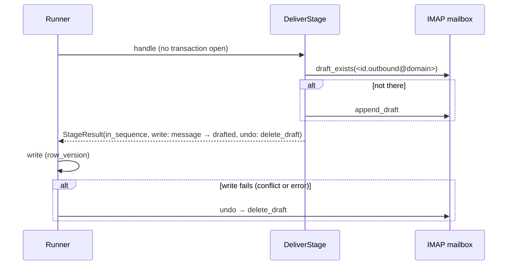

# Stages: Deliver and Sent sync

**Code:** `outbound/stages/deliver.py`, `outbound/stages/sync.py`, `outbound/providers/adapters/imap_mailbox.py` · **Layer:** stages · **Tests:** `tests/db/test_review_and_deliver.py`, `tests/db/test_sent_sync.py`, `tests/providers/test_imap_mailbox.py`

## Purpose

- **Deliver** puts an approved first email into the operator's mailbox as a draft. Before doing so it checks every safety condition one last time, and it saves each draft exactly once, even across crashes ([ADR 0009](../adr/0009-human-approval-and-imap-drafts.md)).
- **Sent sync** later finds what the operator actually sent. It records it as `sent`, with the body that went out and how far the operator edited it. That edit distance is the measure behind the copy-quality goal (8 of 10 sent unedited).

## Responsibilities

- **Deliver:**
  - re-check `check_send` for the approved message's recipient;
  - hold the lead and withdraw the email if it is no longer safe;
  - save the draft with a deterministic `Message-ID`, only if it is not there already;
  - return an `undo` that deletes the draft.
- **Sent sync:** match each drafted message to one sent mail; settle unique matches; flag ambiguous ones once.

**Not their job:**

- approval ([services: review](services.md));
- reading replies or bounces (Phase 4);
- the IMAP protocol details ([imap-mailbox](../integrations/imap-mailbox.md)).

## Public interface

| Symbol | Kind | What it does |
|---|---|---|
| `outbound/stages/deliver.py::DeliverStage` | `Stage` | `name="deliver"`, input `approved`, `guard_policy=True`, `spends=False`. Added to the pipeline only when a mailbox is configured |
| `outbound/stages/deliver.py::draft_message_id` | function | `<{message.id}.outbound@{mailbox domain}>` |
| `outbound/stages/sync.py::SentSync` | `Job` | `run() → {drafts, matched, ambiguous, waiting}` |
| `outbound/stages/sync.py::normal_subject` | function | Lower case, single spaces, without `Re:`, `Fwd:` or `Aw:` prefixes |

## How deliver works

1. **Read** (one short read):
   1. the approved step-0 message, its contact and its exact address;
   2. `policy_decision_for(stage="deliver", provenance, recipient_id)`;
   3. `check_send` with the address status, the contact status, address and domain suppression, that policy decision, `safe_to_send_only` and `verification_skipped`.
2. **Not safe** (any reason, or no address): return `held`, with the policy's hold reason or `needs_operator`, reason "not safe to send: …". The write moves the message to `cancelled`. Once released, the lead is checked again and gets a fresh email; nothing is retried silently.
3. **Safe:**
   1. Compute the `Message-ID`.
   2. If `mailbox.draft_exists(id)` is false, `append_draft(to, subject, final_body or generated_body, message_id)`.
   3. Return `in_sequence`. The write moves the message to `drafted`, with `remote_draft_id` set.
   4. The undo calls `delete_draft(id)`.



**Why it is idempotent.** If the process dies after `append_draft` but before the write, the next run finds the draft by its `Message-ID` and does not save a second copy (`tests/db/test_review_and_deliver.py::test_a_crash_after_saving_but_before_recording_does_not_duplicate_the_draft`).

**Failures never fail the lead.** Deliver is not in `STAGE_INPUT_STATUS`, so any exception (a mailbox error, or "approved but has no approved message") makes the runner *defer* the lead by an hour, leaving it `approved`. One `deferred` event is written per distinct reason.

## How the Sent sync works

1. Load up to 500 messages in `drafted` that have a `remote_draft_id` (drafts imported from the old workbook have none and are ignored), with their addresses. With no drafts, the mailbox is not opened.
2. `mailbox.list_sent(since)`, where `since` is the earliest draft's `updated_at` minus 5 minutes of clock skew and 1 hour of look-back.
3. A sent mail **fits** a draft when:
   - the recipient matches (ignoring case);
   - the `normal_subject` matches;
   - it was sent no earlier than 5 minutes before the draft was saved.
4. For each draft:

| Candidates | Result |
|---|---|
| None | Still waiting |
| Exactly one, and that sent mail fits no other draft | `_settle`: the message moves to `sent`, storing `rfc_message_id`, `sent_at`, `final_body` (the body that went out) and `edit_distance` against `generated_body`. Skipped if the message is no longer `drafted`, or that `rfc_message_id` is already recorded elsewhere |
| Several, or the sent mail fits several drafts | `_flag`: one `sync_ambiguous` event with the candidate ids and "match by hand", written once only; logs `sent_sync_ambiguous` |

The sync changes messages, not leads: a lead stays `in_sequence`.

## Invariants

- No draft is saved unless every safe-to-send condition holds at that moment.
- At most one draft per message exists in the mailbox.
- A message becomes `sent` only on an unambiguous match.
- `final_body` and `edit_distance` reflect what was actually sent.

## Transactions and concurrency

- **Deliver:** reads in one short transaction, calls IMAP with none open, and the runner writes with the lead's `row_version`; on a conflict, the undo deletes the draft.
- **Sync:** reads in one short transaction, calls IMAP outside, then settles each message in its own transaction with the message's `row_version`.

## Configuration

- **IMAP:** `IMAP_HOST`, `IMAP_PORT`, `IMAP_USE_SSL`, `EMAIL_ADDRESS`, `EMAIL_PASSWORD`, `FROM_NAME`, `DRAFTS_FOLDER`, `SENT_FOLDER`, `IMAP_TIMEOUT_SECONDS`.
- **Workspace:** `safe_to_send_only`.

Without an IMAP login, neither deliver nor the sync is assembled, and the pipeline stops at `approved` (`tests/db/test_pipeline_e2e.py::test_the_pipeline_stops_cleanly_at_approved_when_no_mailbox_is_configured`).

## Observability

- Deliver: the runner's `stage_done`, `guard_refused` or `deferred` event.
- Sync: `sent_sync_ambiguous` (WARNING), plus the job's counts in the tick's sync run.
- Undo failures: `undo_failed`.

## Security and privacy

- The mailbox password is a secret held in Doppler.
- Drafts contain the recipient's address and the email.
- `final_body` stores the sent text and is scrubbed by forget.
- Sent mail itself is the operator's correspondence and is never deleted by the engine ([data lifecycle](../data/data-lifecycle.md#outside-the-database)).

## Tests

| File | Proves |
|---|---|
| `tests/db/test_review_and_deliver.py` | Approved email becomes a draft; the edited text is drafted; no duplicate after a crash; mailbox failure leaves the lead approved and a rerun finishes; suppression, domain suppression, a blocked or consent-needing policy, an opt-out, or an invalid address after approval each prevent the draft |
| `tests/db/test_sent_sync.py` | Subject normalising; unedited and edited sends; recipient case; nothing sent yet; wrong recipient or subject; sent before the draft; ambiguity flagged once; one mail fitting two drafts settles neither; several drafts; settled messages ignored; no drafts, no mailbox call |
| `tests/providers/test_imap_mailbox.py` | The adapter against an in-memory IMAP server |

## Known limitations

- The sync runs only from `outbound tick`, which is not scheduled in production ([R-02](../tech-debt-and-risks.md#r-02--p1--pipeline-scheduled-work-never-runs-in-production-b7)).
- An approved email is drafted only when a later run reaches the deliver stage.
- The mailbox comes from settings, not the `mailboxes` table, and `messages.mailbox_id` is never set ([R-20](../tech-debt-and-risks.md#r-20--note--designed-but-not-built-inbound-mail-and-the-mailbox-table-b8)).
- IMAP calls are not retried.

## Planned

- Phase 4 reads the inbox (replies, bounces, out-of-office) and schedules follow-ups: [phase-4-close-the-loop.md](../../phases/phase-4-close-the-loop.md).
- Phase 5 sends directly through a gateway: [phase-5-automated-sending.md](../../phases/phase-5-automated-sending.md).

## How to refresh this page

```bash
grep -n "CLOCK_SKEW\|LOOK_BACK\|def _fits" -A6 outbound/stages/sync.py
grep -n "def handle" -A12 outbound/stages/deliver.py
uv run pytest tests/db/test_review_and_deliver.py tests/db/test_sent_sync.py -q
```
