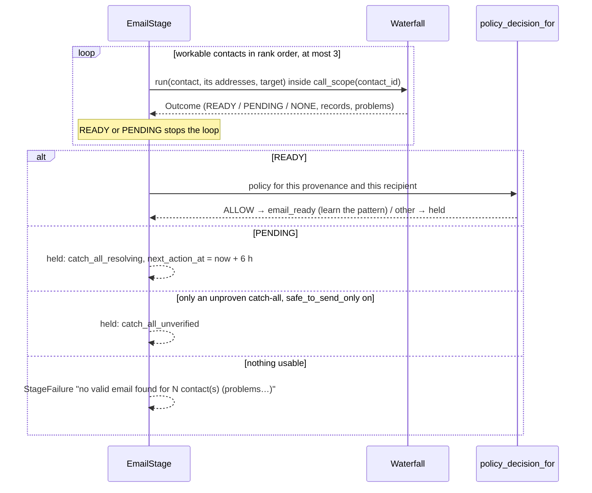

# Stage: Email (the waterfall)

**Code:** `outbound/stages/email/` (`stage.py`, `waterfall.py`, `patterns.py`, `poller.py`) · **Layer:** stages · **Tests:** `tests/stages/test_waterfall.py`, `tests/stages/test_email_patterns.py`, `tests/db/test_email_stage.py`, `tests/db/test_verification_skip.py`

## Purpose

The email stage finds one address that is safe to send to, for the best of the lead's people, at the lowest cost. It tries free sources before paid ones and verifies each address the moment it is found ("found" is not "deliverable"). It saves every address it learns about, so none is ever paid for twice. It is a chain of responsibility over the finders ([ADR 0008](../adr/0008-ports-and-adapters.md)).

## Responsibilities

- Try up to three workable contacts in rank order; the first with a sendable address wins.
- For each contact, walk the sources in order (below), verifying each candidate.
- Send catch-all addresses to the resolver; hold the lead while an asynchronous answer is pending.
- Check the country policy again for the chosen address's provenance and recipient.
- Learn the company's address pattern from a verified address.
- Save every address checked, and mark the chosen one primary.
- Poll the resolver for held leads (`CatchAllPoller`, a tick job).

**Not its job:**

- ranking people ([contacts](stage-gate-and-contacts.md));
- caching and caps ([meter](metering.md));
- the vendor calls themselves ([providers](providers.md)).

## Public interface

| Symbol | Kind | What it does |
|---|---|---|
| `outbound/stages/email/stage.py::EmailStage` | `Stage` | `name="email"`, input `contacts_found`, `guard_policy=True`, `spends=True`; `MAX_CONTACTS = 3`, `POLL_DELAY = 6 h` |
| `outbound/stages/email/stage.py::EmailDeps` | dataclass | `finders`, `verifier`, `resolver` (optional), `poll_delay` |
| `outbound/stages/email/waterfall.py::Waterfall` | class | `run(contact, emails, target) → Outcome`. Decides only; writes nothing |
| `outbound/stages/email/waterfall.py::Target` | dataclass | `domain`, `name`, `pattern`, `site_emails`, `safe_to_send_only`, `is_blocked` |
| `outbound/stages/email/waterfall.py::Outcome`, `Record`, `Verdict` | dataclasses / enum | `READY`, `PENDING`, `NONE`; the addresses learned; the chosen one; problems |
| `outbound/stages/email/patterns.py::PATTERNS`, `build_address`, `infer_pattern`, `matches_person` | — | The nine address patterns (`first.last`, `flast`, …) |
| `outbound/stages/email/poller.py::CatchAllPoller` | `Job` | Polls the resolver for leads held as `catch_all_resolving` |

## How it works

### The stage



`Target.site_emails` comes from `companies.research.site_emails`. `is_blocked` asks `SuppressionRepository.blocks` (address or domain) in a short read.

### The waterfall, for one contact

| # | Source | Rule |
|---|---|---|
| 1 | **Addresses already held** (`_reuse`) | A sendable one (`valid`, `catch_all_resolved`, `catch_all_unverified` only if the safeguard is off, or **any status when the operator skipped verification**) is chosen with no call. `catch_all_pending` means wait. `unverified` (operator-given, never checked) is verified now. `invalid` is never retried unless skipped. A suppressed one is reported and skipped |
| — | **Stop for operator-given addresses** | If the contact has any `operator_given` address, the finders are not used, even when that address is bad: the operator's address is not replaced by a guess |
| — | **Name check** | Without both a first and a last name, the search stops with the problem "has no first and last name (edit the person…, or give their work email)" |
| 2 | **An address published on the company's site** | The first `site_emails` entry that `matches_person` (contains the surname, 3+ characters). Provenance `publicly_published` |
| 3 | **The learned pattern** | One address built from `companies.email_pattern`, never several permutations. Provenance `pattern_inferred` |
| 4 | **Each finder, in `FINDER_CHAIN` order** | A finder's address that is also on the site is recorded as `publicly_published`, else `api_database` |

Each candidate is skipped if already tried or suppressed (so no money is spent on it), then verified (`_check`):

| Verifier says | Result |
|---|---|
| `valid` | Chosen; the search ends |
| `invalid`, `unknown` | Recorded; try the next source |
| `catch_all` | Sent to the resolver (`_resolve`) |

| Resolver says | Result |
|---|---|
| No resolver configured, or the resolver errored | `catch_all_unverified`; the search for this person ends |
| A ticket with no answer yet (Scrubby) | `catch_all_pending`; the lead will be held and polled |
| `valid` | `catch_all_resolved`; chosen |
| `invalid` | Recorded; try the next finder |
| Undecided | `catch_all_unverified`; the search for this person ends |

A catch-all ends the search for that person, because every other address at the domain would say the same. A `ProviderError` from any finder, verifier or resolver, including `BudgetExceeded` from the meter, is added to `problems`, and the next source is tried. The problems appear in the failure reason (up to three).

### What the stage writes

`_save` writes, in the runner's transaction:

- **For each record:** an existing address moves to its new status (`ContactEmailRepository.transition`, which writes an event); a new address is added with its provenance, `found_by`, `verified_by` and `resolution_ref`.
- **Ownership:** an address that already belongs to another contact is not re-added, because the unique address rule keeps one owner.
- **The chosen address** becomes the contact's primary.
- **The pattern:** if the company has none and the chosen address is `valid`, `infer_pattern` learns it into `companies.email_pattern`.

### The poller

`CatchAllPoller.run` (from `outbound tick`, [R-02](../tech-debt-and-risks.md#r-02--p1--pipeline-scheduled-work-never-runs-in-production-b7)):

1. Loads up to 50 leads held as `catch_all_resolving` whose `next_action_at` has passed.
2. For each lead, polls the resolver for its `catch_all_pending` addresses **outside** any transaction.
3. In one transaction, re-reads the lead and leaves it alone if it is no longer held, since the operator may have released it.
   - **Any answer:** moves each answered address to `catch_all_resolved`, `invalid` or `catch_all_unverified`, and sends the lead back to `contacts_found`. The email stage then runs again and picks the resolved address from step 1 at no cost.
   - **No answer yet:** moves `next_action_at` on by 6 hours.

One lead's error is logged (`catch_all_poll_failed`) and the others continue.

## Invariants

- Only one address is ever built from a pattern; permutations are never guessed.
- A suppressed address is never verified, paid for or chosen.
- An `invalid` address is never re-verified, unless the operator skipped the check.
- An operator-given address is never replaced by a finder's guess.
- Every address checked is saved, including invalid ones.
- The chosen address passes the country policy for its provenance and for that recipient's consent.

## Errors and failure behaviour

| Situation | Lead status |
|---|---|
| Nothing usable for any of the three contacts | `failed` at `email`, reason listing up to three problems |
| A pending resolver answer | `held` / `catch_all_resolving`, wakes in 6 h |
| Only an unproven catch-all, safeguard on | `held` / `catch_all_unverified` |
| Policy refuses the chosen provenance or recipient (e.g. a guessed Canadian address; consent belongs to someone else) | `held` with the policy's reason; the addresses are still saved |
| The per-prospect ceiling is reached before the stage | The runner's guard fails the lead before the stage runs |

## Transactions and concurrency

The stage reads contacts and addresses in one short read, runs the waterfall with no transaction open (each `is_blocked` check is its own short read), then the runner writes everything with the lead's `row_version`. The poller's write re-checks the lead's status and version.

## Configuration

`FINDER_CHAIN`, `VERIFIER`, `CATCH_ALL_RESOLVER` and their keys; the workspace's `safe_to_send_only` (default on). See the [configuration reference](../operations/configuration-reference.md) and [integrations](../integrations/README.md).

## Observability

The stage emits no events of its own. Calls appear as `provider_call` and `provider_call_blocked`; the poller logs `catch_all_poll_failed`. Each address's `status_changed` and `created` events show on the lead's timeline, and the ledger feeds the lead page's vendor-call view.

## Security and privacy

The stage sends people's names and the company domain to finders, and addresses to verifiers and resolvers ([privacy](../security/privacy-data-processing.md)). Every call is attributed to the contact, so forgetting the person can find and blank the cached answers.

## Tests

| File | Proves |
|---|---|
| `tests/stages/test_waterfall.py` | Source order, stop on valid, invalid falls through, no verification when nothing found, one verification per address, failing vendors reported, operator addresses not replaced, catch-all paths, suppressed addresses never paid for |
| `tests/stages/test_email_patterns.py` | Patterns built and inferred |
| `tests/db/test_email_stage.py` | Primary saved; next contact tried; at most three; pattern means no finder; site address first; Canadian guess held; catch-all holds; the poller (wake time, reschedule, valid, invalid, undecided, a lead released by hand left alone) |
| `tests/db/test_verification_skip.py` | A skipped address of any status is used without paying; suppression still wins |

## Known limitations

- Scrubby, the default resolver, is not confirmed live ([R-09](../tech-debt-and-risks.md#r-09--p1--vendors-the-provider-chain-is-unproven-e5-d5)).
- The resolver cap check sees a cost of 0 ([R-04](../tech-debt-and-risks.md#r-04--p1--cost-the-budget-cap-prices-a-catch-all-submit-at-0)).
- The poller runs only from `tick` ([R-02](../tech-debt-and-risks.md#r-02--p1--pipeline-scheduled-work-never-runs-in-production-b7)).

## Planned

- Phase 4: a hard bounce moves `valid` and `catch_all_resolved` to `invalid`, and the lead tries the next contact: [phase-4-close-the-loop.md](../../phases/phase-4-close-the-loop.md).

## How to refresh this page

```bash
sed -n '1,20p' outbound/stages/email/waterfall.py
grep -n "MAX_CONTACTS\|POLL_DELAY" outbound/stages/email/*.py
grep -n "PATTERNS" -A10 outbound/stages/email/patterns.py
uv run pytest tests/stages/test_waterfall.py tests/db/test_email_stage.py -q
```
