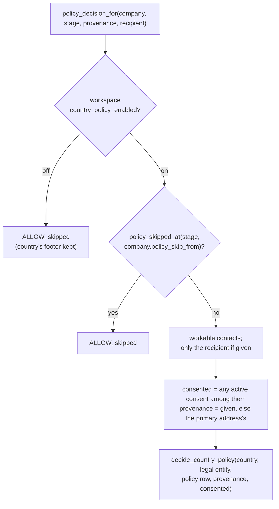

# Stages: Gate and Contacts

**Code:** `outbound/stages/gate.py`, `outbound/stages/policy.py`, `outbound/stages/contacts.py` · **Layer:** stages · **Tests:** `tests/db/test_gate_and_contacts.py`, `tests/db/test_policy_skip.py`, `tests/domain/test_ranking.py`, `tests/domain/test_policies.py`

## Purpose

Two free stages sit between research and the paid email search:

- **The gate** decides whether a researched lead is worth pursuing (fit) and whether it may be contacted at all (country policy). No money is spent on addresses for a lead that would be refused.
- **Contacts** orders the workable people, so the email stage spends only on the best few.

`policy.py` holds `policy_decision_for`, the one function every later step uses to ask the country-policy question about a lead as it stands now.

## Responsibilities

- **Gate:** apply the fit gate, then the country policy; store the decision on the lead.
- **`policy_decision_for`:** apply the operator's switches (the workspace switch, the per-lead skip) and the recipient filter on consent; then delegate to the pure `decide_country_policy`.
- **Contacts:** fail clearly when nobody is workable; rank who is, with people the operator chose first.

**Not their job:**

- the policy rules themselves ([domain](domain.md#country-policy));
- the guards that re-check the policy before later stages ([runner](runner-and-worker.md));
- the full safety model ([safety model](../hld/safety-model.md)).

## Public interface

| Symbol | Kind | What it does |
|---|---|---|
| `outbound/stages/gate.py::GateStage` | `Stage` | `name="gate"`, input `researched`, `guard_policy=False` (it decides itself), `spends=False` |
| `outbound/stages/contacts.py::ContactsStage` | `Stage` | `name="contacts"`, input `qualified`, `guard_policy=True`, `spends=False` |
| `outbound/stages/contacts.py::operator_chosen` | function | Ids of people with an active consent or an operator-given address |
| `outbound/stages/policy.py::policy_decision_for` | function | `(uow, company, *, stage=None, email_provenance=None, recipient_id=None) → PolicyDecision` |

`policy_decision_for` is called by:

- the gate;
- `Guards.check`, for every stage with `guard_policy`;
- the email stage, with the chosen address's provenance and the recipient;
- the copy stage and deliver, with the recipient;
- `LeadService`, when it releases holds and skips policy.

## How it works

### `policy_decision_for`

- **Suppression is not part of this decision.** It is checked separately everywhere, and it always wins.
- **Before a recipient is chosen** (the gate, the guards), any workable person's consent counts. **After** (email, copy, deliver), only the recipient's counts ([ADR 0022](../adr/0022-consent-belongs-to-the-recipient.md)).

### Gate

| Check | Result |
|---|---|
| `passes_fit_gate` fails: a discovered lead with no score, or a score below the campaign's `min_fit_score` (default 60) | `disqualified`, reason "fit: score N, the campaign needs M" |
| Policy ALLOW | `qualified` |
| Policy BLOCK | `disqualified` |
| Policy HOLD | `held`, with the decision's `hold_reason` |

`companies.policy_decision` stores the decision as JSON (`outcome`, `rule`, `hold_reason`, `policy_version`, `reasons`, `skipped`) for every policy outcome. The fit-gate failure returns before the policy is asked, so nothing is stored then.

**BLOCK disqualifies at the gate, but holds at every later guard.** At the gate, a blocked country is a judgement on a lead that has not yet been worked on, and the operator can requalify it or skip the rule from the gate. Later, a block can only come from a setting that changed (a skip revoked, the switch turned back on), and that must not end the lead ([ADR 0019](../adr/0019-policy-block-holds-never-suppresses.md)).

### Contacts

1. Read the lead's contacts and keep the workable ones (`candidate`, `active`).
2. If none are workable, raise `StageFailure`, so the lead fails at `contacts` with a reason that tells the operator what to do:
   - "the only people found could not be confirmed to work here: confirm one on the lead page, or add a person you know", when there are only `unconfirmed` people;
   - "no decision-maker was found on the site or in a public search", otherwise.
3. Work out who the operator chose (`operator_chosen`: an active consent, or an `operator_given` address).
4. `rank_contacts(usable, campaign.target_titles, chosen)`. The rules are in [domain: ranking](domain.md#ranking).
5. Return `contacts_found`. The write saves each person's rank and seniority.

Only the top three ranked people are tried by the email stage.

## Invariants

- The gate never spends money.
- A lead reaches `qualified` only with a policy ALLOW (possibly skipped) for its current country rule.
- The policy decision on record says which rule version it used.
- A person the operator chose is ranked above anyone the engine found.

## Errors and failure behaviour

| Situation | Outcome |
|---|---|
| No workable contact | `failed` at `contacts`; retried after the back-off, or at once by the operator after adding or confirming a person |
| A guard hold before contacts | `held` (from the runner, not this stage) |
| A policy row missing for the country | `held` / `needs_operator`: "no policy row for XX: add and review one" |

## Transactions and concurrency

The stages read inside `ctx.read` and return a `StageResult`; the runner writes it with the lead's `row_version`. Contact ranks are written without a version check (contacts have none, [R-15](../tech-debt-and-risks.md#r-15--p2--correctness-runs-and-three-tables-bypass-the-usual-guards)).

## Configuration

- **Campaign:** `min_fit_score`, `target_titles`.
- **Workspace settings:** `country_policy_enabled`.
- **Lead:** `policy_skip_from`.
- **Country policy rows**, editable by the operator.

## Observability

Neither stage logs events of its own. The runner logs `stage_done`, `stage_failed` and `guard_refused`. The lead's timeline shows the `status_changed` event with the reason, and `policy_decision` on the lead page.

## Tests

| File | Proves |
|---|---|
| `tests/db/test_gate_and_contacts.py` | Fit, operator-chosen bypass, each policy outcome, the stored decision, ranking written, failure reasons |
| `tests/db/test_policy_skip.py` | Skip per stage, the workspace switch, suppression still wins, resume where stopped |
| `tests/domain/test_policies.py` | `decide_country_policy` order and consent overrides |
| `tests/domain/test_ranking.py` | Ranking rules, including a chosen CEO over a wanted CTO |
| `tests/db/test_leads_and_settings.py` | Recipient-only consent |

## Known limitations

- On a seniority tie a VP outranks a C-level person ([R-21](../tech-debt-and-risks.md#r-21--p3--ranking-a-vp-outranks-a-c-level-person-on-a-seniority-tie)).
- People without titles rank last among the engine's finds (Phase 3b D1).

## Planned

- Phase 4: a referral or bounce sends `in_sequence` back to `contacts_found` for the next person: [phase-4-close-the-loop.md](../../phases/phase-4-close-the-loop.md).
