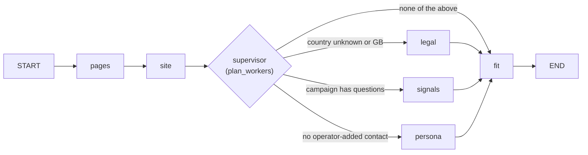

# Stage: Research

**Code:** `outbound/stages/research/` (`stage.py`, `graph.py`, `facts.py`), `outbound/prompts/research.py`, `outbound/prompts/fence.py` · **Layer:** stages · **Tests:** `tests/stages/test_research_graph.py`, `tests/db/test_research_stage.py`

## Purpose

Research turns a bare domain into what the rest of the pipeline needs:

- the company's own name, a summary, products, news and hooks;
- its country and UK legal entity;
- answers to the campaign's questions;
- the people who might be written to;
- a fit score.

It is a small LangGraph, so that only the workers a lead needs run, and so the routing rules can be tested ([ADR 0004](../adr/0004-langgraph-only-in-research-and-copy.md)).

## Responsibilities

- Read up to five of the company's pages (one extract call). If the site cannot be read, fall back to search snippets.
- Ask the model for the company's own name and site facts.
- Infer the country, and for GB the incorporation, **in code**, with Companies House as a second source.
- Answer the campaign's research questions and collect hiring and tech signals.
- Find people: from team pages with the model, else one public LinkedIn-title search, confirming each by employer.
- Score fit against the ideal customer.
- Return engine-written fields and new contacts for the runner to write.

**Not its job:**

- deciding whether the lead qualifies ([gate](stage-gate-and-contacts.md));
- finding addresses ([email](stage-email.md));
- deciding where a found name or country may overwrite an operator value ([persistence](persistence.md#operator-input-wins)).

## Public interface

| Symbol | Kind | What it does |
|---|---|---|
| `outbound/stages/research/stage.py::ResearchStage` | `Stage` | `name="research"`, input `new`, `guard_policy=False`, `spends=True` |
| `outbound/stages/research/graph.py::build_research_graph` | function | Compiles the graph over `ResearchDeps(search, llm, registry)` |
| `outbound/stages/research/graph.py::run_research` | function | Invokes the graph and folds its state into a `ResearchOutput` |
| `outbound/stages/research/graph.py::plan_workers` | function | Which workers run, deterministically |
| `outbound/stages/research/graph.py::search_people` | function | The LinkedIn-title search with employer confirmation |
| `outbound/stages/research/facts.py::infer_country`, `find_incorporation_markers`, `best_registry_match`, `classify_legal_entity` | functions | Code-only compliance facts |

## How it works



The workers chosen after `site` run in parallel, and each feeds `fit`. There is no checkpointer: the graph is a function of its input and the (metered) providers.

| Node | Does | Paid calls |
|---|---|---|
| `pages` | `extract` of `https://<domain>` plus `/about`, `/team`, `/news`, `/contact` (one Tavily extract for five URLs). If nothing comes back, one `search` for `"<name> <domain>"`, and the state is marked `thin` | 1 extract, or 1 extract + 1 search |
| `site` | Model reads the pages (up to 6,000 characters each, 18,000 in total) and returns `SiteFacts`: the company's own name, summary, products, news, hooks | 1 model call |
| `legal` (code) | Country: the operator's country if given; else `infer_country`. A strong signal (a stated registration in England, Scotland, Wales or Northern Ireland, or a country-code domain) sets it; a weak signal (phone prefix, UK postcode) is only a **suggestion** shown to the operator. For GB, including a suggested GB: `find_incorporation_markers` near the company's own name, plus `best_registry_match` from Companies House, then `classify_legal_entity`. The result is corporate subscriber only on positive evidence, else unknown | 0–1 registry lookup (free) |
| `signals` | One search (`"<name> <domain> careers hiring technology"`), then the model answers the campaign's questions and lists hiring and tech signals | 1 search, 1 model call |
| `persona` | If the site was read (not `thin`) and the team-like pages hold more than 100 characters, the model lists people with at least a first and last name. Otherwise, if the campaign has target titles, `search_people` | 0–1 model call or 1 search |
| `fit` | If there is an ideal-customer description, the model scores fit 0–100 with a reason | 0–1 model call |

So a lead costs 1–3 search or extract credits and 1–4 model calls. The model calls are not cached ([metering](metering.md#cache)).

**Which workers run** (`plan_workers`):

- `site` always;
- `legal` when the country is unknown or GB;
- `signals` when the campaign has research questions;
- `persona` when the operator has not added a contact.

**The name the workers search with** is `site_facts.company_name` when the site gave one, otherwise what was known (`display_name(name, domain)`). A discovered lead arrives without a name ([ADR 0023](../adr/0023-discovery-stores-websites-unconfirmed-people.md)).

### Finding people by search

`search_people` makes one query of the form `site:linkedin.com/in "<company>" ("<title 1>" OR … up to 4)`. Profiles are never fetched. For each hit:

1. Skip anything that is not a `linkedin.com/in/` URL.
2. Read the result title into name, title and employer (`read_profile_title`). Skip one-word names.
3. Decide:
   - **Confirmed:** the employer, or the part of the headline after its last comma, `employer_matches` the company (its whole name or its website's name).
   - **Unconfirmed:** there is no employer, but the title or snippet `mentions_company`.
   - **Dropped:** anyone else, because they work somewhere else.

People are de-duplicated by name, and at most 5 are kept.

### What the stage writes

`ResearchStage.handle` reads the lead's contacts and notes, runs the graph, and returns `StageResult(researched)` with:

| Field | Rule |
|---|---|
| `research` | `summary`, `products`, `news`, `hooks`, `hiring`, `tech`, `pages`, `site_emails` (addresses at the company's own domain found in the pages, at most 10), `thin`, `country_evidence`, `country_suggestion`, `legal_evidence`, `workers` |
| `research_answers` | The campaign questions' answers |
| `fit_score`, `fit_reason` | From `fit`, or empty |
| `name` | The site's own name when it differs. An operator-set name is protected by `manual_fields` |
| `country_code` | Only if the lead has none and the evidence was strong |
| `legal_entity_type` | Only when not unknown |
| Contacts (`write`) | `_save_people`: skips a person whose LinkedIn URL is already taken or who is the `same_person` as someone known; adds the rest after the existing ranks as `candidate` (confirmed) or `unconfirmed`, with source `site` or `search` |

The ideal-customer text is the campaign's `icp_description`, else the sender profile's `narrative`.

## Invariants

- Country and legal entity are decided by code with stated evidence, never by the model alone.
- A weak country signal never sets the country.
- People from other sites' pages are never saved: when the site could not be read, only the search path runs.
- One shared word between an employer and the company is never a match.

## Errors and failure behaviour

| Failure | What happens |
|---|---|
| A vendor error after retries, or a model reply that does not fit its schema (`ask_json`) | The exception escapes the graph, and the runner fails the lead at `research` (retry after 15 min × attempts) |
| `BudgetExceeded` | Same: the lead fails with the reason |
| The site cannot be read | Not an error: `thin` is set and search snippets stand in |
| No people found | Not an error here. The contacts stage fails the lead if nobody is workable |

## Transactions and concurrency

There is one read (contacts and notes), then the graph with no transaction open. The runner writes the result, checking `row_version`; if the operator edited the lead meanwhile, the result is dropped and the lead runs again later.

## Configuration

Via the providers: `TAVILY_API_KEY`, the `LLM_*` settings, and `COMPANIES_HOUSE_API_KEY` (optional; without it UK leads rely on site markers and usually stay "entity unknown"). Via the campaign: `icp_description`, `research_questions`, `target_titles`.

## Observability

The module creates a logger but emits no events of its own. Its calls appear as `provider_call` lines and ledger rows, and the runner logs `stage_done` or `stage_failed`.

## Security and privacy

- **Untrusted input.** Every page, snippet and vendor text is wrapped by `outbound/prompts/fence.py::untrusted_text` and the system prompts carry `UNTRUSTED_RULE`. The fence can be closed early ([R-08](../tech-debt-and-risks.md#r-08--p1--security-web-text-can-close-the-prompt-fence)). The model has no tools, and its outputs are validated against Pydantic models. Human approval of the eventual email is the control that holds.
- **Personal data.** Names, titles and LinkedIn URLs of people at the company. Searches send the company name and job titles to Tavily, and prompts send page text to the model provider ([privacy](../security/privacy-data-processing.md)).

## Tests

| File | Proves |
|---|---|
| `tests/stages/test_research_graph.py` | Worker planning; the site name used by later workers; employer confirmation (one shared word is not enough); unconfirmed people; no people from a thin site; profile-title parsing; the fit and signals workers with a scripted model |
| `tests/db/test_research_stage.py` | What the stage writes; the operator's name and country kept; a phone number only suggests a country; no search when the operator gave a contact; a model failure fails the lead; unconfirmed people saved |

## Known limitations

- Pages are found by guessed paths, so `/about-us` or `/people` are missed (Phase 3b D2).
- Many team pages have names without titles (D1).
- One model for every task (D4).
- The prompt fence gap ([R-08](../tech-debt-and-risks.md#r-08--p1--security-web-text-can-close-the-prompt-fence)).

## Planned

- Phase 3b D1–D4 (better pages, titles, discovery filtering, a separate copy model): [phase-3b-hardening.md](../../phases/phase-3b-hardening.md).

## How to refresh this page

```bash
grep -n "PAGE_PATHS\|MAX_PEOPLE\|MIN_TEAM_TEXT\|def plan_workers" -A6 outbound/stages/research/graph.py | head -40
grep -n "add_node\|add_edge\|add_conditional_edges" outbound/stages/research/graph.py
grep -n "strong=" outbound/stages/research/facts.py
uv run pytest tests/stages/test_research_graph.py tests/db/test_research_stage.py -q
```
