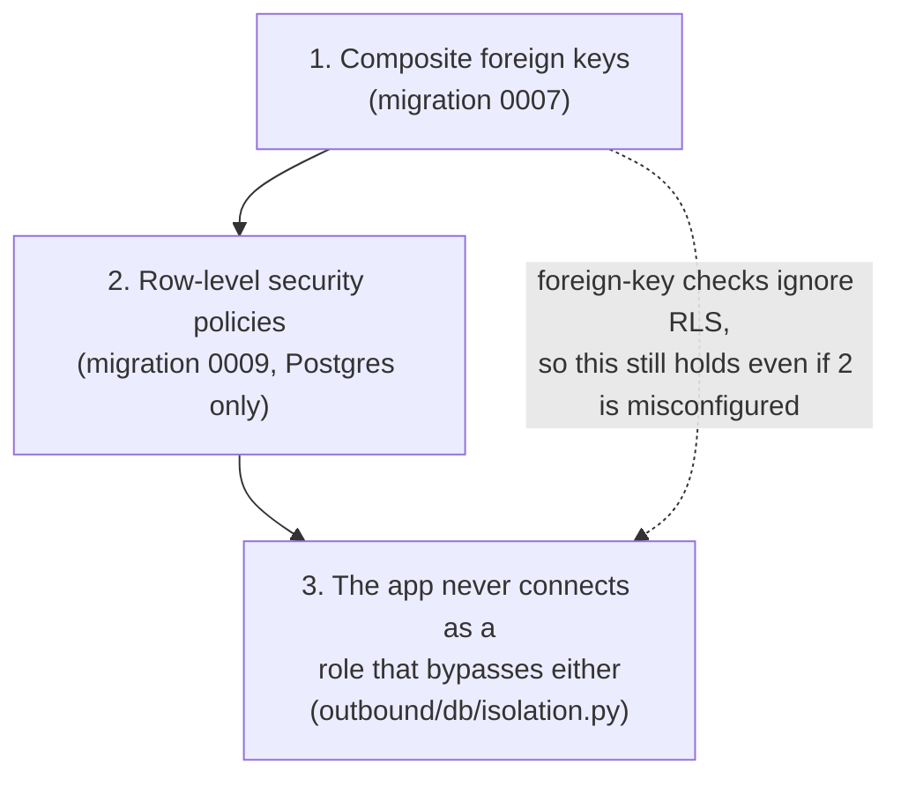

# Tenancy and isolation

**Code:** `outbound/db/models.py` (`_tenant_fk`), `outbound/db/session.py`, `outbound/db/isolation.py`, `outbound/db/uow.py`, `outbound/db/platform.py`, `outbound/db/migrations/versions/0007_tenant_bound_foreign_keys.py`, `0008_workspace_slug_and_status.py`, `0009_row_level_security.py` · **Layer:** db (below everything that uses it) · **Tests:** `tests/db/test_rls.py`, `tests/db/test_scheduler.py`, `tests/test_config.py`

## Purpose

One deployment serves every customer's workspace, and the database itself — not just application code — must refuse to let one workspace's row be read or written through a connection scoped to another. This is Phase 6a's gate: an isolation suite that calls every route with another workspace's ids, run with application-level scoping deliberately patched out, must still find nothing.

## Responsibilities

- Make every foreign key tenant-bound, so a row cannot point into another workspace even through a raw SQL mistake.
- Enable Postgres row-level security on every tenant table, with policies that key off a per-transaction setting, not a column the application remembers to filter by.
- Give the API, the worker and the scheduler exactly the database role they need and no more.
- Refuse to start if the running process is ever connected as a role that would bypass all of this.

**Not its job:**

- deciding who may act, once isolated to a workspace ([identity and access](identity-and-access.md));
- the platform-only tables that have no workspace at all ([identity and access](identity-and-access.md), [plans, credits and admin](plans-credits-and-admin.md)).

## Public interface

| Symbol | Kind | What it does |
|---|---|---|
| `outbound/db/models.py::_tenant_fk(table, column, parent, ondelete=None)` | function | Builds a `ForeignKeyConstraint` on `(workspace_id, column)` → `(parent.workspace_id, parent.id)`, named like the single-column key it replaced |
| `outbound/db/session.py::_set_workspace` | SQLAlchemy `after_begin` listener | `SELECT set_config('app.workspace_id', :id, true)` at the start of every transaction on a tenant session; sets nothing for a platform session |
| `outbound/db/uow.py::UnitOfWork` | context manager | One session bound to one `workspace_id` (and optionally `read_only`), with every tenant repository |
| `outbound/db/uow.py::UnitOfWorkFactory` | class | `factory(workspace_id) -> UnitOfWork` |
| `outbound/db/platform.py::PlatformUnitOfWork`, `PlatformUnitOfWorkFactory` | class | The only way to read across workspaces; writes only platform data |
| `outbound/db/platform.py::SchedulerQueries` | class | `active_workspaces(now)`, `with_queued_runs(now)`, `with_stale_runs(cutoff)` — ids only, never rows |
| `outbound/db/isolation.py::isolation_problems(engine)`, `tenant_tables()` | functions | The startup self-check |

## How it works

### Three layers of defence



1. **Composite foreign keys (migration 0007).** Every tenant child table's foreign key is rewritten from `child.parent_id → parent.id` to `(child.workspace_id, child.parent_id) → (parent.workspace_id, parent.id)`, and every parent gets `UNIQUE (workspace_id, id)` as the target. A row that names the right id but the wrong workspace is refused by the constraint, full stop — this check runs even on a connection that bypasses row-level security, which is exactly the owner connection `migrate` uses. The migration pre-checks for any existing cross-workspace reference and halts rather than silently reinterpreting data; on Postgres it adds each constraint `NOT VALID` then validates it, to keep the lock window short.
2. **Row-level security (migration 0009, Postgres only; a no-op on SQLite).** Two roles, created without login by the migration:
   - `outbound_app` gets `SELECT, INSERT, UPDATE, DELETE` on the 16 tenant tables (see the list below) through one policy, `tenant_rows`, `USING (workspace_id = current_setting('app.workspace_id', true))` and the same as its `WITH CHECK`; and a narrower pair of policies on `workspaces` itself (`own_workspace`: its own row only).
   - `outbound_platform` gets `SELECT` only on the same tenant tables, through `platform_read` (`USING (true)`), and full access to `workspaces` through `platform_all`.
   - Supabase's `anon` and `authenticated` roles — which its Data API uses — have every grant revoked, closing an exposure found before 6a ([the risk register](../tech-debt-and-risks.md), closed).
3. **The startup self-check (`outbound/db/isolation.py`)** means neither of the first two layers is trusted blindly. `serve` and `worker` call `isolation_problems(engine)` before taking any work, and refuse to start in production if:
   - the connected role is a superuser or has `BYPASSRLS`;
   - the connected role **owns** any tenant table (owners are not subject to row-level security at all);
   - row-level security is off on any tenant table;
   - `anon` or `authenticated` can still read or write a tenant table.

   This is checked with real Postgres catalog queries (`pg_roles`, `pg_tables`, `has_table_privilege`), not by trusting a setting.

### The tenant tables

`outbound/db/isolation.py::tenant_tables()` returns every table with a `workspace_id` column, minus three platform tables that happen to carry one anyway (`memberships`, `auth_tokens`, `audit_log` — see [identity and access](identity-and-access.md)), plus `workspaces` itself:

```
campaigns, companies, consents, contact_emails, contacts, country_policies, credentials,
events, import_batches, import_rows, inbound_messages, mailboxes, messages, notes,
provider_calls, runs, suppressions, workspaces
```

`workspace_plans`, `entitlement_overrides`, `credit_grants` and `usage_events` (Phase 6d) are also tenant tables under the same `tenant_rows` policy, but `outbound_app` holds only read access on the first three (a platform admin writes them) and read+insert on `usage_events` ([plans, credits and admin](plans-credits-and-admin.md)).

### Setting the workspace per transaction, not per connection

```python
with container.uow(workspace_id) as uow:          # UnitOfWork.__enter__
    ...                                             # after_begin fires: SET LOCAL app.workspace_id
    uow.commit()
```

- `session.info = {"workspace_id": ..., "read_only": ...}` is set once, when the session is created.
- The `after_begin` listener (`outbound/db/session.py::_set_workspace`) reads `session.info` and issues `set_config(..., true)` — the `true` third argument makes it transaction-local, so it is gone the moment the transaction ends, which matters on a pooled connection that will serve another workspace's request next.
- A `read_only` unit of work also issues `SET TRANSACTION READ ONLY` — used for a superadmin's view of a workspace they do not belong to.
- A **platform** session sets nothing: there is no `workspace_id` in its `session.info`, so `outbound_app`'s policy (which this session never uses anyway) would see no rows, and `outbound_platform`'s read-only policy does not need the setting at all.

### The platform unit of work: read-only, cross-workspace

`PlatformUnitOfWork` is a deliberately different shape from the tenant `UnitOfWork`: it has no single `workspace_id`, and import-linter forbids stages, the runner, metering and most services from importing `outbound.db.platform` at all. The only code that uses it:

- `outbound/worker.py`'s scheduler, for "which workspaces have work due" — never a workspace's own rows;
- the admin console's services, for cross-customer reads and the platform-only writes (plans, vendor keys, directory);
- `outbound/bootstrap.py::Container.workspace_id(name)`, to resolve a name to an id at CLI start-up.

### Three connections

| Setting | Role | Who | Note |
|---|---|---|---|
| `POSTGRES_MIGRATE_URL` (falls back to `DATABASE_URL`) | owner | `migrate` only | The one process allowed to create or alter tables |
| `DATABASE_URL` (as `POSTGRES_URL`) | `outbound_app` | `api`, `worker` (tenant work) | — |
| `PLATFORM_DATABASE_URL` (as `POSTGRES_PLATFORM_URL`) | `outbound_platform` | `worker`'s scheduler, admin reads | Falls back to `DATABASE_URL` if unset, which is wrong for production: see [deployment](../operations/deployment.md) §1.2a |

On SQLite all three settings resolve to the same file, there is no row-level security, and isolation rests entirely on the composite foreign keys and the application always passing the right `workspace_id` to its repositories — which is exactly what the Postgres suite re-proves with scoping patched out, because SQLite alone cannot.

## Invariants

- No row's foreign key can point at a parent in a different workspace — enforced by the database, not by a repository's own care.
- `outbound_app` can never see a row whose `workspace_id` does not match the current transaction's setting, on Postgres.
- `outbound_platform` can never write a tenant table's rows.
- The app refuses to start in production connected as any role that would make either of the above untrue.

## Errors and failure behaviour

| Situation | What happens |
|---|---|
| A row would reference another workspace's parent | The `INSERT`/`UPDATE` is refused by the foreign-key constraint, in every environment |
| The app is connected as the owner, a superuser, or a BYPASSRLS role, in production | `serve`/`worker` refuse to start, naming the problem |
| `anon`/`authenticated` regain a grant (a Supabase setting changed) | The same self-check catches it on the next start; nothing catches it between starts |
| A platform connection is accidentally given write access to a tenant table in a future migration | Not caught automatically; a reviewer must read the grants in any migration touching roles |

## Transactions and concurrency

Setting `app.workspace_id` happens once per transaction (`after_begin`), which is also why a `UnitOfWork` must open a fresh transaction for each piece of work rather than reuse a long-lived one across workspaces — consistent with the "no transaction across a network call" rule, which already keeps transactions short.

## Configuration

`DATABASE_BACKEND`, `DATABASE_URL`/`POSTGRES_URL`, `PLATFORM_DATABASE_URL`/`POSTGRES_PLATFORM_URL`, `MIGRATE_DATABASE_URL`/`POSTGRES_MIGRATE_URL`, `DATABASE_POOL_SIZE`. See the [configuration reference](../operations/configuration-reference.md) and [deployment](../operations/deployment.md) §1.2–1.2a for setting up the two login roles by hand in Supabase (migration 0009 creates the roles themselves, `NOLOGIN`; a human adds the password and `LOGIN` once).

## Observability

No log events of its own; a refusal to start logs a `ConfigurationError`-style message naming the exact problem (owner, superuser, BYPASSRLS, missing RLS, or an exposed Data API role).

## Security and privacy

This module **is** the tenant security boundary; see the [threat model](../security/threat-model.md#tenant-isolation) for the STRIDE treatment and [ASVS checklist](../security/asvs-l1-checklist.md).

## Tests

| File | Proves |
|---|---|
| `tests/db/test_rls.py` | The isolation suite: every tenant table refuses a cross-workspace read/write when connected as `outbound_app`; `outbound_platform` can read but not write; the self-check catches an owner/superuser/BYPASSRLS connection and an exposed Data API role |
| `tests/db/test_scheduler.py` | `SchedulerQueries` returns ids only, correctly filtered by status and access |
| `tests/test_config.py` | The `DATABASE_URL`/`PLATFORM_DATABASE_URL`/`MIGRATE_DATABASE_URL` fallback chain |
| The whole Postgres suite, run twice | Once as the owner (for setup convenience in CI), and the isolation-specific tests as `outbound_app`/`outbound_platform`, per `scripts/pg_tests.py` |

## Known limitations

- SQLite gives no row-level security at all; it is a development and test convenience, not a tenancy boundary.
- Row-level security is `ENABLE`d, not `FORCE`d, by design (the owner still runs migrations and seed); the startup self-check substitutes for `FORCE` in production.
- `PLATFORM_DATABASE_URL` silently falling back to `DATABASE_URL` is correct for SQLite and for a single-role rehearsal, but means a misconfigured production deployment could run the scheduler as `outbound_app` with full read access to only its own workspace — which would simply break scheduling (no workspace would ever be found due), not leak data, but is worth a sharper check (see the register for anything open here).

## Extending it

A new tenant table needs: `workspace_id`, a `_tenant_fk` to any tenant parent, an entry in migration-time grants if a future migration changes roles, and a row in `tenant_tables()`'s implicit list (automatic, since it is column-driven) — but add it to the isolation test's table-by-table check explicitly, so a forgotten `ENABLE ROW LEVEL SECURITY` is caught.

## Planned

Phase 6f reviews whether `outbound_platform`'s blanket read access needs narrowing further before public launch, and adds a penetration test that targets this boundary specifically.

## How to refresh this page

```bash
sed -n '1,20p' outbound/db/migrations/versions/0007_tenant_bound_foreign_keys.py
sed -n '1,20p' outbound/db/migrations/versions/0009_row_level_security.py
cat outbound/db/isolation.py
uv run python -c "from outbound.bootstrap import build_container; from outbound.db.isolation import isolation_problems; print(isolation_problems(build_container().engine) or 'ok')"
uv run --with pgserver python -m scripts.pg_tests tests/db/test_rls.py -q
```
