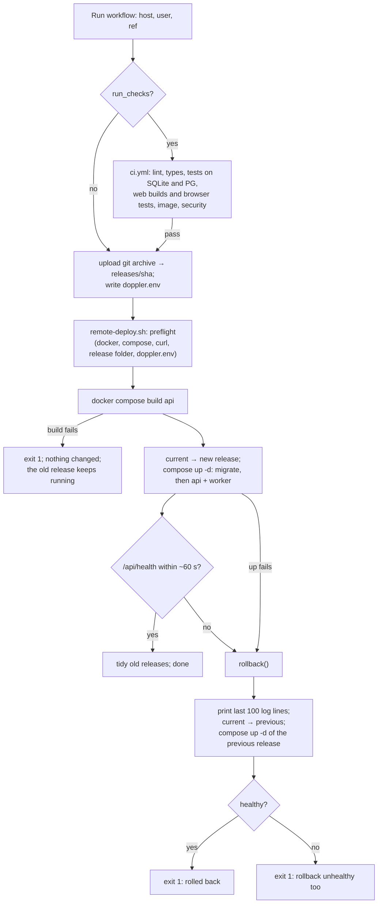

# Release and rollback

What a release is, how it is promoted, how it is checked, and how to go back. Setup and the deploy steps for the operator are in [deployment](deployment.md).

## What a release is

- **A release is one commit.** Its id is the first 12 characters of the SHA.
- **Code:** the workflow uploads `git archive` of the commit to `/opt/outbound/releases/<sha>/` on the VM.
- **Image:** the VM builds it from that folder and tags it `outbound:<sha>`. There is no registry.
- **Live release:** `/opt/outbound/current` is a symlink to the live release folder.
- **Retention:** the current release, the previous one, and the 5 newest others (`KEEP_RELEASES`) are kept with their images, so recent rollbacks are quick. Older ones are deleted.
- **Not versioned:** there are no tags or version numbers. The package says `0.0.1` and the API `0.3.0`; neither identifies a release ([R-19](../tech-debt-and-risks.md#r-19--p3--housekeeping-stale-references-and-inconsistent-versions)). The SHA is the release id: it is in the workflow summary, the folder name and the image tag.

## Promotion



- **The health gate** is `curl` of `http://127.0.0.1:$OUTBOUND_PORT/api/health`, up to 30 tries, 2 s apart, with a 3 s timeout each. It proves only that the API process answers: it checks neither the database nor the worker ([R-06](../tech-debt-and-risks.md#r-06--p1--operations-health-checks-do-not-see-a-broken-worker-or-database)). After a deploy, check the worker too (below).
- **Concurrency:** one deploy per host at a time; runs are not cancelled mid-way.
- **Downtime:** a deploy restarts `api` and `worker`, so the app is unavailable for a few seconds. A run in progress is killed and stays `running` ([R-05](../tech-debt-and-risks.md#r-05--p1--runs-a-stopped-worker-leaves-its-run-running-runs-can-overlap-b2-b3)). **Deploy when no run is in progress.**

## Migrations and compatibility

`migrate` runs `outbound db upgrade && outbound seed` on every deploy, before `api` and `worker` start. Migrations follow expand/contract ([migrations](../data/migrations.md)), so the previous release's *code* can run on the new schema.

## Rolling back

**Known defect ([R-01](../tech-debt-and-risks.md#r-01--p0--operations-a-rollback-after-a-migration-leaves-the-app-down), reproduced on 2026-10-21).** Both the automatic rollback and "run the workflow with the older ref" start the older release's whole stack, including its `migrate`. The older code's `db upgrade` stops with `Can't locate revision identified by '<newer rev>'`, and because `api` and `worker` wait for `migrate` to succeed, **the site stays down**. This happens only when the release being left behind added a migration.

| Case | What to do |
|---|---|
| The failed release added **no** migration | The automatic rollback works. Confirm with the checks below |
| The failed release **added a migration** | Prefer **rolling forward**: fix and deploy a new commit. If you must go back, start only the previous release's `api` and `worker`, skipping `migrate` (procedure below) |
| You are not sure | Compare `ls releases/<old>/outbound/db/migrations/versions/` with the database (`oc run --rm --no-deps api outbound db current`) |

**Manual rollback that skips `migrate`.** This is untested: rehearse it with `deploy/local-test.sh` before you need it. On the VM, as the deploy user:

```bash
cd /opt/outbound
PREV=<previous sha>                                  # ls -1t releases/
export OUTBOUND_HOME=/opt/outbound OUTBOUND_PORT=${OUTBOUND_PORT:-8010}
ln -sfn "releases/$PREV" current
RELEASE=$PREV docker compose -p outbound -f "releases/$PREV/deploy/compose.yml" \
  up -d --no-deps api worker                         # --no-deps: do not start migrate
curl -fsS "http://127.0.0.1:$OUTBOUND_PORT/api/health"
```

The image `outbound:$PREV` must still exist (`docker image ls outbound`). If it does not, build it first with `RELEASE=$PREV docker compose -p outbound -f releases/$PREV/deploy/compose.yml build api`.

## Checking a release

After every deploy or rollback:

```bash
cd /opt/outbound/current
export RELEASE=$(basename "$(readlink /opt/outbound/current)")
alias oc='docker compose -p outbound -f deploy/compose.yml'
oc ps -a                                  # migrate exited 0; api healthy; worker up (not restarting)
oc logs --since 10m worker | grep -E '"service_started"|not configured'
oc logs --since 10m api | grep '"level": "error"'
oc run --rm --no-deps api outbound db current
```

- **Good:** `service_started` with `role: worker`; no `not configured: …`; `db current` shows the latest revision.
- **Then:** open the web app, sign in, and check that the Runs screen shows no run stuck in `running`.

## Planned

- Fix R-01 and R-06 (Phase 3b proposal 3b.17), then simplify this page.

## How to refresh this page

```bash
sed -n '/^healthy()/,/^}/p;/^rollback()/,/^}/p' deploy/remote-deploy.sh
grep -n "KEEP_RELEASES\|depends_on\|condition" deploy/remote-deploy.sh deploy/compose.yml
```
