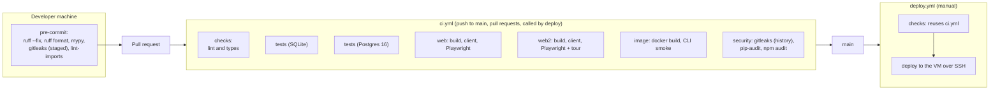

# CI/CD

Every automated check between a change and production: the pre-commit hooks on the developer's machine, CI on GitHub, and the deploy workflow. The platform, its secrets and its trust settings are described in [GitHub Actions](../integrations/platform-github-actions.md).

## Pipeline



## Pre-commit (`.pre-commit-config.yaml`)

Install once with `uv run pre-commit install`. All hooks are local and run through `uv`:

| Hook | Runs | Blocks the commit on |
|---|---|---|
| `ruff-check` | `ruff check --fix` | Lint errors it cannot fix |
| `ruff-format` | `ruff format` | — (it formats) |
| `mypy` | `mypy` | Type errors (strict on `outbound/domain`) |
| `gitleaks` | `gitleaks git --pre-commit --staged --redact` | A secret in the staged changes. Runs on every commit, including docs-only commits |
| `lint-imports` | import-linter | A broken layer contract |

## CI jobs (`.github/workflows/ci.yml`)

| Job | Steps | Fails when |
|---|---|---|
| **lint and types** (`checks`) | `uv sync --frozen`; `ruff check .`; `ruff format --check .`; `mypy`; `lint-imports` | Lint, format, type or layer violations; a lockfile out of date |
| **tests (SQLite)** | `uv run pytest` (`tests/` and `agent/`) | Any test fails |
| **tests (Postgres 16)** | A `postgres:16` service; `TEST_DATABASE_URL=postgresql+psycopg://…`; `uv run pytest tests` | Any test fails on Postgres |
| **web** (legacy) | Node 22; `npm ci`; `gen:api` then `git diff --exit-code`; build; Playwright | The legacy app breaks, or its client is stale ([R-16](../tech-debt-and-risks.md#r-16--p2--supply-chain-gaps-in-update-and-pinning-coverage): to be removed) |
| **web2** | Node 22; `npm ci`; `gen:api` then `git diff --exit-code openapi.json src/api/schema.ts`; build; Playwright against `scripts/e2e_server.py` | Type or build errors; **a stale API client**; any browser test, including **every tour step pointing at a real element** |
| **image** | `docker build --pull -t outbound:ci .`; `docker run --entrypoint outbound outbound:ci --help` | The image does not build, or the CLI does not start in it |
| **security** | `gitleaks-action` over the whole history; `uv export --frozen` then `uvx pip-audit`; `npm audit --audit-level=high` for `web` and `web2` | A secret anywhere in history; a known vulnerability (high or above for npm) |

**Triggers:** push to `main`, every pull request, and `workflow_call` (the deploy workflow reuses it).

**Required checks:** configure branch protection on `main` to require all seven jobs. The repository's settings, not this file, decide that; confirm it there.

## Deploy (`.github/workflows/deploy.yml`)

1. Manual (`workflow_dispatch`): host, user, ref, port, app folder, run checks.
2. Runs `ci.yml` first unless `run_checks` is off.
3. Deploys in the `production` environment, which can require reviewers: upload `git archive`, write `doppler.env`, run `deploy/remote-deploy.sh` (build, migrate, start, health check, rollback).

Details: [release and rollback](../operations/release-and-rollback.md). There is no automatic deploy on merge, and no staging environment. The local rehearsal (`deploy/local-test.sh`) stands in for staging ([environments](../operations/environments.md)).

## What CI does not check

- Documentation: no link check, Markdown lint or Mermaid render. Docs are verified by review and by each page's refresh commands ([README](../README.md#keeping-the-pages-true)).
- Coverage.
- The deploy scripts. The rollback defect R-01 shows the cost.
- Image vulnerabilities.
- The real vendors: `scripts/live_check.py` is run by hand.

## How to refresh this page

```bash
grep -n "^  [a-z0-9-]*:$\|name:\|run:" .github/workflows/ci.yml
grep -n "id:\|entry:" .pre-commit-config.yaml
grep -n "on:\|workflow_dispatch\|environment:\|uses:" .github/workflows/deploy.yml
```
