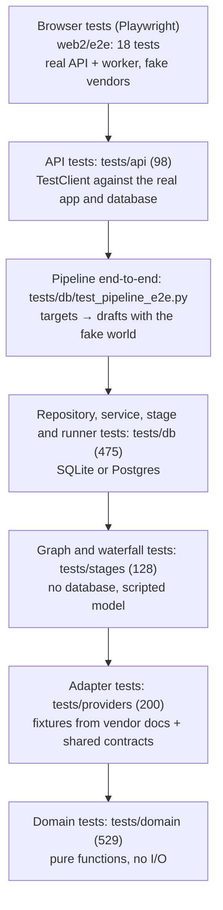

# Testing strategy

How Outbound is tested, what each kind of test proves, and the rules every test follows. The quality bar (what must pass before a phase gate) is in [PLAN.md §14](../../PLAN.md#14-testing-and-quality-bar). Where each architectural promise is proven is listed in [quality attributes](../architecture/quality-attributes.md).

## Rules

1. **No test calls the network.** pytest runs with `--disable-socket --allow-hosts=127.0.0.1,::1,localhost`. `tests/test_hygiene.py` fails if that changes.
2. **No test depends on the developer's environment.** `tests/conftest.py` clears every variable named after a `Settings` field and ignores `.env`, so a key on a laptop never changes a result or reaches a vendor.
3. **Fakes at ports, fixtures at adapters.**
   - Stages and services are tested with fake providers.
   - Adapters are tested against JSON fixtures built from vendor documentation, served through an `httpx` mock transport.
   - Nothing is mocked inside the domain.
4. **The database is real.** Database tests run against SQLite by default, and against Postgres when `TEST_DATABASE_URL` is set. CI runs both.
5. **Each phase document lists the tests that must exist** before its gate is checked.

## The layers



| Layer | Where | Count (collected) | Proves |
|---|---|---|---|
| Domain | `tests/domain/` | 529 | State tables, policies, ranking, linter, names, money, ids. Fast and exhaustive (parametrised) |
| Adapters | `tests/providers/` | 200 | Each vendor's documented responses map to our models; retries and errors (`test_http.py`); the registry. **Contract tests** (`tests/contract/`) run the same assertions against every adapter of a port |
| Stages without a database | `tests/stages/` | 128 | The research and copy graphs with a scripted model; the waterfall's source order; email patterns |
| Database | `tests/db/` | 475 | Repositories, constraints, migrations (up, down, parity with models, `CHECK` = enums), services, stages with the runner, metering, erasure (scanning every column), the data-fix script |
| API | `tests/api/` | 98 | Every endpoint, auth, CSRF, errors, headers, path traversal, the webhook, request logging, a worker loop |
| CLI, config, logging, hygiene | `tests/*.py` | 42 | Commands, the settings switch, log shape and redaction, the no-network rule |
| Scripts | `tests/scripts/` | 24 | The bake-off's collection and simulation |
| Browser | `web2/e2e/` | 18 | Whole operator flows, every screen on desktop and phone, the guided tour's targets |
| Legacy | `agent/tests/` | 63 | The retiring `agent/` package (deleted after the first live run) |
| **Python total** | | **1,559** | |

The counts in [CLAUDE.md](../../../CLAUDE.md) and [phases/README.md](../../phases/README.md) are older ([R-19](../tech-debt-and-risks.md#r-19--p3--housekeeping-stale-references-and-inconsistent-versions)).

## Shared test infrastructure

| File | Provides |
|---|---|
| `tests/conftest.py` | Autouse: no retry sleeps; provider variables cleared; no `.env` |
| `tests/db/conftest.py` | `TEST_DATABASE_URL` → Postgres, else a temp SQLite file; a migrated engine per session; tables emptied per test; `fresh_url` (a new Postgres database per test, for migration tests); `factory`, `ws`, `other_ws` (two workspaces, for isolation tests) |
| `tests/api/conftest.py` | `api` (signed in, sends the CSRF header), `anonymous`, `make_app` (no-network DNS lookup), fixed test secrets |
| `tests/stages/fakes.py` | `FakeLlm` (answers by the role in the system prompt), `ScriptedLlm`, `FakeSearch`, `FakeMailbox`, `FakeRegistry`, page fixtures |
| `tests/stages/world.py` | `World().providers()`: a whole fake outside world (site search, a finder that finds, a verifier that says valid, a mailbox) for end-to-end and browser tests |
| `tests/providers/helpers.py` | `httpx` mock-transport handlers |
| `tests/providers/fixtures/` | JSON from vendor documentation ([README](../../../tests/providers/fixtures/README.md)); Scrubby's non-pending shapes are guesses |
| `tests/contract/` | Shared contracts for finders, verifiers, resolvers and search |
| `scripts/e2e_server.py` | The real app and worker on throwaway SQLite with the fake world, for Playwright and for local UI work |
| `scripts/pg_tests.py` | Runs pytest against a throwaway Postgres (`pgserver`), with no Docker |

## Running tests

| What | Command |
|---|---|
| Everything (SQLite) | `uv run pytest` |
| On Postgres, no Docker | `uv run --with pgserver python -m scripts.pg_tests tests -q` |
| On a given Postgres | `TEST_DATABASE_URL=postgresql+psycopg://… uv run pytest tests` |
| One area | `uv run pytest tests/db/test_runner.py -q` |
| Lint, format, types, layers | `uv run ruff check . && uv run ruff format --check . && uv run mypy && uv run lint-imports` |
| Web types and build | `cd web2 && npm run typecheck && npm run build` |
| Browser tests | `cd web2 && npm run build && npx playwright test` |

## Writing a test

- **Name it as a sentence** about behaviour: `test_a_suppressed_domain_is_never_handed_to_a_stage`.
- **Choose the lowest layer that can prove it.** A rule belongs in `tests/domain`. A rule that needs data belongs in `tests/db`. Only flows go in browser tests.
- **Prove refusals as well as successes**, for example "approval refused without acknowledgement, recorded with".
- **Isolation:** any query-level test that could leak across workspaces uses `other_ws`.
- **A bug fix starts with a failing test.**
- **Data in tests is fictional.** Some tests replay real public LinkedIn result titles from the first live run, to pin the matching rules. Do not add personal data beyond what is public and needed.

## Gaps

- **No coverage measurement.** `pytest-cov` is installed, but nothing reports or enforces coverage.
- **Adapter tests prove the documentation, not the vendor.** Vendors are proven by `scripts/live_check.py` and the bake-off ([integrations](../integrations/README.md)).
- **No test for the deploy scripts.** The rehearsal (`deploy/local-test.sh`) is manual, and the rollback defect ([R-01](../tech-debt-and-risks.md#r-01--p0--operations-a-rollback-after-a-migration-leaves-the-app-down)) was found by hand.
- **No performance or load tests**: not needed at the design volume ([capacity](../operations/capacity-and-limits.md)).
- **R-17:** no test checks the headers on a 500.

## How to refresh this page

```bash
uv run pytest --collect-only -q | tail -1
for d in tests/api tests/db tests/domain tests/providers tests/stages tests/scripts agent; do echo "$d $(uv run pytest --collect-only -q $d | tail -1)"; done
cd web2 && npx playwright test --list | tail -1
```
