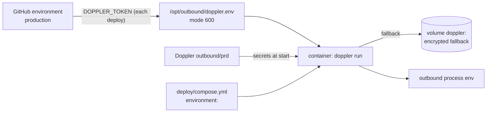

# Secrets management

Every secret Outbound uses: where it lives, who reads it, and how to rotate it. If a secret has leaked, go straight to [the secret-leaked runbook](../operations/runbooks/secret-leaked.md).

## Rules

1. Secrets MUST come only from the environment: Doppler in production, a git-ignored `.env` locally. They MUST NOT appear in code, commits, the image, logs, tickets or chat.
2. The VM MUST hold only the read-only Doppler service token. Personal Doppler tokens MUST NOT be used on the VM.
3. Secrets in settings are `SecretStr`, so they never print, and they are unwrapped only where used ([configuration and bootstrap](../lld/configuration-and-bootstrap.md)).
4. `gitleaks` runs as a pre-commit hook (`uv run pre-commit install`) and in CI over the whole history. The one allowlisted file is `.env.example` (placeholders). `.dockerignore` keeps every `.env*` out of the image.
5. Logs redact secret-named fields, Authorization values and keys in URLs ([logging](../lld/logging.md)). Do not rely on that: never pass a secret to a log call.

## Inventory

| Secret | Purpose | Lives in | Read by | Rotate |
|---|---|---|---|---|
| `SESSION_SECRET` | Signs the session cookie (at least 16 characters; use 32+ random bytes: `openssl rand -hex 32`) | Doppler `prd` (and `dev`), `.env` | `api` | Set a new value in Doppler, then redeploy or restart `api`. **Every session ends**: the operator signs in again. This is also the only way to revoke a stolen session |
| `OPERATOR_PASSWORD_HASH` | The operator password, as an Argon2 hash (`uv run outbound auth hash-password`) | Doppler, `.env` | `api` | Make a new hash, set it, restart `api`. Rotate `SESSION_SECRET` too if the old password may be known |
| `INTAKE_WEBHOOK_SECRET` | HMAC key for the webhook (blank disables it) | Doppler, `.env`; shared with the caller | `api` | Agree a switch time with the caller, set the new value, restart `api`. There is no overlap window: requests signed with the old key fail with `401 bad_signature` |
| `POSTGRES_URL` (contains the database password) | The production database | Doppler `prd` | all containers | Reset the password in Supabase (Project Settings → Database), update `POSTGRES_URL` (URL-encoded), restart the stack |
| `EMAIL_PASSWORD` | The IMAP mailbox | Doppler, `.env` | `worker`, `api` (draft deletion) | Change it at the mail provider (use an app password if available), update Doppler, restart |
| `HUNTER_API_KEY`, `ZEROBOUNCE_API_KEY`, `MYEMAILVERIFIER_API_KEY`, `ORBISEARCH_API_KEY`, `ENRICHLEY_API_KEY`, `SCRUBBY_API_KEY`, `TAVILY_API_KEY`, `COMPANIES_HOUSE_API_KEY` | Vendor accounts (spend) | Doppler, `.env` | `worker`, `api` (Tavily for intake) | Create a new key in the vendor's dashboard, update Doppler, restart, **then** revoke the old key |
| `ANTHROPIC_API_KEY`, `OPENAI_API_KEY`, `GEMINI_API_KEY`, `COPILOT_API_KEY`, `LLM_API_KEY` | The model provider (spend) | Doppler, `.env` | `worker` | As for vendor keys |
| `DOPPLER_TOKEN` (service token, read-only, `outbound/prd`) | Lets containers fetch secrets | GitHub environment `production`; written to `/opt/outbound/doppler.env` (mode 600) by each deploy | `doppler run` in every container | Create a new service token in Doppler, update the GitHub secret, redeploy, revoke the old token |
| `DEPLOY_SSH_KEY` | SSH from GitHub Actions to the VM's deploy user (who is in the `docker` group, so effectively root) | GitHub environment `production`; public half in the VM's `authorized_keys` | the deploy workflow | `ssh-keygen -t ed25519`; add the new public key; update the secret; remove the old public key |
| Doppler `dev` config | The local rehearsal (`deploy/local-test.sh`) | Doppler; a read-only dev token in `.deploy-local/doppler.env` (git-ignored) | local Docker | As above. **`dev` holds real vendor and mailbox keys** |

Not secret, but kept with the secrets: `SSH_KNOWN_HOSTS` (GitHub), `SCRUBBY_BASE_URL`, `IMAP_HOST`, `EMAIL_ADDRESS`.

## Where values come from at runtime



Doppler's values override compose's on a clash ([R-11](../tech-debt-and-risks.md#r-11--p2--configuration-doppler-overrides-compose-not-the-other-way-round)). Never add `DATABASE_BACKEND`, `COOKIE_SECURE`, `FORWARDED_ALLOW_IPS` or the other compose-fixed keys to Doppler.

## Local development

- Copy `.env.example` to `.env` and fill it in. `.env` is git-ignored and gitleaks blocks it from commits.
- `test_keys.py` (untracked) is the operator's own key smoke test; `uv run python -m scripts.live_check` is the supported one.
- Tests clear every provider variable and ignore `.env`, so a key on a laptop never changes a test result or reaches a vendor.

## How to refresh this page

```bash
uv run python -c "from outbound.config import Settings as S; print([n for n,f in S.model_fields.items() if 'SecretStr' in str(f.annotation)])"
grep -n "secrets\.\|DOPPLER_TOKEN\|DEPLOY_SSH_KEY\|SSH_KNOWN_HOSTS" .github/workflows/deploy.yml
cat .gitleaks.toml
```
