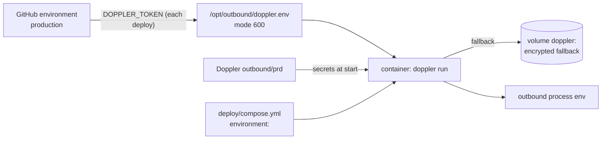

# Secrets management

Every secret Outbound uses: where it lives, who reads it, and how to rotate it. If a secret has leaked, go straight to [the secret-leaked runbook](../operations/runbooks/secret-leaked.md).

## Rules

1. Secrets MUST come only from the environment: Doppler in production, a git-ignored `.env` locally. They MUST NOT appear in code, commits, the image, logs, tickets or chat.
2. The VM MUST hold only the read-only Doppler service token. Personal Doppler tokens MUST NOT be used on the VM.
3. Secrets in settings are `SecretStr`, so they never print, and they are unwrapped only where used ([configuration and bootstrap](../lld/configuration-and-bootstrap.md)).
4. `gitleaks` runs as a pre-commit hook (`uv run pre-commit install`) and in CI over the whole history. The one allowlisted file is `.env.example` (placeholders). `.dockerignore` keeps every `.env*` out of the image.
5. Logs redact secret-named fields, Authorization values and keys in URLs ([logging](../lld/logging.md)). Do not rely on that: never pass a secret to a log call.

## Inventory

| Secret | Purpose | Lives in | Read by | Rotate |
|---|---|---|---|---|
| `SECRETS_KEYS` | AES-256-GCM key(s) that encrypt every workspace's mailbox credentials and platform vendor keys, versioned (`outbound secrets new-key`) | Doppler `prd` (and `dev`), `.env` | `api`, `worker` | **Add a new version, never remove the old one until nothing references it** — removing a version makes every credential sealed under it permanently unreadable ([R-25](../tech-debt-and-risks.md#r-25--p2--secrets-secrets_keys-is-a-single-point-of-failure-for-every-workspaces-encrypted-credentials)). Rotation itself is just adding a new highest version; old credentials re-seal under it the next time they are written |
| `MICROSOFT_CLIENT_SECRET`, `GOOGLE_CLIENT_SECRET` | The platform's own OAuth app secrets (not any customer's credentials — [mailboxes and OAuth](../lld/mailboxes-and-oauth.md)) | Doppler, `.env` | `api` | Rotate in the Entra/Google Cloud console first, then update Doppler and restart; existing customer mailbox connections are unaffected (they hold their own tokens, not this secret) |
| `SMTP_PASSWORD` | The platform's own transactional-mail relay (invites, resets) | Doppler, `.env` | `api` | Change it at the relay, update Doppler, restart |
| `POSTGRES_URL`, `POSTGRES_PLATFORM_URL`, `POSTGRES_MIGRATE_URL` (each contains a password) | The production database, as three roles — [tenancy and isolation](../lld/tenancy-and-isolation.md) | Doppler `prd` | `api`, `worker` (first two); `migrate` (the third) | Reset the password for the affected role in Supabase (Project Settings → Database), update the matching `POSTGRES_*` variable (URL-encoded), restart the affected containers only |
| `HUNTER_API_KEY`, `ZEROBOUNCE_API_KEY`, `MYEMAILVERIFIER_API_KEY`, `ORBISEARCH_API_KEY`, `ENRICHLEY_API_KEY`, `SCRUBBY_API_KEY`, `TAVILY_API_KEY`, `COMPANIES_HOUSE_API_KEY` | **Platform-wide fallback vendor accounts.** From 6d, a platform admin can instead store a vendor key per workspace or platform-wide in the database, encrypted under `SECRETS_KEYS` and rotated from the admin console (`PUT /api/admin/vendors/{vendor}/key`, with versioned rollback) — these environment variables remain as the `outbound vendors import-env` seed path | Doppler, `.env`, or the database | `worker`, `api` | Environment keys: as before. Database keys: rotate from the admin console, which keeps the old version for one-click rollback |
| `ANTHROPIC_API_KEY`, `OPENAI_API_KEY`, `GEMINI_API_KEY`, `COPILOT_API_KEY`, `LLM_API_KEY` | The model provider (spend) | Doppler, `.env`, or the database (6d) | `worker` | As for vendor keys above |
| `DOPPLER_TOKEN` (service token, read-only, `outbound/prd`) | Lets containers fetch secrets | GitHub environment `production`; written to `/opt/outbound/doppler.env` (mode 600) by each deploy | `doppler run` in every container | Create a new service token in Doppler, update the GitHub secret, redeploy, revoke the old token |
| `DEPLOY_SSH_KEY` | SSH from GitHub Actions to the VM's deploy user (who is in the `docker` group, so effectively root) | GitHub environment `production`; public half in the VM's `authorized_keys` | the deploy workflow | `ssh-keygen -t ed25519`; add the new public key; update the secret; remove the old public key |
| Doppler `dev` config | The local rehearsal (`deploy/local-test.sh`) | Doppler; a read-only dev token in `.deploy-local/doppler.env` (git-ignored) | local Docker | As above. **`dev` holds real vendor and mailbox keys** |

**Removed since Phase 3b:** `SESSION_SECRET` (sessions are now revocable rows, not signed tokens — revoking one no longer requires rotating a shared secret and ending every session at once: [identity and access](../lld/identity-and-access.md)), `OPERATOR_PASSWORD_HASH` (real per-account passwords instead), `INTAKE_WEBHOOK_SECRET` (now per workspace, rotated from Settings → Integrations, not a platform-wide Doppler value), `EMAIL_PASSWORD`/`IMAP_HOST`/`EMAIL_ADDRESS` (each workspace's own mailbox credential, encrypted under `SECRETS_KEYS` in the database, not a platform secret at all).

Not secret, but kept with the secrets: `SSH_KNOWN_HOSTS` (GitHub), `SCRUBBY_BASE_URL`, `APP_BASE_URL`.

## Where values come from at runtime



Doppler's values override compose's on a clash ([R-11](../tech-debt-and-risks.md#r-11--p2--configuration-doppler-overrides-compose-not-the-other-way-round)). Never add `DATABASE_BACKEND`, `COOKIE_SECURE`, `FORWARDED_ALLOW_IPS` or the other compose-fixed keys to Doppler.

## Local development

- Copy `.env.example` to `.env` and fill it in. `.env` is git-ignored and gitleaks blocks it from commits.
- `test_keys.py` (untracked) is the operator's own key smoke test; `uv run python -m scripts.live_check` is the supported one.
- Tests clear every provider variable and ignore `.env`, so a key on a laptop never changes a test result or reaches a vendor.

## How to refresh this page

```bash
uv run python -c "from outbound.config import Settings as S; print([n for n,f in S.model_fields.items() if 'SecretStr' in str(f.annotation)])"
grep -n "secrets\.\|DOPPLER_TOKEN\|DEPLOY_SSH_KEY\|SSH_KNOWN_HOSTS" .github/workflows/deploy.yml
cat .gitleaks.toml
```
