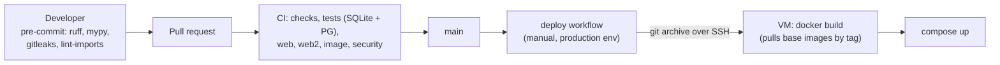

# Supply chain

What third-party code and infrastructure Outbound is built from, how each is pinned, and how vulnerabilities and leaked secrets are caught. Gaps are tracked as [R-16](../tech-debt-and-risks.md#r-16--p2--supply-chain-gaps-in-update-and-pinning-coverage).

## Dependencies and pinning

| Component | Pinned by | Updated by |
|---|---|---|
| Python dependencies | `uv.lock` (hashes); `uv sync --frozen` in CI and the image | Dependabot (`uv`, weekly) |
| Python runtime | `.python-version` 3.12; image `python:3.12-slim` | **Not watched** (tag only) |
| `uv` | Image `ghcr.io/astral-sh/uv:0.9.26` (tag) | **Not watched** |
| `web2` npm packages | `web2/package-lock.json`; `npm ci` | **Not watched**: Dependabot covers `/web` only |
| Legacy `web` npm packages | `web/package-lock.json` | Dependabot (`npm` in `/web`), although `web/` is no longer served |
| Node for the web build | Image `node:22-slim` (tag) | **Not watched** |
| Doppler CLI | Doppler's signed apt repository, channel `any-version` (whatever is current at build time) | — |
| GitHub Actions | Major-version tags: `actions/checkout@v4`, `actions/setup-node@v4`, `astral-sh/setup-uv@v5`, `gitleaks/gitleaks-action@v2` | Dependabot (`github-actions`, weekly) |
| CI and rehearsal service images | `postgres:16`, `caddy:2.8.4` (tags) | — |

Images are pinned by tag, not by digest, so a rebuild can pull a different base image. The image is built on the VM at deploy time, so two deploys of the same commit can differ in base layers.

## Checks

| Check | Where | Blocks |
|---|---|---|
| **gitleaks**, secrets in staged changes | pre-commit hook (`gitleaks git --pre-commit --staged --redact`) | The commit |
| **gitleaks**, secrets in the whole history | CI `security` job (`gitleaks-action`, full history) | The PR |
| **pip-audit**, known vulnerabilities in the locked Python set | CI `security` (`uv export --frozen` → `uvx pip-audit`) | The PR |
| **npm audit** `--audit-level=high` | CI `security`, for `web` and `web2` | The PR |
| **ruff `S`** (bandit rules) | pre-commit and CI `checks` | The PR. Ignored only in `tests/*` and `scripts/*` for specific rules (asserts, test credentials, subprocess) |
| **Image build** (`docker build --pull`) and smoke (`outbound --help`) | CI `image` | The PR |
| **No network in tests** (`--disable-socket`) | pytest config; `tests/test_hygiene.py` | The PR |
| Image vulnerability scan | — | **None** |
| SBOM | — | **None** |
| Image signing or provenance | — | **None** |

**Suppressions policy.** A `# nosec`, `# noqa: S…` or `--ignore` MUST carry the reason in the same comment ([CLAUDE.md](../../../CLAUDE.md)). Dependency exceptions are recorded in the PR that adds them.

## Build and deploy path



The deployed code is exactly the commit's tree (`git archive`), but the base images and the Doppler CLI are fetched again at build time on the VM.

## Recommended next steps

In order of value; tracked in [R-16](../tech-debt-and-risks.md#r-16--p2--supply-chain-gaps-in-update-and-pinning-coverage):

1. Add `web2` (npm) and `docker` (the `Dockerfile` base images) to `.github/dependabot.yml`.
2. Remove `web/` from CI, Dependabot and the repository.
3. Pin base images by digest, and GitHub Actions by commit SHA (Dependabot can still update them).
4. Scan the image in CI (Trivy or Grype) and produce an SBOM.
5. Pin the Doppler CLI version.

## How to refresh this page

```bash
cat .github/dependabot.yml
grep -n "^FROM\|image:" Dockerfile deploy/*.yml
grep -n "uses:" .github/workflows/*.yml
sed -n '/security:/,$p' .github/workflows/ci.yml
grep -n "per-file-ignores" -A4 pyproject.toml
```
