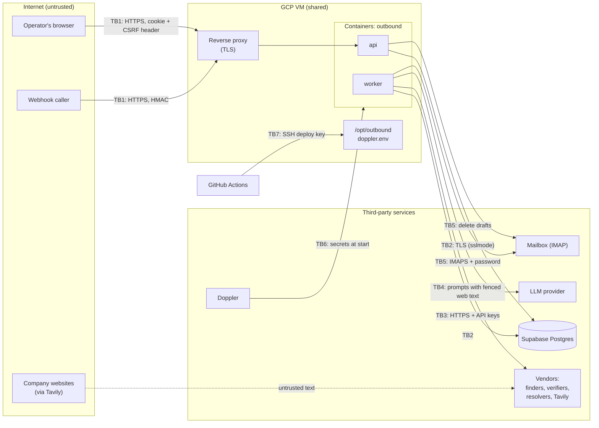

# Threat model

What Outbound must protect, from whom, across which boundaries, and how well it does. The method is a data-flow diagram with trust boundaries, then [STRIDE](https://learn.microsoft.com/azure/security/develop/threat-modeling-tool-threats) per boundary, plus the [OWASP Top 10 for LLM applications](https://genai.owasp.org/llm-top-10/) for the model-facing parts. Residual risks link to the [register](../tech-debt-and-risks.md). Review this page whenever a boundary, a secret or a data flow changes, and at every phase gate.

## What is worth protecting

| Asset | Why it matters | Where |
|---|---|---|
| Personal data of prospects (names, work addresses, titles, consents, drafts) | GDPR, PECR, CASL and DPDP duties; reputational harm | Supabase; vendor caches; the mailbox |
| The mailbox and the sender's reputation | A compromised mailbox or a wrong email harms the operator directly | IMAP credentials; drafts |
| Vendor and LLM keys | Direct spend; access to vendor accounts | Doppler; process memory |
| The operator session | Full control of the app, including forget, delete and suppress | Browser cookie |
| Budget | Runaway spend through loops or abuse | The meter; vendor accounts |
| Integrity of decisions (consent, skips, approvals) | Legal accountability depends on the audit trail | `events`, `companies`, `messages` |
| The VM | Shared with another application | GCP |

## Who might attack, or fail

| Actor | Capability | Motive |
|---|---|---|
| Internet attacker | Reaches the proxy and the public endpoints | Data theft, spend, defacement |
| A malicious or compromised web page | Its text reaches the model during research | Steer research or copy; leak data through the email |
| A compromised vendor or vendor response | Returns crafted JSON | Inject data; cause errors |
| A webhook caller holding a workspace's secret | Sends targets into that one workspace | Spam that workspace's pipeline; spend its credits |
| **A signed-in member of another workspace** (new, Phase 6) | A valid session, but no membership in the target workspace | Read or act on data belonging to a company they do not work for |
| **A platform admin or superadmin** (new, Phase 6) | Cross-workspace read (superadmin), or write to plans/keys/settings (admin) | Mostly legitimate support; a compromised or rogue account could read every customer's data |
| A user of the other app on the shared VM | Local access, possibly root via Docker | Read secrets or data |
| A compromised dependency or CI action | Code execution in CI or the image | Supply-chain compromise |
| A workspace admin or member, by mistake | Every permission within their own workspace | Wrong email, wrong skip, wrong delete |

## Data flow and trust boundaries

| Boundary | Crossing | Authentication | Confidentiality |
|---|---|---|---|
| TB1 | Browser and webhook → API | Session cookie (Argon2 login) + `X-Requested-With`; HMAC-SHA256 for the webhook | TLS at the proxy; the app port is loopback-only |
| TB2 | API, worker → Supabase | Password in `POSTGRES_URL` | TLS only if `sslmode=require` is in the URL |
| TB3 | Worker → vendors | API keys (some in query strings) | HTTPS |
| TB4 | Worker → LLM | API key | HTTPS. **The content is untrusted in both directions** |
| TB5 | Worker, API → mailbox | IMAP password | IMAPS (993) |
| TB6 | Doppler → containers | Read-only service token | HTTPS; encrypted fallback file |
| TB7 | GitHub → VM | Deploy SSH key; host key pinned only if `SSH_KNOWN_HOSTS` is set | SSH |
| TB8 | Within Supabase, workspace → workspace (new, Phase 6a) | No network boundary at all — the same database, same tables, same connection pool. The boundary is enforced entirely by role and row-level security, not by network topology | N/A (no transport; see [tenant isolation](#tenant-isolation)) |
| TB9 | API → Microsoft/Google (new, Phase 6c) | OAuth 2.0 authorization code with PKCE; per-workspace refresh tokens, sealed at rest | HTTPS; see [mailbox OAuth](#mailbox-oauth) |

## STRIDE

| # | Boundary | Threat | Mitigation in place | Residual |
|---|---|---|---|---|
| S1 | TB1 | **Spoofing** an account by guessing its password | Argon2id; 5 failures per 60 s per client address | The throttle is per process, reset on restart; it trusts `X-Forwarded-For` from `*`, which is safe only behind the loopback-only proxy ([R-13](../tech-debt-and-risks.md#r-13--p2--security-session-and-login-hardening)) |
| S2 | TB1 | Session theft or replay | `HttpOnly`, `SameSite=Strict` and `Secure`/`__Host-` cookie; strict CSP; **revocable** — see [identity](#identity) | No HSTS |
| S3 | TB1 | Forged webhook | HMAC over timestamp and body, constant-time compare, ±300 s window, `event_id` dedupe; disabled without a secret | No rate limit; a leaked secret allows unlimited target creation until it is rotated |
| T1 | TB1 | **Tampering** by cross-site request forgery | `X-Requested-With` required on every write; `SameSite=Strict`; no CORS | — |
| T2 | TB1 | Lost updates or races between operator and engine | `row_version` on leads and messages; operator input wins | Contacts, emails and runs are last-writer-wins ([R-15](../tech-debt-and-risks.md#r-15--p2--correctness-runs-and-three-tables-bypass-the-usual-guards)) |
| T3 | TB3 | Crafted vendor JSON | Adapters map into frozen models with `extra="forbid"`; non-JSON is refused | — |
| T4 | TB7 | Malicious code deployed | CI runs before deploy (default); the production environment can require reviewers; read-only workflow permissions | Actions pinned by tag; first-use host-key trust if `SSH_KNOWN_HOSTS` is unset; no image signing ([R-16](../tech-debt-and-risks.md#r-16--p2--supply-chain-gaps-in-update-and-pinning-coverage)) |
| R1 | all | **Repudiation** of a decision (who skipped, approved, forgot) | Every status change and operator action is an event in the same transaction, with the actor; approvals record acknowledged skips | One operator account, so "who" is always "operator"; the events table has no tamper evidence |
| I1 | TB1 | **Information disclosure** through files or errors | The single-page-app file server blocks traversal and dotfiles (the encoded `..%2f` bypass was fixed and tested); 500s carry no detail; the OpenAPI document is behind login; no API docs pages | 500s lack security headers ([R-17](../tech-debt-and-risks.md#r-17--p3--api-a-500-response-lacks-the-security-headers)) |
| I2 | logs | Secrets or personal data in logs | Redaction of secret-named fields, bodies, addresses, keys in URLs and Authorization values; httpx logs silenced; query strings never logged | Client IPs logged ([R-14](../tech-debt-and-risks.md#r-14--p2--privacy-personal-data-in-logs)) |
| I3 | TB2 | Database exposure | Supabase project of its own; TLS via URL; credentials in Doppler | TLS not enforced in code; no backups documented ([R-12](../tech-debt-and-risks.md#r-12--p2--capacity-the-connection-pool-fills-the-supabase-pooler), [R-07](../tech-debt-and-risks.md#r-07--p1--data-no-backups-no-retention-unsalted-suppression-hashes-a6-e3)) |
| I4 | VM | Another app's user reads secrets | Only a read-only Doppler token on disk (mode 600); secrets live in container memory; the container runs as non-root uid 10001 | Anyone in the `docker` group can read container environments; no `cap_drop`, read-only root or `no-new-privileges` in compose |
| I5 | data | Suppression list reversed | Values stored as SHA-256 only | Unsalted: guessable addresses can be confirmed ([R-07](../tech-debt-and-risks.md#r-07--p1--data-no-backups-no-retention-unsalted-suppression-hashes-a6-e3)) |
| D1 | TB1 | **Denial of service**: request floods | Webhook body ≤ 1 MB, ≤ 200 targets; upload ≤ 2 MB; request strings ≤ 10,000 characters; the API never runs the pipeline in a request | No rate limit on the API or webhook; one process |
| D2 | budget | Spend exhaustion (loops, a hostile webhook) | Per-prospect ceiling; monthly caps per provider; cache; vendor-side limits (Tavily 432/433) | Model spend and resolver submits not counted ([R-03](../tech-debt-and-risks.md#r-03--p1--cost-model-calls-are-recorded-at-0-b5), [R-04](../tech-debt-and-risks.md#r-04--p1--cost-the-budget-cap-prices-a-catch-all-submit-at-0)); the ceiling is not live ([R-10](../tech-debt-and-risks.md#r-10--p1--budget-a-running-worker-does-not-see-budget-changes-b4)) |
| E1 | TB1 | **Elevation of privilege**: unauthenticated or under-permissioned access to a tenant or admin route | Every route requires a session and declares one `Permission`, checked against the resolved role; tested | — |
| E2 | VM | A container escapes to the host | Non-root user; loopback port | Docker defaults otherwise; a shared host |

## Model-specific risks (OWASP LLM Top 10)

| Risk | Where it applies | Mitigation | Residual |
|---|---|---|---|
| **LLM01 Prompt injection** (indirect) | Web pages, search snippets and vendor text read during research; notes; research output fed into copy | Untrusted text wrapped in `<untrusted>` with a system rule to treat it as data; no tools; fixed JSON output schemas; **a person approves every email before it reaches the mailbox** | The fence can be closed early (`</untr</untrusted>usted>`, upper-case tags) ([R-08](../tech-debt-and-risks.md#r-08--p1--security-web-text-can-close-the-prompt-fence)). Research summaries and fit scores are not reviewed one by one |
| **LLM02 Insecure output handling** | Model output becomes email text, the subject, research fields | Parsed into Pydantic models; the subject forced to one line (no header injection); the footer and signature added by code; the linter; human approval; the web app renders text, never HTML | — |
| **LLM06 Sensitive information disclosure** | Prompts carry page text, names, notes and previous drafts | Only what the task needs is sent; no secrets in prompts | The provider's retention terms apply ([privacy](privacy-data-processing.md)) |
| **LLM09 Overreliance** | Fit scores, inferred people, copy claims | Country and legal entity decided in code; people confirmed by employer or by the operator; only facts from the sender profile offered as proof; the sender profile must be reviewed | — |
| **LLM10 Unbounded consumption** | Rewrites and research calls | At most 3 writer calls and 3 checks per draft; one research graph per lead; `max_tokens` | Model cost not recorded without `LLM_PRICES` ([R-03](../tech-debt-and-risks.md#r-03--p1--cost-model-calls-are-recorded-at-0-b5)) |

## Tenant isolation

The boundary that did not exist before Phase 6a: one workspace reading or writing another's rows, inside the same shared Postgres database. Full mechanism in [tenancy and isolation](../lld/tenancy-and-isolation.md).

| # | Threat | Mitigation in place | Residual |
|---|---|---|---|
| TI1 | **Information disclosure**: a repository query forgets to filter by `workspace_id` | Row-level security (`outbound_app`'s `tenant_rows` policy, keyed on `current_setting('app.workspace_id')`) returns nothing even if application scoping is wrong — this is the control the Phase 6a gate specifically re-tests with scoping patched out | SQLite (development/tests) has no row-level security at all; isolation there rests on application scoping alone |
| TI2 | **Tampering**: a write names the right row id but the wrong workspace, or a foreign key is forged across workspaces | Composite tenant-bound foreign keys (`(workspace_id, id)`) refuse the write at the database level, independent of row-level security — this holds even on a connection that bypasses RLS entirely (the migration/owner role) | A new tenant table that uses a plain `ForeignKey` instead of `_tenant_fk` would silently lose this; caught only by code review and the isolation test's explicit table list |
| TI3 | **Elevation of privilege**: the application connects as a role that bypasses row-level security (owner, superuser, `BYPASSRLS`) | The startup self-check (`outbound/db/isolation.py`) refuses to start `serve`/`worker` in production under any such role, or if Supabase's `anon`/`authenticated` Data API roles still hold a grant | Nothing catches a misconfiguration *between* starts — only the next restart re-checks |
| TI4 | A platform-wide connection (`outbound_platform`) writes a tenant's rows | It has read-only grants on every tenant table; writes are refused by Postgres itself, not just by convention | — |

## Identity

Real accounts, sessions and roles replaced the single operator password in Phase 6b. Full mechanism in [identity and access](../lld/identity-and-access.md).

| # | Threat | Mitigation in place | Residual |
|---|---|---|---|
| ID1 | **Spoofing**: credential stuffing or guessing against any one account | Argon2id hashing; the same per-client-address throttle as before, now gating real accounts | Still per-process, in-memory ([R-13](../tech-debt-and-risks.md#r-13--p2--security-session-and-login-hardening)) |
| ID2 | Session theft or replay | `HttpOnly`, `SameSite=Strict`, `__Host-`-prefixed when `COOKIE_SECURE`; **now revocable** — a stolen session can be ended by the user or an admin without rotating a shared secret, closing most of what [R-13](../tech-debt-and-risks.md#r-13--p2--security-session-and-login-hardening) described | No HSTS header yet |
| ID3 | **Elevation of privilege**: acting with a permission the caller's role does not grant | Every route declares exactly one `Permission`; `can()` is pure and tested for every role; a test fails any tenant route declaring none | The fixed role set (admin/member, platform admin/superadmin) has no finer-grained custom roles — out of scope for the alpha |
| ID4 | A non-member learns a workspace exists by probing its id or slug | A non-member's request returns `404`, identical to a request for an id that does not exist at all | — |
| ID5 | A superadmin's cross-workspace access is misused | Read-only by construction (`Principal.superadmin_view` grants only `READ`); first access per session per workspace is audited | Repeat views in the same session are not individually logged ([R-27](../tech-debt-and-risks.md#r-27--note--the-superadmin-cross-workspace-view-is-alpha-only-and-unaudited-beyond-the-first-access)) |

## Mailbox OAuth

A workspace's connected mailbox (Microsoft 365, Google, or IMAP) is the single highest-value credential it holds. Full mechanism in [mailboxes and OAuth](../lld/mailboxes-and-oauth.md).

| # | Threat | Mitigation in place | Residual |
|---|---|---|---|
| MO1 | **Information disclosure**: a stolen database dump exposes mailbox credentials | AES-256-GCM at rest, associated data bound to `(workspace_id, credential_id)` — a row cannot be decrypted after being moved to a different workspace or credential, even with the right key | `SECRETS_KEYS` itself is a single point of failure for every workspace's credentials at once ([R-25](../tech-debt-and-risks.md#r-25--p2--secrets-secrets_keys-is-a-single-point-of-failure-for-every-workspaces-encrypted-credentials)) |
| MO2 | **Spoofing/tampering**: the OAuth authorization code flow is intercepted or replayed | PKCE (RFC 7636): the code is useless without the verifier generated for that specific attempt; `state` is checked on return | The platform's OAuth apps are not yet verified with Microsoft or Google ([R-24](../tech-debt-and-risks.md#r-24--p2--security-the-oauth-apps-are-not-yet-verified-with-microsoft-or-google)) |
| MO3 | **Denial of service / SSRF**: a customer-typed IMAP host points at the platform's own network | `netguard.py::public_address` refuses any resolved address that is not global-unicast, and connects to the exact address it checked (closing a DNS-rebinding window) | IMAP only; the same class of risk would need the same guard if a future adapter accepted another customer-supplied host |
| MO4 | A refused token refresh is silently retried forever | `ReconnectNeeded` is raised and surfaced to the workspace, not retried in a loop | — |

## Lead directory

The one place in the system where data deliberately crosses workspace boundaries by design. Full mechanism in [the lead directory](../lld/lead-directory.md).

| # | Threat | Mitigation in place | Residual |
|---|---|---|---|
| LD1 | **Information disclosure**: a served fact reveals which workspace contributed it, or when its run happened | No field in any served shape (`DirectoryHit`, `DirectoryBadge`) carries a workspace id, run id or day-level date — `month()` discards the day. This is structural (never written), not a redaction applied at serve time | A sufficiently motivated correlation across many facts and a long observation window is not analysed here; judged low-value given a verified business email is the only fact type shared |
| LD2 | A wrong or stale fact is served | Re-verified once before use regardless of age; a dispute (`report()`) removes it from circulation for everyone immediately, not after review | A disputed fact can stay unavailable (not wrongly served, but withheld) for an unbounded time pending review |
| LD3 | A customer is charged for a directory hit | `DirectoryFinder` is never billed (`billed=False`); the only cost is the mandatory re-verification, priced the same as any other verifier call | — |

## Assumptions

- The reverse proxy on the VM terminates TLS and **overwrites** `X-Forwarded-For` (as `deploy/nginx.conf.example` does). If it appends instead, S1 weakens.
- The app's port is published on `127.0.0.1` only, so nothing reaches it except through the proxy.
- Workspace admins and members are trusted within their own workspace; the platform's own staff (admin, superadmin) are trusted with cross-workspace access, which is why that access is logged.
- Vendors and the LLM provider are trusted to keep data as their terms say.

## Review triggers

Revisit this model when any of these change:

- a new boundary (a new vendor, the sending gateway in Phase 5, users in Phase 6);
- a new secret;
- automatic sending;
- a change to auth;
- moving off the shared VM;
- any security incident.

## Planned

- Phase 5 adds automatic sending, which removes the human-approval control for emails that rely on no skipped check. This model must be redone before it: [phase-5-automated-sending.md](../../phases/phase-5-automated-sending.md).
- Phase 6 adds users, roles and row-level security: [phase-6-saas-ready.md](../../phases/phase-6-saas-ready.md).
